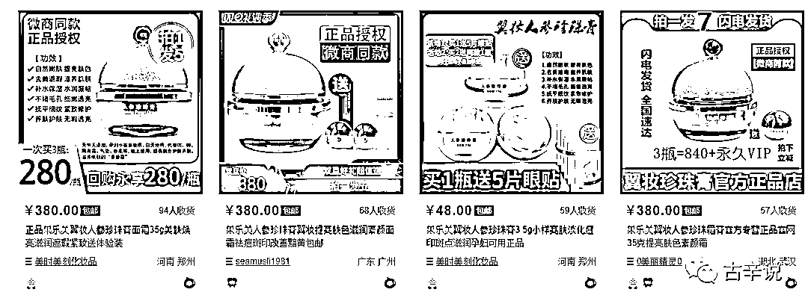

做小红书蓝海选品，很多人只盯着“竞争小、利润高、好出单”，却容易漏掉一个隐藏的大坑——侵权。一旦被品牌方盯上，轻则下架链接，重则起诉索赔，前面做的努力全白费。那有没有办法在选品阶段就提前看出端倪？其实是有的。

一个比较实用的思路是：别在小红书里瞎猜，直接去淘宝“探路”。如果这款产品在淘宝会被品牌方投诉，拿到别的平台大概率也躲不掉；反过来，淘宝上没人投诉的品，其他平台往往也是安全的。

接下来分享四个我常用的识别技巧。

第一招：看标题里有没有“别称”。
有些产品因为官方品牌名带风险，卖家会主动换成别的叫法。比如“马栗乐”，在淘宝上还能搜到“马栗露”“马膏”等称呼。原因是这个品牌被国内某家公司抢注了，对方正在批量投诉卖家。我之前做淘宝蓝海时也选中过这款，就是因为投诉风险太大放弃了。
可能有人问：那为什么现在还有人在卖？能卖不代表能一直卖。如果真有人长期卖得好，说明人家手上有你搞不定的资源。

第二招：看主图是不是刻意藏Logo。
正常卖家都巴不得把品牌Logo放大摆出来，显得自己货正、可信。如果一款产品的主图集体把Logo遮住，那就很反常。事出反常必有蹊跷，八成是因为品牌名一露出来就会挨投诉。

第三招：看淘宝卖家数量是不是少得离谱。
拿“蕾特恩祛痘精华液”来搜，淘宝上居然只有一个卖家。正常产品再小众，少说也有几十个卖家在卖。卖家这么少，不是没人想卖，而是想卖的早被别人处理掉了。

第四招：看所有卖家价格是不是“整齐划一”。
淘宝只要条件允许，价格战肯定会打起来。同款商品，不同卖家价格总有差别。如果所有人卖价一模一样，那就不正常了。卖家都懂降价能拉销量，既然大家都不动，说明不是不想降，是不敢降——降价就可能引发投诉。想避雷的话，跟上大家的统一定价就行，反而相安无事。

当然，这四招做不到100%避开侵权坑，但足以过滤掉八成以上的问题产品，让小红书蓝海这条路走得稳一点、久一点。