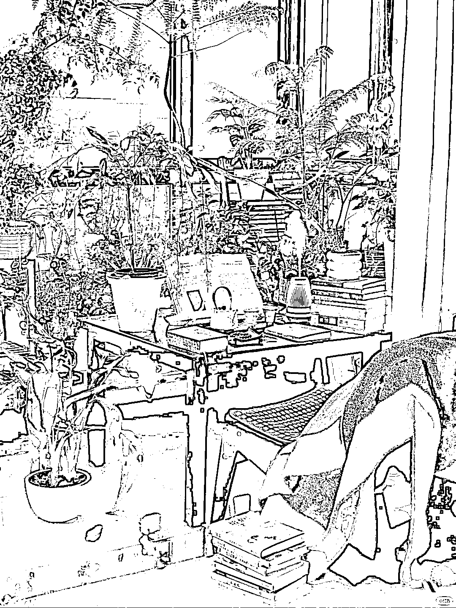

# 一张书桌，见证了我从读书者到8万粉博主的成长
作者：龙哥

三年前，我开始在📕记录自己的阅读。

那时的我，正被事业与家庭之间的拉扯困住。很多时候，现实让人疲惫不堪，而读书成了我暂时抽离出来、重新获得片刻平静的方式。

我一边读，一边把读过的书整理成图文笔记分享出去。没想到，这个习惯一坚持就是三年，如今账号已经积累了8万粉丝。

在这段时间里，我换过几种不同的书桌布景，也逐渐找到了适合自己的商业化路径：接品牌合作、做直播、带货，以及开发自己的知识产品。

从一个普通读书人，到全职内容创作者，我有几条经验想分享给同样想做博主的人：

·

## ◾️别把做博主当成“随便试试”

全职做博主之后，我并没有一直处于轻松自在的状态。

相反，刚开始的时候，我经常怀疑：每天发发内容、拍拍照片，真的算一份正式工作吗？

自由职业最大的挑战，就是没人替你安排日程。今天可以更新，也可以不更新；这条笔记可以发布，也可以再拖一拖。久而久之，很容易在犹豫和自我消耗中浪费大量时间。

我也曾反复被数据影响情绪，经历过持续内耗。后来，我开始重新建立自己的工作节奏：

固定时间发布笔记，固定时间直播，固定时间完成知识产品的交付，同时定期检查账号数据，分析哪些内容有效，哪些地方需要调整。

如果你决定成为一名博主，就要用经营工作的方式来经营账号。

把写笔记视为每日任务，把数据复盘当成工作会议，把商务沟通当成与客户对接。只有建立起稳定、专业的执行习惯，做账号才不会一直依赖灵感和情绪。

## ◾️账号经营，本质上也是一门生意

为什么有的账号只有几百粉丝，却已经开始获得合作；有的账号拥有几万粉丝，依然没有稳定收入？

答案往往不只在粉丝数量，而在于内容质量、账号表现和商业价值。

一个几百粉的账号，如果内容扎实、图片好看、数据稳定，并且有足够的合作展示空间，也可能获得品牌置换。反过来，有些账号虽然粉丝不少，但内容单薄、更新断断续续、互动和数据都不理想，品牌自然不会主动联系。

所以，想要通过账号获得收入，就不能只站在自己的角度思考。

品牌为什么愿意和你合作？平台为什么愿意持续给你流量？用户为什么愿意停留、互动，甚至购买？

归根结底，你需要持续提供有价值的内容，能够把产品拍得好看、讲得清楚，并且让内容真正衬托出产品的价值。无论是接平台合作，还是直播带货，都应该让品牌、平台和用户都能从中得到收获。

这才是长期稳定的合作基础。

如果你的图文暂时没有流量，也不要轻易否定自己。认真写的内容没有被看见，并不代表它没有价值，也可能只是选题、表达、封面或发布方式还需要调整。

多做几轮尝试，多复盘几次数据，把一次次不理想的结果，变成下一次优化的依据。只要愿意持续行动和修正，经验一定会慢慢沉淀下来。