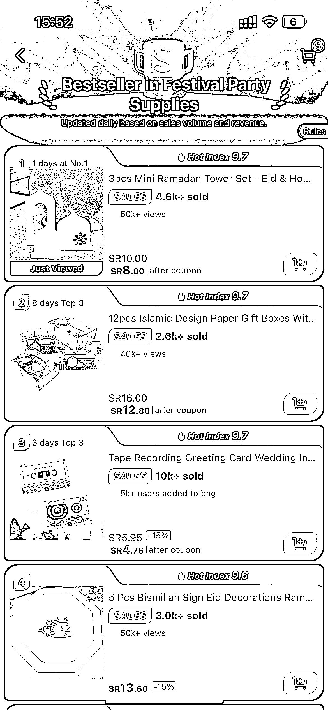
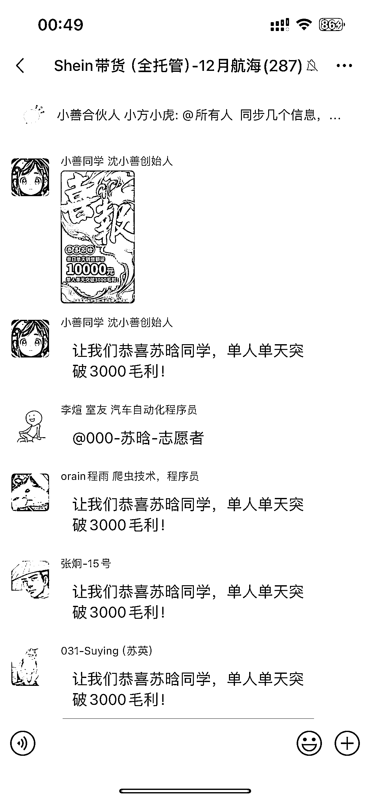
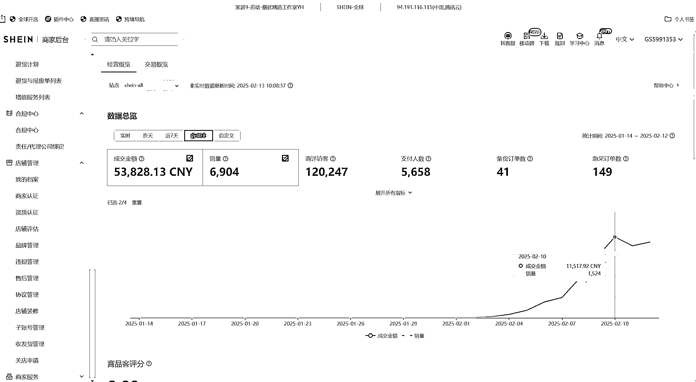

# 实体老板第一次做 SHEIN，单人单店日销售额破万，保姆级起店复盘分享

从实体店老板到 SHEIN 日销破万：我一个人，如何干翻过去 13 家门店？

大家好，我是苏晗。

如果你问我，过去 3 个月我做的最正确的一件事是什么？我的答案不是“赚了多少钱”，而是：**我把自己从实体生意的泥潭里，一把拽了出来，扔进了互联网的轻资产快车道。**

先给大家看一组硬核数据——**单人、单店、单日销售额突破 10000 元，日订单量稳定在 1500 单以上，并且成功拿下 SHEIN 节庆热卖榜榜首的位置。**

说实话，那天看到后台跳动的数字，我愣了好一会儿。忍不住感慨：互联网这东西，真特么神奇。过去我做实体酒水供应链，5 年时间，开了 13 家门店。听起来风光，背后的苦水只有自己往下咽：每个市区门店，光货款加房租水电就要压进去 30 多万，还得请本地人看店、分润、斗心眼。人情世故，利益算计，样样都得应付。到最后，**外面赊账没收回来的，还有大几十万，至今挂在账上。**

而现在呢？几乎零成本入场，一天毛利就能做到 3000+。你敢信？

熟悉我的人知道，我是个内向的人，但一聊起干货就容易话痨。所以今天，我按时间线，把这段从 0 到 1 的完整起店过程，掰开了揉碎了讲给你听。

时间倒回 2024 年 11 月 25 日，我和刀姐飞到三亚 NCC 社区，第一次见到了传说中的“小善”。第一眼，我真没觉得这姑娘有什么特别——直到我看见她每天抱着一本《真需求》，在后花园跟我上铺的室友李煊聊着什么。好奇心驱使我凑过去听了一耳朵，原来她们在拆解 SHEIN 店铺新链接起量的底层逻辑。说实话，有点意思。

那时候，所谓的“选品研究”还处在 1.0 版本。后来程雨也加入了我们，除了做航海海报、整理学员作业分数，**我们每天的核心工作就是：从海量产品数据里抽出销量 TOP500 的爆款，反推它们背后的店铺，找出重合度最高的那些，再深入解剖这些优质店铺的共同规律。**

这件事，和我过去 10 年的舒适区完全相反。在 2024 年 1 月加入赚钱之后，我的操作路径一直是“看到异常值 → 直接拆解 → 对标模仿”，靠这一套，也变现了 30W+。但那种“爬 500 米小山”就能拿到结果的事，做久了人就废了。**爬 500 米的山，和爬 5000 米的山，上限完全不一样。** 我想登更高的山峰，看更远的风景，而这一次，我终于有了重新出发的感觉。

真正让我下定决心梭哈 SHEIN 的，是一个极其微小的瞬间。那天小善在研究店铺数据，我们三个大老爷们也在研究。从早上 9 点到晚上 9 点，我们仨中途已经累趴下，回寝室躺了两轮，可小善始终坐在电脑前，纹丝不动——唯一的变化，是旁边多了两堆洽洽五香瓜子。那一刻我就在想：**和这样的人并肩作战，想不成事都难。**

其实我第一次看到 SHEIN 航海帖子时也心动过，但一看“只做选品、全托管”，我犹豫了：这会不会太简单了？毕竟我当时已经在赚钱拿到过 30W+ 的结果，想挑战点更有难度的。

结果第二天打开高阶航海报名入口——早就被抢光了。

所以，我选择以志愿者的身份“强行上船”。没想到，这一上船，就成了我 2025 年最赚的一笔投资。

接手店铺之后，我严格按虹姐教的 70 分精品上架法来操盘，持续优化链接，20 多天打磨，2 月初正式上架开卖。**上架仅 1 周，就做到了单日销售额破万，日销 1500 单+，还一举拿下 SHEIN 节庆热卖榜第一名。**

这一路走过来，踩过的坑、试过的错、总结出来的方法论，我全都沉淀在了这 3 个月里。上个月 20 号我写了第一版分享帖，觉得不够好，撕了重来。**花 2 周时间——1 周思考沉淀，1 周打磨文字——把我从选品、上架、运营、货源到提效工具的所有经验，毫无保留地写成了这份保姆级复盘。**

里面涵盖了 SHEIN 起店的六大核心板块：

1、SHEIN 选品篇  
2、SHEIN 70 分精品上架篇  
3、SHEIN 产品上架的 5 个阶段及常见问题  
4、SHEIN 店铺运营  
5、SHEIN 产品货源  
6、SHEIN 提效工具

由于完整版包含了大量图片、视频和实操细节，为了获得更好的阅读体验，我把全文整理到了飞书文档，感兴趣的读者可以点击下方链接直接查看完整内容。

[实体老板第一次做 SHEIN，单人单店日销售额破万，保姆级起店复盘分享](https://eqr5180l7jb.feishu.cn/docx/KvjCdOwjioOjQsxdEbRci6NGneg?from=from_copylink)

爱出者爱返，福往者福来。在赚钱这片土壤里我收获太多，今天也轮到我勇敢分享一次。希望这一篇，能成为你起盘 SHEIN 的第一块跳板。