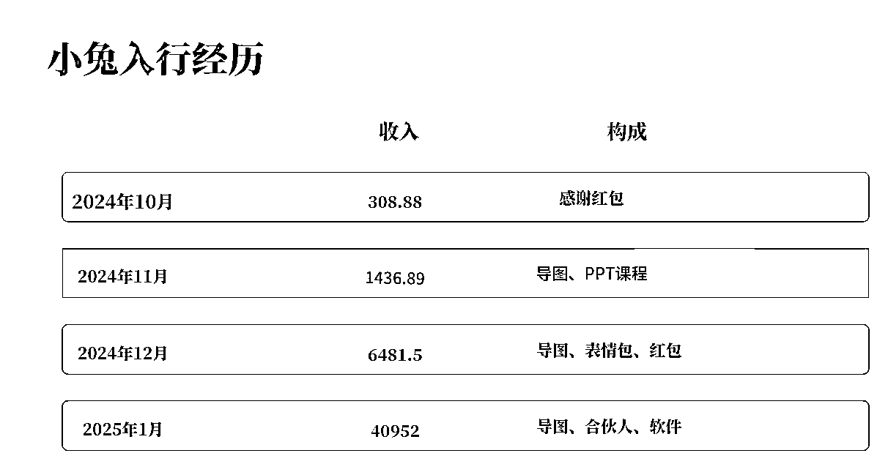
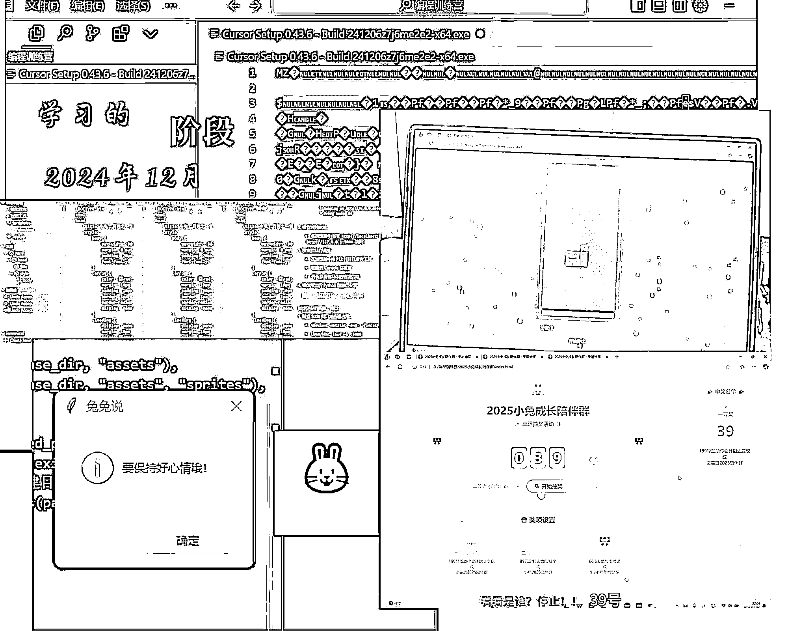
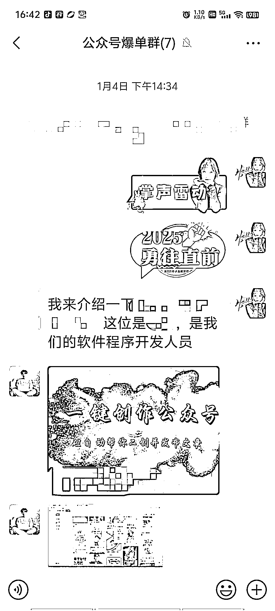

# 38岁医院收费员的副业突围：从零摸索编程，到做出一款年流水超2万元的内容产品

作者：小兔  
日期：2025-03-09

大家好，我是小兔。这是我在赚钱的第二次分享。

前几天参加龙哥老师的直播时，我在评论区提到：自己通过航海项目接触了编程，并把它做成了副业。没想到被团队老师看到，邀请我把这段经历写下来。

从一个不懂技术、连相关工具都不会用的普通上班族，到做出内容产品，再到参与研发自己的软件，这一路并不顺利。2025年开年两个多月，我的各项副业收入累计超过5万元，其中一款内容工具的GMV也超过了2万元。

这篇文章可能比较长，因为我想把每一步都交代清楚。

## **我为什么加入赚钱**

我今年38岁，在体制内工作，日常在公立医院负责挂号和收费。

2023年9月28日，我加入了赚钱。当时刚结束中级会计职称考试，平时刷📕时偶然听到【搞钱女孩】的节目。连续听了几期后，我多次听到嘉宾提到【龙哥盟】，虽然当时并不了解它究竟是什么，但知道里面有不少人已经靠副业赚到了钱。

2021年至2023年，我几乎一直在备考，社交软件也基本停用了。那时我知道GPT可能会带来机会，却没有精力追踪，只能先把考试放在前面。

真正让我决定付费的，是黄小刀参加的那一期节目。节目还没听完，我已经开始搜索相关信息，下载知识星球并完成报名。

3000多元的费用，对当时的我来说并不轻松，我还是选择分期付款。因为比起花钱，我更担心自己错过变化中的时代。这里有人研究新技术，也有人把方法做成了收入，我想亲自进来看看。

# **第一阶段：什么都想学，却没有真正开始**

刚进入赚钱时，我的状态很像第一次逛大型游乐园：每个项目都想试一遍，却不知道从哪里下手。

2023年10月，我报名了【📕店铺】。那时我连航海资料放在哪里都不知道，也没有完成过一次打卡，更不了解坚持打卡可以获得返还。很多看似复杂的问题，追根究底只是因为当时不会使用相关网络工具。

那一年，我更多是在浏览内容，很少真正执行。

因为工作里接触过思维导图，我对竖版思维导图很感兴趣，于是报名了罗卜和小熊老师的相关项目。作为会计，我也觉得RPA可能对工作有帮助，所以顺手报名了提效项目。

但那时候我的出发点并不是赚钱，而是“先学点东西”。一旦觉得自己掌握了基础，就失去了继续打卡的动力；换到另一个主题后，又因为难度太高而中途退出。

现在回头看，我当时所谓的学习，其实是在回避结果。我害怕失败，于是用“先学习”给自己留了退路。

2024年初，我还去挑战CPA。一个中级会计考了三年的人，贸然去学CPA，结果自然不难猜。

## **第二阶段：现实逼着我真正动手**

2024年，家里的经济压力明显增加。过去还能相对从容地生活，后来开始处处精打细算。

我和老公都是上班族，我每月工资和绩效加起来4800多元，他的收入在5000元以上。因为备孕，我常常往北京跑，看中医每月就要花3000多元，医院检查也需要额外支出。收入很快就被各种开销消耗掉了。

真正刺激我的，是2024年9月7日发生的一件小事。

那天我开车时碰到一位闯红灯的女士，对方要求我赔偿衣服和丝袜。我查看她的购物记录时发现，她买的丝袜一双就要200多元，而且一次买了三双。

再看看自己：整个夏天只买了一件抖音上99元包邮的衣服。

那一刻我突然意识到，自己不能继续把“没准备好”当成不行动的理由。既然经济压力已经摆在眼前，就该真正下场试试。

于是，2024年9月，我同时参加了【📕教育资料引流】和【AI写作】两个项目。

这次我要特别感谢航海志愿者【海滨】，是他教会我如何使用相关网络工具；也感谢【Cheese海盐】老师帮我找到充值GPT的渠道。那是我第一次真正接触到这些工具，也第一次感受到技术确实可以改变效率。

即使当时经济很紧张，赚钱续费我依然没有犹豫，继续用分期方式留下来。

# **第三阶段：先卖课，再找到自己的节奏**

刚开始做教育资料引流，我并没有取得好成绩。

一方面，我没有孩子，很难真正理解家长的需求；另一方面，我老公是小学老师，手上看似有资源，但他认为售卖资料是在制造家长焦虑，因此坚决不愿意参与。

既然别人不做，那就我自己来。

2024年9月29日，我加入了【全国会计副业圈】。直到10月20日前，我仍然没有收入。10月23日，我又报名了会计做课训练营，决定尝试把自己的知识整理成课程。

10月中旬，我读了梁宁的**《真需求》**。结合自己的经历和现有资源，我设计了第一门课：【导图助你会计副业变现】。

这门课的核心很简单：把原本零散的资料，用竖版思维导图重新整理，再转成适合学习的内容。

课程价格从39.9元逐步调整到99元、199元，销售情况比我预想得好。后来我还尝试用表情包、PPT等不同形式制作小课，39.9元、16.8元的产品都卖过，最终拿到了训练营第一名。

那段时间，我第一次明显感觉到：原来我也能把一个想法变成收入。

如果说得直接一点，我做的其实就是把学到的内容重新整理、讲解，再提供给需要的人。但我在医院工作，日常会接触很多中老年患者，知道很多人不是没有需求，而是不知道如何操作。因此，我的课程不会故意做得高深，而是尽量拆成普通人也能理解的步骤。

有人说我的课程没有精美海报，录音里还有杂音，也没有露脸。

我承认这些问题都存在。但当时预算有限，我只能先把内容做出来。对我来说，市场是否愿意付费，比包装是否完美更重要。

## **我是在什么时候开始接触编程的**

2024年12月，我一边继续售卖课程，一边参加了【👸号爆文写作】和【小绿书带货】两个项目。

我没有报名正式的编程项目，是因为之前参加RPA项目时认识了带队老师BUFF。那年12月，他开设了两种不同周期的Cursor课程。我就把他的课程和航海资料结合起来，自学编程。

我对这件事非常感兴趣。即使当时工作很忙，我仍然每天抽出一到两个小时，与AI编程助手反复交流，尝试做一些小程序：

- 俄罗斯方块
- 图片抠图工具
- 群抽奖程序
- 桌面宠物
- 医院会计系统

医院系统做到一半时，我还是卡住了。我也尝试过做内容写作相关的软件，但当时只能在自己的电脑上运行。要把程序交付到别人的电脑，或者完成真正的部署，我还没有这个能力。

不过，这段经历让我埋下了一个念头：原来普通人也可以参与软件制作。

接触编程后，我最大的变化不是立刻变成了技术人员，而是遇到问题时会先思考：能不能让AI帮我试着解决？

我本来就是上班族，还在备孕，时间非常有限。凡是能够借助工具提升效率的地方，我都愿意去尝试。

## **从一个想法到真正立项**

2025年1月2日晚上8点多，我发了一条朋友圈，寻找愿意一起做项目的合伙人。

当时我给自己设定的价格是4999元，使用三年。第一位合伙人和我聊了一个多小时，建议我把价格提高到5999元。没想到我调整价格后，她反而直接报名了。

当天晚上，我就找到了两位合伙人。

她们看中的并不是我懂多少技术，而是我反应快、执行力强，遇到需求后能够迅速测试并推进。我的优势也很明确：发现问题后，我会尽快把它做成一个可以验证的方案。

1月3日，第三位合伙人主动找到我。起初我拒绝了两次，后来在1月5日接受了她的加入。她们四个人一起组成了【小兔AI创作助手】的最初团队。

同样是在1月3日，我花了一整天盘点自己的资源，最后确定：可以做一款帮助普通人完成内容表达的软件。

第二天早上，我把这个想法告诉合伙人，大家讨论后认为可行。当天，我联系了一位技术人员，正式商量研发方案。

其实，早在12月初，这位技术人员就曾向我推荐过他的内容生成产品，并表示可以免费让我试用。但那时我同时参加多个项目、学习编程、售卖课程，根本没有精力接手，所以拒绝了。

1月4日，项目正式进入研发阶段；1月5日支付定金，开始推进。

 hmGoy_8VJVlv)

## **这款产品背后的几个判断**

【小兔AI工具01】LuckyTwo的研发过程，我已经在上一篇文章里写过，技术细节可以参考那篇《用cursor做出AI写作软件，接口是大热的DeepSeek，目前GMV2万+》飞书文档。

这次我更想分享产品和执行上的思考。

### 1.先做，再完善

我属于典型的行动型选手。遇到问题时，我不会长时间纠结“为什么又失败了”，而是先看当前环节能不能继续推进。

这个办法不行，就换另一个；结果不理想，就重新调整。只要持续尝试，总会找到一条能走通的路。

### 2.焦虑无法替代行动

我越来越相信，变化越快，越不能把时间耗在焦虑上。

与其担心自己跟不上，不如学一点新东西、测试一个新想法、验证一个真实需求。38岁才开始尝试副业的我，都能从零做出结果，说明年龄并不是决定性因素。

关键在于：有没有真正动手。

### 3.小需求也可能成为生意

3月7日晚上，我在坤汀和SKY的直播里看到批量制图的演示，突然意识到：很多做内容的人，确实需要一个更省事的海报制作方案。

于是我马上联系技术人员，希望在参加下一次航海前，先做出一个可以批量生成📕和小绿书图文海报的测试版本。

3月8日，工具完成了初版。当晚10点，我拿到试用版本后，团队立即开始讨论用户需求、价格和推广方案，我也同步录制说明视频。

晚上11点，我在陪伴群里发布了消息。虽然视频还没有完全录好，但已经有人愿意先锁定名额：

- 9人直接支付了全款
- 15人用1元定金锁定价格
- 3月9日早上，有成员反馈已经收到了30个定金
- 当天下午，定金数量进一步超过40个

这个结果让我再次确认：市场上并不缺需求，缺的是有人愿意把小问题做成可用的产品。

大IP有大IP的打法，小团队也有自己的空间。价格不需要很高，只要解决具体问题，让普通用户也能承担，就可能形成稳定的生意。

之前我用同样的方式做过群抽奖程序，也有人主动来问能不能购买。很多机会并不是不存在，而是没人认真验证。

## **为什么我要把产品做得足够简单**

把操作流程做简单，是这款产品最重要的设计目标之一。

国外有类似插件，每月收费约200元，而我们的产品并不追求复杂功能，核心就是让用户尽快完成内容创作。

我之所以特别看重易用性，是因为我的工作每天都在提醒我：复杂流程会挡住大量普通用户。

去年，我在医院参与电子医保码的推广。平均每天接触两百多位患者，其中很多人对手机操作并不熟悉。一个“打开微信、扫一扫、调出医保码”的流程，也可能让他们卡住。

我们花了整整10个月，一个个教患者操作，最终把电子医保码使用率从13%提升到了70%。

我常说的一套教学话术就是：

“点这里，再点一下；现在对准脸，眨眨眼、张张嘴，好了，大爷。”

所以，我非常清楚：对普通用户而言，简单并不是降低标准，而是产品能不能被真正使用的前提。

## **产品最初服务谁**

最初，我们把目标用户设定为有副业需求的会计从业者，主要解决两个问题：

- 不知道如何写👸号内容
- 担心专业内容被AI随意改写

后来实际使用后发现，它并不只适合会计。只要能够打字、表达想法，就有机会用起来。

最初的用户画像大致是：

- 有一定工作经验的女性会计
- 对电脑操作不熟悉
- 需要输出专业内容
- 担心AI出现事实错误
- 想通过内容建立个人影响力

围绕这些需求，我们设计了几个方向。

### 1.尽量减少学习成本

团队成员都有本职工作，没有太多时间长期答疑，所以产品必须让人一看就懂。

用户只需要填写基本想法，再选择相应方向，就可以得到一篇👸号草稿，不需要先学习复杂的操作流程。

### 2.让专业内容保持边界

会计类内容不能让模型随便发挥。普通模型虽然写得流畅，但有时会擅自修改数字、概念和结论，用户往往需要来回沟通多轮。

因此，我们在产品里设置了草稿编辑区域，让用户先提供核心内容，再让模型围绕这些内容进行组织，尽量避免偏离事实。

### 3.帮助用户形成自己的表达资产

很多人做内容，只想着每天发几篇，却没有长期积累个人标签。

我们的想法是：不追求批量复制，也不鼓励无差别铺量，而是帮助用户围绕自己的经历、专业和观点，逐步建立属于自己的内容体系。

### 4.把复杂的指令提取出来

用户可以粘贴一篇👸号文章或其他内容，让系统分析它的写法和结构，提炼出可参考的指令。

即使是📕内容，也可以通过复制文本的方式进行分析。我们的目的不是把“提示词”包装成高价课程，而是尽量把这部分能力开放给用户使用。

### 5.不用学专业术语，也能表达需求

我并不擅长复杂的提示词设计，也没有系统研究过相关理论。

我更习惯用普通人能听懂的话描述需求，例如：

“请帮我写一篇面向某类人群的👸号文章，语气参考某种表达方式，开头要抓人，中间加入具体故事，结尾留下行动引导。”

这些要求并不专业，却足够清晰。

产品最后呈现出的样子，也受我的能力边界影响。我不会高深的东西，所以更关注普通人能不能用。

### 6.主动砍掉不必要的功能

我们没有加入批量抓取👸号、批量制作表格等复杂流程。

不是做不到，而是觉得当前阶段没有必要。很多内容素材，用搜索和简单整理就能找到，没必要为了“功能很多”而增加学习成本。

先把一件事做扎实，再考虑其他产品，是我们目前的选择。

技术人员在项目完成后总结了一句话：

**成功=70%场景理解+20%模型调校+10%运气**

我觉得这句话非常准确。

> 二、破局之战：当「提示词工程师」败给「一键生成」
>
> 如果说前几个项目是技术验证，那么 2025 年 1 月交付的第三代内容生成器，则彻底改写了客户对 AI 的认知。
>
> 客户的需求很简单：”根据我们提供的资料，参考其他自媒体作者的文章，输出爆文“。
>
> 这个看似简单的需求背后，藏着所有 AI 培训机构的集体焦虑：
>
> 学员连压缩包都不会解压，却要教他们写提示词？
>
> 花 3 小时调教出的文章，热度还不如奶茶凉得快
>
> 爆文生产流程像玄学，根本无法标准化教学
>
> 我们拆开项目黑箱时，发现了更残酷的真相：
>
> 用通用 AI 生成的文章，查重率高达 25%（平台限流红线）
>
> 每次生成需要经历 17 步操作（包括 5 次手动复制粘贴）
>
> 学员平均流失率 68%("学完还是不会用 AI")
>
> 解决方案：把「开飞机」变成「坐电梯」
>
> 当传统方案还在教用户怎么当"AI 飞行员"时，我们直接给电梯装上了智能按钮：
>
> 第一步：混沌吞噬者
>
> 自动解析对标文章结构
>
> 深度清洗"我妈说宝宝要捂汗"等非结构化数据
>
> 构建专属知识图谱（连客户自己都惊呼"原来我有这么多干货"）
>
> 第二步：爆文基因解码
>
> 用行业黑话分析器拆解爆文
>
> 建立情绪波动曲线模型
>
> 预设多种「人性弱点触发器」
>
> 第三步：奶奶都会用的操作界面
>
> 添加/选择资料
>
> 选择模板
>
> 点击生成（三步到位）
>
> 这个项目教会我的事
>
> 很多客户需要的根本不是大模型，而是：
>
> ✅ 把复杂技术封装成「开水龙头就有热水」
>
> ✅ 把概率游戏变成「保证最低收益」的生产线
>
> ✅ 把玄学般的 AI 魔法变成可复制的操作手册
>
> 三、你该拥有的 AI 开发路线图
>
> 经过 12 个项目的实战积累，我总结出企业级 AI 应用的黄金公式：
>
> 成功=70%场景理解+20%模型调校+10%运气

## **这款产品目前赚了多少**

目前的计算方式是：

699元/年 × 30人 = 20970元

我们没有采用常见的“拉人就返现”模式，只有实际购买过产品的用户才拥有分销资格，返佣比例为30%。

我知道这种设置并不算主流，也可能会降低传播速度，但团队成员都有工作，无法把大量时间放在基础答疑上。

我在医院工作时基本无法及时看手机，只能下班后集中回复。如果每增加一位客户，就需要长时间一对一辅导，我们几个人很快就会被拖垮。

因此，我们宁愿增长慢一点，也不想让副业完全吞掉生活。

我们还要照顾家人、陪伴孩子、锻炼身体、准备怀孕，也希望保留和伴侣相处的时间。

副业应该帮助人改善生活，而不是把生活变成另一份高强度工作。对于需要大量服务、远超团队承受范围的客户，我们只能选择暂时不接。

## **下一步：继续补课，也继续尝试**

我知道自己的能力还不够，尤其是不擅长设计复杂的写作指令。

3月7日听直播时，SKY老师提到了“咪蒙”风格。我抱着试试看的心态体验后，发现确实很有启发。

所以这个月，我又报名了两个IP相关的航海项目，准备认真跟着练习。

我对自媒体的很多规则仍然不熟悉。过去的我，不过是一个喜欢看韩剧、看到感人情节就掉眼泪的普通家庭主妇。2021年至2023年备考期间，我甚至断网了三年，网感几乎从零开始。

现在的我没有成熟套路，也谈不上什么技巧。

但我愿意继续试、继续做、继续把一个个想法落到现实里。

如果这段经历能说明什么，大概就是：

普通人不必等到完全准备好，才开始尝试新机会。

先迈出一步，再在行动中补齐能力，也许就能慢慢走出自己的路。

这次航海经历，说实话，我自己都没想到能走这么远。赚钱团队的小伙伴一直在跟我说，多发帖、多冒泡，别怕声音小。说实话，对一个没什么存在感的小透明来说，这种“被看见”的感觉真的很难得。他们不但没觉得我菜，反而一个劲儿鼓励我多表达——就冲这份信任，我是真的喜欢这个圈子。

更夸张的是，我就随手发了一句评论，竟然被选中上墙了！当时激动得手机都拿不稳，等反应过来想截图留念，页面已经刷过去了……天知道我有多想穿越回去按个保存键，那可是我的高光时刻啊！哪怕现在想起来，还是又开心又后悔。

没想到第二天，赚钱官方居然主动找上门来。说实话我有点懵，也不知道我写的航海复盘是不是符合标准格式。但我想明白了：哪有什么套路，真诚就是最硬的必杀技。我不会说什么漂亮话，可能就剩一句“头脑简单往前冲”了。但好在，我身后还有三个会计！

真的，我这个人总容易上头，一激动就想瞎搞，但每次我热血沸腾的时候，会计们就开始噼里啪啦按计算器，把我按得明明白白。我也是听劝的，行行行，你说咋办就咋办，我乖乖听话。毕竟我考中级会计考了三年才过，这水平，还是别跟专业人士犟了。

要说有什么经验能分享，总结起来也就两条：

第一，认认真真跟完每一次航海，别管当下有没有结果，说不准哪天就突然开花。把手弄脏，亲自下场干，我这样的老阿姨都能做到，你肯定也可以。

第二，听专业的人的话，准没错。别觉得会计管着你烦，她们是帮你踩刹车，不让你摔太狠。

顺便说下评论区里好多朋友问的问题——怎么找到付费用户？我现在的做法是：别先埋头做产品，先看看客户缺啥。你缺啥，我就做啥。哪怕只是一个小模板、一个小工具，只要有人肯花钱，这就是最小的商业闭环。几个人买就说明需求存在，很多人买就说明需求很大。先干起来，再不断给自己正反馈，比如做个群抽奖模板收个三五十块，定制版收个99，又有什么不行呢？目标很简单——我就是想赚钱。想清楚了这一点，所有动作自然就有了方向。

谢谢你看到这里，也谢谢所有给我鼓励的朋友。咱们3月新航海见！