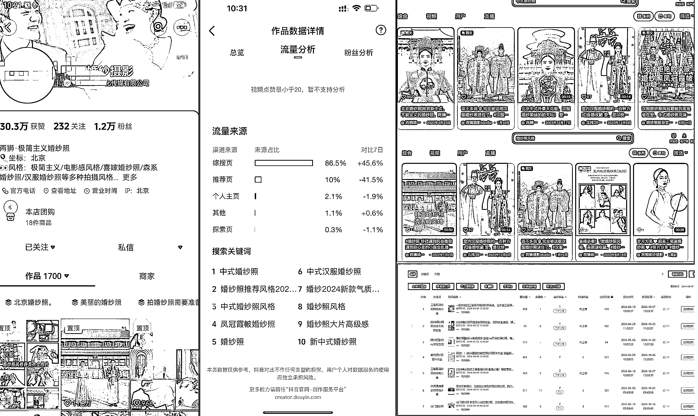
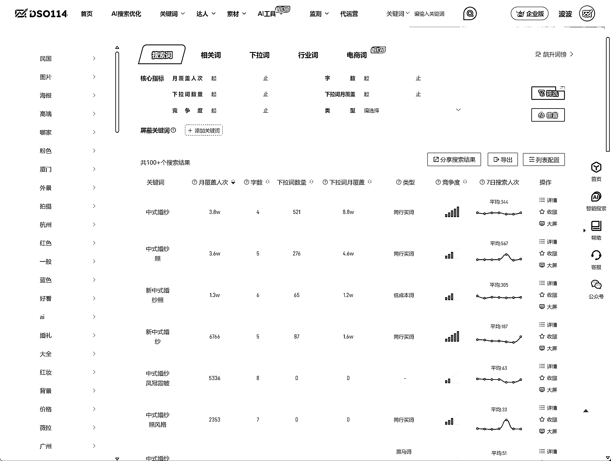
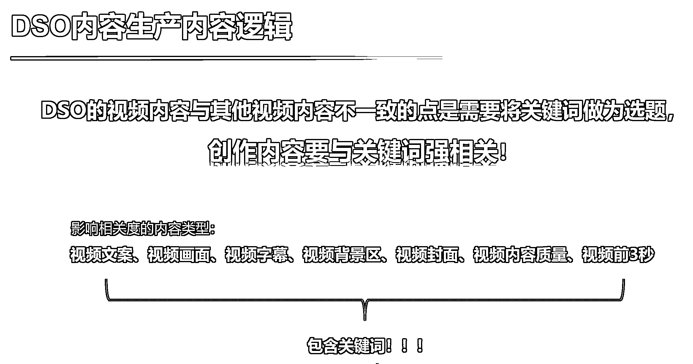
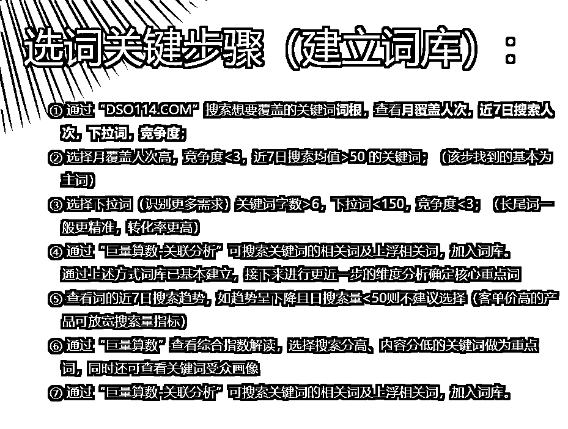
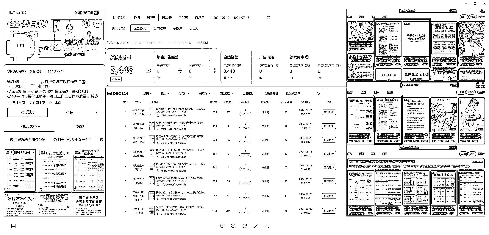
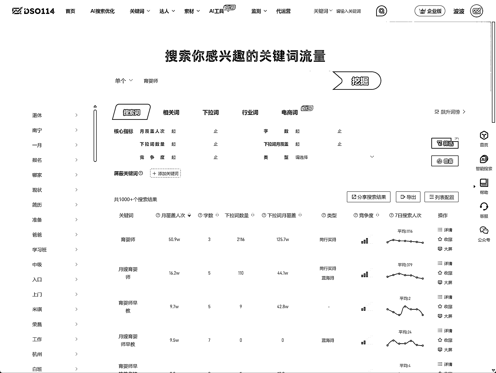
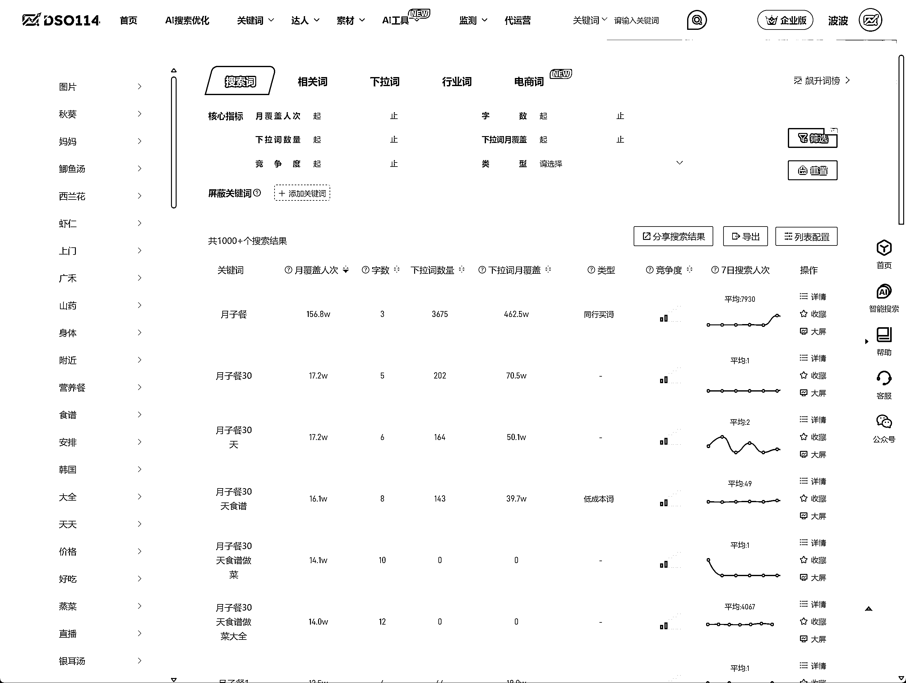
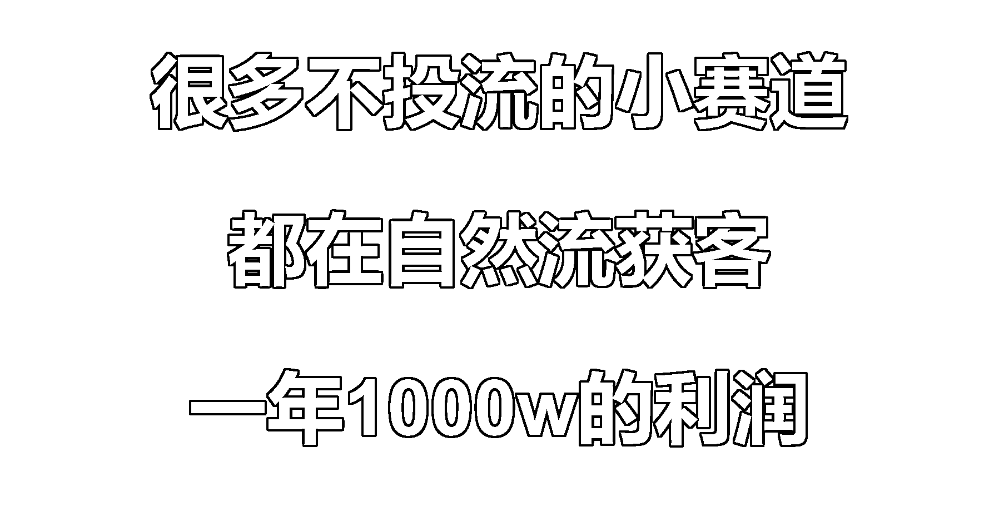

# 蓝V搜索变现实战笔记：婚纱、到家服务如何用DSO吃下抖音搜索流量

> 原文：[`www.yuque.com/for_lazy/zhoubao/xbulclpzaq3e9dwm`](https://www.yuque.com/for_lazy/zhoubao/xbulclpzaq3e9dwm)

## 抖音本地生意做DSO搜索，两个真实账号的拆解复盘

作者： 波波@抖查查@爱盈利

日期：2025-03-09

今天还是上硬菜，都是波波团队自己跑出来的实操项目，直接拿去复刻就行。

**先看第一个项目，婚纱摄影蓝V号：**

经过一段时间的搜索优化打磨，效果已经很明显。**70%** 投放的**短视频** 都**吃上了目标关键词排名**，综合搜索页带来的流量占比**85%** 以上。全程0广告投放，就把高客单业务做出了稳定转化，现在数据还在持续向上走。

下面这张图是**主页概览+流量来源+封面标题+DSO后台统计** 一页式总结！

真正起决定性作用的，是关键词的选定。最稳的词根我们选了“中式婚纱”。来看下周边词的搜索热度：

数据来源：[www.dso114.com](http://www.dso114.com)

从数据能明显看到，一大批长尾词的日均搜索量都在几百上下波动，拿到手就能变成每天稳定进来的精准询盘。

要让作品被目标词收录，核心逻辑很简单：标题里必须带上核心关键词，视频正文、口播、字幕里最好也能多次复现。这样只要内容质量分过线，就有极大概率被搜到并排名。

蓝V账号做DSO，实操门槛并不高。选词、让AI辅助写脚本、按DSO规范发布，一套流程下来一个人就能搞定。高质量DSO素材一天出5条完全没问题。量堆起来后，搜索流量会非常稳。

**再看第二个项目：保姆到家**

先看它的one page总览：

这个号主打图文形式去卡位关键词。月子餐食谱、育儿常见问题、月嫂收费标准...都是切中搜索意图的好方向。用DSO114一查，会发现像“育婴师”这样的主词，抖音上能拓展出1000+的长尾词，而且来的全是精准主动搜索的流量。

本地赛道里，能被搜索引流的远不止这两类。不管是上门服务还是门店服务，只要把蓝V养起来，把内容卡在关键词上，就能持续吃到主动搜来的精准客流。

把基础DSO跑通后，就能往更高阶的打法进化：

1. 服务搜索需求拦截（最直接） ；
2. 信息搜索品牌植入（养品牌词/=行业词）；
3. 泛人群内容引导搜索（看后搜）；
4. 热门视频吸顶词和小蓝词截留（通过看后搜行为干预）；

搜索获客，恰好是付费投放成本越来越高的解法。老板不用亲自出来做个人IP，线索获取全流程运营就能闭环。等流量稳定后，再在前几秒植入IP或品牌镜头，就能把短期获客变成长期资产。

有问题随时来交流DSO玩法^_

过往DSO拆解：

[轻度游戏 App，抖音搜索（DSO）引流实战案例](https://articles.zsxq.com/id_5355amrotlvr.html)

[财税线索获客：抖音搜索（DSO）案例拆解](https://articles.zsxq.com/id_xupwwrrpd0wz.html)

[留学行业在抖音一天免费搞几百条精准线索！](https://articles.zsxq.com/id_hwrs6kaqghs3.html)

[律师、法律行业利用抖音搜索（DSO）做号：自家实战案例](https://articles.zsxq.com/id_xhuiu54b43lt.html)

**1****.** **服务搜索需求拦截（最直接）**

**2****.** **信息搜索品牌植入（养品牌词/=行业词）**

**3****.** **泛人群内容引导搜索（看后搜）**

* * *

评论区：

暂无评论