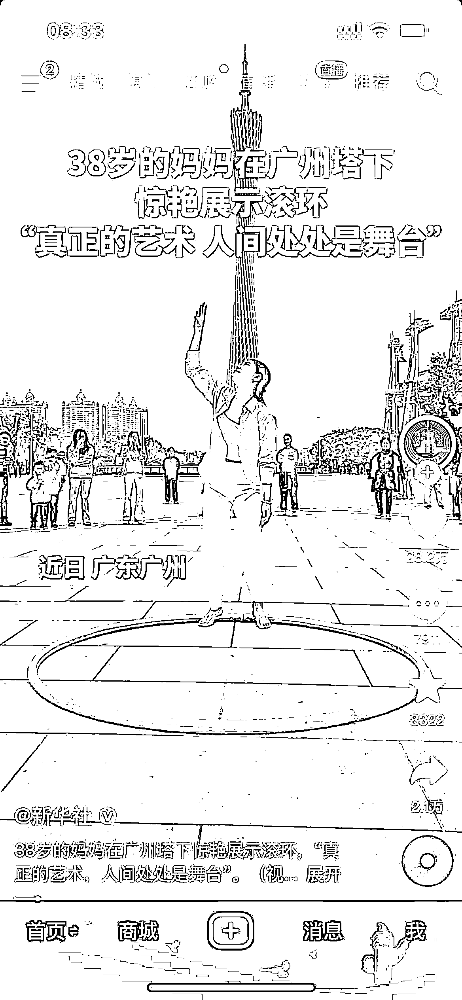
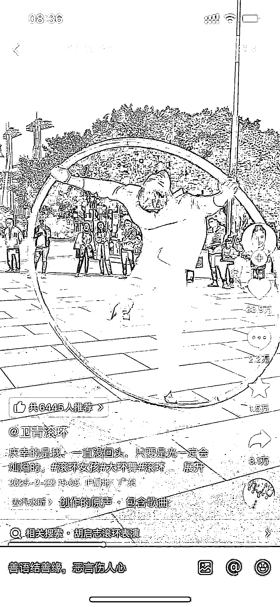
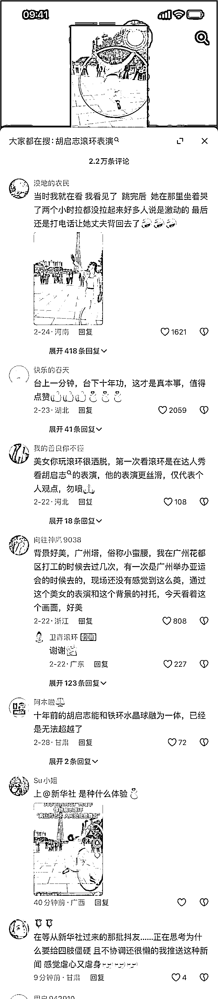

# 内容创作：用“人群垂直，内容不垂直“策略打造高黏性 IP 账号

你有没有经历过这样的状态：关注的对标账号突然停更，自己也跟着没了方向；想选题想到头秃，却总觉得内容差口气；发出去的作品半天没动静，连点赞都寥寥无几……如果你也正卡在创作的瓶颈期，那这篇文章或许能帮你换个思路。

很多人做 IP 账号时，总习惯把自己塞进一个特别窄的标签里，比如“家居博主”“育儿博主”“职场博主”。但越是这么干，越容易越走越累。因为问题的核心不在于你做什么内容，而在于你服务的是谁。记住一句话：做 IP，不是做内容，而是找到一类人，服务他的全部人生。

前几天我刷到新华社的一条抖音，封面赫然写着：“38岁的妈妈在广州塔下惊艳展示滚环——真正的艺术，人间处处是舞台”。恰好我本人就是一名接近这个年龄的妈妈，看到这几个字的一瞬间，我就被抓住了。心里立刻浮现出一个画面：一位宝妈，依然在坚持高难度艺术表演。这个标题没有多余的解释，但“38岁”和“妈妈”这两个词，恰好和我自身重叠，让我产生了强烈的共鸣。我把这个封面文案理解为视频标题。

于是我又点进了表演者本人的账号——卫青滚环。有意思的是，这位原创者发布同一段视频时，完全没有设计封面标题，只在视频简介里写了一句话：“庆幸的是我，一直没回头，只要是光一定会灿烂的。 #滚环女孩”

假如我先刷到的是原作者的版本，我大概只会感叹一句“好厉害”，然后被划走。同一个内容，官方媒体加上“38岁妈妈”的标签，是在突出一个传统观念里应该把重心放在家庭的年龄和角色，却依然能追求艺术、展现才华；而原创者则用“我”的视角，表达对艺术的热爱，传递一种不回头、追光的信念。两种不同的标题框架，直接筛选出了两种不同的观众，评论区也自然长成了两种样子。

官方账号的评论区内，能看到中年女性被同龄人的精彩表演激励，艺术爱好者欣赏民间技艺，广州本地居民因为地标产生本地自豪感，宝妈群体从“38岁妈妈”的身份里看到了另一种活法，有人热烈讨论“38岁”和“妈妈”这两个标签本身，还有纯粹路过被正能量感染的短视频用户。  
而观看卫青滚环本人视频的，则更多是杂技艺术爱好者、被优美身姿吸引的普通刷视频的人、向往积极心态的人，以及从官方视频里追过来的“过客”。

同一个内容，为什么能吸引完全不同的观众？因为标题不只是内容的说明书，它是一座“筛子”，决定让谁看见你、让谁愿意留下来。标题在筛选受众的同时，也在帮内容定位：设置观看预期、触发身份认同、激活算法推荐、构建情感预期。比如“38岁妈妈”唤醒了普通人对超越年龄与身份的认同感，“艺术”则让专业者聚焦技艺本身；“大龄挑战”带来的是鼓舞和励志，“技艺传承”带来的是文化自豪感。不同框架，带来完全不同的情绪和互动路径。

既然标题这么重要，那该如何有策略地设计它？

首先，在动笔前就要想清楚：你最想触达的人群是谁？是年龄标签（35+职场女性）、身份标签（二胎妈妈）、兴趣标签（传统艺术迷），还是价值观标签（追求自我实现的中年人）？然后学会组合标签——人群标签（妈妈）、专业标签（滚环）、情感标签（惊艳）、价值标签（突破），用“38岁妈妈+滚环艺术+惊艳”这样的组合制造张力。更重要的是制造反差：身份与行为的反差、年龄与成就的反差、期待与现实的反差。另外，不同平台的标题策略也不同：公众号适合用长标题埋钩子，短视频需要短平快、把关键信息前置，小红书则更强调情绪共鸣和话题性。

而比标题更核心的策略，是“人群垂直，内容不垂直”。

什么意思？人群要精准，内容却不要死守着一条线。因为任何一个人，尽管有身份标签，生活却是多维度的。比如宝妈，她既有带娃需求，也有自我提升的需求，还想经营夫妻关系、打理家庭财务，甚至希望有自己的事业。如果你只做育儿干货，那么孩子长大了，用户就取关你了。但如果你围绕“宝妈”这个垂直人群，提供育儿、职场平衡、自我成长、家庭管理、情感经营等多元内容，就能真正走进她的生活，成为长期陪伴她的IP。束束的小红书就是一个例子：她的定位原本是“家居/改造/装修干货”，后来增加了沉浸式购物、清洁等系列内容。这样一来，哪怕家里的装修完成了，用户依然愿意关注她，因为她的内容和生活紧紧相连。

这种“人群垂直，内容不垂直”的策略，有三层好处：第一，用户黏性更强，因为单一内容很容易让人疲劳，某一天用户的需求被满足就会流失；而多元内容能覆盖不同生活场景，随着用户生命阶段变化持续提供价值。第二，创作者不容易枯竭，不必在一个话题上死磕到灵感耗尽，反而能在不同内容交叉处找到新的创意。第三，商业变现的可能性更广，围绕一个人群提供多重价值，自然能创造更多合作机会，延长用户生命周期价值。

具体怎么做？第一步，把人群定位做到足够精准，用人口、身份、地域、价值观四个维度的标签去锁定你的核心受众。第二步，建立多支柱的内容矩阵。比如针对宝妈群体，可以设置这样几根支柱：育儿科学、职场平衡、自我成长、家庭管理、情感关系。第三步，让各支柱内容之间产生自然连接，保持统一的叙事视角和一致的价值观，比如始终以“宝妈”视角去聊不同话题，让IP形象贯彻始终。第四步，用数据说话，定期看后台反馈，发现最受欢迎的内容，及时调整内容比例，并根据评论区的信号寻找新选题。

最后想聊聊“标签”。作为创作者，我们不得不借助标签来分发内容，但作为独立的个体，我们又本能地抗拒被标签定义。这并不矛盾。我选择的方式是：接受标签作为工具，但让内容传递积极、正向的价值观。我们可以在“标签”和“无限可能”之间自由行走，既不拒绝人们通过标签找到我们，也不让标签框住生命的全部意义。就像那位38岁的滚环妈妈，她既是母亲，也是艺术家，更是追光的人。标签是一扇窗，不是一间牢房。

真正懂内容的创作者，永远是在精准定位一个人群的同时，看到这个人群背后完整的生活图景，然后用多元但有机连接的内容，去建立一种长久而深刻的关系。方法千千万，但核心不变：找准一类人，服务他的全部人生。