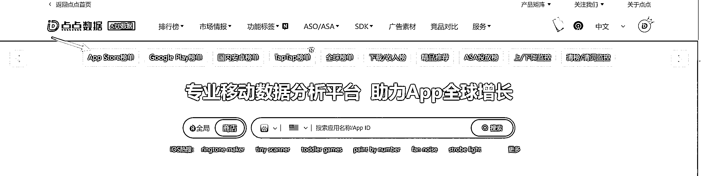
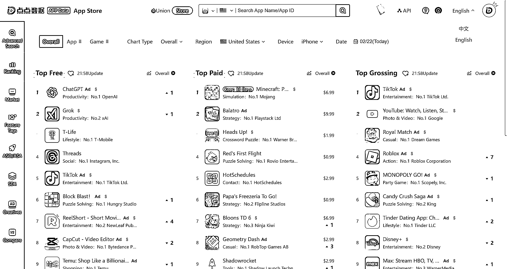
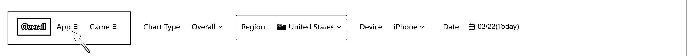
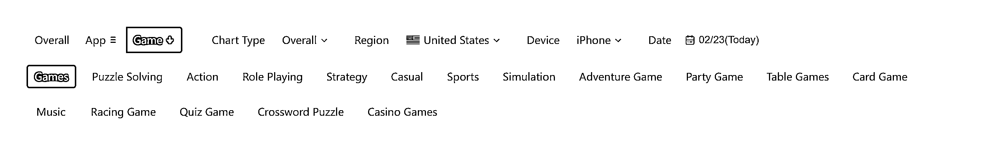
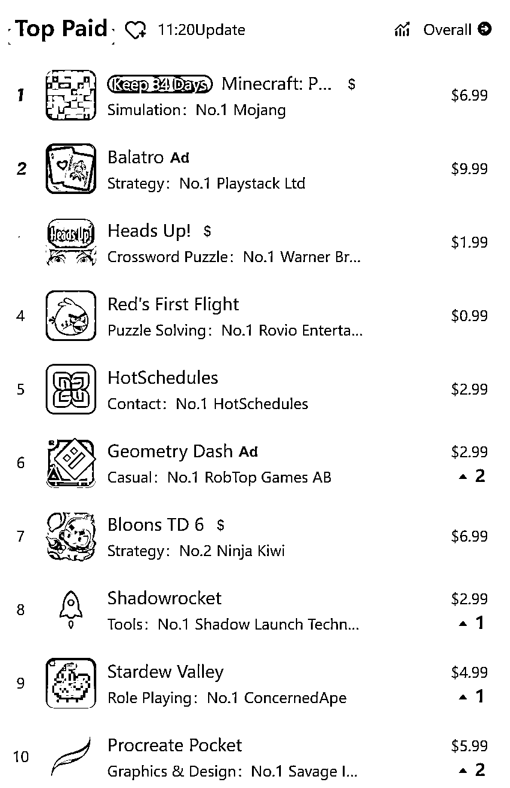
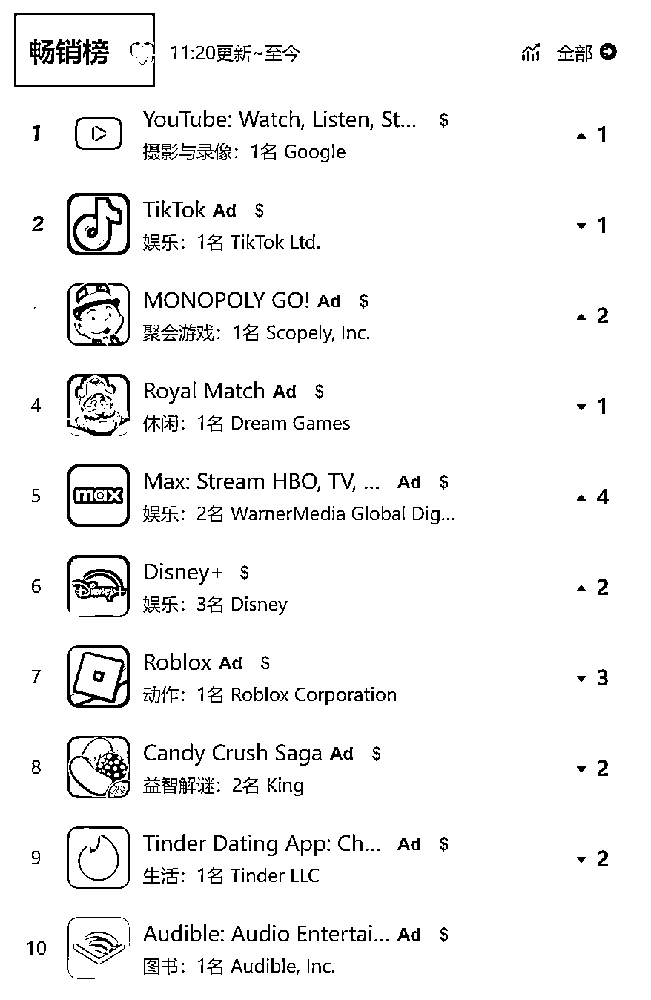
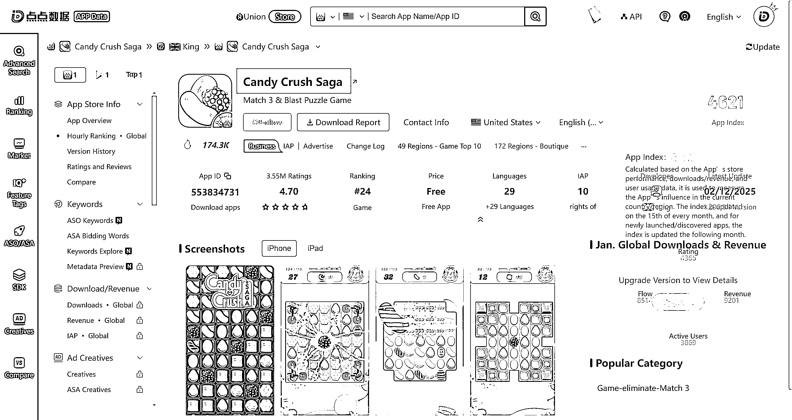
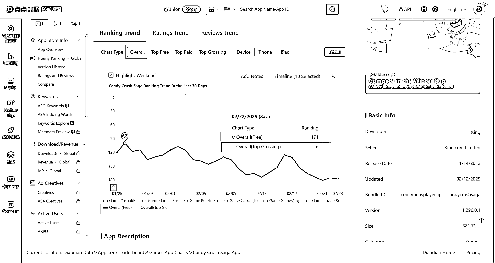
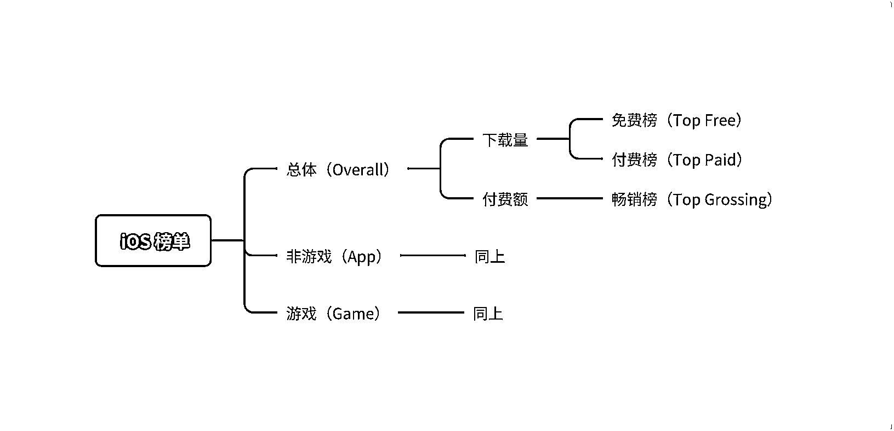

# 用 App Store 榜单读懂海外市场：一个增长人的日常望远镜

## 海外营销必备技能：如何读懂 App Store 榜单

作者：梁山
日期：2025-02-26

各位朋友好，很多人想摸清海外 App 的真实热度，App Store 就是最靠谱的窗口。这篇文章就带你把榜单看明白。

如有排版问题，可移步飞书查看

[海外营销技能：看懂 App
榜单](https://jt0evptqde.feishu.cn/docx/RTYHdtIBZoyRTLxpQtrcMb5Cnhd)

感谢赚钱里 @哥飞 @杨涛 的点拨

欢迎交流~

* * *

# App Store 榜单到底是什么

App Store 榜单就是苹果应用商店的排名，能直观看出哪些应用下载最猛，哪些应用赚钱最多。可类比国内的小米、华为应用商店的排行榜。

海外主流商店只有两家：App Store 和 Google Play。本文以 App Store 为例展开，Google Play 的逻辑大同小异。

为了方便，下文说的苹果榜单、iOS 榜单、App 榜单，都指 App Store 榜单。

# 为什么要盯榜单

看榜单并不会立刻给你带来钱。某款 App 某天冲上百名，也不会分你一分钱。

但对做海外营销的我来说，盯榜单是为了保持市场嗅觉。作为用户增长从业者，必须靠一线的一手信号才能快速捕捉变化。

你不用自己去算每个 App 的日装量，做不到也没意义；也不用等媒体报道才知道什么产品在火。App Store 的官方排名就是最权威、最即时的市场体温计。

我负责海外增长时，每天上班第一件事就是打开榜单。看得久了，市场哪怕一点风吹草动都会被你捕捉到。接下来就教你怎么用。

# 榜单去哪看

理论上手机就能看，但工作需求量大，手机操作很不方便。实操中大家都用第三方监测站，比如点点数据、七麦数据这类平台。

注意，这些平台不生产榜单，它们只是抓取 iOS、Google 等不同商店的官方排名后汇总展示。看到的内容和你在手机上看到的一模一样。

我常用点点数据，下面以它为例。注册很简单，免费版的信息对日常使用完全够用。

进站后点「App Store 榜单」即可进入

额外提醒一句：做海外市场营销，强烈建议直接用英文界面。很多词翻译成中文后意思会跑偏，看英文更准确。

# 看懂榜单先搞清维度

新手觉得 iOS 榜单乱，是因为没搞清分类维度。维度理清了，榜单就简单了。

1. 榜单分类
2. Overall
3. 含游戏和非游戏，也叫总榜。默认就是这个，能反映整体市场
4. App
5. 这里的 App 容易和 App Store 的 App 混淆。
6. 这里的 App 指非游戏类应用
7. 而 App Store 里的 App 是泛指所有应用
8. 可以再细分到具体类目，如 Photo & Video、Entertainment、Education 等
9. Game
10. 纯游戏类
11. 选 Game 后只显示游戏排名，也能再筛到 Puzzle Solving、Action、Role Playing 等子类
12. 
备注：榜单分类不是官方术语

1. 地区
一般选 United States

1. Chart Type
不用纠结，只影响展示形式

1. Device
默认 iPhone，iPad 占比太小

1. Date
一般选当天

# 三大核心榜单详解

维度弄清后，榜单就好解读了。下面截图都基于 Overall。

1. Top Free 免费榜
2. 统计范围
免费下载的应用
3. 统计指标
近期下载量
官方没公布具体算法，市场普遍认为是近期每天下载量加权，扣今天最多。简单理解成近期下载量即可，近期大概指最近三天
4. 重要性
最核心的榜单
App Store 分别给了免费榜和付费榜，没有把两者合并。因为付费应用很少，所以当分类是 Overall 时，Top Free 基本等同于整体 iOS 应用的排名。平时说的“上了榜第几名”指的就是免费榜。
5. 关注数量
看前 20 足够了。能进前 20 的都是顶流或潜力股
6. 关注点
头部位置动了吗？
有没有新面孔上榜？
新上榜的背后是什么驱动下载？
头部产品的获客打法是什么？
哪些产品涨幅惊人？
哪些从前 20 掉出去了？
各个类目占比如何？
不同国家的头部差异在哪？
……

1. Top Paid 付费榜
2. 
3. 统计范围
必须付费才能下载的应用
4. 国内很少见付费下载，但海外仍有一批。注意别和后面 Top Grossing 混了，这里只看下载门槛是否收费，不看下载后的内购。
5. 统计指标
近期下载量
和免费榜类似，理解为近期下载量即可
6. 重要性
一般。非做付费应用可略过
7. 关注数量
Top 10 即可
8. 关注点
同免费榜思路

16. Top Grossing 收入榜
17. 
18. 中文常译为畅销榜，容易误解。App Store 榜单本身就是畅销度排名，这里的“畅销”到底指什么？看英文就清楚了，Top Grossing，Gross 就是收入。
19. 所以更准确的说法是收入榜、应用内购榜。
20. 统计范围
所有应用，不分是否付费下载
21. 统计指标
应用内收入，主要指充值、买道具等
注意，电商类卖实物的不在此榜范围内，不然榜单会全是电商。
22. 重要性
一般
23. 关注数量
Top 10
24. 关注点
除了免费榜的观察点，还可以对比收入榜和免费榜前几名的波动频率，哪个变化更快。顺带思考一个问题：谁能在前 10 停留的时间最长？

# 三个实战案例

1）时间对比看变化

左图是 25 年 2 月中旬美国免费榜 Top 10，右图是 24 年 12 月底。可以看出明显位移。
右图第 2 名是字节的 Lemon8，当时正逢 TikTok 禁令风声紧，替代品迅速被推高。

 images.zsxq.com/FuRWhNA-4rsj3ZZPj_OHveg527Vt) images.zsxq.com/FslrtroHwMLhc0pio3P5SiOiXAnF)

2）Kalshi 的快涨快跌

第一张图，24 年 11 月初，这个 App 从沉寂直接冲到总榜第 1，随后迅速回落。
第二张图，25 年 2 月又一次爆发，但只到总榜第 207，随后消失。
体量很小，平时基本查不到。24 年 11 月那次太亮眼，后来一直追踪。结合当时政治、体育新闻，它的爆发原因就不难推断。

 images.zsxq.com/FtCwQ9riwXdSb5OtqLGc9QmihIkB) images.zsxq.com/Fid45v3iq1lNM167RPXtvNJ9jcnR)

3）Candy Crush Saga：长青吸金机
上线于 2012 年，三消之王，装量 10 亿+，十多年几乎没有低谷。

点进 App 详情页

把 Chart Type 设为 Overall，下面会出现多个指标，我们看 Overall Free 和 Overall Top Grossing。

下载排名仅 171，说明新增不高；但收入排名是 6，靠存量用户养活。运营十多年仍常年收入前十，含金量极高。

# iOS、Google Play 和国内榜单怎么选

本文主要讲 iOS 榜单，但海外从业者也需要看 Google Play。实践中两者差异不大，时间有限的话，只盯 App Store 也足以保持敏锐。

国内生态更复杂，有应用系统榜单、手机厂商榜单小米华为 OPPO vivo、第三方渠道榜单应用宝百度360豌豆荚，数据口径各不相同，很容易迷失。

我的经验是，国内只要关注 iOS App Store 榜单即可。以前负责拉新时，某渠道出现爆发式增长，对比各榜单表现，发现 iOS 榜单的趋势和内部真实下载量几乎完全一致。

小结

如果嫌上面太细，只需要记住这张图的核心逻辑即可。

作者：梁山
原创，转载请征得作者同意。

全文完

* * *

评论区：

11 : 学到新东西啦！谢谢

大卫 : 短小精悍的文章，有收获