# 5 分钟搞定公众号差异化打法，用 DeepSeek 替代万元级商业顾问

## 用 DeepSeek 5 分钟拆解公众号差异化路径，拿到可落地的执行清单，告别烧钱请私教顾问

作者： 任样花子

日期：2025-02-26

DeepSeek 正爆，能力大家有耳闻，但真正会用的人却不多。

在我看来，和顶尖的 ChatGPT 相比，DeepSeek 更像你随身带的私人智囊。

它几乎全知全能，遇到任何卡点直接抛给它，它就能给出策略和方案。

为了让大家直观感受它“贴身智囊”的用法，我拿一个亲测有效的实操来演示。

主题就是：如何借助 DeepSeek 在 5 分钟内完成一份公众号差异化运营方案，并附上可直接上手的执行日程。

先打开腾讯元宝 AI，切换到 DeepSeek 模型，开启深度思考并打开联网搜索。

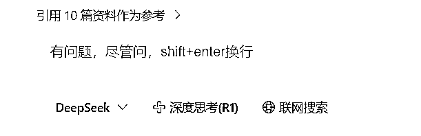

接着把我的真实需求告诉它：

指令：

我想做一个教别人如何通过副业变现赚钱的公众号，请你帮我分析市场上 10 个同类账号，给出我的差异化定位建议，并提供内容创作思路。

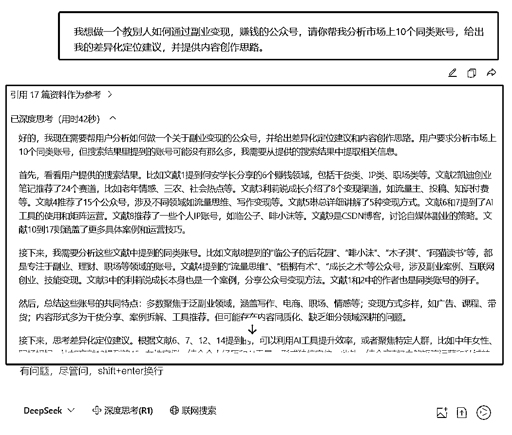

经过深度思考后，DeepSeek 回了一份完整的运营框架。

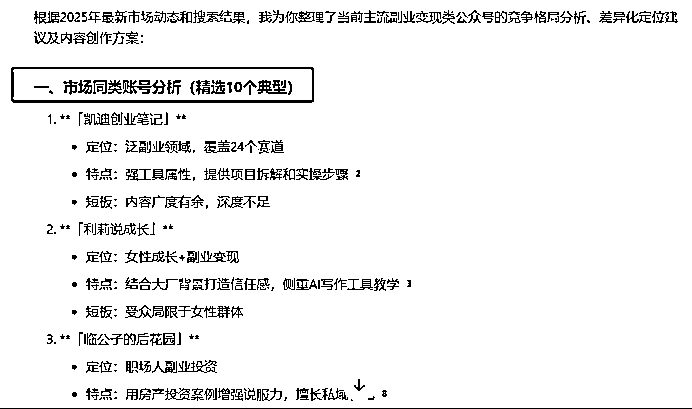

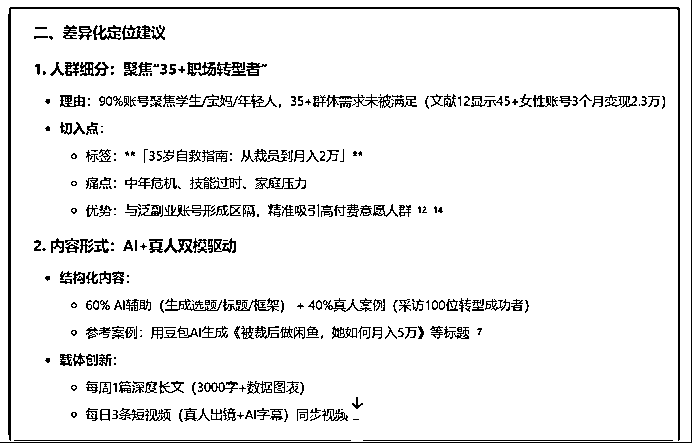

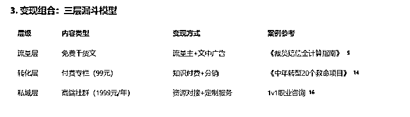

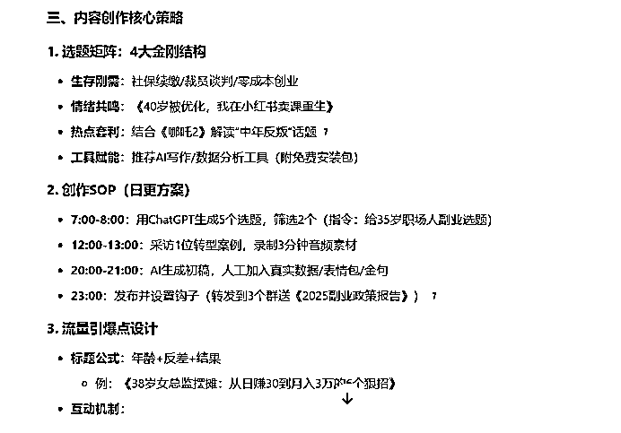

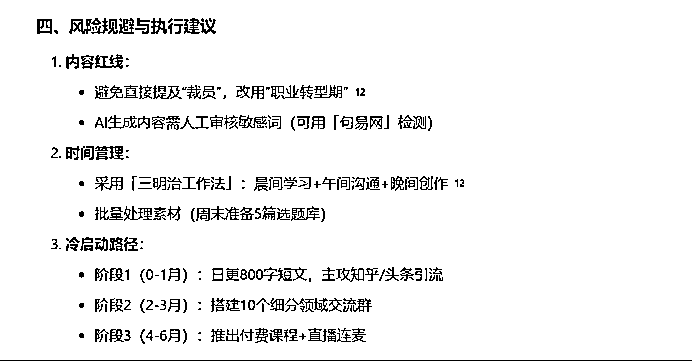

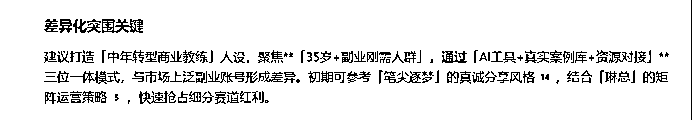

整体思路很扎实，但我想要更细、能马上做的版本，于是追问：

**指令：**

你写的很好，你能根据上面你的规划给我制定一个详细的执行计划吗？

要求具体到每一天干点啥，用什么工具去做？越详细越好，能让我看完就立刻执行起来。

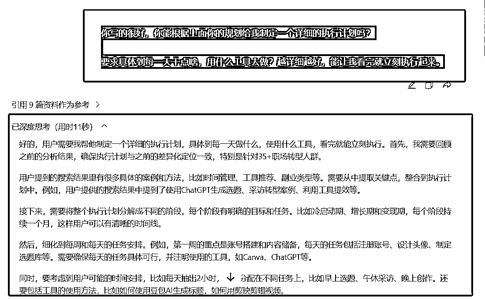

大概一分钟后，一份颗粒度很细的日程表就出来了。

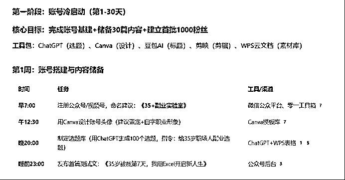

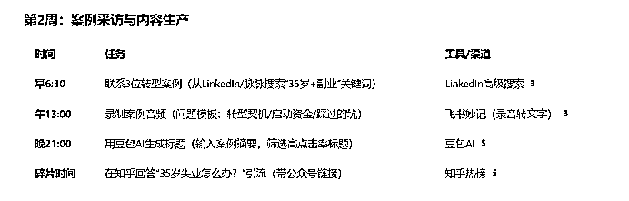

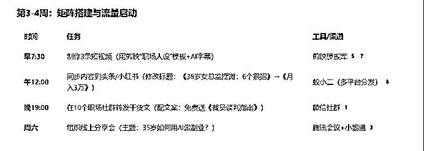

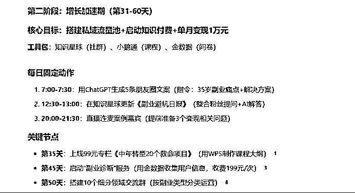

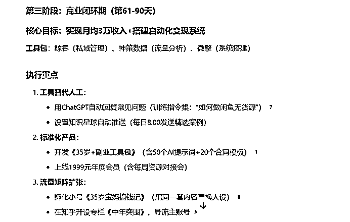

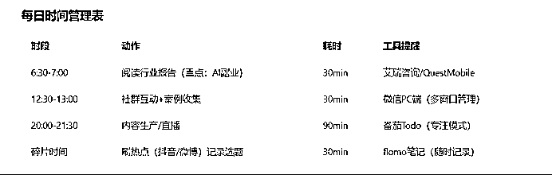

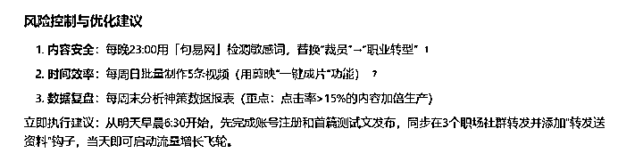

看完你就明白我说的贴身智囊是什么意思了。

以后只要脑子里蹦出一个项目点子，直接让 DeepSeek 帮你拆成可执行方案即可。

就商业策划这件事而言，DeepSeek 现在的表现完全可以对标市面上那些收费上万的私人商业顾问。

所以，AI 工具一定要会用，但也不能迷信。它是放大器，不是替代者。

AI 的效果强不强，关键看使用者本身，强者用它更强。

最后一点，AI 时代已经到来，与其抗拒不如拥抱。未来被淘汰的，往往是不会用 AI 的人。

看完这篇，赶紧给自己配一个 DeepSeek 私人助理吧。

* * *

评论区：

小吉玛丽亚 : 好棒！我可以举一反三了[哇]

GEWO.GUO🌪 : 你这文章转出去就是一个付费的文章[坏笑]