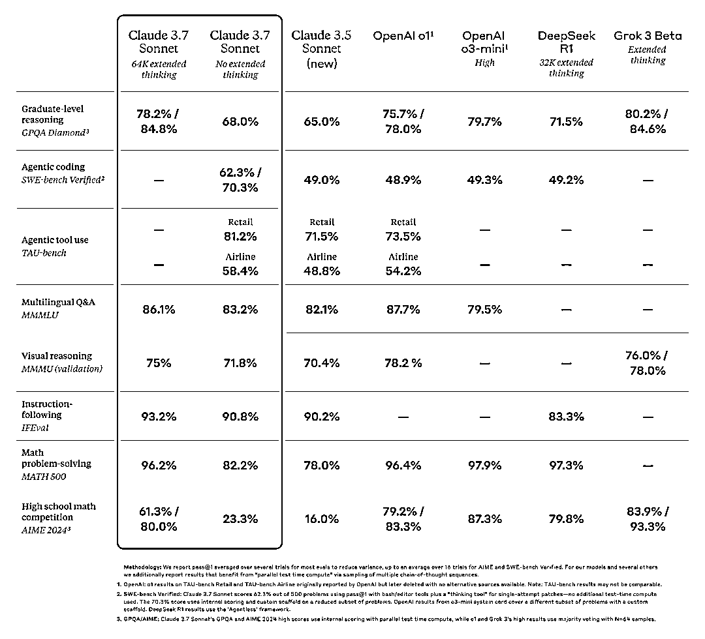
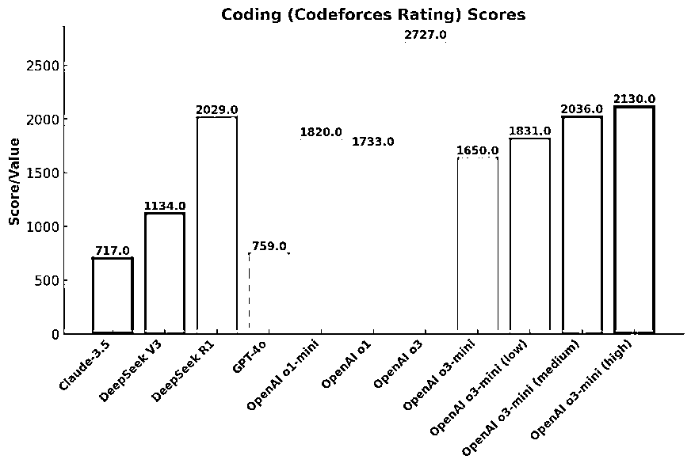
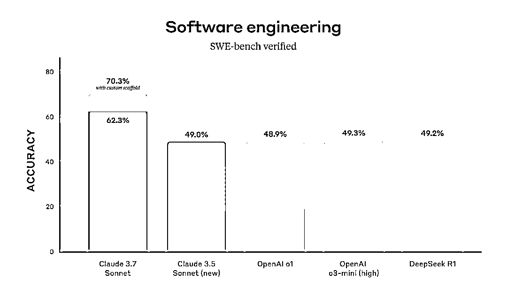
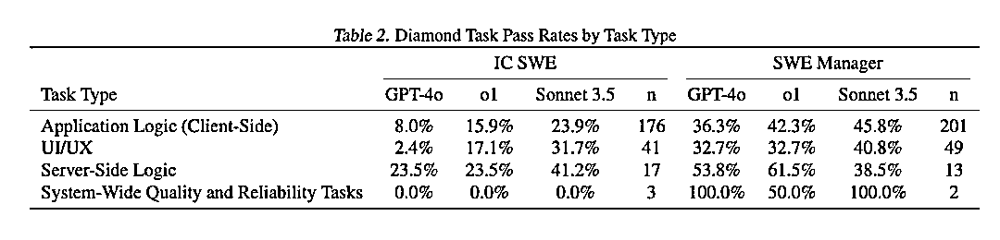
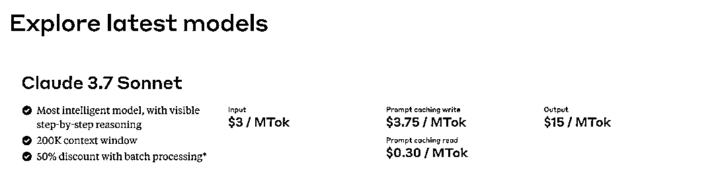
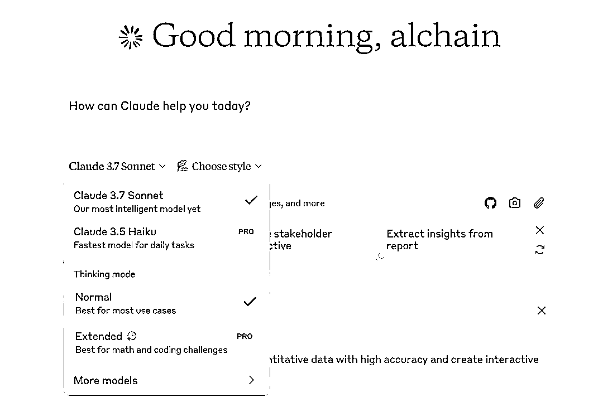
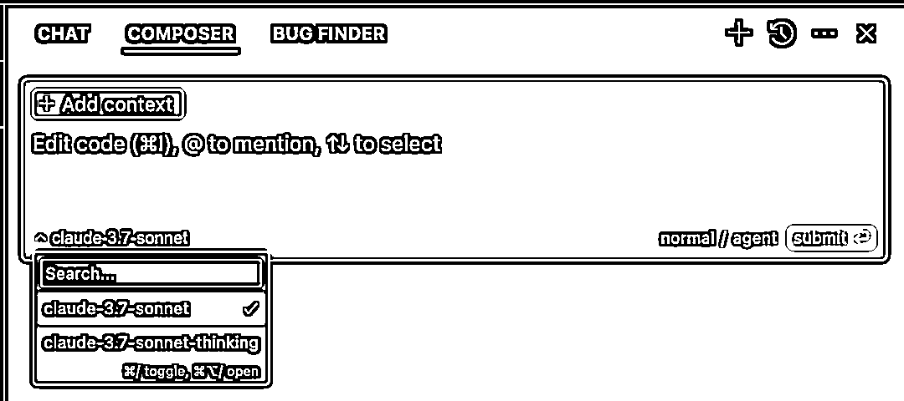
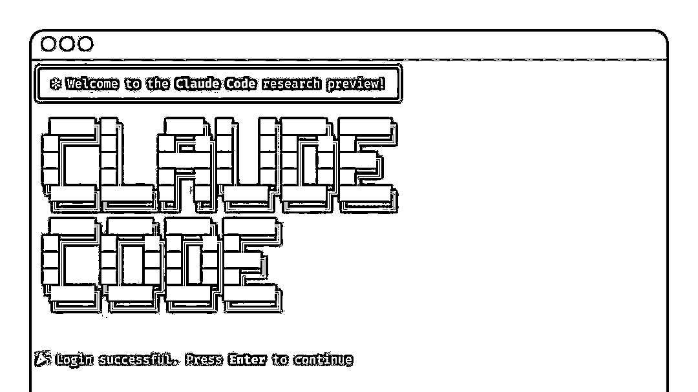

# Claude 3.7 Sonnet 发布：AI 编程真正进入工程级实战时代
作者：龙哥

## Claude 3.7 Sonnet 深度拆解：为什么这次是编程能力的分水岭

作者： AI 进化论-花生

日期：2025-02-25

凌晨推送一来，Anthropic 的 **Claude 3.7 Sonnet** 正式上线。用最直白的话说：AI 编程的工程水准再次被拉高一档。只要你的工具链支持，比如 Cursor，现在就直接切到它，用着顺手的就别回头，更别用那些还没接入的方案硬撑了。

回看 AI 编程的发展，去年 6 月的拐点很清晰。**Claude 3.5 Sonnet** 上线后，编程味儿完全变了，Cursor 借此从小众 IDE 变成大众刚需，Claude 3.5 Sonnet + Cursor 这套组合让 AI 编程跨过了“能用”的门槛，零基础的人也能靠它把点子变成能跑的产品，体验到创造的快感。

此后半年，各家新模型扎堆秀 benchmark，OpenAI 的 o1、o3，DeepSeek 的 V3、R1，Grok 3 等都在榜单上反复把 Claude 3.5 Sonnet 按在地上。但真实使用者都知道一个不太体面的事实：**在每天写代码、造产品的场景里，Claude 3.5 Sonnet 仍是吊打众生的那一个。**

听起来反常识，原因其实很简单。

### **竞赛编程和工程开发，本质上是两类活儿**

发布会上大家爱拿 **Codeforces** 说事。这个平台是国际算法竞赛圈的标杆，相当于编程界的奥数。分数高，说明推理快、数学强。

可问题是，**竞赛高分和造出能用的软件，根本不是一回事。**

拿奥数打比方，金牌得主不一定能成数学家，更不一定能带队做研究。BAT 的 CTO、顶级架构师，极少是靠刷竞赛上来的。

同理，模型在 Codeforces 上拿满分，只证明它擅长孤立的算法推导。它不代表能读懂一个百万行代码的项目，能在不破坏依赖的前提下改 Bug，能把需求落地成稳定上线的功能。

### **Codeforces 火起来，不是因为它准，而是因为它好玩**

**它标准化，单文件，无上下文，分数好看，容易刷。**

要在 Codeforces 上涨分，核心就是强化数学推理、算法模板和代码补全。这些靠堆数据、调策略就能做，评测也客观——通还是不通，耗时多少，一眼分晓。

任务本身通常是自给自足的一道题，不用关心架构、不用整合代码库、不用管前后端协同。对大模型很友好，喂够 OJ 题，分自然就上来。

所以你会看到新模型发布必秀 Codeforces 成绩，OpenAI、DeepSeek、xAI 都在那儿比谁更高。但这对真实开发的参考意义，真的有限。

### **分高不代表好用，真实痛点 Codeforces 测不到**

如果你每天跟 AI 写代码，这几个尴尬再熟悉不过：

1.  它能写出教科书级的 DP，却把你一个几十万行的 repo 的目录结构搞懵，修 Bug 时先把路走丢。
2.  它几秒飙出一堆漂亮算法，一让你调数据库就给出低效的 SQL，直接拖垮线上。
3.  它能过 LeetCode Hard，却改个 UI 组件就乱来，完全无视设计规范，CSS 堆成补丁。

这些坑，**Codeforces 根本测不出**。它只关心“这道题解不解得开”，工程却关心“这段代码放进真实系统里会不会炸”。

简单说，AI 在竞赛里已碾压人类 99.9%，却依旧替代不了真正的工程程序员。

### **想看真本事，看 SWE-bench 和 SWE-Lancer**

要评价现实编程力，目前有两个更靠谱的参照：

1.  **SWE-bench Verified：AI 修 Bug 的真实能力**
2.  **SWE-Lancer：AI 在真实商业任务里的赚钱能力**

### **SWE-bench Verified：能修好，不添乱吗？**

SWE-bench Verified 不考算法，它直接拿开源项目里的真实 Bug，让 AI 在不破坏原有代码的前提下修复，并用自动化测试验证。

这就是在模拟日常维护工作。

在这轮测试里，Claude 3.7 Sonnet 的成功率达到 **70.3%**，比 Claude 3.5、OpenAI o1、o3-mini、DeepSeek R1 都高出 20 个百分点以上，属于工程级的碾压。

意味着它修 Bug 的时候更稳，不再是“修好一个又造出三个”的体验。

### **SWE-Lancer：用 Upwork 的真单检验**

SWE-Lancer 由 OpenAI 提出，从自由职业平台 **Upwork** 里抽了 **1488 个真实开发单，总价约 100 万美元**，让 AI 直接去接单竞争，看能不能交付、能不能“挣钱”。

任务分两类：

1.  **IC SWE：独立开发类，写功能、修 Bug，像真自由职业者一样交付**
2.  **SWE Manager：技术管理类，评审多份方案并选优，相当于技术负责人**

有意思的是，OpenAI 在论文里罕见承认，Claude 3.5 Sonnet 比 o1 和 GPT-4o 更适合现实工程。数据透露了几个信号：

1、Claude 3.5 Sonnet 仍是工程场景首选，能完成约 40% 的真实任务； 2、模型在技术管理类任务上表现明显优于独立开发类，或许管理岗比写码岗更容易被 AI 渗透； 3、AI 在后端逻辑类任务上更强，反而前端 UI/UX 表现平平，这和大众“AI 更适合写前端”的直觉相反。

### **Claude 3.7 Sonnet 的意义：从刷题到实战**

综合 SWE-bench 和 SWE-Lancer 的信号，Claude 3.7 的提升不是纸面分数，而是工程可用性的再一次跃迁。它不再只是“会做题的 AI”，而是“能帮你把活干完的 AI”。

所以选模型，别盯着 Codeforces 看，要看 SWE-bench 和 SWE-Lancer 里的表现。

结论很干脆：**Claude 3.7 Sonnet 目前是 AI 编程的实用性之王，比那些竞赛榜单更高的模型更适合真实开发。**

弄清这点后，再来看它的设计思路和配套工具 Claude Code。

## **推理不是开关，而是光谱**

Anthropic 对推理的理解跟 OpenAI、DeepSeek 不同。他们不认为推理是二选一的开关，而是可以调节的连续体。

因此没有单独拆一个推理模型，而是给了个 **混合推理模型**，你可以决定它思考不思考、思考多久。API 调用时可限制思考 token 数量，通常思考越久效果越好，最高可达 128k token，烧钱程度可想而知。定价是输入 3 美元/百万 token，输出 15 美元/百万 token，比 o3-mini 和 DeepSeek R1 都贵不少。

C 端目前感知有限，在 Claude 官网上可通过选择“Extended”来开启思考模式。

Cursor 侧提供了两个版本：Claude 3.7 Sonnet 和 Claude 3.7 Sonnet thinking。日常写新功能用标准版就够；遇到 Bug 调试、需要做架构规划时切思考版，并在提示词里直接要求它多想、给多套方案，效果更好。



## **Claude Code：终端里的 AI 代理**

除了模型，Anthropic 还推出了 **Claude Code**，一个纯终端运行的 AI 代码代理。

和 Cursor、Copilot 这类 IDE 助手不同，Claude Code 直接在命令行里动手术：改文件、提交 Git、修 Bug、甚至管理整个代码库。它更像一个“AI Shell 伙伴”，而非编辑器里的补全插件。

目前形态还很早期，短板明显：

1.  **权限控制偏宽松，AI 直接在你机器上操作，失误成本高**
2.  **交互方式和 IDE 差异大，上手门槛高，不算新手友好**

可以尝鲜，但别指望它现在就取代 Cursor。

希望 3.7 的发布和 SWE-Lancer 的推动能让厂商把精力拉回真正有用的工程能力上。AI 距离中级工程师的距离又近了一步，当代码不再是瓶颈，我们该用怎样的想象力重新定义软件？

* * *

评论区：

老鹰 : 今天已经用上 3.7 了[憨笑][憨笑]