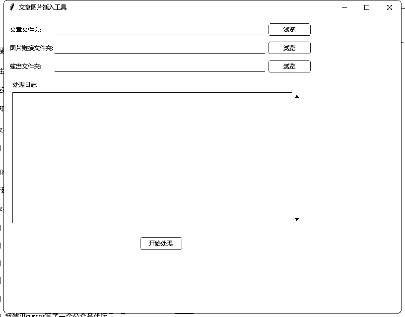

# 如何利用 cursor 实现文章中自动批量插入图片

👸号代运营的日常，大概就是被文章排版、找图、插图这些杂事反复折磨吧？尤其是一下子要处理几十篇稿子的时候，光配图就能把人耗干。

最近发现一个特别省事的玩法：利用Cursor把“文章自动配图”这件事彻底交给脚本去跑，再也不用一张张手动粘贴了。整个过程有四个关键动作：

1. 先把每篇文章要用到的图片链接，统一整理到一个txt文件里；
2. 把图片链接批量转成html格式；
3. 拿到96编辑器里做样式还原（这个思路借鉴了猫哥的做法）；
4. 运行一个图形化操作界面，它会根据文章文件名和图片链接文件名自动对应匹配，一键完成插图。

也就是说，只要提前把“文章txt”和“图片链接txt”按同名放好，剩下的随机选图、段落间插空行、自动排版，全都可以交给脚本完成。单个文档对应单篇文章的图片列表，匹配逻辑清晰，批量处理非常顺畅。

我顺手跑了一下，GUI界面很直观，选择文件夹、看处理日志、一键执行，基本没有学习成本。最棒的是，作者直接开源了源代码，大家不用从零开始写。

文末把源码获取方式留给大家，别忘了自取。

脚本链接：https://si06f5z4e71.feishu.cn/wiki/TDl3wg7HxiTuNpkg3wsc5Dj4neg?from=from_copylink

如果你也在代运营里挣扎，一定要试试这个工具，把时间从重复劳动里省出来，去干点更值钱的事。觉得有用的话，点个收藏再走吧～