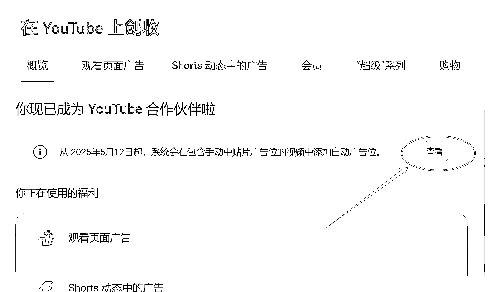
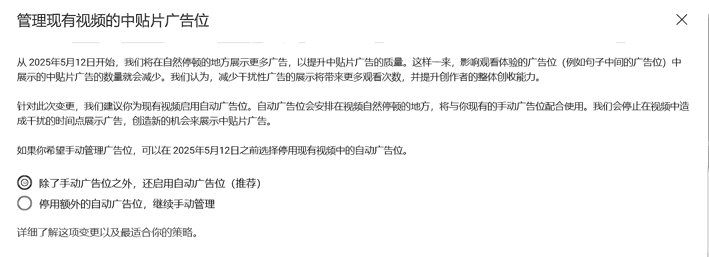
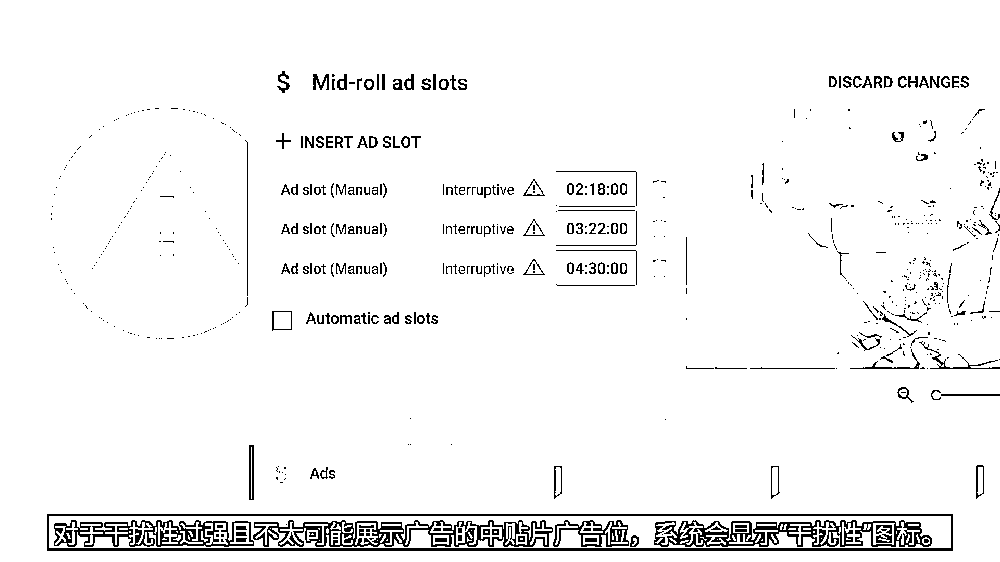
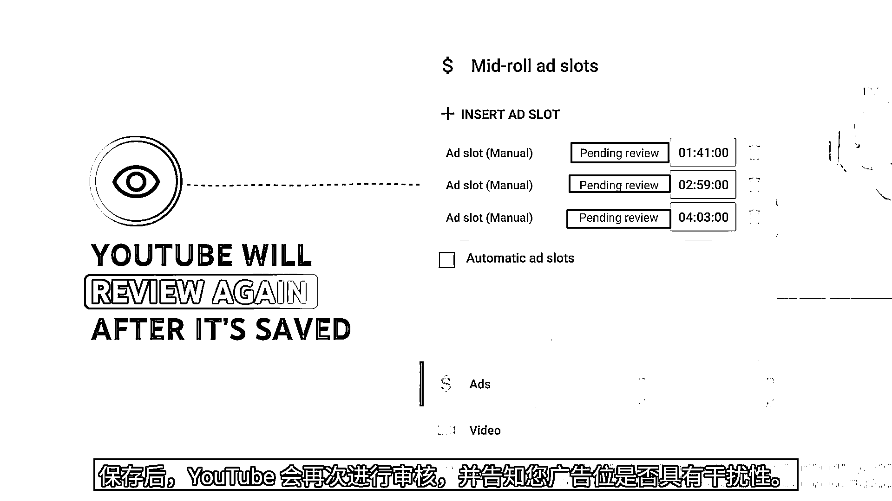
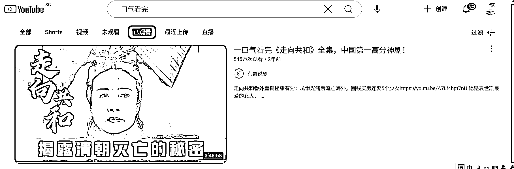

# 油管长视频新规：中插广告自动补位来了，创作者收入有望再上一层

## （油管重大更新）启用长视频“中贴片广告自动插播”功能，帮助油管博主多赚钱。

作者： 书情小跟班

日期：2025-02-28

前言：紧跟 YouTube 官方动向很有必要，我就在昨天捕捉到了这条推送

更好的观看体验见飞书文档

【油管重大更新】启用长视频“中贴片广告自动插播”功能，帮助油管博主多赚钱。

[`rlwxa0zgke.feishu.cn/docx/AK5zd884Moq0GVxx83ZcepBenFf`](https://rlwxa0zgke.feishu.cn/docx/AK5zd884Moq0GVxx83ZcepBenFf)

往期的更新见飞书文档

做 YouTube 的一些常识 [`rlwxa0zgke.feishu.cn/docx/P2DYduGbkoW0nqxcRZgcL6xKn7I`](https://rlwxa0zgke.feishu.cn/docx/P2DYduGbkoW0nqxcRZgcL6xKn7I)

官方说明原文

管理长视频中中贴片广告的插播时间点 Hans#zippy=,在-youtube-工作室中管理广告插播时间点,新上传视频的中贴片广告位,现有已上传视频的中贴片广告位,中贴片广告质量反馈功能)

我把官方文档里需要重点关注的部分梳理如下

## 在 YouTube 工作室中管理广告插播时间点

决定中插广告出现位置一共有 3 种操作方式：

1.  自动广告位：开启自动投放的中插广告后，由系统自行寻找视频中的自然停顿点来投放，从而给观众提供更均衡的观看感受。

2.  手动广告位：若你想自己指定广告出现点，尽量挑在段落衔接处。不要把广告硬塞在句子中间或动作高潮处，否则会打断观感。内容本身如果预留了广告位，则可通过手动方式来固定投放时机。

3.  手动广告位和自动广告位相结合：可在保留手动设置的广告位基础上，再叠加自动中插广告作为补充。若手动设定的位置会损害流畅度，平台会自动寻找更合适的替代点。

广告位设定完毕后，务必利用中贴片广告质量反馈功能 Hans#qualityfeedback) 检查是否出现干扰项。可将广告位挪到转场、章节切换等自然停顿处，既能提升体验也能提高收益。

直接采用 【在保留手动广告位的条件下，同时开启自动广告位 推荐】 这一方案，也就是官方文档里的第 3 种做法

1.  **手动广告位和自动广告位相结合：您可以使用自动中贴片广告，作为对手动添加的展示位置的补充。如果您手动选择的展示位置会影响视频流畅性，我们将为您找到更合适的展示位置。**

在手动添加广告位时，注意一个细节，如下图所示，一旦出现红色感叹号，就说明该位置需要重新调整

我的理解是，这次 YouTube 的改动核心是优化观看体验。

在这一机制上线前，主创可以完全自主决定中插广告的插入点，位置是否合理全看个人。更新后，平台会判定不合适的点并用红色感叹号提示。

过去常出现这种糟糕体验：观众正听得专注，话说到一半广告就弹出来，等广告结束，前面内容已经忘得差不多了，这对留存非常不利。

此次调整就是为了减少这种割裂感。官方会介入审核广告点位，这也意味着制作时更需要按章节、按段落来规划内容。

按照旧思路继续死守纯手动插播，在 2025 年 5 月 12 日之后就不再明智了。手动设定的位置若被判定不合理，平台是不会在你指定的时间播放广告的。这也是不建议完全依赖手动管理广告位的原因。

补充一个基础规则：无论手动还是自动，中插广告的前提都是视频时长超过 8 分钟。不要为了凑时长而硬拉视频，观众一眼就能看穿。一种做法是把同主题内容打包成合集。

比如影视解说，如果单集解说不足 8 分钟，后期可以做一个全剧合集解说，一口气看完 XXX 系列。

把同系列视频串成播放列表，如下图 【播放列表】

【13 个视频】，观众看完一集会自动进入下一集，再包装成合集，也就是前面提到的“一口气看 XXX 系列”的形式。

这种“一口气追完 XXX 系列”的合集玩法，极易拉长总观看时长

* * *

评论区：

暂无评论