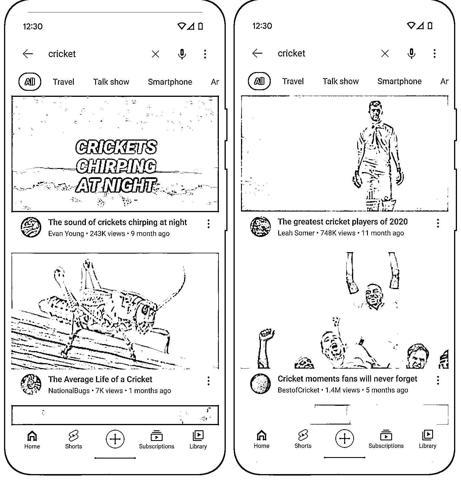
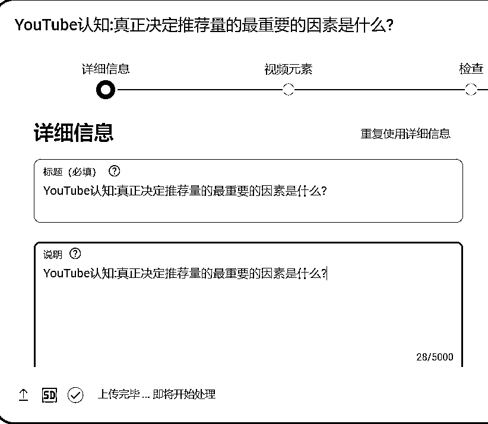
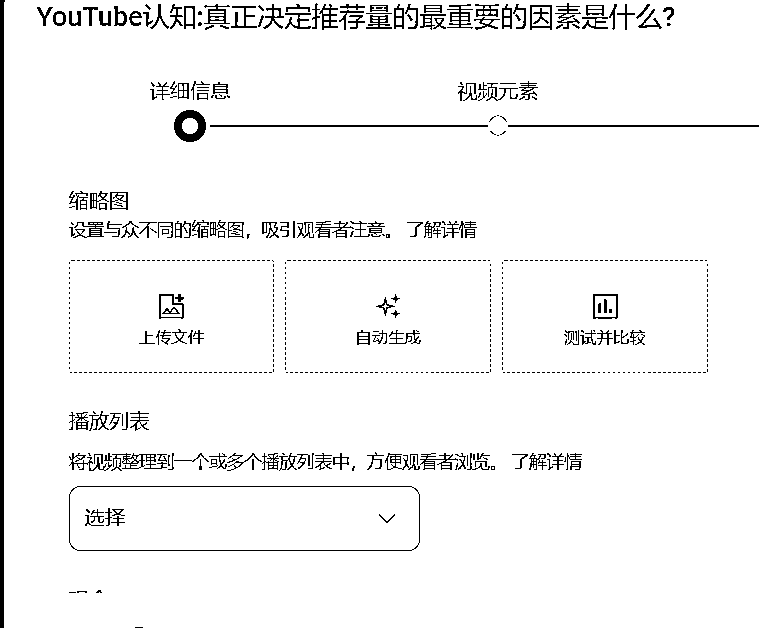
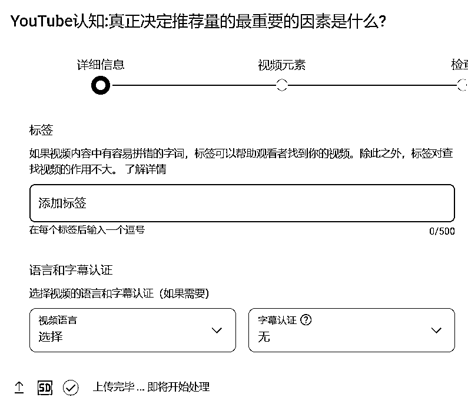
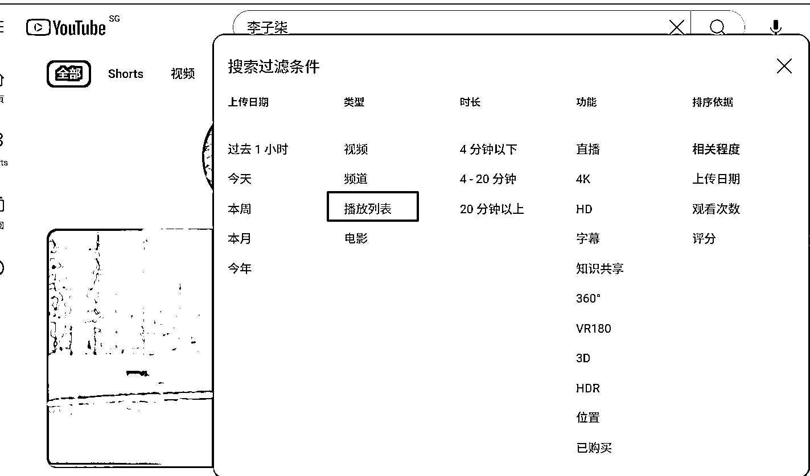
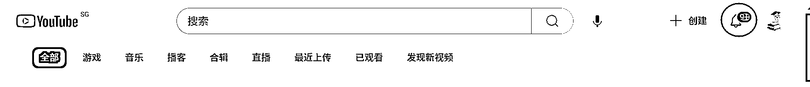
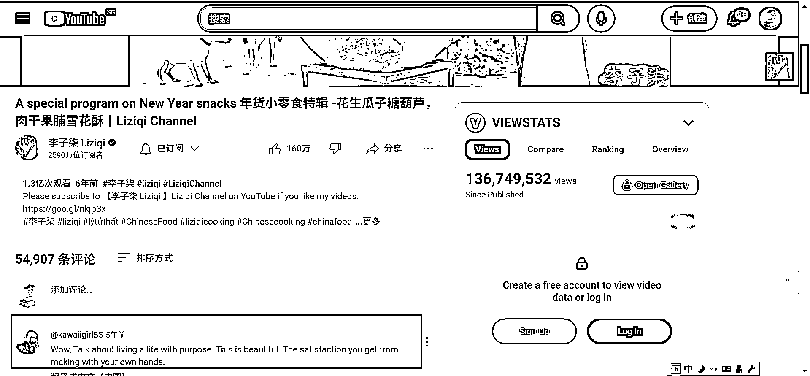
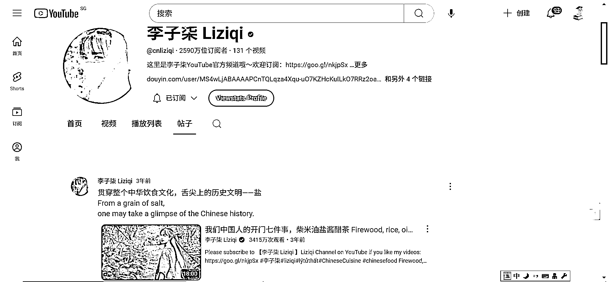

# YouTube 频道持续曝光的分类打法与实操清单
作者：龙哥

想让频道真正活起来，光靠按时更新远远不够。需要分层思考：先把基础搭建扎实，再主动出击获取人群，最后用投放做放大。整体思路可归为三类：

1. 等待型获客
2. 主动型获客
3. 付费型放大

下面按顺序展开。

## 一、等待型获客：打好地基，让分发机制替你工作

等待不等同于躺平，而是把前期准备做好后，让检索与推荐帮你送达。

### 1. 用检索思维来定选题

做选题要围绕用户会检索的表达来布局，尤其是长尾需求与当下热点。依托这些词去生产内容，会提升被检索到的概率。

YouTube 每分钟都有海量上传，若无排序机制，用户几乎找不到想要的内容。

平台的检索排序主要看三点：

- 相关程度
- 互动反馈
- 内容水准

相关程度会看标题、标签、简介以及视频本身与查询词的契合度。互动反馈会参考观看时长等行为信号，比如在某次搜索里用户愿意把时间花在一个片段上，就说明该片段更符合需求。内容水准则会判断账号在特定领域是否具备专业度、权威度与可信度。

官方明确说明不会接受付费换取自然检索排名，也不会对自家内容给予特殊照顾。

此外，检索结果还会结合个人历史记录、观看偏好与兴趣倾向。所以同样一个关键词，不同人看到的排序也会不同。

例如长期看体育的人检索“板球”时，更容易被推送板球运动相关内容，而不是关于蟋蟀的自然科普。

[官方文档链接](https://www.youtube.com/howyoutubeworks/product-features/search/)

### 2. 把频道当成线上门店来装潢

用户通过检索或推荐进入视频后，很多会点进主页了解创作者是谁。

主页、作品列表、合集、社群、关于页等模块都要填满信息。作品不少却主页空空的账号，很难建立信任感。

建议自检清单：

- 关于页是否讲清定位
- 关键词是否设置合理
- 主页是否有清晰的视觉主线
- 合集是否按主题归类
- 新访客能否在十秒内明白你做什么
- 页面风格是否统一专业

若有自有产品，可在首页放一段预告片，作为自我介绍与产品入口。若无产品，就放播放量高且具代表性的作品，帮助陌生用户快速认识你。

### 3. 元信息要同时服务算法与人

封面、标题、简介、标签共同决定点击与理解。

即使平台把视频推给了用户，封面不吸睛也会直接被划走，曝光就浪费了。平台需要通过元信息理解内容，人也需要通过这些信息决定是否点击。

封面负责吸引注意，标题负责传递信息，内容负责留住人，三者是递进关系。

过去靠夸张封面和标题博取点击的做法，随着平台提高完播与观看时长权重而失效。封面和标题都需要做 A/B 测试，看是视觉变化还是文案变化带来的提升更大。

标题本身也是检索入口。用户带着明确需求搜索时，标题既要吸引点击，也要符合搜索习惯。

新视频发布后的头 48 小时是试水的黄金期，平台更愿意给新内容机会，观众也更偏向看新鲜事物。需要调整封面或标题，最好在前期完成。新闻、时政、强时效内容尤其如此。

视频清晰度不必追求 4K，1080P 对大多数场景已足够。

真正关键的指标是完播表现，尤其是开头的 30 秒。把核心信息、亮点或冲突前置，能更快抓住好奇心。

画面长时间单一容易让人疲劳，适当切换镜头节奏能保持注意力。MrBeast 的剪辑节奏就是典型代表，画面切换快于疲劳感出现。

### 4. 推荐机制服务观众而非创作者

常见误区是把推荐算法当成给创作者服务的工具。实际上算法更关心观众的兴趣与行为轨迹。它是根据用户偏好，从新旧视频里挑选内容，而不是从创作者角度推送。

所以思考重点应该是：用户为何点、能否看下去、会不会继续看其它内容、需求是否被满足。

上传时需要填写的信息很多，但重要性不同。

说明文字并非核心决定因素，但有时间建议认真写，能帮助平台进一步理解主题。借助 ChatGPT 等工具，把字幕整理成摘要再填入说明，成本很低。

标签的作用被过度放大了。新账号可以用少量精准标签帮助平台理解定位，账号成型后影响很小。不要堆砌无关标签。

分类选择随意即可，对推荐权重很低。

文件名不会影响推荐，无论是英文、数字还是下划线，系统基本不读取。

发布时间固定主要是为了培养老观众的观看习惯，不会自动带来更多推荐。做好就发，不要纠结具体点。

归根结底，选题、封面、标题、开头几十秒才是投入回报最高的环节。分类、标签、文件名影响有限。

### 5. 做精品比堆数量更有效

MrBeast 的思路可以借鉴：

1. 用指数级的思维扩大格局
2. 追求质量而非数量
3. 用团队处理 80% 的重复工作，自己聚焦关键 20%

一个百万播放的精品，带来的效果往往超过几十条低播放的平庸内容。

把可外包的工作交给剪辑师等专业人员，自己留出时间做选题、创意和策略，是更合理的分工。

## 二、主动型获客：自己去找观众

主动推广分为站内与站外两条线。

### 站内主动方法

**1. 在片中引导分享**
自然地提醒观众把内容转发到其它平台或群组，分享会带来新的回流入口，部分用户会通过链接回到 YouTube 观看并订阅。

**2. 与同类频道互推**
找到受众重叠的创作者进行直播连麦或内容互换。在简介区放置对方链接并口头介绍，同时让对方也为你引流。频道设置里也可以把合作对象加入精选频道。

**3. 用合集搭便车**
合集本身也可能出现在搜索结果中。

操作思路：

1. 选定一个明确主题或关键词
2. 把该主题下头部创作者的视频加入合集
3. 在后面位置放自己的同主题视频
4. 等待用户连播触达

前提是你的内容与前面视频同主题，否则用户没有继续观看的动机。

当用户先看头部再看你的视频，平台会逐步建立内容关联，后续在相关推荐里更容易出现你的作品。

**4. 在头部频道下做高质量留言**
去大频道评论区曝光，关键是提供价值而非硬广。

做法：订阅目标频道并打开提醒。

收到新视频通知后第一时间观看并留言，越早评论越容易出现在前排。提供补充信息、总结要点、有洞察的观点，能提高被点赞或置顶的几率。

不要直接说“来看我的频道”“我也做了类似的”，这种目的性太强容易被删除或拉黑。

这种方式有效的原因：受众精准、导流更自然、有机会与头部建立内容关联，未来被推荐给相似用户。

示例，某些头部视频播放量过亿，第一时间留言则曝光概率极高。

**5. 直播评论引流**
直播的实时互动更强。持续输出有料的评论容易引起注意，其他观众会点开你的主页查看，发现内容匹配就可能订阅。

**6. 写社群贴**
社群内容会出现在用户首页。发布有讨论价值的话题并引发互动，能带来频道入口。投票形式上手快，主题有趣易传播。

### 站外主动方法

外部推广就是把 YouTube 之外的流量导进来。

**1. 分发链接到社媒与社群**
把视频或频道链接分享给身边的朋友，发布到社交平台、社群和内容社区。但要精准投放，只有出现在对主题感兴趣的人面前，转化率才高。

## 三、付费型放大

付费是放大器，不是替代品。基础内容和被动、主动策略跑通后再考虑投放，才能把付费流量转化为长期订阅。

把基础建设好、主动触达做起来，再用付费加速，频道成长会更稳。

把你的频道地址、视频链接直接告诉观众，就是最基础也最有效的起步动作。

可以大声说出来，也可以在各个社群里分发。🛰️群、Telegram 群、Facebook 群组、Twitter、个人博客、各种 App 社媒账号，都是可以投放信息的地方。内容形式不限，你可以丢链接、放封面图、甚至只给一个搜索关键词。只要用户能顺着你给的线索在 YouTube 上精准定位到你的频道，并点进来看、点订阅，这就属于典型的外部导流，而且效果很实。

除了社群分发，另一个被低估的操作是把视频嵌入到网站里。无论是自己搭建的官网，还是在别人的站点里争取一个展示位，把 YouTube 视频以播放框的形式嵌进去，都能让流量无缝过渡到平台。

主动型和被动型推广的本质区别在于谁先迈出脚步。

被动型是等别人来找你，主动型则是自己去找别人。主动出击虽然更费精力，但转化普遍更高。特别是从 YouTube 之外把人带进来这种打法，平台本身也会给你额外照顾。原因很简单，你从 Facebook、🛰️、🧣这些外部渠道帮 YouTube 拉来了用户，平台自然乐于回馈给你一部分推荐流量。

从付费这条线来看，付费推广更直接粗暴，效果通常会好过完全免费的方法，不过具体好多少，最终还是要看执行细节。

付费推广大致能分成两类。

第一类是非 Google Ads 的付费引流。

YouTube 喜欢外部导流，但如果你没有足够的人脉资源，仅靠自己在博客或🛰️上发消息很难撬动大号做免费宣传。这时付费就有了意义，它和主动型的外部引流逻辑一样，只是把免费换成了付费。

具体做法有几种：一是花钱让头部社交账号发帖帮你带量，也可以在一些垂直网站投放广告位；二是直接在 YouTube 内部找大频道合作付费。各大频道都有自己的频道页，可以设置推荐频道，很多人就是靠这个变现。你可以联系对方谈价格，把自己的频道加进对方的推荐位里。如果预算允许，也可以让对方在社区区发一条宣传帖，价格私下谈。

另外一种常见的合作是付费采访。频道主在采访你的过程中，会顺带提及你的频道、品牌和产品，曝光是自然带出来的。

第二类是 Google Ads。

说到付费，很多人脑子里第一反应就是谷歌广告，所以把它放在最后。是想提醒大家，别把付费推广等同于只投 Google Ads，选项其实很多。

谷歌广告上手门槛低，任何创作者都能自己开户，为单条视频或整个频道买曝光。想小打小闹体验一下，投几十几百块自己玩玩是可以的。但如果目标是认真做频道增长，就一定要找懂行的人操盘。广告后台的坑很多，不了解定向、排期、出价逻辑，很容易花光预算还得出“谷歌没用”的错误结论。

用对了，谷歌广告非常有效，所以有资源就别自己硬上。

不管是靠等、靠冲，还是靠花钱，这三种推广方式再好，也只是后面的 0。内容本身才是前面的 1。如果作品质量还没稳定下来，谈推广就是本末倒置。

怎么判断作品是否合格？一个最直观的标尺是观看完成度。如果大部分视频的完播率长期徘徊在 20% 到 30%，那就先别浪费精力去做引流，更不要去烧付费广告，否则等于把钱和时间扔水里。

以上内容只是整体框架，还有很多细分打法没展开，篇幅也确实不小，先写到这里，后续会继续补充。抛砖引玉，如果你有自己验证过的方法，也欢迎交流互动，也希望这篇内容能给你一点实用的启发。