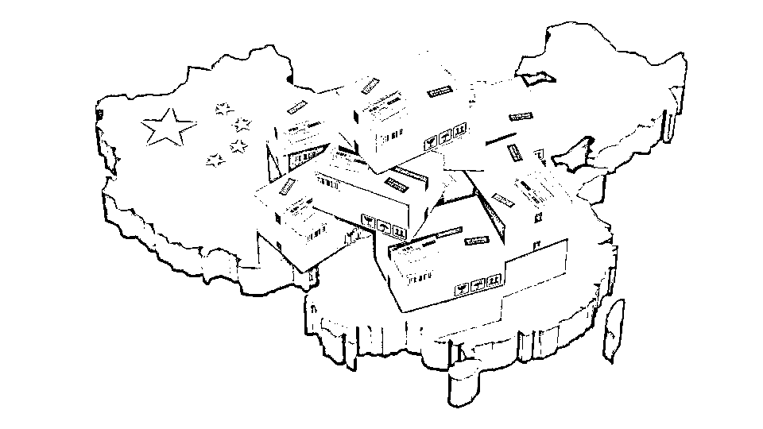
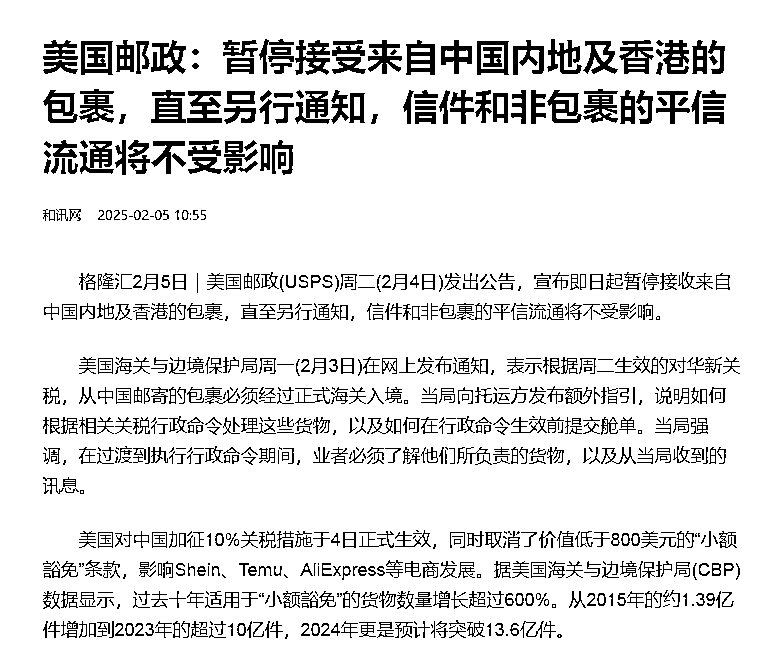
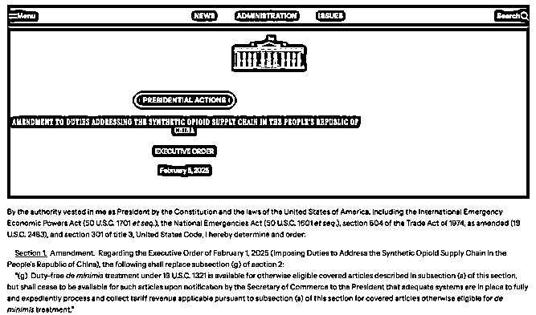
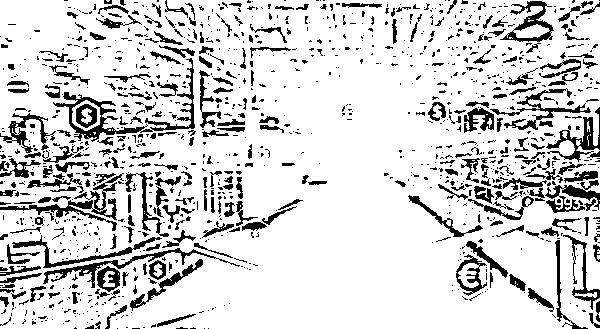
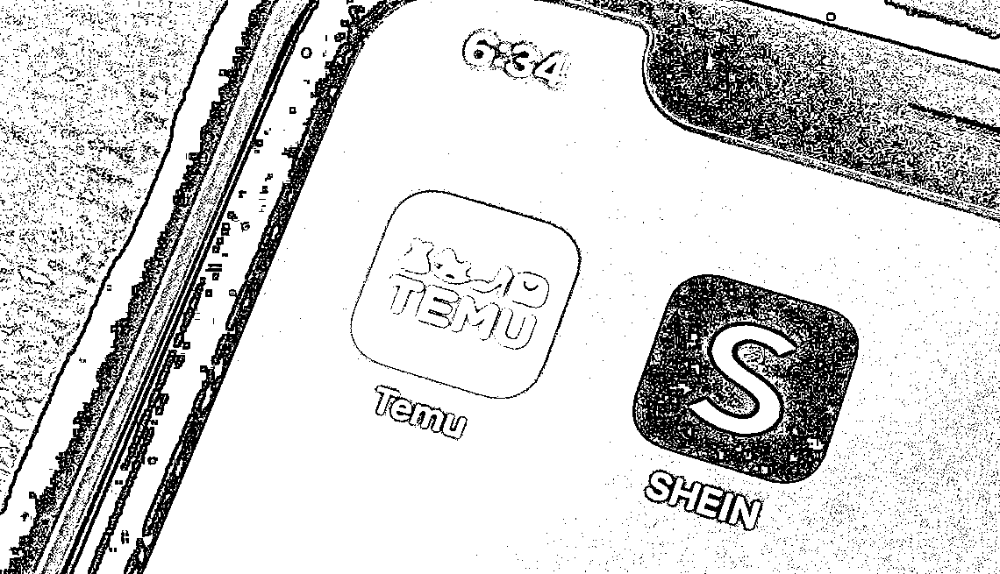

# T86 一旦退出历史舞台，跨境卖家要扛住哪些冲击？

## 如果 T86 真的取消，跨境电商将面临什么样的挑战？

作者： 国民弟弟的跨境十年

日期：2025-02-24

近期美国是否废除 T86 的声音越来越大，各种解读层出不穷。作为深耕一线十年的跨境从业者，我发现不少专家的分析脱离实操。今天就用卖家的视角，聊聊 T86 真的被砍掉后，行业会发生怎样的剧变。

### 为什么 T86 的去留如此关键

简单说，T86 就是美国对 800 美元以下小额包裹免征关税的机制。大量依赖低价小件的商家，正是靠这条通道把成本打下来。如果豁免被取消，靠小包走量的模式将直接被釜底抽薪。

**近期政策波动：**

*   **2025 年 2 月 4 日深夜，美国邮政 USPS 突然宣布，全面停止接收来自中国内地和香港的入境包裹。**

也可以看看以往的文章~[`articles.zsxq.com/id_rw26ved5l8w1.html`](https://articles.zsxq.com/id_rw26ved5l8w1.html)

*   **不足一天次日便恢复。**

**暂停背后是什么逻辑？** 根源在美国海关的承压。根据美国海关与边境保护局的数据，如今每日涌入美国的低价货物已超 400 万件，远超 2022 年日均 190 万件的水平。T86 一停，这些包裹就必须转入更繁琐的 T1 通道报关。用个通俗的比喻，就好比原本排队快速通关的旅客，瞬间被要求全部摘鞋脱衣人工检查；对海关而言，这无异于系统性 overload。

直接的后果就是包裹大面积积压。仅纽约肯尼迪国际机场在 T86 暂停的 48 小时内，就有超过 100 万件包裹滞留，仓库爆满。USPS 也一度彻底拒收中国和香港邮件，后虽恢复，但混乱程度出乎所有人意料。

眼下特朗普的这一波暂停，确实为行业争取到一丝喘息。但从媒体报道中频频出现的 “delay”“pause” 就能看出，关税豁免只是被拖延，并非被放弃。这场博弈远未落幕。

### T86 真被取消，行业会迎来哪些连锁反应

#### 1. 清关路径和成本的重构

失去 T86 后，卖家的通关成本将显著抬升。现在 T86 几乎等同于免报关，而切换到 T11 简易模式或 T01 一般贸易模式，报关费、税费都会实打实增加。

举例说明：产品到岸价 2 美元，若按 40% 税率计算，T86 下基本零税负；换到 T11，清关手续费就要多 2.6 美元，税费另计，综合成本瞬间上涨约 70%。对于走量小包的商家，这几乎是致命打击。

#### 2. 小卖家的生存困境

不少人会想用转口来续命，即先把货发到东南亚等第三方监管仓，再二次发往美国，试图继续享受豁免。但这条路风险很大。

一来，如果美国全面取消豁免，转口通道就形同虚设。二来，一旦美方对货物原产地进行严格核查，转口的合规风险和被查概率都会急剧上升。显然这只是权宜之计，不可能长做。

#### 3. 平台与头部大卖的压力

像 TEMU、SHEIN 这类全托管型平台，根本不具备大规模转口的可操作性。体量太大、SKU 太多，靠换仓绕路不现实。

SHEIN 受冲击会更直观，因其主打快时尚，品类税率普遍偏高。即便清关流程被优化，税负上行带来的成本压力也很难消化。

TEMU 相对分散，品类覆盖广，运营弹性略好一些，也会受影响。总体来看，长期成本曲线对所有头部平台都是向上走的。

### 卖家现在可以怎么准备

**1.多平台多区域分散风险：** 不要把鸡蛋放在一个篮子里。铺开多个平台、多个站点，即便某个国家政策收紧，也能靠其他市场对冲收入波动。

*可以参考以往的文章~[`articles.zsxq.com/id_u3ozgmvvvps6.html`](https://articles.zsxq.com/id_u3ozgmvvvps6.html)

**2.强化供应链与产品力：** 政策会变，但供应链效率和研发能力是最硬的护城河。成本上来了，只有更强的供应链才能保住价格竞争力。

**3.做好现金流与财务缓冲：** 政策切换期最怕断现金。提前储备资金，应对突发涨价、滞留和运营波动，才能撑过阵痛期。

**4.动态调整定价策略：** T86 取消意味着多数商品成本抬升，定价必须跟着动。涨价要克制，避免流失用户；降价要审慎，避免利润被吃空。

### 最后说一句

T86 的退出必然会重塑跨境电商的格局，尤其是依赖低价小包的长尾卖家会首当其冲。挑战虽大，但只要保持布局多元、供应链扎实、资金健康，就能把冲击降到最低。

政策不可控，但我们的反应速度可以控。敏感捕捉风向，及时迭代打法，才是在全球化竞争中活下来的关键。

跨境之路永远是风险与机会并存，能顺势调整的人，才能稳步前行。

以上！

**国民弟弟相关创业的故事文章推荐：**

**跨境电商认知分享，个人创业者从 0 到 1000w+**

[`articles.zsxq.com/id_8n2o7gax71fr.html`](https://articles.zsxq.com/id_8n2o7gax71fr.html)

**3 分钟搞定美国公司，150 美金，超简单**

[`articles.zsxq.com/id_exggkcb30j69.html`](https://articles.zsxq.com/id_exggkcb30j69.html)

**3 分钟，如何远程开美国实体银行,送 2340 入金奖励。**

[`articles.zsxq.com/id_ubk2osmj6wzb.html`](https://articles.zsxq.com/id_ubk2osmj6wzb.html)

**美国收款工具：**

美版支付宝 Venmo:[`articles.zsxq.com/id_x73bbkhkkzau.html`](https://articles.zsxq.com/id_x73bbkhkkzau.html)

* * *

评论区：

暂无评论