# 陪跑带教时，用官方授权看数据比开共享屏幕更高效

> 原文：[`www.yuque.com/for_lazy/zhoubao/ikk77t52avlpkuq8`](https://www.yuque.com/for_lazy/zhoubao/ikk77t52avlpkuq8)

## 教练视角：用 YouTube 官方邀请实现跨账号数据查看

作者： 书情小跟班

日期：2025-02-26

过去带新人，导师想了解对方频道后台表现，普遍做法是让对方开启远程桌面或屏幕共享，一起盯数据。费时费力。实际上 YouTube 已提供官方授权通道，通过频道层级的受邀访问，就能把对方的数据视图接入自己的工作室。下面是具体走法。

飞书文档

关于做陪跑更好了解学员的情况的一个好方法 [`rlwxa0zgke.feishu.cn/docx/G5sydTm3GoeiVaxc0UWcAL9Tn3a`](https://rlwxa0zgke.feishu.cn/docx/G5sydTm3GoeiVaxc0UWcAL9Tn3a)

**1、先进入频道管理中心，打开【设置】**

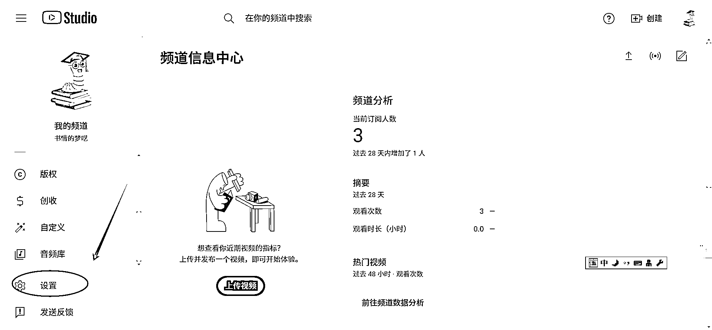

2、在设置内找到【权限】，进入后点【邀请】

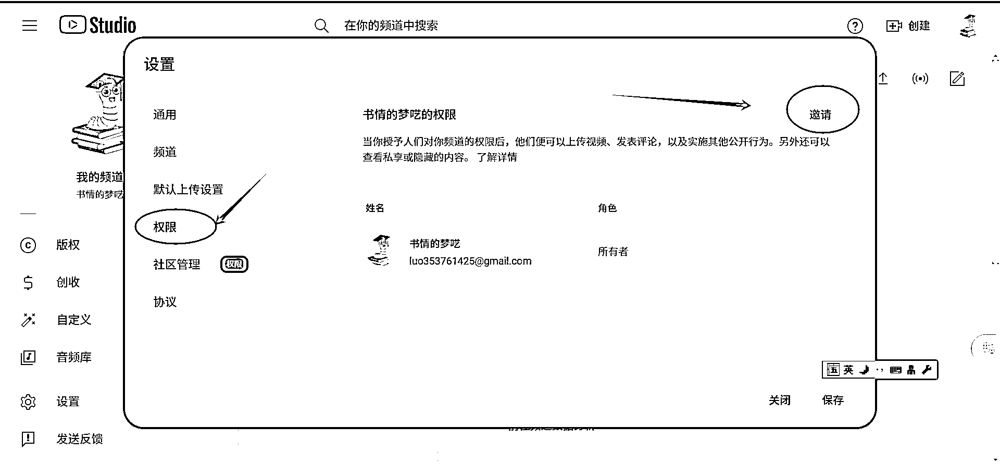

3、填写受邀人邮箱地址

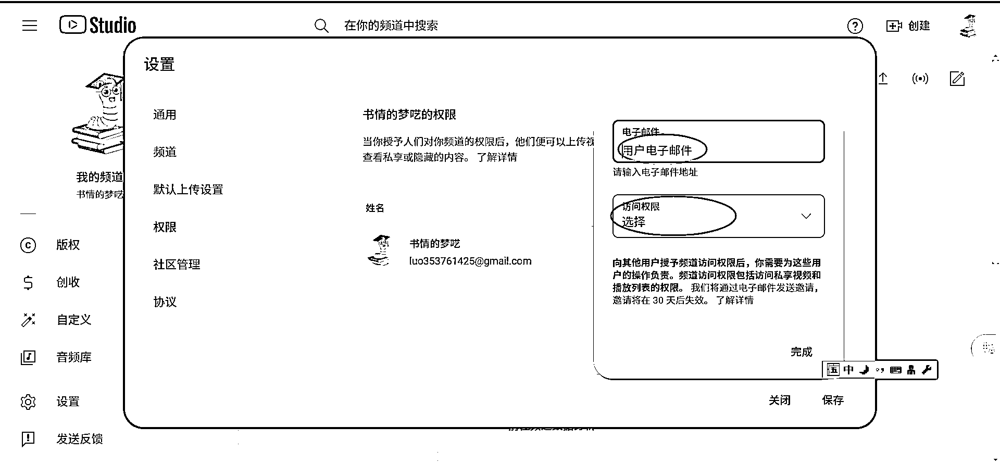

关键在于角色等级的选择，页面会展示多档访问级别

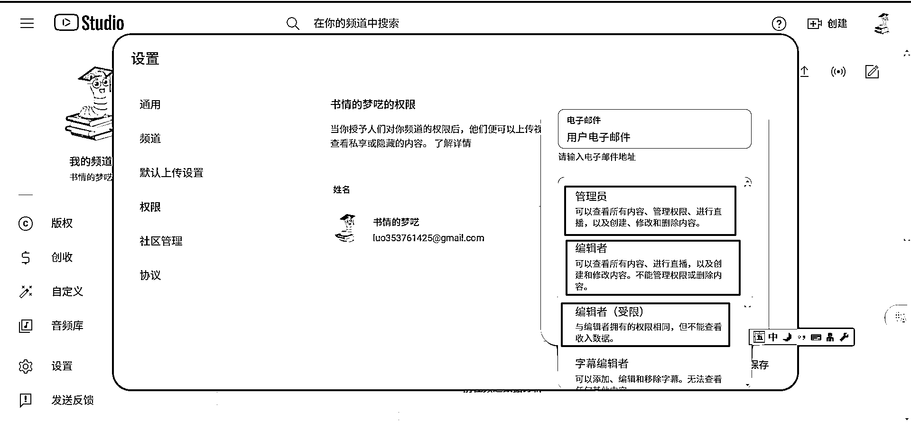

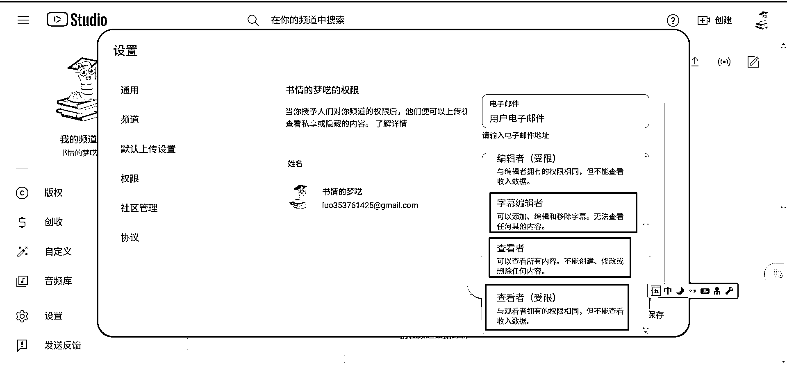

## 各类角色的可操作范围

角色支持不支持所有者可在所有平台上执行所有操作，包括：删除频道管理直播和实时聊天管理权限可以关联 Google Ads

账号无法将所有权转让给其他用户管理员可以查看频道的所有数据可以管理权限（在 YouTube

工作室中）可以修改频道详情可以管理直播可以创建、上传、发布和删除内容（包括草稿）可以在直播控制室中聊天或管理聊天可以创建帖子可以评论可以关联 Google

Ads

账号无法删除频道编辑者可以查看频道的所有数据可以编辑所有内容可以上传和发布内容可以管理直播可以删除草稿可以在直播控制室中聊天或管理聊天可以创建帖子可以评论可以关联

Google Ads

账号无法删除频道或已发布的内容无法管理权限无法签订合同无法删除预定的直播/正在进行的直播/已结束的直播无法删除或重置直播码编辑者（受限）与编辑者拥有的权限相同与编辑者受到的限制相同无法访问收入数据（包括聊天收入和观看者活动标签页）字幕编辑者可以为符合条件的视频添加、编辑、发布和删除字幕与编辑者受到的限制相同无法修改任何内容（视频字幕除外）无法访问收入数据（包括聊天收入和观看者活动标签页）无法上传和发布内容（视频字幕除外）无法管理直播无法删除草稿无法在直播控制室中聊天或管理聊天无法管理直播无法删除预定的直播/正在进行的直播/已结束的直播无法在直播控制室中聊天或管理聊天无法查看所有频道数据查看者可以查看（但不能修改）所有频道详情可以创建和修改 [YouTube

数据分析组](https://support.google.com/youtube/answer/3529123)可以查看收入数据（包括聊天收入和观看者活动标签页）可以在预备直播或直播期间查看/监管已创建的直播可以查看除直播码以外的所有直播设置无法管理直播无法删除预定/正在进行的直播/已结束的直播无法在直播控制室中聊天或管理聊天查看者（受限）与查看者拥有的权限相同与查看者受到的限制相同无法访问收入数据（包括聊天收入和观看者活动标签页）

在日常诊断中，给到“查看者”层级通常已足够。该层级可看到收益明细，足以支撑运营建议。

一个容易忽略的操作细节：填完信息后务必点【保存】，否则邀请邮件不会发出。

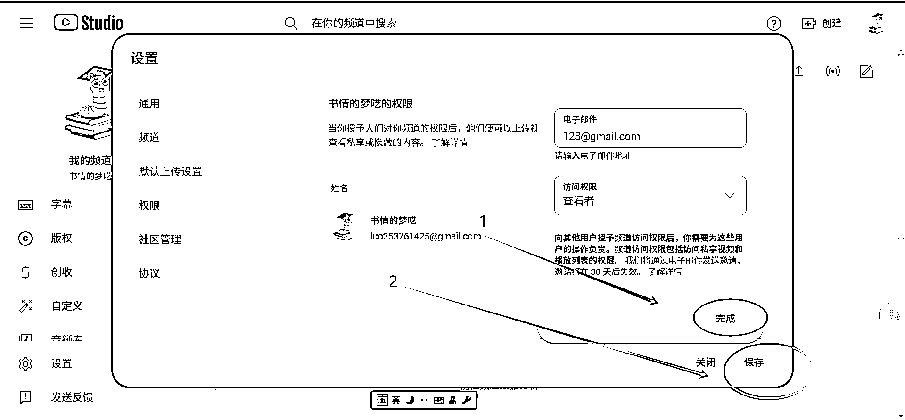

被邀请方需在 Gmail 收到通知，点击【接受】后页面会自动跳转。

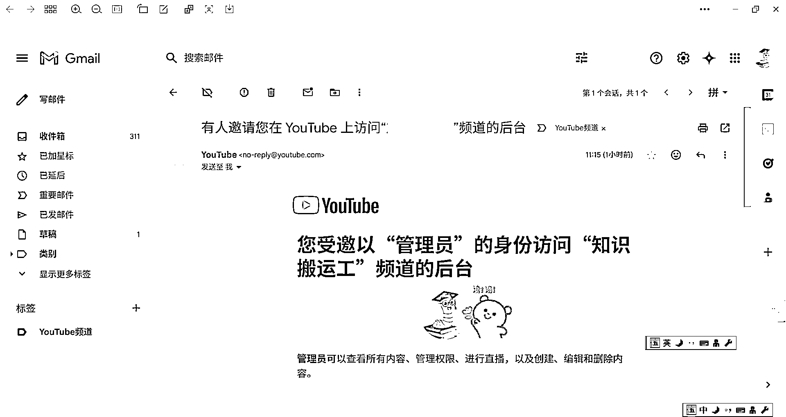

跳转完成后如图所示，授权即生效。此时通过频道切换即可进入被邀请方的后台视图。

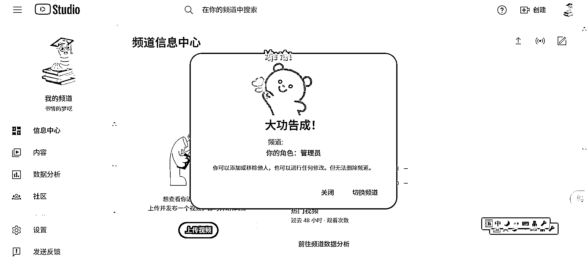

若带教对象较多，建议用浏览器标签页区分，每个对象一个标签，统一入口集中管理。

补充之前未讲透的内容：频道买卖相关信息

卖频道的网站 [`flippa.com/buy/media-communities/youtube`](https://flippa.com/buy/media-communities/youtube)

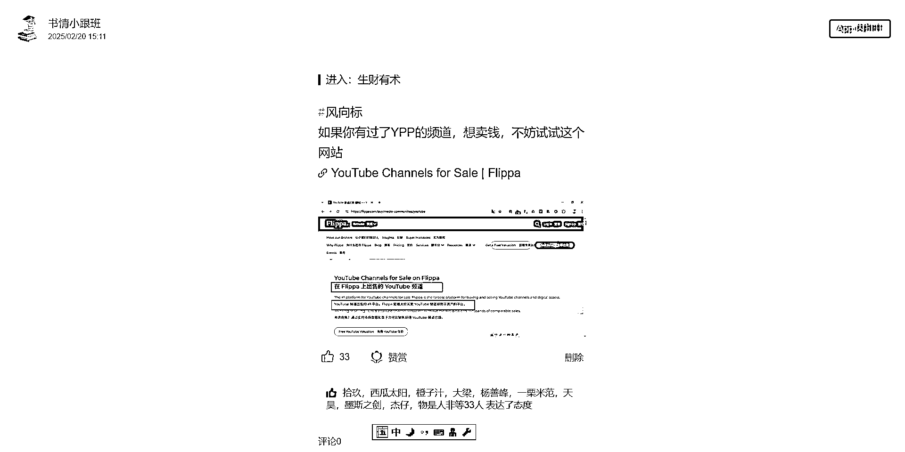

一旦聊到买卖，就绕不开品牌账号。品牌账号的设置界面与普通频道存在差异

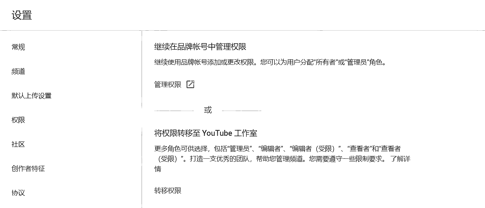

先说品牌账号是什么。可理解为商业化频道。官方表述：**品牌账号是为您的企业或品牌设置的 Google 账号，可用于某些 Google 服务**

需要厘清的核心概念：**个人账号不支持转移，具备流通属性的是品牌账号**

个人账号对应 YouTube 工作室，真正能进行交易的载体是品牌账号

展开说明如下

## 权限边界：普通频道权限与品牌账号机制

#### 频道权限范围

所有者无限制。可以执行删除频道以及管理直播和实时聊天等操作无法将所有权转让给其他用户管理员无法删除频道，但可以删除处于草稿状态的视频编辑者无法删除预定/正在进行/已结束的直播编辑者（受限）与编辑者拥有的权限相同，但无法访问收入数据（包括聊天收入和观看者活动标签页）查看者无法使用直播码无法修改直播设置/元数据无法开始直播或结束直播无法删除预定/正在进行/已结束的直播无法在直播控制室中聊天或管理聊天查看者（受限）与查看者拥有的权限相同，但无法访问收入数据（包括聊天收入和观看者活动标签页）

#### 品牌账号范围

主要所有者无限制所有者无限制管理员无法加入或退出

MCN 无法邀请其他用户无法转移频道，或者接受他人转移的频道（除非由主要所有者转移）无法删除频道无法进行购买交流管理员无法在 YouTube 上执行任何操作

上述内容分为两条线：

一、普通频道权限的边界

二、品牌账号的边界

关于普通频道权限的边界

所有者：无限制。可以执行删除频道以及管理直播和实时聊天等操作**无法将所有权转让给其他用户**

加粗处即为个人账号无法买卖的根源

关于品牌账号的边界

频道归属由主要所有者决定，主要所有者拥有最高决定权

操作路径如下，回到设置页

点击红框标注的位置，会进入新的管理页面

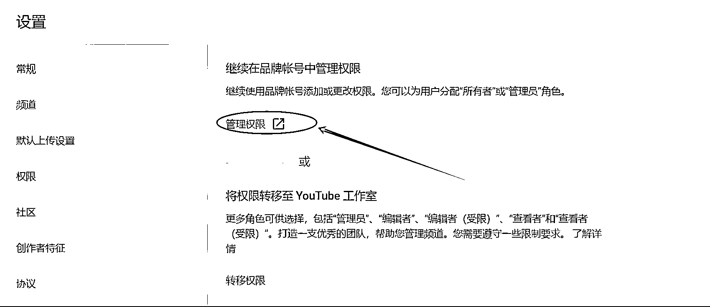

进入后点【邀请】，注意此处的邀请入口与前面频道权限的邀请并非同一功能

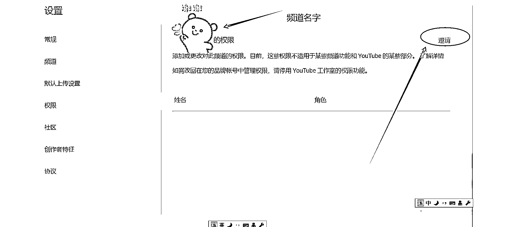

点击后会打开新页面，如下图

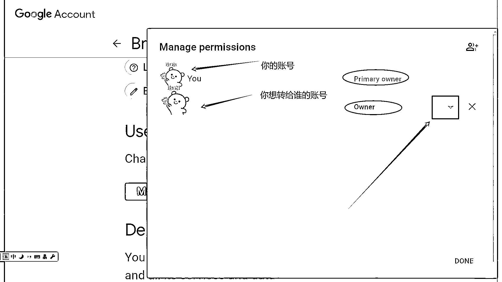

留意红色箭头所指的下拉菜单，展开后选择 Primary owner

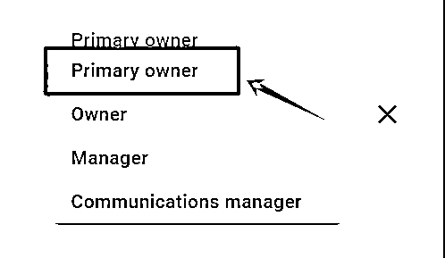

将对方设定为 Primary owner 后，自己原有的主要所有者身份可移除。移除后频道归属即转移至对方名下。

以上内容仅供参考，如有偏差欢迎交流

官方文档

[通过频道权限添加或移除对您的 YouTube

频道的访问权限](https://support.google.com/youtube/answer/9481328)

[从品牌账号用户访问权限改为使用频道权限](https://support.google.com/youtube/answer/9367690#channelpermissions)

* * *

评论区：

暂无评论