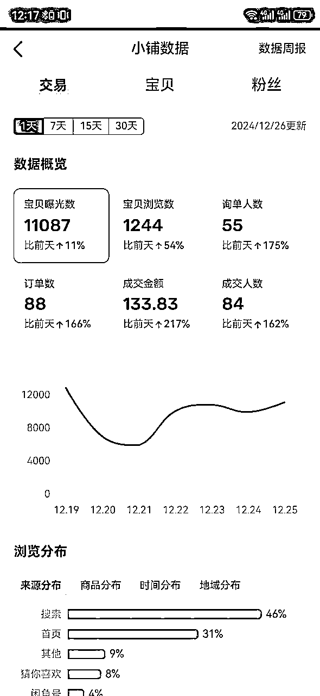
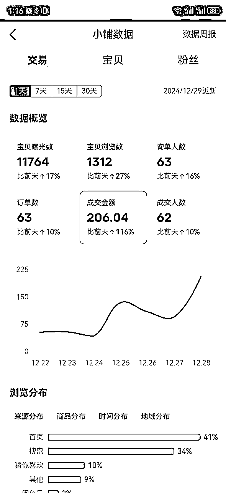
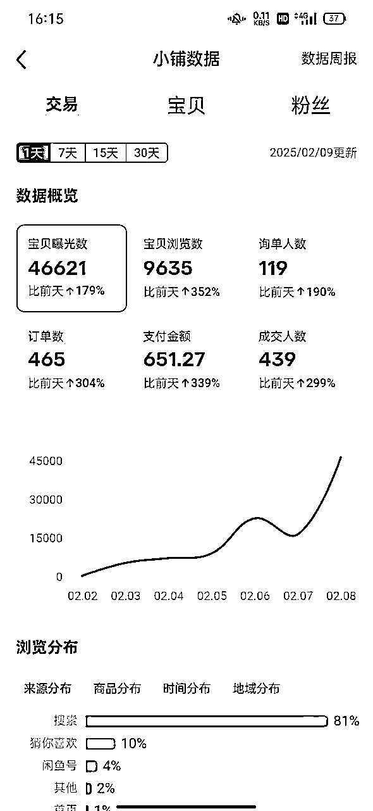
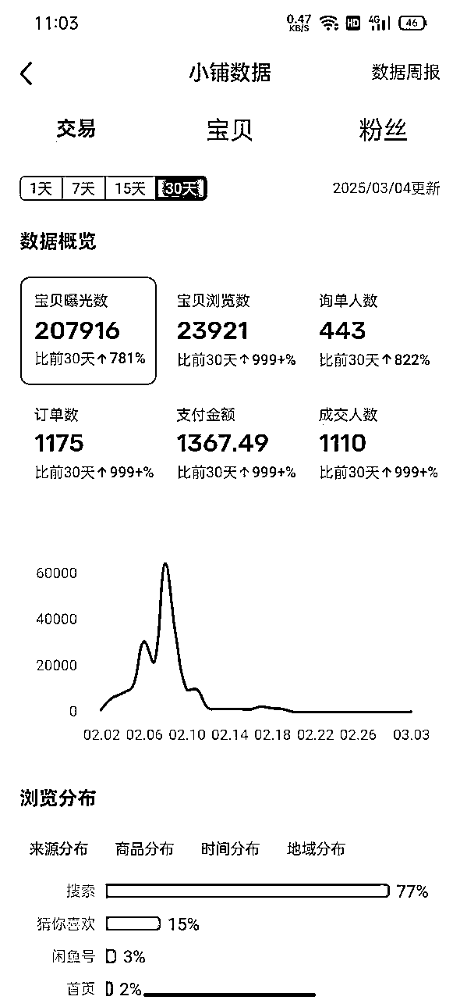

# 一趟航海，让我把门票钱翻了倍赚回来

> 别急着划走，这是一个普通上班族的真实经历。

先介绍一下自己：80后，来自一座不起眼的四线城市，白天是普通打工人。2023年误打误撞进了龙哥盟，到现在已经待了三年。说实话，以前我很少冒泡，跟大多数圈友一样默默潜水。但这三年，我不光眼界打开了，还真金白银赚到了钱。

很多人来赚钱，图的就是赚钱和认知提升，我也不例外。去年12月那次航海，我选的是闲鱼虚拟资源，结果不到俩月，门票成本就回来了。今天不藏私，把我的实操过程完整扒给你。

先上结果：

（截图在这：第一个号销售额1500多，第二个号也做到了1300多，合计将近3000块）

这笔钱不算多，但对我来说意义重大——从0到1，我赚到了互联网上的第一块钱。

下面我把每一步都拆开讲，希望对你有启发。

## 第一步：先养号，别急着赚钱

新号前10到15天，基本就是养号期。这段时间别想太多，每天保持活跃：

- 坚持上架宝贝，哪怕没销量也别停；
- 多逛多互动，攒活跃度，等系统给你开通闲鱼店铺。

一旦店铺开通，就能传500个商品，还能设置库存，不用卖一件重新上架一次，甚至能绑定自动发货，效率直接起飞。

## 第二步：让AI帮你批量上架

一个人手动传几百个商品？累死也干不完。我的办法是：交给AI。

开通店铺后，我用AI批量生成商品标题和描述，省下大把时间。

提示词大概是这样的：

> 我给你一个商品介绍，请帮我写商品标题和描述。
> 要求：描述不超过300字，分4段（商品亮点、适合人群、购买须知、相关话题）；标题不超过30个字，包含热搜关键词。

举个例子，商品是“清华大学DeepSeek使用教程”，AI就给我生成：

- 标题：DeepSeek本地部署安装教程 | 小白进阶指南
- 描述：
  - 亮点：DeepSeek的NLP能力很强，本地部署不受网络限制，数据也更安全；
  - 适合：NLP研究者、深度学习爱好者、高校师生；
  - 须知：虚拟资源无实体，需要一定计算机基础；
  - 话题：#DeepSeek #本地部署 #NLP技术

那阵子DeepSeek正火，我靠这类教程一天最高进账600块，完全没想到。当然有运气成分，但AI确实把效率拉满了。

至于主图，先参考同行、适当改动，再搭配网盘截图，凑3到5张就够。等商品跑出流量后，再自己动手做专属主图。

## 第三步：选品不能光靠感觉

我的选品思路其实很朴素：运气打底 + AI辅助分析。

好卖的爆款商品，基本逃不过这6个特点：

1. 目标人群明确
2. 内容信息量大，能满足需求
3. 买回去就能用，实用性强
4. 比市场同类更便宜或更值
5. 主图有视觉冲击力，让人想点
6. 标题带热搜关键词，容易被搜到

我第一个号的主要收入来自B站课程合集，这类资源需求大、价格又不贵，自然卖得动。

一个选品小技巧：先用AI拆解一个已知爆款的特征，然后按这些特征去“以爆找爆”，顺藤摸瓜找同类产品。

再送你个福利：大部分资源我都是免费搞来的。推荐一个注册就能下载全部内容的资源站：https://www.yunpanziyuan.xyz/

**但千万注意**：闲鱼上有些资源是违规的，比如某些课程。如果你搜不到别人在卖，那大概率就是违规品，千万别碰。

我就因为上架羽毛球课程被人投诉，直接封了号。合规这条红线，碰一次就够你哭的。

## 关于2025年航海，我的选择思路

新一期航海已经开始了，这轮几乎全是AI相关项目。我认真看了介绍，锁定两个：

1. AI网站工具应用开发——长期趋势，可持续做
2. AI赋能IP，搭建个人IP——贴合自己，也有兴趣

但我只打算报第一个，第二个后面自己抽空学。原因很简单：精力有限，谁也不可能同时做好几件事。

判断一个航海值不值得跟，我会看四个条件：

- 有没有长期价值？至少能干3-5年；
- 是不是当下风口？AI就像5年前的短视频；
- 自己有没有兴趣？没热情坚持不下去；
- 能不能赚钱？毕竟最终目标还是搞钱。

我还用AI把各个航海的特征都分析了一遍，结合自身情况，先排除不合适的方向，再挑出几个能做的，最后只留一个最适合的。

## 为什么你总是拿不到结果？

说句扎心的，包括我自己在内，很多人都是一阵子鸡血，一阵子躺平。

三天打鱼两天晒网、执行力跟不上、注意力到处分散——这才是拿不到结果的主因。别急着反驳，想想自己是不是这样。

## 我最近的一些感悟

**关于学技能**

光看几篇文章、几个视频，永远只是知道点皮毛。真正的掌握，必须靠系统学习 + 实战应用。

那句话说得特别好：知道做不到，等于不知道。

**关于做决策**

最近看龙哥大佬的分享，有一句话特别戳我：

> 不可逆的决策要慢，可逆的决策要快。

还说要敢为自己的决策下重注。意思就是，一旦想清楚就别纠结了，全力以赴往前冲。

**关于进步**

对我们普通人而言，每天进步一点点，已经很了不起。别因为今天没动就沮丧，要学会和自己和解。只要不放弃，早晚能拿到结果。

我们总是高估一年的努力，却低估十年的积累。

最近还在看小排老师的精华帖，有句话特别治愈：

> “不是成功让你感觉良好，而是你感觉良好后，成功才会到来。”

心态先调好，我们这次航海见！

加油！