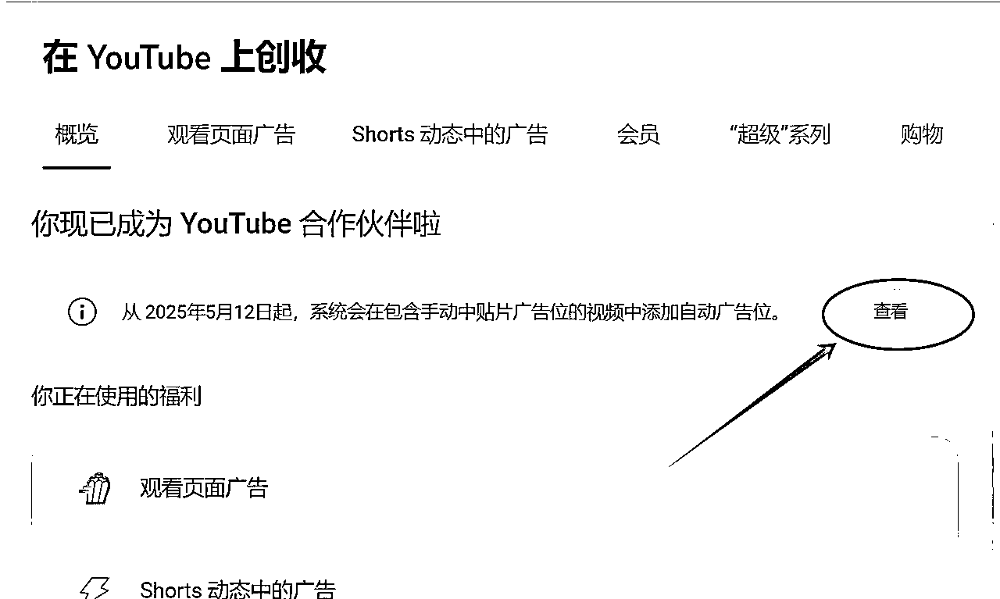
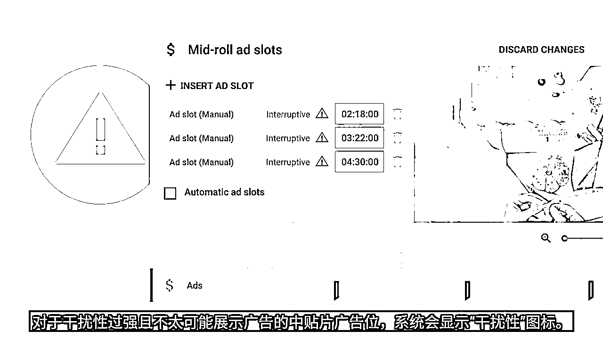
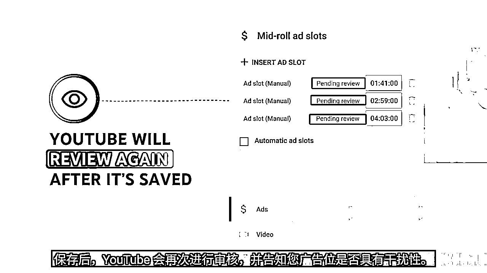
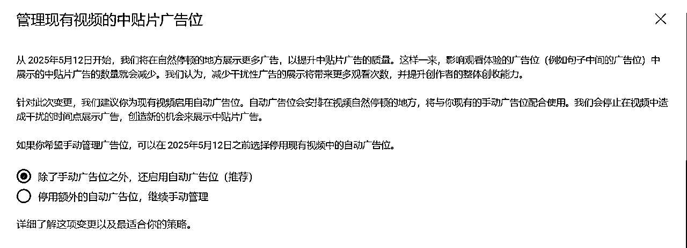
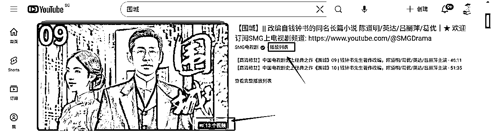
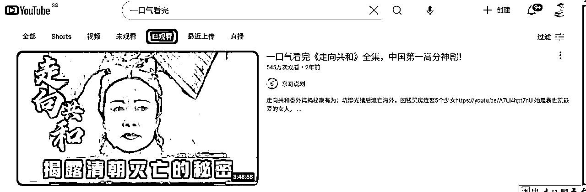

# YouTube大动作上线：长视频中贴片广告自动寻位，创作者收益迎来新变量

前言：紧盯YouTube官方动向很重要，就在昨天我刚捕捉到这条更新提示

官方其实已经放出了专门的管理长视频中贴片广告时机的说明文档

下面是我从文档里梳理出的重点

## 如何在YouTube工作室里掌控中贴片广告的插入时机

目前决定中贴片广告出现位置的思路主要有三种：

*   纯自动投放：开启自动中贴片广告后，系统会自行寻找到视频中最自然的停顿处来投放，观感会更均衡，不会生硬打断。
*   纯手动投放：若你坚持自己指定广告出现点，尽量挑在章节切换、语义完整结束这类自然空档。切忌把广告硬插在一句话中间或动作进行中，否则会严重破坏流畅感。如果你在前期脚本设计时就预留了广告位，再用手动模式来锁定也没问题。
*   手动+自动双轨：这是最灵活的做法。你可以保留自己手动设定的几个点，同时再打开自动中贴片作为补充。若系统检测到你手动设的点会伤及观看体验，它会自动寻找更合适的替代位置。

广告位设定完成后，建议用中贴片广告质量反馈工具复查一遍是否存在干扰项。把有问题的位点挪到转场、总结等自然停顿处，既能顾好体验，也能让收益更稳。

我的建议很直接：直接采用 【在手动广告位基础上再开启自动广告位，官方推荐的做法】，也就是文档里的第三种组合方案

*   手动广告位和自动广告位相结合：您可以使用自动中贴片广告，作为对手动添加的展示位置的补充。如果您手动选择的展示位置会影响视频流畅性，我们将为您找到更合适的展示位置。

手动放置时有个细节要注意，像下图这样一旦出现红色感叹号，就说明这个位置不被平台认可，需要重新调整。

我的解读是，这次YouTube的改动本质上是提升观看体验的一次优化。

在此之前，创作者可以完全自己决定广告插在哪，合理性全靠个人判断。现在一旦系统判定位置不合理，就会直接标出红色感叹号。

以前常见的尴尬场景是：观众正听得起劲，话还没说完就“啪”地中断去看广告，等广告结束连刚才的核心点都忘了。这种割裂感直接拉低完播和满意度。

这次更新后，平台会对广告出现时机进行干预，目的就是让观看过程更连贯。往后做视频时，强力建议按章节化结构来剪辑、留白。

如果你还沿用老习惯只手动插播，那在2025年5月12日之后就很吃亏了。位置不合理，平台就不会在你指定的点位播放广告，这也是官方不建议大家完全依赖手动管理的原因。

再补充一个基础常识：无论是手工还是自动，触发中贴片广告的前提都是视频时长8分钟以上。当然也不能为了凑时长而硬凑，观众一眼就能看穿。更聪明的做法是把同类型内容打包。

举个例子，电视剧解说类，一集解说撑不到8分钟，可以后期汇总成一整部剧的全集解说合集，让观众一口气追完。也可以把同系列视频做成播放列表，比如 【播放列表】 【13个视频】，观众看完一集会自动进入下一集，再配合合集概念，形成“一次看完XXX系列”的沉浸体验。

这种“一次性看完系列”的打包方式，对总观看时长和完播率的拉动非常明显

