# 从零到1000万播放：AI短视频实战复盘，解锁高级YPP与持续高单价收益

各位朋友，我是一名前端开发，圈内ID是cc。去年10月最后一周，我在生财有术看到亦仁标记过的一条内容后，正式接触短视频赛道。这一路换过两次方向，直到春节期间迎来转机：一条700万+播放的作品出现，当时我以为初级YPP已经收入囊中——注意，我说的是“以为”，因为随后发生的事让我连续失眠好几天。

先呈上账号现状：累计播放已破千万，但百万级爆款只有1条，千万级爆款还是0。好在高级YPP已经拿下，截至3月4日，收益合计120美元。2月19日寄出的PIN码，3月5日收到了，虽有小波折，总归顺利走完全程。


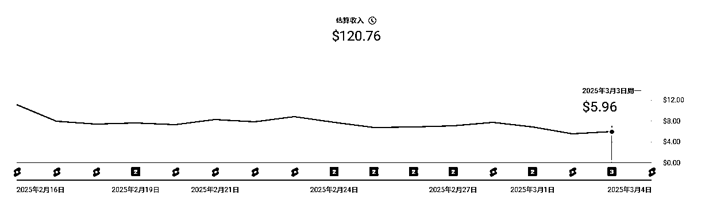

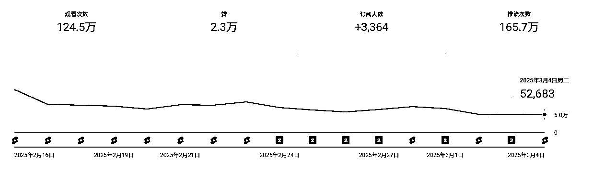

接下来，我把这条从0到1000万的路，按时间线完整拆解。

## 01 冷启动阶段：方向未验证，别急着搞自动化

10月25日，我的第一条作品上线，属于“动物融合”类型。直到12月3日，账号总共也只有10条类似内容。为什么更新频率如此低？因为每一帧都是AI现场生成。跑图、选帧、调细节，一整晚只能磨出一小段，每次做一半就想摔鼠标。撑下去的唯一动力，是12月那场航海活动——我早早就盯上了YouTube这艘船。

那段日子我还有个毛病：天天刷平台上的帖子，看到新工具就走不动路，把大量时间砸进了一套“全自动流水线”的搭建里——抓取视频、逐帧抽图、调API提取关键词生成Prompt、再调API出图……原本还想加一步让图片直接自动合成视频，看了眼成本预算，果断放弃了。

当时脑子里就只有一个词：全自动。可后来我意识到一个关键问题：流程没跑通，项目也没有任何正反馈，还没学会走就想着跑，这不是给自己找借口吗？正确的做法应该是：当已有技术已经无法承接现有项目的发展需求时，才值得投入精力去研究更进阶的工具。

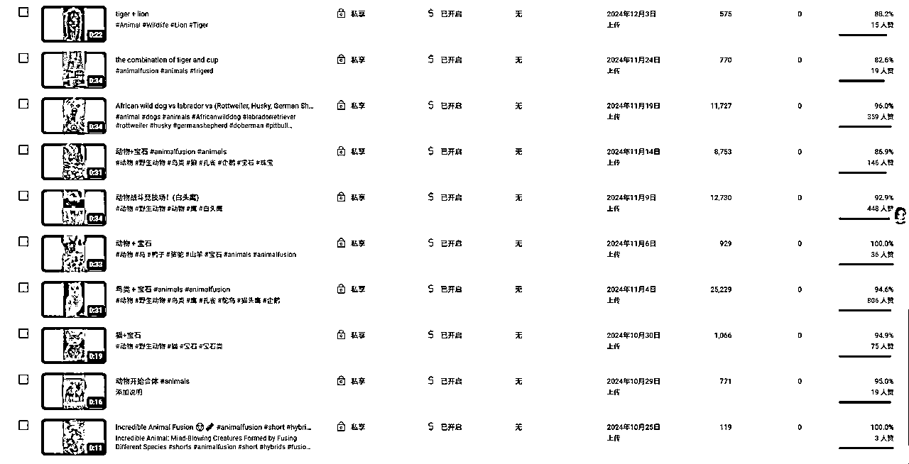

这个认知，我花了整整一个半月才彻底落地。

## 02 转向阶段：一组数据，让我改了方向

航海正式开启后，我决意把动物融合这个方向拿掉。期间试过宝宝走秀、AI转绘，最后被教练的一篇帖子打动——24天3600万播放，这个数字太有说服力了。我当即决定押注“猎奇混搭”内容，并照着帖子里的Prompt逻辑，自己整理出一套模板，再交给ChatGPT补齐细节。用这套模板产的片子，播放基本都在万级，但两个问题始终绕不开：一是很难突破2万，二是印度观众占比实在太高。

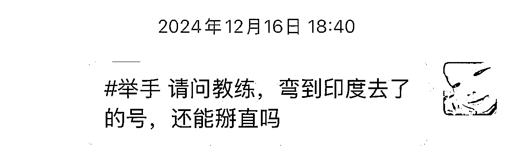

这两个问题让我很焦躁。特别是那会儿刚听完另一位教练的直播，讲的是叙事类账号，当晚我就动了换赛道的念头——那类内容的观众以欧美为主，开通变现功能后单价明显更有优势。可思索片刻，我清楚自己的软肋：搜集素材。我每次搜集素材，翻着翻着就忘了最初目的；看到两个差不多的素材，能纠结半天。找素材这件事，是我创作流程中最耗时的环节，同时也是最让我烦躁的环节。

后来总算想通了：单价高低是开通YPP之后的事，那时距离YPP还有很长的路，不值为之焦虑。而且后来我意识到，想在短期内堆出千万级播放，前期绕不开印度观众的贡献。

于是，我继续留在猎奇混搭赛道，并把更新频率提到了一天两更。航海临近结束时，我刷到一支已经跑到600多万播放的作品——蓝白瓷风格的账号。

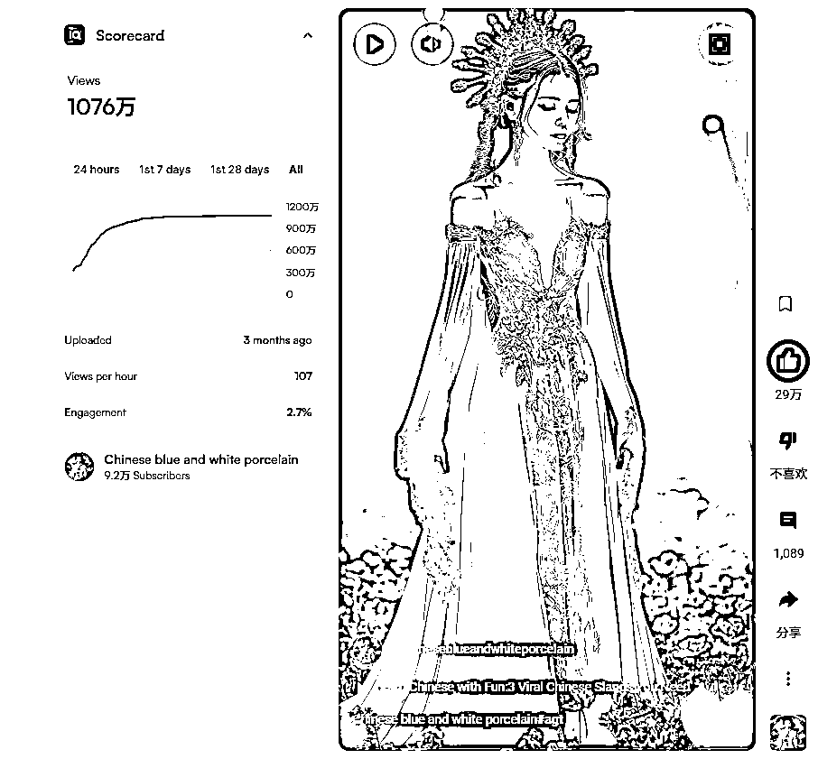

当时我做的是“人+动物”的混搭内容，没打算照搬对方，只是借了一个思路，做了一支自己的版本。一星期后，这支视频跑到30多万播放，算是一种确认：方向对了。

## 03 爬坡阶段：模仿、等待、以及一次报名

12月底到1月中下旬，我的核心目标只有一个：用最短路径接近YPP门槛。那段时间的操作几乎全是模仿对标账号，偶尔出现十万播放，整体没有明显进步。唯一算得上优化的，就是画面里的模特从1个加到2个再到3个——仿佛人越多，流量越愿意倾斜。

依靠AI绘图工具出图，再用重绘固定背景，人物的一致性在画面背景不变的情况下基本没崩。我的Prompt开头几乎固定不变，虽然出图后的五官有些微差别，但整体观感非常接近。一套独特的手搓工作流就这样定型了。

```
fullbody,an amazingly beautiful Asian beauty, 
```

有意思的是，当我逐渐放弃“人+动物”后，印度观众的比例在肉眼可见地下降。这是前期的受众地域分布，当时印度基本是断层第一：

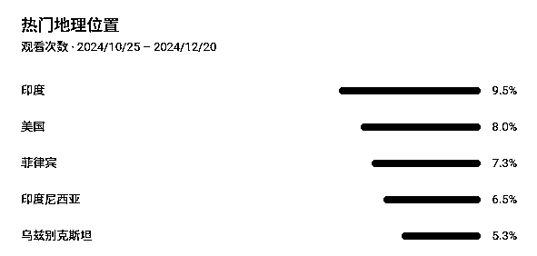

这是切换到“人+物体”之后的表现：

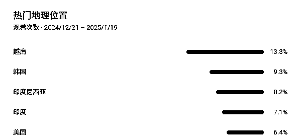

可数据整体的天花板依然很低。两个多月总播放不到200万，我开始怀疑自己：有些人在一个航期里就触到达标线，我花了两倍时间，完成度只有十分之一。一个人埋头做内容，特别容易走进死胡同。所以当我看到有陪跑小组报名的消息时，几乎没犹豫，立刻报了名。

## 04 爆发阶段：一次完整复刻，直接做出爆款

进组之后，我还是按手册里的AI参考出图方式更新了几天“美女+物体”内容，数据依然不温不火。那时我已经准备好预订教练的1对1咨询了。

结果，转机来了。

恰逢主业最忙的时期，晚上的创作时间被大幅压缩，我开始找操作步骤更轻的内容。这时发现蓝白瓷账号又跑出一支千万级爆款，这一次，我决定做一次“接近原版”的复刻，动作分三步：

第一步，从爆款视频中截取四张关键画面；
第二步，用AI工具把四张画面解析成Prompt；
第三步，把Prompt丢进AI绘图工具生成对应图片。

中途有个小插曲：生成的Prompt语义有些露骨，AI绘图工具直接拒了。我把Prompt改成英文之后，顺利通过。说句实话，我自己对生成结果并不满意——模特不够惊艳，整体质感也就那样。但就是这样一支我眼中“平平无奇”的视频，第三天破了20万，第五天直接冲到100万。

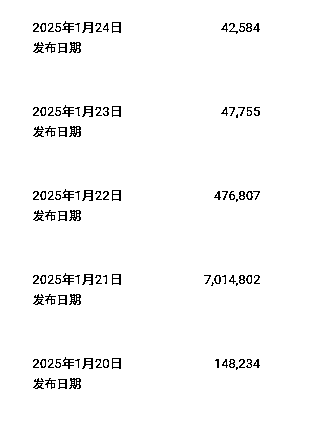

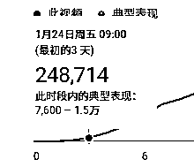

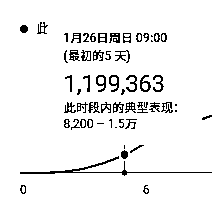

从那之后，我直接复用这套爆款Prompt来批量出图，偶尔加一点微调。

四张关键画面的Prompt参考：

```
fullbody,Young woman, exquisite makeup, long hair, sparkling crystal crown, dangling earrings, off-shoulder gown, deep V neckline, exquisite embroidery and lace patterns on the gown, long flowing sleeves, floor-length skirt , there are delicate decorations on the skirt, standing in a sea of blue and white flowers, with a spotlight shining behind her, mysterious, elegant, dreamy, and glamorous.

fullbody,Young woman, exquisite makeup, long hair, blue flower headdress, strapless dress, sweetheart neckline, dress decorated with blue flowers, flowing long sleeves, floor-length skirt, standing in a sea of blue and white flowers, with a spotlight shining behind her, mysterious , elegant, dreamy, cool.

fullbody,Young woman, exquisite makeup, black hair, gorgeous blue headdress with many ornaments and tassels, blue embroidered ancient costume, off-shoulder design, exquisite decoration on the chest, wide and flowing sleeves, floor-length skirt, patterned skirt , with a spotlight shining behind it, mysterious, elegant, dreamy, and glamorous.

fullbody,Young woman, exquisite makeup, black hair, gorgeous blue headdress with flowers and other decorations and tassels, blue and white porcelain style ancient costume, off-shoulder design, delicate patterns on the chest and skirt, wide and elegant sleeves, hands on the abdomen , classical, elegant, gorgeous, porcelain texture, mysterious, with a spotlight behind it, mysterious, elegant, dreamy, glamorous.
```

原视频及主要数据：

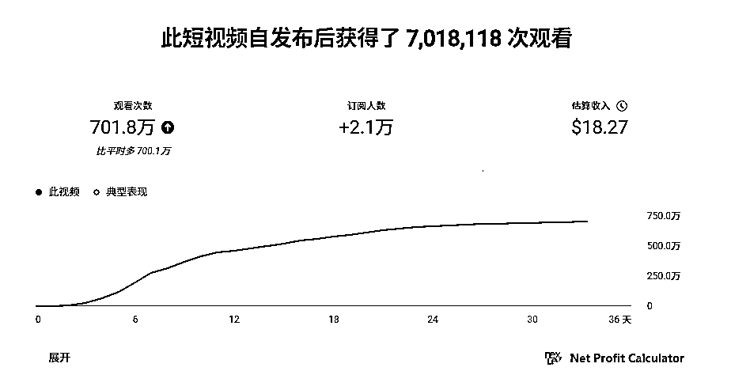

春节期间，我本来做好了断更的打算，结果流量恰好在那几天集中爆发，于是那几天晚上我都在老老实实地做视频。初级YPP眼看就要解锁了，可就在这时，出了整个账号生涯中最棘手的一个问题。

## 05 插曲：旧AdSense账号卡死了YPP审核

开通YPP的第二步，需要绑定AdSense账号。我手里有个几年前注册的老号，一直闲置没用。这次为了绑定，我改了收款地址，然后收到一封审核邮件。

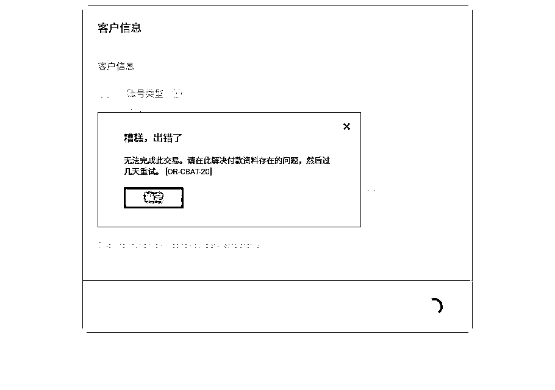

我按照要求提交资料后，后台状态变为“个人资料正在接受审核”，提交时间是1月30日。

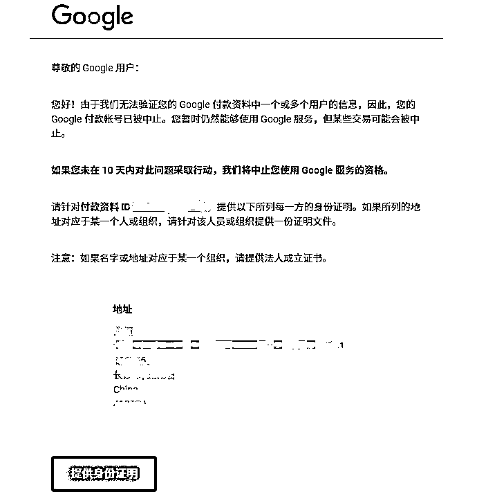

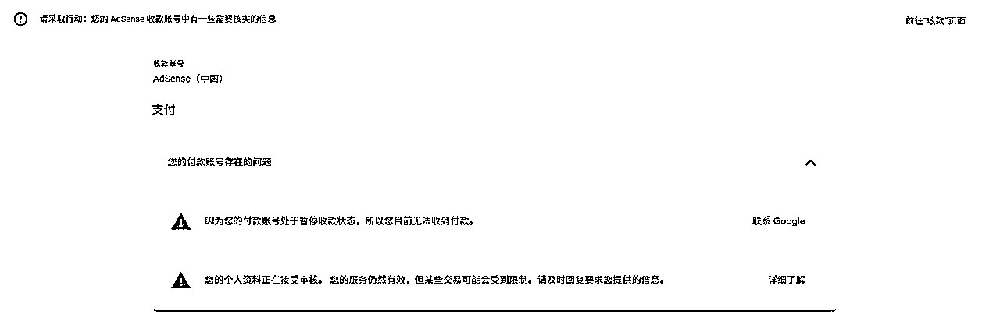

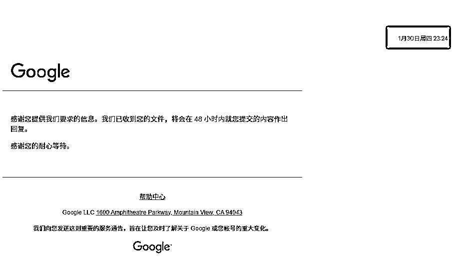

系统提示48小时内会有答复，但一周过去，邮箱毫无动静。更麻烦的是，这个账号处于无法关闭的状态。

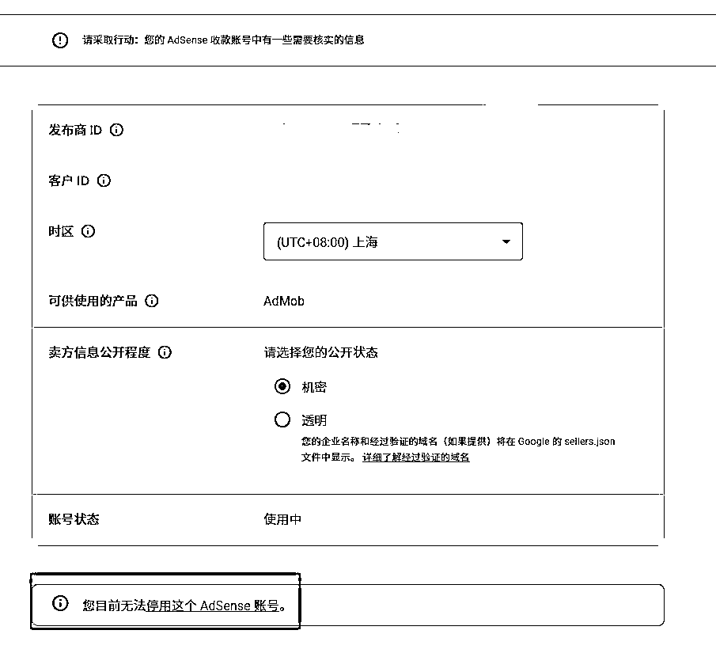

YPP卡在这个位置，寸步难行。我试过催办、上传资料（前后提交了三次）、找教练、问圈友、搜遍YouTube，还通过AdSense反馈入口和社区发帖求助，全部没有下文。最后，教练建议我去翻下那位博主的视频找找类似案例。我找到一个接近的情况，其中一句话点醒了我：

尝试通过YPP官方支持求助。

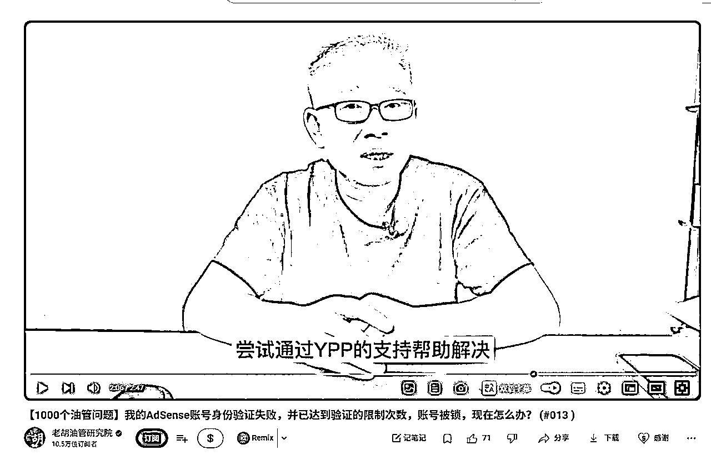

看到这句话，我马上找到反馈入口，把问题仔仔细细写了进去。

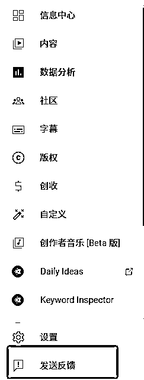

第二天上午，YouTube官方就回了邮件，工作人员态度亲和，处理意愿也很强。当天下午，AdSense的审核通过邮件如期而至。

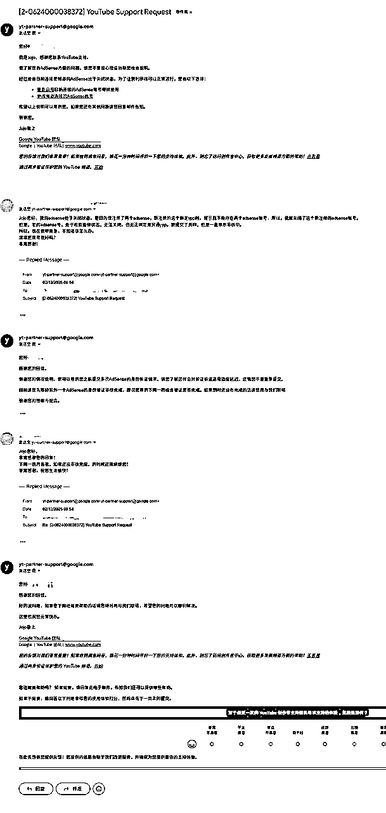

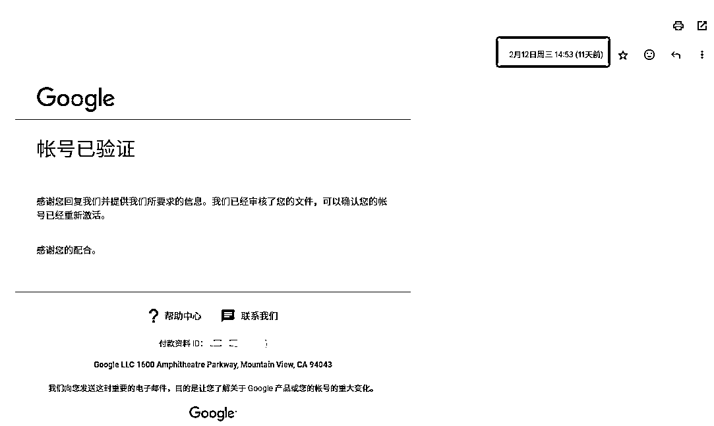

困扰我将近两周的难题，就此翻篇。那位博主在视频里说得没错：AdSense的支持渠道几乎解决不了问题，遇到类似状况，最有效的办法是直接找YouTube官方。

到这时，账号总播放量刚好突破1000万，高级YPP正式开通。

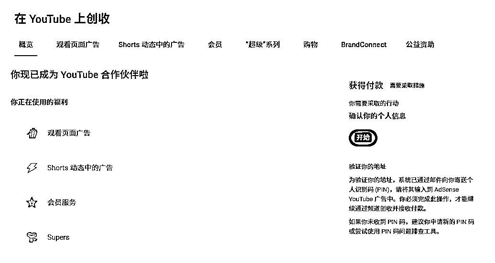

## 06 经验篇：如何把平均收益做到万播1美元

相信大家都清楚，YouTube后台中发达国家和地区的观众占比越高，到手收益往往越好。而猎奇混搭赛道几乎长期被印度观众统治，这类账号的千次播放收益通常只有0.3到0.6美元。我的号能做到万播1美元，靠的是发达地区观众的占比高出同类型账号。下面这张图，是我账号近期的受众地域组成。

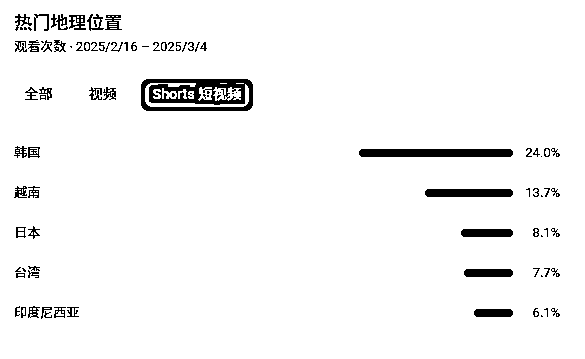

关于如何优化高价值观众比例，我总结了三条经验：

第一，模特肤色尽量白皙，以韩系脸为基准，尽量避开东南亚深肤色长相，身材也要在线，长腿和比例是加分项。

第二，作品前两帧不要放中式传统服饰，这类元素容易吸引东南亚观众驻足，但他们的留存对收益帮助有限。

第三，少碰恶心、猎奇、怪异向的画面，这类内容会明显拉偏受众结构。

用两支作品做个对照：一支用的是深肤色模特，另一支用的是亮白韩系模特。两者的发布时间只隔了两三天，前者播放量一万出头，后者超过三万。从受众画像看，韩国观众明显更偏爱后者。

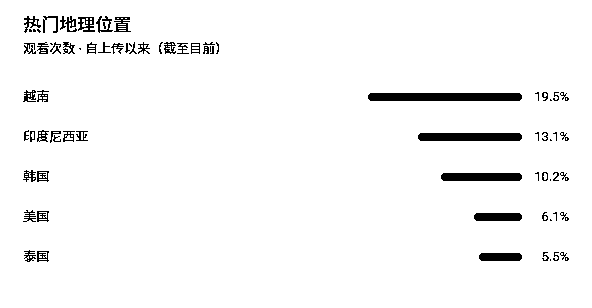

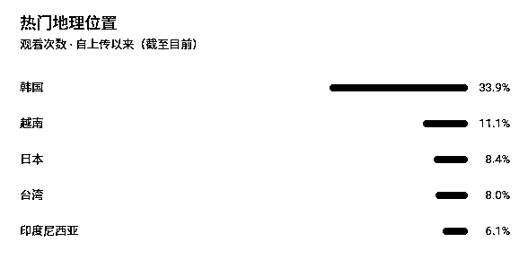

## 07 写在最后

这段时间我反复在想，一路走来，最大的收获到底是什么。写着写着，答案自己浮现了：是自信。

12月航海刚开始时，我还和教练有过一次对话，那时的我连方向都说不清楚，问题也问得很青涩。

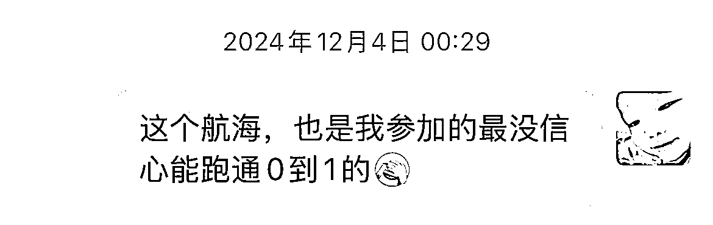

现在回头看，荆棘已经越过，繁花正在盛开。路还长，愿我们都能在星海尽头相遇。

感谢生财有术，感谢YouTube私教陪跑社群，感谢七天老师、方波妮教练、Gary教练在成文过程中给予的精心指导。也感谢时光圈友，蓝白瓷爆款赛道的首创人，正是你的探索，让我得以续写这段千万播放的篇章。