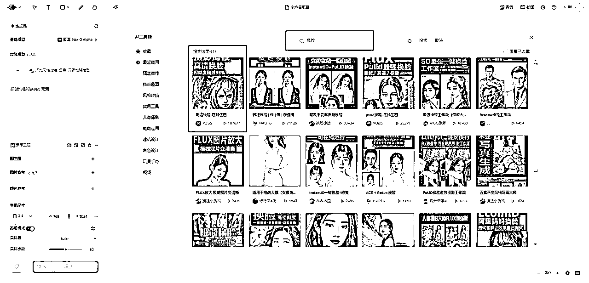
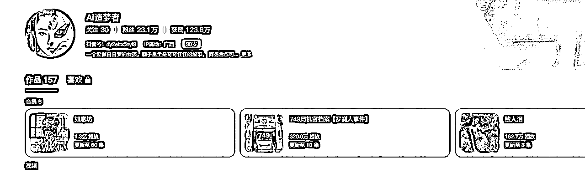
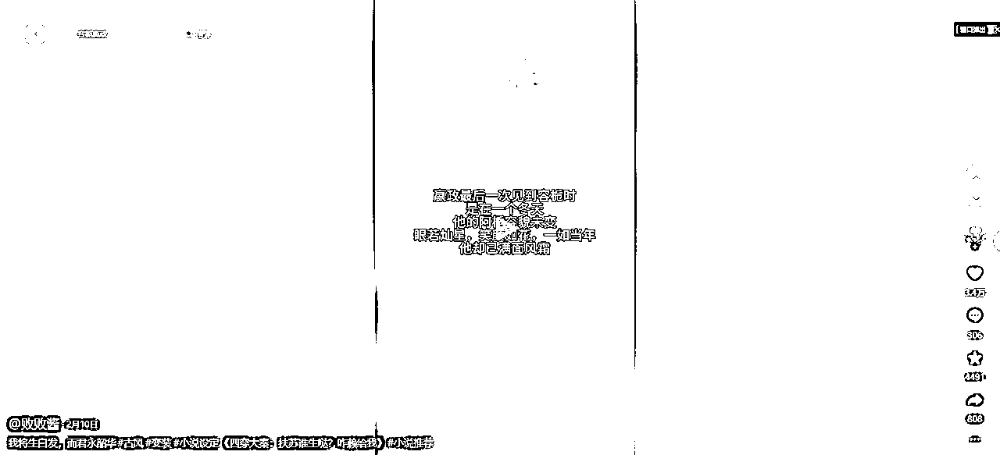
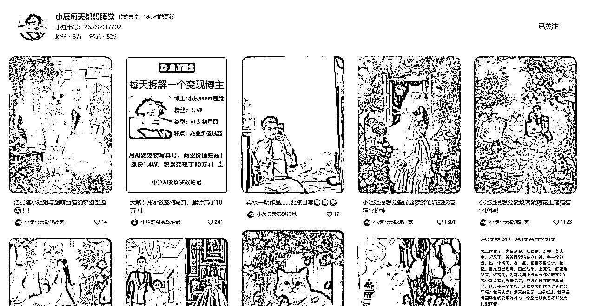

# 手机里的一场光影秀：用AI零基础拍出影楼级换装大片，还能变现
作者：龙哥

躺在沙发上刷着短视频时，你是不是也幻想过自己能拥有那种杂志大片的质感？其实不需要去影楼排队，也不需要买专业相机。现在一套AI工具就能把你从普通人秒变古风美女、都市丽人，甚至把家里的猫咪拍成高定写真，更重要的是，这些内容完全可以做成副业来变现。

这套从拍照到成片再到赚钱的打法，我整理成了四步闭环。

## 第一件事：先用即梦把画面定下来

过去想要一张好看的照片太难了：影楼一套下来三千打底，DIY拍摄又受限于光线和构图，拍出来的效果常让人失望。

现在换个思路，先用AI把“理想中的画面”画出来。

打开即梦，往里填一段描述性的提示词即可。比如：淡柔紫色的交领上襦，领口用清新嫩绿色做绲边装饰，整体雅致灵动。衣身上绣着浅金与米白交织的几何回纹，工艺细腻。下方是红色高腰齐胸裙，裙面暗纹提花，金丝在光下微微闪烁。外搭一层同色轻纱，像云雾一样增添飘逸感。整套汉服剪裁合体，搭配银色缀珠发饰，尽显古典婉约。

生成后就能得到一张媲美专业摄影的静物级照片。

给你几个可直接套用的风格参考：
奶油色茧型风衣配裸米色缎面裙，裙摆缀有细碎亮片。精致东方面孔的女子慵懒地靠在露天咖啡馆藤椅上直视镜头，骨瓷茶具置于原木桌，热气缭绕，背后常春藤爬满古砖墙，午后斜光洒下，蕾丝窗帘的光影与珍珠发夹交相辉映，打造慵懒都市感。

水蓝雪纺连衣裙，立体剪裁，珍珠串领口，腰间缎带蝴蝶结，裙摆绣渐变樱花。女子手提藤编包伫立在欧式白拱门前，紫藤花架下斑驳光影，微风拂动衣摆。

香槟色醋酸缎套装，挺括西装外套配鱼尾裙，衣襟立体手工花朵点缀，内搭浅金蕾丝衬衫。漫步鹅卵石湖畔小径，柳枝垂水，夕阳为湖面镀金。

米白针织开衫配薄荷绿吊带长裙，裙身不规则剪裁，细长珍珠项链。倚靠文艺复兴风格喷泉，白鸽环绕，春日柔光如油画。

淡紫提花改良旗袍，景泰蓝盘扣，袖口裙摆水墨晕染，外搭欧根纱罩衫。身处江南青石板巷，撑油纸伞走过白墙黛瓦，雨丝成帘，烟雨意境拉满。

## 第二件事：用星流把脸换上去，一键换装

有了完美的场景和服装，下一步是把你的真实面孔融合进去。传统做法是PS抠图换背景，技术门槛高；或者找设计师代做，一张起价两百。

星流的操作很直接：

1. 打开星流，进入「AI工具箱」，找到换脸功能。

2. 把你的自拍原图和即梦生成的写真一起上传。
3. 一键生成，换装完成。

## 第三件事：用可灵让照片动起来

静态图好看，动起来才有传播力。以前拍视频要设备要剪辑，现在AI直接生成。

把换装后的图片导入可灵，输入一段简短的动作描述即可：
正面提示：女人微笑，轻纱飞舞
负面提示：动画、模糊、变形、毁容、低质量、拼贴、颗粒、标志、抽象、插画、电脑生成、扭曲

点击生成，几秒钟后一张照片就变成一段流畅的动态视频。

## 第四件事：用剪映封装成爆款

最后一步是包装。把可灵生成的素材导入剪映，配上一首情绪向的背景音乐，比如《恨海情天》，再叠加「彩虹光」这类流行特效，导出即成可发布的成品。

## 怎么把玩票变成收入？三条成熟的变现方向

1. AI故事博主
用AI生成的古风剧情视频做内容，承接品牌植入广告。这类账号需要自己写故事、设计转场节奏，投入学习成本高，但变现空间大。

2. 小说推文博主
用AI还原小说里的关键场景，配合推文口播赚取佣金。以前这类内容多用真人出镜，现在AI完全能达到同等质感。

3. 宠物写真师
把猫主子、狗狗等宠物照片换成梦幻场景写真，接宠物用品广告。图片质感很容易出圈，不过也需要自己去“抽卡”和反复调关键词才能出爆款。

这几条路径都不是一键躺赚，想做好终究要花时间研究工具、运营账号、打磨审美。

但时代已经变了，机会留给会用工具的人，而不是等工具变成熟的人。

与其担心被AI取代，不如先学会用AI创作。技术本身不会淘汰人，会用技术的人正在淘汰不会用的人。

现在就可以拿起手机开始试，别让想法停留在沙发上。

足不出户拍出大片，同时把流量变成收益。

## 工具合集

即梦：https://jimeng.jianying.com/s/iPqvYDq9/?t=-4
星流：https://www.xingliu.art/
可灵国内官网：https://klingai.kuaishou.com/
剪映免费电脑会员版：https://pan.quark.cn/s/5dbd3ddfbd21