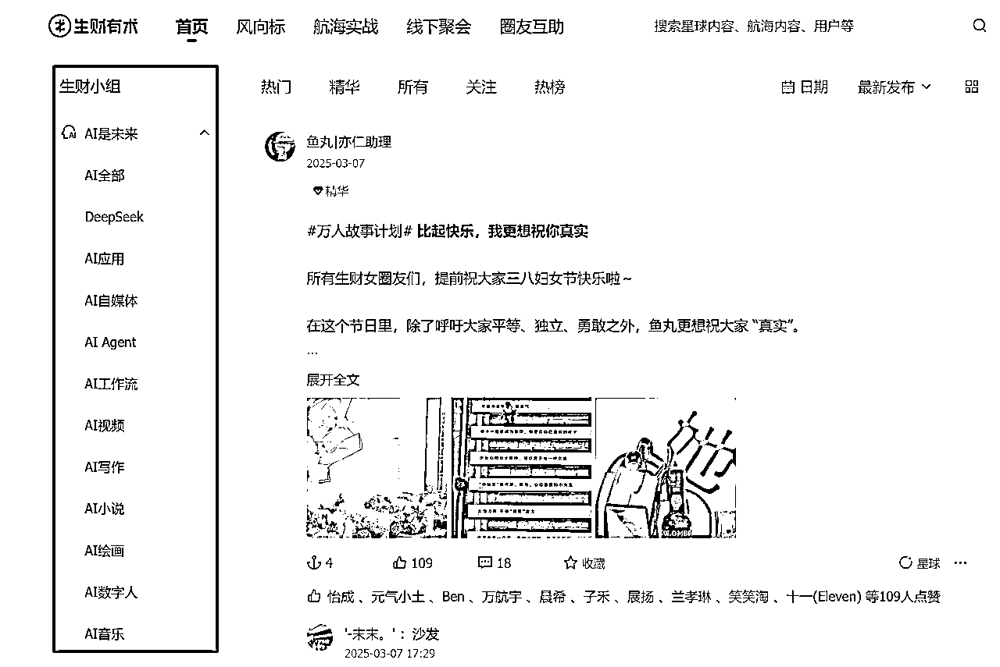
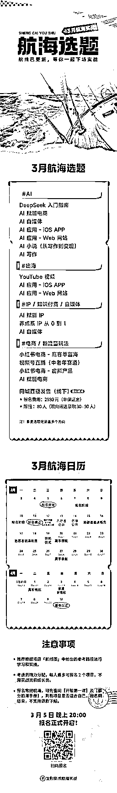
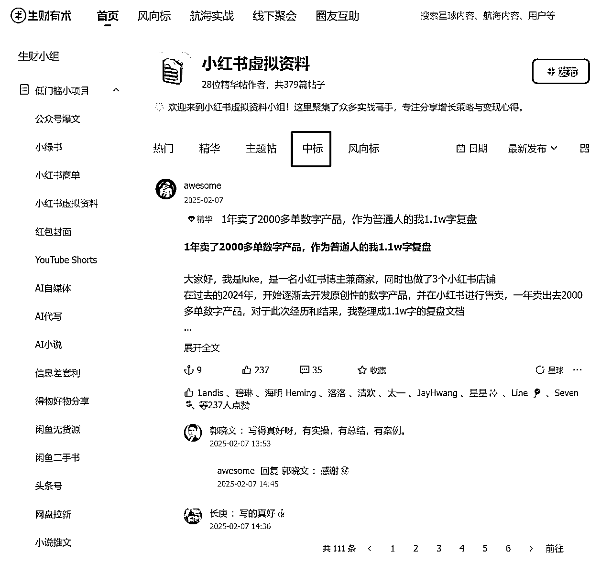
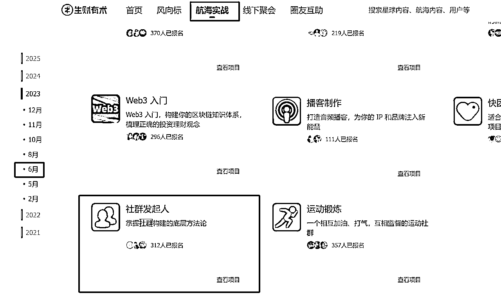

# 亦仁直播精华复盘：2025 航海的底层逻辑与方向判断

> 来源：[https://pcuddnfsui.feishu.cn/docx/ANrodf07toC39Xxo646cRdU1nFf](https://pcuddnfsui.feishu.cn/docx/ANrodf07toC39Xxo646cRdU1nFf)

## 为什么这次要开直播

先说一下这次上线的动机。坦白讲，我是典型的 i 人，习惯躲在幕后。但航海正式开放，正好是一个节点，年初回来也快一个月了，大家都在琢磨年后怎么打方向，怎么做规划。

三月份的航海我们团队准备了很久，所以想把盘算公开讲清楚。让参与的人心里有底，少点纠结，遇到问题知道往哪儿校准。

另外一个私心是，我想挑战自己。我越是抗拒的事，越值得去试试。直播、演讲、写作，这些我都不是很爱做，但恰恰是这些“怕”的领域，成长空间最大。擅长的事情很容易被消耗掉价值，而害怕的事情一旦迈步，往往能带来全新的体验和增量。

这次直播在我自己看来也是行为实验，想告诉圈里的朋友：选题会觉得难，比如编程、做工具型产品，都是因为没迈出第一步。播了就发现没那么可怕，人不会因为开播就出事。希望大家能感受到这份踏实感，航海里觉得难的事，往前探一探，通常也没那么致命。

## 2025 航海选题做了哪几处改动

这次的航海项目数量不多，但都是生财精挑细选的。花了很多时间跟团队对齐要带大家往哪走。生财的航海跟外面市面上的项目是不一样的，它是为生财圈友量身定制的。圈友大多是普通人，不是冲着做大公司，而是想通过自己的小尝试、长期积累，拿到体面的回报。基于这个画像，我们做了四个调整。

### 调整一：更偏长期深耕，而非短期套利
以前的航海追求快速反馈，但有些反馈快、空间小，一波就结束了。这次我们主动放弃了这类选题。希望大家能在一个领域扎根两三年，赛道还在，空间还在。后面会拆解具体案例，讲清楚其中能做大的逻辑。

### 调整二：聚焦十倍量级的赛道
想把大家聚拢到几个真正有十倍体量的大方向，比如 AI、出海、IP。我们反复推演过，这些赛道足够大。很多朋友选项目时视野受限，信息源单一，导致同样的投入，产出天差地别。生财和智囊团的作用，就是帮你先选对方向，事半功倍。

### 调整三：项目有闭环，有即时小反馈
我们依然要让项目可落地。推荐的几个方向本身就是闭环，比如做 YouTube 短视频，不需要从零搭账号再做产品再做变现，能在一个点上就看到反馈。把复杂度拆小，才更容易坚持。

### 调整四：低成本试水
不要一上来就砸几十万开店囤货。先用低成本验证，有信号了再加码。这是这次选题的共性：长期空间 + 十倍方向 + 闭环反馈 + 低成本切入。

## 生财与航海的核心理念

有老朋友也有新同学，可能对生财和航海还不熟悉。简单说，航海就是一个行动训练营。

我一直相信，在正确的方向上持续行动、持续试错，结果是水到渠成的。方向是前提。

航海就是生财选方向 + 设计行动氛围，带着大家下场。一次航海，或几次航海积累下来，成果自然会出现。

需要纠偏一个认知：结果不等于赚到钱。很多人参加完航海说没赚钱，但认知提升了、技能学会了、经验有了、人脉和资源链接了，这些都是结果。点多了就能连成线，最后形成大结果。

我自己做生财前也到处试：开淘宝店、写论坛文章引流、做公众号、兼职运营论坛和社群。那时候不知道这些点有什么用，只是在试。直到生财后，这些点串起来才爆发。航海的心态就是这样：不要指望一次就拿到大回报，而是靠多次小结果的复利，在合适的时机释放优势。

## 2025 航海的大盘判断

### 第一大方向：All in AI

AI 已经是确定性的时代浪潮，所有人都被卷进来。做生意、打工、自由职业，都绕不开。主动把业务和 AI 结合，或没有业务就直接成为 AI 原住民，都是机会。没有历史包袱反而更容易起步。

这跟一本书的观点很像：创新的先锋往往是边缘人，正因为没有基本盘，才能更快抓住新窗口。

#### 1. AI 是生财的核心战略
生财团队内部讲法就是 All in AI。我们合伙人坤汀，原来做航海家俱乐部，访谈年入千万的人。现在账号改名为【坤大汀学AI】，让他代表生财和圈友，去找国内乃至全球用 AI 最好的人，拆解他们怎么用 AI、怎么结合行业、有哪些新机会。可关注视频号【坤大汀学AI】。

生财星球这半年 AI 内容井喷，圈友应该有明显体感。我自己看生财内容时常有“原来还能这么玩”的冲击。如果你是圈友，AI 相关内容至少要刷一遍，门票就回本了。

我们把官网的 AI 内容做了体系化整理，在生财官网有 AI 小组，十几个分类：AI 自媒体、AI 应用、AI 编程、AI 音乐、AI 视频等，价值极高。

接下来我们会启动 AI 传术师俱乐部，把生财里用 AI 最狠的人聚集起来，还会拿出几百张生财门票送给市场上顶尖的 AI 实践者，让他们进入生财交流碰撞。未来会形成一张人网，化学反应会很大。如果你玩得好，就把经验分享出来。

#### 2. 官网和线下也在加码 AI
官网 scys.com 会上线更多 AI 功能。比如精华帖概读，星球精华帖动辄上万字，看完的人很少。我们用 AI 提炼关键信息和核心价值，让你一天刷完一期精华。

风向标情报产品也会接入 AI 辅助分析。以前大家看风向标会问“这怎么玩”，现在 AI 能帮你拆解玩法、衍生机会、流量路径。

我们还在规划情报 Agent。团队分赛道做情报，但做深很难。未来用 Agent 把全网 AI 相关分析收录并重点抓取。

线下我们租了一层楼，半层做成 AI 联合办公空间。圈友在这里碰撞，有做 AI 培训的、做产品、做应用的。合适的项目我们会给资金、招聘、流量获取等资源支持。

圈友大多是个体，时代窗口不会等你。生财想做中台，把共性问题解决掉。我们也在跟圈友合作搭建 AI MCN，帮做 AI 账号的人对接商单，专注内容即可。

团队周会我一直强调：AI 方向一定对，但哪件事对没人知道。所以只能 All in AI，做大量低成本、可逆的尝试。圈友参与航海也是如此，方向对了就大胆试，21 天没反馈损失也有限。多试几次，总能找到属于自己的那条路。

#### 3. AI 与本次航海选题
生财 All in AI，航海选题也随之倾斜。

##### 1. AI 自媒体
去年就强调过，这是一个需求旺盛、供给稀缺的机会。AI 产品和应用越来越多，需要渠道推广，但真正懂 AI 内容的人很少。现在做 AI 自媒体，溢价高、竞争小。以前做自媒体的老手反而有路径依赖，学习成本高。你去做，容易弯道超车。

AI 是全民浪潮，资本热钱在里面。大钱往往来自资本而非割小生意。航海里有 AI 自媒体方向，超级标已有案例。如果对表达敏感，可以试试。不仅是公众号，视频号、抖音、小红书都可以，围绕工具使用、趋势解读做内容，粉丝就能聚起来。

##### 2. AI 应用
有两个细分：iOS 应用和 Web 站点。原因有两点：一是 AI 编程和设计成熟，个体也能做出应用；二是大量传统应用需要 AI 重做，比如搜索体验被颠覆后，更多场景都要重构。这是 AI 应用的切口，后面会详细展开。

##### 3. AIGC 内容生产
一个是 AI 写作，一个是 AI 小说。AI 写作我们做过多次航海：PPT、论文、演讲稿等。星球里之前发过 AI 服务这个超级标。真正熟练和 AI 协作的人很少，大多数人仍需在闲鱼、小红书找人帮忙，背后是服务需求。

AI 小说本质也是生成内容，和 AI 写作、AI 短剧同类。之前星球里也有人提问公众号爆文、AI 写作、AI 小说的区别。

很多人会问：AI短剧、公众号爆文、视频号分成、YouTube广告收益，这些项目到底有什么区别？

从底层逻辑来看，它们其实是一回事：先借助AI批量生产内容，再把内容发布到不同平台，平台获得流量和广告收入后，再按照规则把一部分收益分给创作者。

比如这次我们会重点做YouTube Shorts，通过AI制作短视频，甚至进一步尝试中视频。只要内容能够吸引观众，平台就可能根据播放和广告表现产生分成。

除了内容变现，这一期还会重点讲AI如何融入具体业务，包括AI赋能个人IP、AI赋能电商等。你可以用AI辅助完成IP定位、课程设计、朋友圈文案、视觉运营内容；如果你做电商，也可以把AI应用到模特图生成、换装、换脸等环节。

可以说，AI会贯穿本次航海的大部分方向。我们希望带着大家把AI真正用到自己的行业、业务和工作流里，而不只是停留在了解工具的层面。

### DeepSeek入门：为什么要单独拿出来讲？

这次我们把DeepSeek专门设置成一个独立选题，是因为它在我看来，不只是又多了一个AI工具，而是推动了AI普及的重要节点。

过去，移动互联网让更多人接入网络；而DeepSeek的出现，则让大量普通人第一次真正接触并使用AI。以前可能只有科技、互联网从业者在讨论AI，现在很多家庭成员、亲戚朋友都开始使用它，这意味着AI正在快速进入大众生活。

对我们这些希望抓住趋势的人来说，当越来越多人接入AI，就意味着新的需求、新的服务和新的机会正在出现。因此，这次DeepSeek入门会覆盖多个实际应用场景，帮助大家从零开始掌握它的使用方法。

---

## 关于AI方向的几个常见问题

### 1. AI自媒体和DeepSeek有什么区别？

DeepSeek本身只是工具，最终能产生什么价值，取决于你拿它去做什么。

而在我们的语境里，AI自媒体更接近“AI科普账号”。现在AI更新速度非常快，几乎每天都有新模型、新产品、新消息，很多人会感到信息过载，甚至产生焦虑。

这时候就需要有人帮用户筛选信息：

- 最近AI领域发生了哪些重要变化？
- 哪些工具值得关注？
- 哪些产品只是短期热点？
- 普通人真正需要掌握什么？
- 哪些功能可以直接应用到工作和生活？

当你持续输出有价值的AI信息，就有机会积累粉丝和影响力。等账号形成一定规模后，AI平台、软件厂商和相关产品就可能通过商单、广告等方式找到你。

当然，广告只是其中一种变现方式，但AI自媒体的基本路径，就是通过内容科普建立影响力，再利用影响力获得商业回报。

### 2. AI写小说现在还是红利期吗？

以目前的情况来看，我不认为AI小说仍处于明显的红利阶段。

原因很简单：AI生成小说的技术门槛并不算高，供给已经越来越多。真正稀缺的，不是“能不能写出来”，而是“能不能找到并沉淀读者”。

而大量读者已经被各大网文平台集中起来了。平台掌握用户、流量和分发渠道，因此在利益分配上通常更有话语权。对于普通创作者来说，进入门槛低，但能够获得的收益空间未必大。

所以可以尝试AI写小说，但不要一开始就抱有过高收益预期。

如果你不仅会写内容，还拥有独立获客能力，比如自己搭建小说网站、运营用户、形成私域或独立流量池，那么整体空间会大很多。

### 3. 小红书电商值得做吗？

我个人非常看好小红书电商。

目前小红书的商业化还没有完全释放，而一个内容平台一旦进入商业化加速阶段，平台内的参与者通常都有机会获得一部分增长红利。

对于大多数内容平台而言，电商往往是最稳定、最成熟的变现方式之一。因此，小红书未来大概率会继续把电商放在非常重要的位置。

无论是开店、做内容，还是通过种草带动成交，都有可能获得不错的机会。

不过，机会存在，并不意味着每个人都能马上抓住。很多圈友在电商知识、供应链、运营能力和资源积累上还不够成熟，短期内未必能够直接拿到结果。

但如果现在完全不接触、不学习、不积累，等下一轮平台机会出现时，你依旧会从零开始。所以如果你愿意长期投入，小红书电商值得尝试。

### 4. 视频号还有红利吗？

我认为视频号仍然存在机会，判断逻辑和小红书比较接近：它还处于商业化持续推进的阶段，整体没有像某音那样完全成熟。

如果你的身份是普通个体，想找一个低成本、可作为副业切入的平台，那么视频号和小红书都比较适合。

但如果你已经拥有成熟品牌、团队和充足预算，那么某音依然是更大的市场。只是对于个体创作者而言，直接去最成熟、竞争最激烈的平台硬拼，压力会更大。

### 5. AI自媒体和AI赋能IP到底有什么不同？

AI自媒体，本质上是一个独立项目。

你可以从零开始注册账号、持续发布AI相关内容、吸引粉丝，最终通过广告、商单或其他方式变现。即使过去没有个人品牌，也可以尝试。

AI赋能IP则是另一种路径。它更适合本身已经在做IP，或者明确想打造个人品牌的人。你要做的不是重新建立一个AI账号，而是把AI嵌入现有业务，重新设计自己的工作流程。

比如：

- 用AI辅助定位个人IP；
- 让AI根据你的历史内容生成朋友圈；
- 建立属于自己的AI智能体；
- 用AI制作公众号封面；
- 协助排版、改稿和优化文章；
- 提升日常内容生产效率。

过去你可能一天只能认真写几条朋友圈，导入自己的素材、经历和表达风格后，AI可以帮助你持续生成更多内容，而且效率和稳定性都会明显提升。

简单来说：

- **AI自媒体**：把AI科普做成一个账号和项目；
- **AI赋能IP**：你已经有IP或准备做IP，再用AI升级业务和工作流。

---

# 第二个重点方向：出海

这次航海的两大主线，一条是AI，另一条就是出海。

AI不是可选技能，而是所有人都需要逐步掌握的基础能力。至于出海，我更愿意把它理解成一种提前布局和风险对冲。

## 1. 为什么要趁业务稳定时探索出海？

很多人会等国内业务下滑了，才开始考虑海外市场。但这个时候再做，往往已经太晚。

真正合理的方式，是在国内业务仍然稳定、甚至还在增长的时候，抽时间研究海外市场。就像天气好的时候提前修屋顶，而不是等到房子漏雨了才开始准备。

出海不是立刻就能见效的事情。一个完全没有经验的新手，从了解市场到找到方向、完成产品、获得流量和收入，快的话可能需要半年到一年，慢的话两三年也很正常。

如果国内收入已经明显下降，你再把全部希望押到海外，决策容易变得急躁，动作也会变形，甚至因为焦虑做出不理性的投入。

所以，越是当前业务还不错，越应该提前尝试。

## 2. 生财语境下的出海，和公域常说的出海有什么差别？

现在网上谈出海的人很多，但我们讨论的出海，并不是让普通个体去海外开实体店、注册公司、租办公室，或者去迪拜做重资产项目。

这些方式投入大、周期长、资源要求高，并不适合大多数普通圈友。

我们更关注的是轻量化的互联网出海：

- 把内容发布到海外平台；
- 获取海外用户；
- 开发工具、网站或应用；
- 通过海外平台实现流量和收入；
- 用较低成本验证产品和市场。

这才是更适合个人、小团队和资源有限创业者的出海方式。

---

# 本次出海方向

## 1. Web网站

海外市场和国内有一个非常明显的差异：很多海外用户依然高度依赖Google搜索，也依然习惯通过独立网站获取信息、使用工具和完成购买。

国内用户的很多需求，已经被少数超级App集中承接；但在海外，网站生态仍然非常活跃。

例如在美国预订餐厅，很多时候就是直接进入餐厅官网完成预约。这说明网站并不是落后形态，而是海外用户日常使用的重要基础设施。

可做的网站类型很多，包括：

- 工具站；
- 资讯站；
- 游戏站；
- 英文博客；
- 垂直服务网站；
- AI应用网站。

过去，做网站往往需要懂代码、懂设计，还要有开发团队。但现在AI编程能力大幅提升，即使没有传统编程基础，也可以借助AI把想法逐步实现出来。

这件事本身就很有成就感：你提出一个需求，AI协助你写代码、调整功能、修复问题，最后真的能把一个产品做出来。

网站项目可以分成三个阶段：

### 第一阶段：广告变现

先把网站做出来，再解决流量问题。前期可以通过Google AdSense等广告平台获取收益。

这一步的重点是建立完整的小闭环：

- 产品怎么做；
- 用户从哪里来；
- 如何获取搜索流量；
- 广告如何产生收入。

### 第二阶段：Micro SaaS

当网站拥有稳定用户后，可以进一步转向Micro SaaS，也就是小型SaaS产品。

用户订阅你的工具或服务，按月、按年付费。这种模式比单纯广告收益更稳定，商业空间也更大。

### 第三阶段：完整SaaS

当产品规模、功能和用户群继续扩大，就可以从微型SaaS成长为完整SaaS平台。

这个阶段的想象空间会非常大，优秀项目甚至能够做到年收入数千万美元。

所以，不需要一开始就想着做一个庞大的平台。可以先从一个小网站开始，先跑通产品、流量和变现，再逐步升级。

很多人担心英语和编程能力不够，其实现在这些都不再是绝对门槛。AI可以协助翻译、写文案、开发功能、处理技术问题，一个人也有机会完成过去需要多人配合的工作。

## 2. iOS应用

第二个出海方向是开发苹果应用。

之所以优先考虑iOS，一方面是因为苹果用户整体付费能力较强，另一方面是苹果生态的支付和分发机制相对成熟。

目前AI正在重新改变大量应用。过去已经存在的工具，很多都可以结合AI重新设计；过去因为开发成本太高而无法满足的细分需求，现在也有机会被快速实现。

以前开发一个App，可能需要准备很高的预算；而现在，借助AI和成熟开发工具，个人也可能独立完成一个小型应用。

尤其是那些看起来很细、用户规模不大的长尾需求，只要不断尝试、持续发布，就有机会从大量产品中跑出几个表现突出的项目。

做iOS应用还有一个明显优势：支付问题由苹果生态统一处理。虽然平台会收取一定比例的费用，但你不需要自己搭建复杂的支付系统，可以把更多精力放在产品和获客上。

目前优秀的iOS应用收入非常可观，头部产品甚至能达到月收入千万美元级别。虽然普通人不可能一开始就做到这个规模，但这也说明苹果应用市场的商业天花板依然很高。

## 3. YouTube短视频与中长视频

第三个方向是YouTube，包括Shorts短视频以及中长视频。

此前我们已经带着几千人尝试YouTube，也有不少人获得了阶段性反馈。但这个项目的特点是回报周期相对长，不一定刚开始就能看到明显收益。

在航海结束后，我们又组织了更深度的陪跑，带着一百名左右的同学继续运营YouTube。经过一个多月的持续实践，已经有不少人成功开通了YouTube合作伙伴计划，这意味着账号具备了平台变现资格。

当前很多人的收益还不高，这是正常现象。YouTube需要持续积累内容、频道权重和用户基础，真正明显的增长可能要等几个月之后。

如果你参与这个方向，可以重点掌握AI视频生产能力，包括：

- AI生成脚本；
- AI生成图片；
- AI生成视频；
- 视频剪辑；
- 内容包装；
- 频道运营；
- 海外平台分发。

相比文字和图片，AI视频的制作难度更高，但它的应用价值也更大。即使你最后没有直接依靠YouTube赚到很多钱，掌握AI视频制作、剪辑和运营能力，本身也可能成为一项非常有价值的职业技能。

---

# AI与出海，最好结合起来做

这次航海最核心的两个方向，就是：

1. **全面拥抱AI；**
2. **提前尝试出海。**

如果能把两者结合起来，机会会更大。

比如用AI生产海外内容，用AI开发英文网站，用AI制作iOS应用，再通过海外平台获取用户和收入。这种“AI+出海”的组合，既能降低生产成本，也能突破国内市场的边界。

### 关于YouTube生成视频属于哪个方向？

主要对应YouTube航海。

你可以制作短视频、中视频或长视频，上传到YouTube，通过平台分发获得播放量。当频道达到一定规模后，就有机会通过广告分成获得收入。

### 完全不了解网站的人也能做吗？

可以。

生财一直强调对新手友好，并不是要求大家一开始就拥有顶级资源、复杂团队或很深的技术背景。

很多事情都可以从一个简单的项目开始，边做边学。对于网站项目也是一样，先理解产品怎么搭建，再研究流量从哪里来，最后学习广告、订阅等商业化方式。

不要因为暂时没有经验，就认为自己没有机会。现在工具越来越强，真正重要的是愿不愿意开始，以及能不能持续迭代。

很少有人会把话题落在这样一个层面：普通人如何用自己的双手多挣一点、如何让一家人过得更体面一些。风口、趋势被谈过无数次，却鲜少有人给出一条能落地的路径。

基于这样的观察，我做生财有术。目标很直白，帮助那些没有家世、没有资源、起步普通的同路人，一起找到可执行的事，把回报做起来。出发点就这么简单。

有人问，没有背景、没有经验，能不能去碰网站、去学新工具来做事？我个人觉得完全可以。生财相对新人很友好，缺的基础能在做事里补上。节奏慢一点也没关系，只要方向没错，路终究会通。新手不必自我设限，先进来再说。

答疑3：AI自媒体和小红书虚拟商品，哪条更适合宝妈？
这个话题我稍后会在第三个板块详细展开。小红书虚拟店铺的观察、不同人群的适配，我待会儿再讲。

答疑4：没上过航海的零基础人群，想先拿到一次正向反馈，哪条更容易？
正反馈对新人很关键，它能让人坚持往前。对此我有两点建议。

第一条是围绕人工智能做服务。说的具体点就是用大模型产出内容，然后把这个能力包装成服务去对外接单。比如帮别人写演讲稿、做PPT、整理材料。这类单价不一定高，但钱会真实到账，过程中服务意识、交付能力、沟通能力都会被锻炼。上限有限，却是入门的友好入口。

第二条是用模型生产内容然后分发。生财以前做过不少公众号爆文，借助模型后可批量化。细分赛道里仍有机会，虽然竞争激烈，但做好一个垂直方向，每天几十元的稳定回流对新人就是很好的确认。

另外视频号的广告分成也值得留意。用模型生成短视频，投放到视频号，流量起来后就有分成。我最近看到一个有意思的账号，选一个热点温暖片段，比如照顾小猫，前面用原片，后面用一张AI生成的插画收尾，整体风格统一，点赞分享都很高。这样的玩法门槛不高，核心在于选对素材并用模型加工。跑通后也能形成小副业。

所以小白的起点可以归纳为两种：学模型做服务；用模型产出内容到平台换流量。

### 其他机会判断

AI和出海是两大主线。除此之外，还有几条投入产出比较合理的尝试。

1. 小红书电商与视频号直播
小红书电商和视频号直播目前仍有红利。抖音已高度商业化，普通人切入难度大；小红书电商和视频号直播的窗口相对宽松。

小红书内部存在高客单蓝海，可以不囤货，先挑利润可观的品做内容测款，积累手感后逐步夯实供应链、品牌与内容能力，慢慢升级为合格商家。

视频号直播也很有机会，尤其对已有私域的人。生财很多朋友在微信里有积累，正好可用。视频号用户结构偏中老年，围绕这类人群做内容与选品，反馈来得更快。

2. 小红书的虚拟商品
这里要强调是小红书的虚拟商品，而非单纯的小红书，也不是单纯的虚拟商品。

过去大家常在小红书做内容引流到私域成交。随着平台对外部导流的管控收紧，这条路性价比下降。但堵的同时也在疏，小红书开始规范电子资料、虚拟商品类目，现在可以直接在站内开店做虚拟商品销售。

这意味着交易可以闭环：把脑中的知识提炼、把收集的资料整理成资料包，在小红书开虚拟店，用站内内容直接成交。无需囤货、无需物流。

市面上已有很多模板、陪跑、考研资料类的成功案例。可去生财官网的小红书小组，查看中标板块，把案例刷一遍，就能理解逻辑。

看完案例就明白在讲什么。若仍不清晰，去看风向标分享即可。很多人认知还停留在引流到私域，现在站内闭环了，想象空间比多数人预估的大，我已看到百万级的案例。

3. 养成系IP与AI赋能IP
我不认为这是红利，但这是几乎所有个体必须做的事——做IP。雷军、周鸿祎、江南春都在亲自出镜，因为真人IP是建立信任成本最低的方式。

交易本质是信任。真人持续输出，比砸预算投放更高效。

在IP方向有两个选题：AI赋能IP，适合已有IP或想提升效率的人；养成系IP，适合还没影响力但在持续成长的人。

可以公开记录学习过程，比如在生财里学模型、学内容，把每日收获发到朋友圈或小群。别人见证变化，信任自然累积。100个铁杆就足以启动很多事情。

4. 同城发售
同城发售是我们高阶航海。会挑选教练，带几十人线下深度实操。往期已带数百人参与，部分人获得不错回报。本期继续与孙策合作，玩法会加入直播发售，帮助商家在直播间完成销售。

答疑1：小红书蓝海电商与虚拟电商怎么选？
看阶段。若想低成本试探，虚拟电商更合适。但低成本意味着低门槛，人人可入，竞争会迅速升温，空间也相对有限。低门槛的项目适合拿第一笔反馈，长期则要找壁垒。

生财办公室墙上写着做难而正确的事情。难的事情做熟了会变简单，简单的事情做多了会变难。若你仍在起步，先拿反馈；若已有基础，就该挑有壁垒的方向。

答疑2：没做过IP的普通人，AI赋能IP还是养成系IP？
建议从养成系IP开始。AI赋能IP面向已有IP或明确想深耕的人。零基础先记录成长，体验内容生产。

### 生财联合办公
杭州已有联合办公空间，约30位圈友在办公，氛围不错。初衷是帮自由职业者和早期创业者聚集，缓解创业的孤独。试点成功后会考虑北上广深等城市。

申请方式在星球搜索许老师的帖子，表单在里面。

### 给大家的四点提醒

1. 如何面对焦虑
现在很多人焦虑，焦虑本身不是坏事，它是想变好的信号。要接纳它，不要让它干扰生活与行动。若暂时没时间入场也无妨，任何时间出发都不晚，每个时代都有机会。

2. 理解规律
航海的调整方向是纪律而非一波流。没有人能跳过阶段一步登天。成长是积累，碎片连成线才走得远。短平快的案例别影响判断，长期视角更重要。

3. 焦虑的解法是具体行动
状态不好时就去写、去拍、去做。注意力从情绪转到问题，行动会带来掌控感。何以生财唯有行动，何以生财唯有实战。

4. 别给自己设限
早期优势不明显，尝试足够多才会显现。别因不会直播就不做，别因不擅长写作就放弃。AI已大幅降低专业门槛，除了造火箭，多数项目都可试。

我07年上大学到17年，大约试了上百个项目，半数失败，半数有所收获。关键是不设限。

最后提醒，航海报名到3月11日。建议最多报两个，甚至一个就够。其他手册对所有圈友开放，可先读后决定。

如果你已在生财，跟上节奏即可。若还没加入，我不建议现在冲动加入，先观察先判断。

关于价格和入群时机，先说结论：现在生财有术的定价是3365元。我个人觉得这个价位对应的价值已经很高了，性价比很足。

418节点我们会给大家一些让利，但幅度不会太大。因为往年这个时间点我们都会放出比较大的优惠，今年整体价格体系会更稳定，所以折扣只是一个小幅度的调整，大概率在几百块以内，三四百的样子。

所以你要加入的话，418前后是一个相对更合适的窗口。如果你并不在意这几百块的差价，更看重立刻开始跟航海的同学一起行动，那现在进来也没问题，毕竟时间成本才是最贵的。

怎么加入？去生财公众号里找鱼丸联系，感受一下再决定就好。选择权始终在你。

至于说不加入也没关系，我的真实想法是希望每个人都能去尝试一些东西，找到自己的兴趣点，做出一点小收入就很好了。加不加生财我都能理解，加了的话我当然更开心。

关于老用户返费，有人问力度多少。说实话现在还没定。今年的418和往年节奏完全不同。往年我们大概在418前三个月就开始筹划优惠，今年我跟团队的共识是不要赶，先把社区和产品本身打磨好。

做扎实的事比猛做销售更重要。销售不是不重要，而是当产品、服务、社区都经营到位时，销售自然会变得轻松。反过来，花大量时间在促销上，产品内容跟不上，只会越做越累。

所以我们目前还没讨论续费政策，至少要等到三月份，离418还有一个月左右才启动。老用户不用着急，我相信最终会给出一个值得认可的回馈。认可你的人、支持你的人，理应得到足够程度的回报，这是双向奔赴。

下面是直播里几个问题的补充。

答疑1：web和iOS哪个机会更大？
我认为两者都很大，都远超生财有术本身的天花板。做得好，空间都比现在大很多。iOS前期门槛会高一点，需要Mac和开发者账号，投入大一些。web相对低门槛。选哪个都行，纠结就随便挑一个。

我分享一个决策习惯：如果两个选项让你犹豫，就把试错成本降到最低。像web航海和iOS航海，选错了也就损失199块保证金，回撤成本极低。那就别纠结了，选一个就全身心干。

真正需要谨慎的是回撤成本极高的选择，航海不属于这个范畴。所以抓阄也行，选一个开始走就对了。

顺带说个信息，我的合伙人坤汀运营了一个视频号【坤大汀学AI】，这是生财AI战略的一部分。他会去访谈真正把AI用起来的实践者，讲他们怎么把AI和业务结合、怎么找机会。如果你在意AI，值得关注。

答疑2：老带新佣金多少？
常规的分销赏金是20%，今年可能会上调一点，具体未定。想推荐的朋友非常欢迎，但也不用太计较佣金数字。靠佣金赚不了太多，关键是把合适的产品带给合适的人。对我们社区来说，约三分之一的用户是通过推荐进来的。

人生最大的幸运之一就是遇到贵人，带你进入一个新圈子、新赛道。如果你身边有人适合，就把生财推给他。也可能有人会说你割韭菜，这种情况就一笑了之，别争辩。

答疑3：web和YouTube哪个空间更大？
生财的每个选题空间都不小。YouTube的空间就很典型，昨天来的朋友投了一个做YouTube电影解说的项目，年营收几千万美金。空间大不大，完全取决于人。

公众号爆文的赛道也一样，做得好的人一年百万以上很常见。从零到一跑通后，接下来就是加杠杆：团队杠杆、资金杠杆、媒体杠杆、产品杠杆。我那个朋友一个人能同时运作几百个号，靠的是工具和系统支撑。普通人做不到，但这也说明了上限有多高。

别问哪个赛道大，问你能不能抓住机会。

答疑4：同城直播发售补充一下
同城直播的具体内容，航海教练孙策在星球里发过帖子，讲得比我更细，感兴趣的可以去看。哪怕没报名航海，我们从去年418到现在累计70多场航海，每场都有几万字的手册，对所有圈友开放，手册的价值非常高，可以先去阅读。

另外，明天坤汀会和航海家SKY连麦，聊AI如何赋能在职场、如何提升效率。如果你还在职场，或对AI还不熟，这场值得预约。

第一次做这种直播，谢谢大家的配合和打赏。做下来才发现，很多以为很难、以为会恐惧的事，迈出一步就发现不过如此。觉得赚钱难、航海难，就去试试，真的没什么好怕的。

最后推广一下生财朋友圈。如果听完有启发，欢迎去发一下感悟。我最近把朋友圈的权重调得很高，放在很醒目的位置。因为在AI时代，内容和答疑的门槛在降低，最稀缺的是人跟人之间的连接。

生财的难得之处，在于聚集了一群有情有义、利他、真正厉害的人。我们希望通过朋友圈让大家展示自己、被看见。发点照片、自拍、学习心得都行。希望我们在朋友圈里见。