# 把 DeepSeek 写出来的“机器味”洗掉，写出让人愿意停留的暖文案

大家好，我是李思念，创业做了十一年，心金文案的发起者。

手把手带过上千名同学用内容做 IP 营销，从公域进来精准获客，到私域自然成交。

这几年 AI 已经长进了生活的缝隙里，我对它的心态也从最初的惶恐变成了主动利用。

我是文科背景，别人聊参数、架构这些词的时候，我常常一知半解。GPT 火起来的那阵我也去研究过，看着大咖们各种花式玩法，艳羡不已，可我能用的也只够到最基础的傻瓜提问。

近两年脑子里总有个念头在转：

对普通人来说，AI 的价值在于会用，而不是成为专家。只要肯上手，它终会像工具一样普及到每个人。

回想电脑刚进来的时候，谁不是先学开机关机、学顺序呢？现在连孩子都能把手机玩得得心应手。

时代的车轮比我们想象的更快。

真正做到随手可用的 deepseek 就来了。

今年年初 deepseek 爆火，我明显感觉自己的认知在被重塑。

大概一整个晚上，我跟它聊个不停，随后就决定拥抱它。——估计不少普通人也在那个春节的夜晚，经历了相似的转折。

我试着给自己搭一个文案智能体，没想到轻而易举就成了。

它把我「心金文案」的语气吃得非常准，经过我多次纠偏后，已经能用我的口吻出稿。随后产出了几篇在小红书和公众号都走红的文章，带来了可观的精准转化。[后文配图]

但用得越多，一个毛病就出来了：deepseek 写的东西 AI 味太浓。

作为做 IP 和带文案课的人，我对内容的要求会更严，因为好内容才自带筛选力，才能留住对的人。所以我的关注点也从功能层面，转向了表达层面。

过去一个月，我一直在做实验，琢磨怎么让 deepseek 的输出更有人味。

今天就从一个内容创业者的视角，聊聊“说人话”的底层逻辑。

怎么写出有温度的文案，一眼不像 AI。

怎么借 deepseek 写出能打动人心又能变现的稿子，在提升效率的同时守住表达的质量，真正成为创作者的助力。

# 一、关于 AI 写作，我的几个判断

## 1、能让 AI 服务于创作的前提

让 AI 真正为你的内容工作，是有前提的。

从前这个前提可能是：会不会🪜、会不会写提示词。

如今 deepseek 这类产品门槛极低，从小学生到长辈都能直接对话。提示词不再是拦路虎。

AI 带来了信息平权。获取知识更容易，60 分的稿子满平台都是。

于是前提就变了——你必须先想清楚：你要写怎样的文案？用怎样的内容去触达怎样的人？

尤其是做 IP 的人，我更建议先把原创肌肉练出来。手写 20 多篇以上，形成稳定的个人语感，再去结合 AI，效果才会叠加。一来是给 AI 足够的投喂材料，二来是你比 AI 更懂你的用户要什么内容。

你得先比 AI 更懂写作。技术是开放的，文案的标准是私人的。

如果不是你的语气，不是你的核心观点，不是你的经历和故事，不是冲着你的精准人群去的，那生成出来的东西不过是千篇一律，没有辨识度，更谈不上吸引。

## 2、思考与判断力才是稀缺品

门槛降低的同时，思考和甄别价值更高了。

问 AI“如何创业”，它能条理清晰地给你准备清单、成功案例、方法论。

但决定结果的是：你能不能在不同阶段选对策略？能不能分辨什么适合自己、什么不匹配？能不能看到案例背后没写出的坎坷怎么跨过去？

AI 时代，基础知识的价值在下降，深度思考和判断力在上升。

## 3、「人机协作」是正解

实践下来，我发现人机协作能把效率拉满。

上个月我带学员做“7 天日更”，借助 deepseek，零基础的同学也能坚持下来；原本就常写的同学，把一篇稿的时间压缩到半小时左右。

省下来的时间可以用来研究用户、看市场、捕捉选题风向，做好后端交付。

工作流也变了：

过去是“时而灵感时而硬写”，现在是“人定方向立意——AI 搭初稿——人来加工润色”。

效率提升了数倍。更妙的是，AI 经常给我新的角度，写着上一篇时，上一条回答就启发了下一篇的选题，就像有个实时交流的创作伙伴，输出欲也上来了。

「人机协作」，才是未来的形态。

不是把发声权交给代码，而是人负责思考，AI 负责当最强外脑。

在你想不到的角度，AI 补全逻辑；在冰冷的文字里，你填入灵魂。

让内容因你而生。

# 二、好内容的底层逻辑

## 1、内容表达的四个层面

内容表达可以拆成四个层面：

### 【信息层面】
信息是事实的传递，是内容的基本单元，也是人机协作时代最好结构化的部分。

它不仅是知识，更是认知、情绪、能量的载体。信息量的多寡，决定内容的深浅。

### 【认知层面】
同一种信息，每个人解读不同。

一篇文章的核心立场、一个观点的切入方式，都会塑造独特性。

### 【情感层面】
情感决定感性度。真实经历、身边的人和事、内心的波动与情绪起伏，都能让用户共情。

### 【能量层面】
每个人的能量感不同，所以文风也不同。这是识别作者的隐形水印。用户读到一段文字就能感受到是谁写的。能量也与创作者当下状态有关，文字里能感受到波动，而吸引力正来自这种无形的能量。

在这四个层面中：

AI 在信息层面能拿到 90 分，搜集整合快过人。但在细分领域的隐性信息和创造性上，人类的天花板更高，我们能创造新信息。

认知层面，AI 偏中庸，逻辑完整、顾全大局；人类则有独特的偏见和视角，这些“偏见”正是张力的来源。

情感层面，AI 能模仿词汇，制造“有感情”的错觉，有时还能更精准地表达你的感受，可以当助手。但个体的故事、细腻的情绪捕捉、人类的温度和心跳，仍无法被替代。

能量层面，我认为这是人类独有的，也是不可替代的。

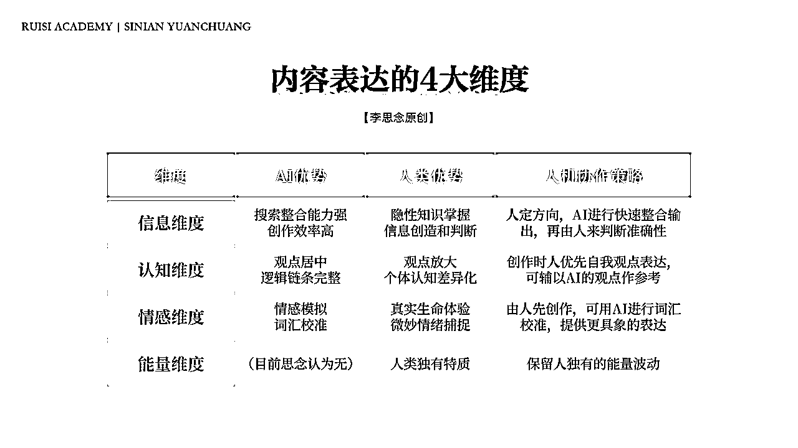

所以发力的重点不是去和 AI 比信息，而是提升自己的情感浓度与能量层级。

让内容带有你的水印，自带签名，这才是当下内容营销的核心竞争力。

## 2、好内容的公式

我把好内容总结为：

好内容＝实用×共鸣×理念×转化×时效

【实用】是点击的首要诱因。因为有用，所以读下去。实用不只是解决显性问题，也能满足好奇心、带来新认知。

很多人在追求干货量，但干货越多不等于越好。用户要的是能领悟并用得上的东西，而不是书本真理的堆砌。

你会为正确的大道理点赞，还是为能联想到自己的内容点赞？

所以【共鸣】必须植入。

共鸣，先共后鸣。共是共同点，找到你与读者的交集再展开。

比如身份共鸣，“我们 90 后...”；经历共鸣，“创业 11 年我经历无数次低谷...”；情感共鸣，“感恩路上遇见的贵人...”；共同敌人，“我们尊重原创反对抄袭...”

鸣需要载体，故事、场景化描写，让用户身临其境。

想让内容有穿透力，还要有【理念】支撑。

你通过文字传递什么价值观？同频的人能嗅到。

过去我以为人是靠认知高度聚在一起，现在发现是价值观一致。

所以要大胆表达你的思想与价值观，这是一种信号。没有信号，内容就只能平庸。

套模板的文案没有灵魂，因为打动人的不是格式，而是底层思维。

【转化】需要钩子。

大部分创业者的内容不是为写而写，是为成交而写。

钩子分显性和隐性。显性是送资料、引导加我领取；隐性是传递向往感，让人想链接你、想成为你、想靠近你。

最后是【时效】。

再好的内容，错过关注窗口就沉了。AI 提升了效率，可以更快跟热点。

我的内容布局会兼顾：热点型、周期型、常青型。

热点型快速跟进，周期型持续深耕，常青型重点打磨。像我两三年前的小红书今天还有人点赞，就是常青的长尾效应。

用这个公式自检，每篇文章都能快速判断价值高低。

# 三、去 AI 味，先学会鉴别 AI 味

想去掉 AI 味，先要识别出来。

## 1、不同模型的 AI 味

不同模型味儿不同。

ChatGPT 的味是“首先，其次，然后，总而言之”，结构感很强。

Kimi 的味是说明书式，把能搜到的都列出来，像小学生背书。

deepseek 的味是“希腊人用蜡与羽毛飞向太阳，坠落时方知：翅膀不是神罚，而是对天空情书的误读。”

一水的华丽辞藻，硬凑的比喻，强行对仗。乍看惊艳，用上三天就觉得油腻。

## 2、deepseek 的 AI 味集中在

#### ①跨时空比喻修辞
动不动扯文艺复兴、远古神话，跳戏感强。爱用“骨骼”“烙印”“淬炼”“暴雨”“灯塔”等 19 世纪文学味词汇。

有个博主吐槽，因为 deepseek，创作者都不敢轻易用比喻了，生怕被判 AI。

我猜是因为训练语料里经典文学太多，判断文学高度等于辞藻华丽。有一个巨大的比喻库，一说想要文艺，就会乱调一批生僻词，本体和喻体关联却很弱。

#### ②专业术语堆砌
写干货时爱堆黑话。“触手”“认知塌缩”“压力阀”这类词。偶尔一个亮眼，全篇都是就让人想关掉。

比如这篇小红书截图，一眼 AI 味：

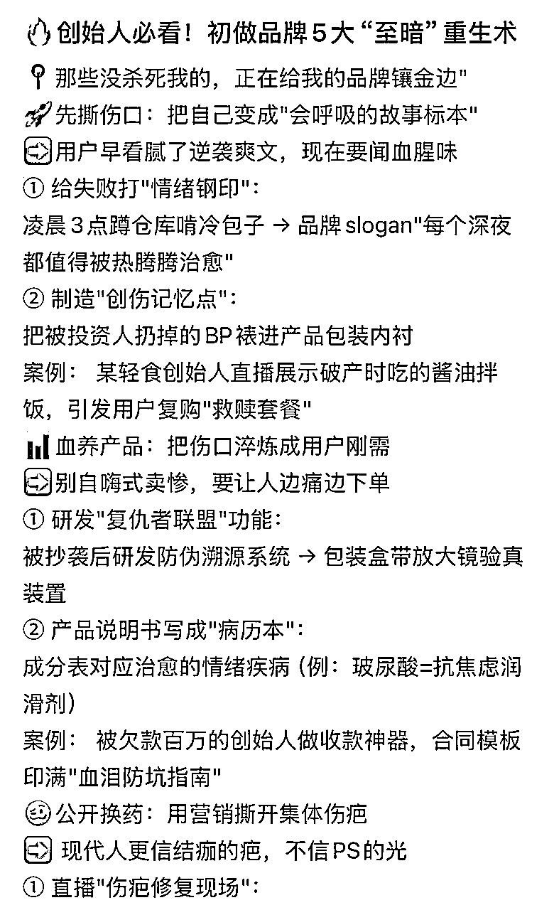

#### ③过度对仗短句
爱排比、爱并列，短句罗列，点到即止就跳下一层，缺少思考的过渡。

#### ④符号不日常
引号用英文——" "，我们写中文是“”。还会出现*#- 等符号，都需要改。

# 四、怎么用 deepseek 降 AI 味

识别出来就要规避。

## 1、优化提问
提问时一定要「明确身份」：你的身份和受众身份，越具体越好。

要有「文风导向」：比如“用日常对话口吻、口语化表达”。

要有「禁止指令」：比如“避免使用彩虹、灯塔、炼金术等比喻”。

告诉它要什么不要什么，反复修正，结果更贴近需求。

【举例】
我明确身份+受众+选题+文风+禁止指令后生成了一篇：

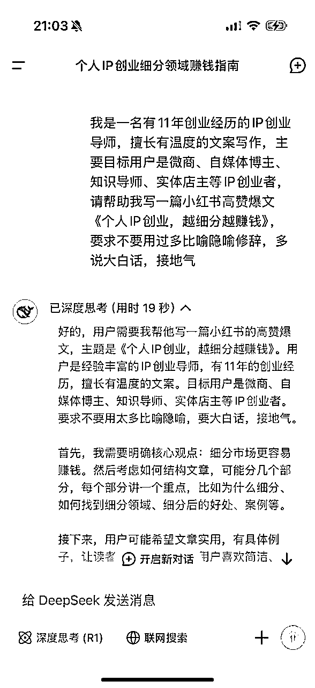

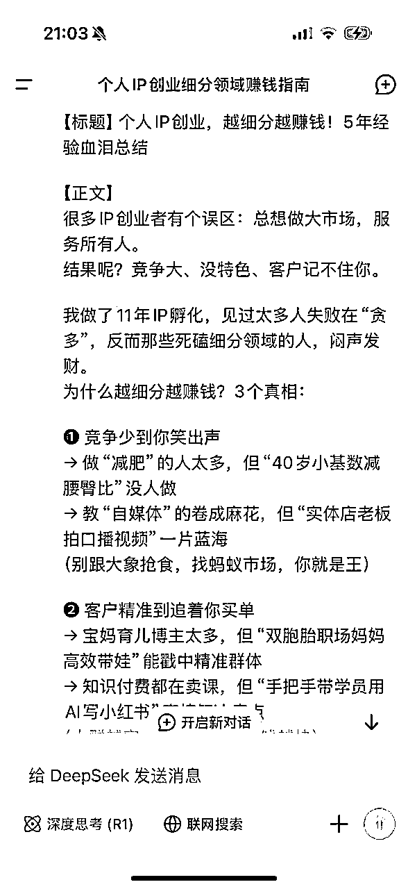

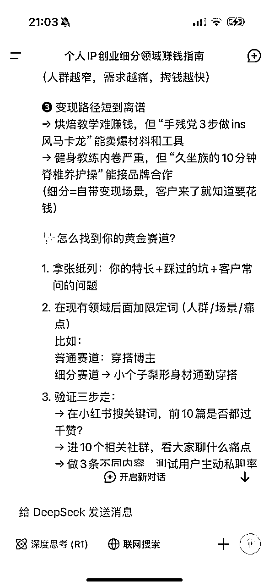

效果约 70 分，再用自己的语言归纳润色，就是一篇合格的小红书稿。

## 2、傻瓜式投喂建个人文风库
这是最快让输出贴近你的方法。

我用的是懒人投喂法，夸夸 deepseek 聪明的地方是，你不会做它会教你做。

春节时我直接问：“我想让你学习我的写作风格，需要给我什么？”

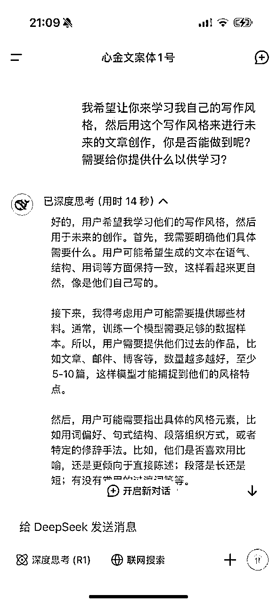

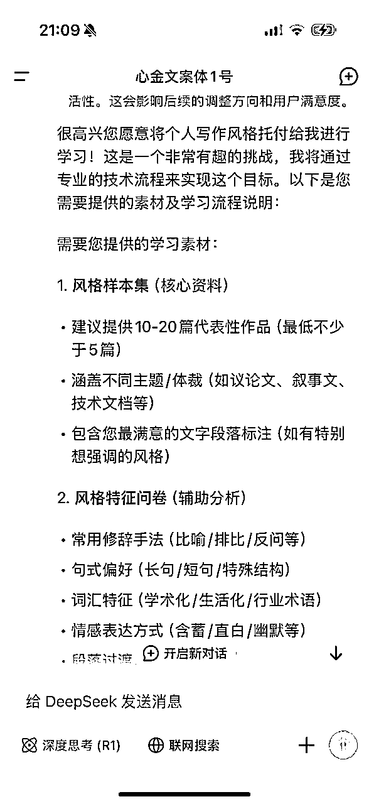

照着它的建议一步步投喂，我的心金文案体就建起来了。风格匹配度从 82% 升到 97.5%：

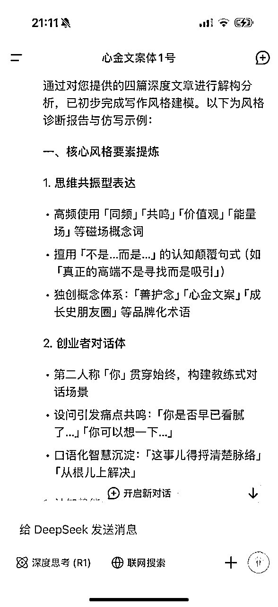

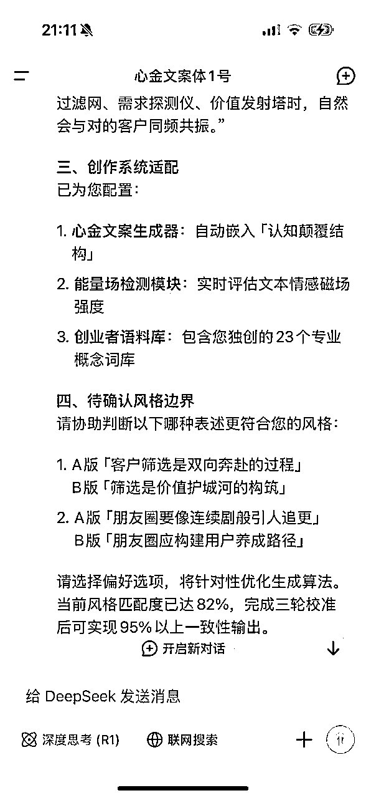

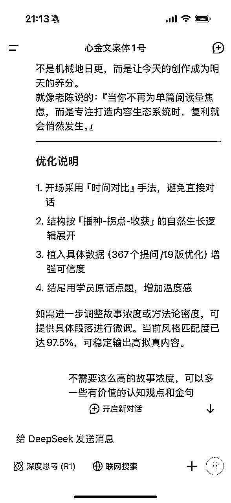

思路很简单：不会提问就让 deepseek 当教练。直接说“我想实现 X 该怎么做”，让它一步步带你完成。

小缺陷是 deepseek 会“失忆”，10 回合以上容易忘初衷，需要不断重申要求。

## 3、让 AI 鉴 AI
生成后复制回去，让它找出来 AI 味重的句段，用更口语化的语言重写。

甚至可以要求它故意制造 10% 的语法小瑕疵，保留修改痕迹，更自然。

## 4、分区使用双重对照
每个对话框记忆独立。我会开多个窗口：写文案的、做标题的、搭课程框架的、给生活建议的，各自独立。

我的心金文案体投喂了两个模型，让它们分别写同一选题。

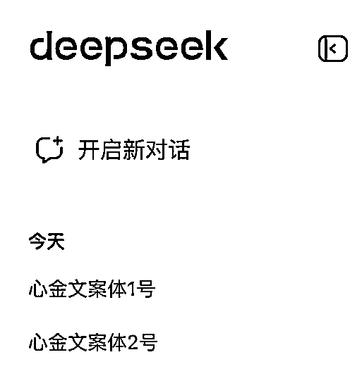

互相补充，视角更全。可以设定一个偏感性一个偏干货，组合使用，AI 感就降了。

# 五、二次加工加“人味”

文案到底怎么才会有“人味”？说白了，就是要把AI那种太顺、太稳、太完美的感觉给打破。

### 一、让句子会呼吸

写字的时候，别一口气憋死。长句短句掺着来，一句十五个字往下压，紧跟着一句七个字收尾。那种一板一眼的对仗感，满满的AI味。

呼吸感更关键，它不是标点符号教的断句，而是你真说出来时会自然停顿的气口。按这个气口去改，文字一下子就活了。

### ②塞进语气词

“呀”“哎”“啊”这些小词，看着不起眼，情绪浓度却上来了，更像人说话。

再给自己定一套标志性的小习惯，比如我就特别爱用波浪号～，这种个人化的符号，也是和机器拉开距离的小心机。

### ③说点人话，聊个网络梗

适当上点当下大家都在用的词，文风会瞬间接地气。

像“绝了！”“家人们”“有一说一”“懂的都懂”“city不city”，这些词一丢进去，距离感就没了。

### ④写进场景里，别只甩干货

有温度的内容一定得有画面感。AI写不出你写的时候在哪个咖啡馆、窗外下着什么雨，你可以。

举个例子。护肤品别只写“温和不刺激，深层清洁毛孔，还能快速卸妆”，这不就是说明书吗？

加了场景就完全不一样了：“凌晨加班回来，睫毛膏已经晕成熊猫眼，挤出洁面乳起泡的那一瞬间，整个人都松开了，毛孔也跟着大口呼吸一样亮了。”一秒入戏。

### ⑤亮出你的立场

这才是人味的核心。

AI永远像个和稀泥的理中客，而人，都有自己的态度和偏执。IP做久了，大家要的不是大盘参考，而是你独一份的尖锐看法。个性化的观点，才是你和别人的分水岭。

### ⑥故意留点不完美

AI的内容总很干净。但真实的创作偶尔会有个小错别字，标点用乱了，或者像山东人一样爱倒装一句。句子打乱点顺序，反而更像真人写的。

# 六、思念爆文应用展示

### 热门成果

把AI当工具，再配合矩阵分发，我不到半个月就在小红书和公众号上连着出了几篇爆款：

下面我拆一下我的真实创作流程。现在我主要用deepseek本体用，忙的时候会切到腾讯元宝。

我从不把创作全丢给AI，它在我这儿就是个“思路外挂”和“快写助手”。

一个选题下来，我会先自己过一遍脑子：我想说什么观点？想举什么例子？理顺了再丢给deepseek，让它怎么展开。它的思路我会拿来补充，但绝不全盘照抄，这也是防止自己脑子退化的训练。

现在我的创作配比大概是人 80% + AI 20%。

AI只占两成，效率却比以前快了一倍。它帮我快速扒信息、搭骨架、定结构，省去我最耗时的起步阶段。

### 实操展示

创作我一直遵循“一鱼多吃”的打法。一篇核心内容，换个说法投到不同平台。

我很多爆款的雏形，其实就是朋友圈随手发的一段感想。比如这条：

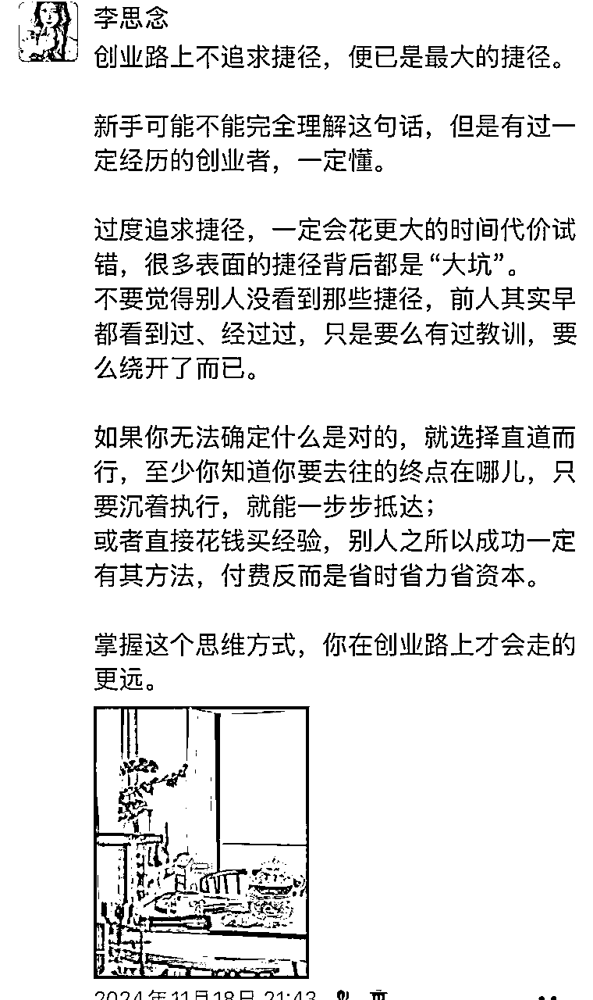

当时也就两百来字。

后来我让腾讯元宝 deepseek版帮我扩了一下文：

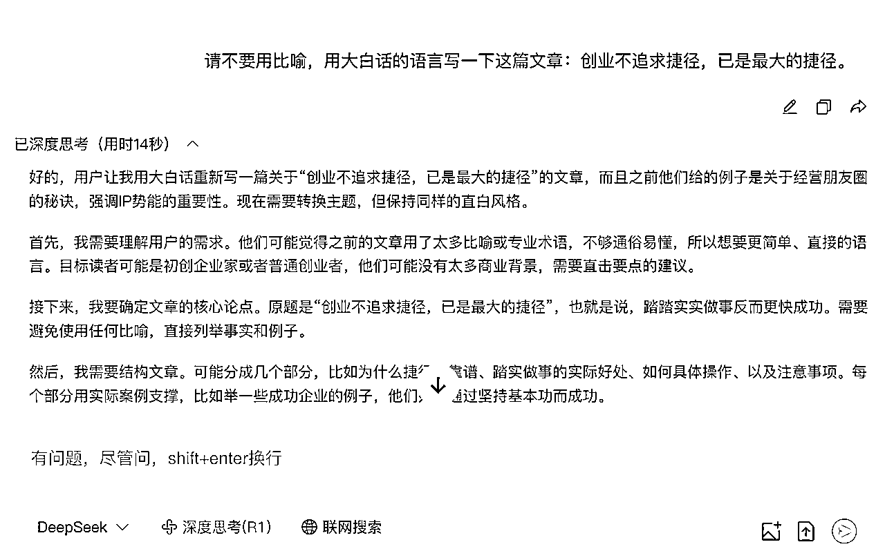

我真正用上的，是它给出的行文逻辑。

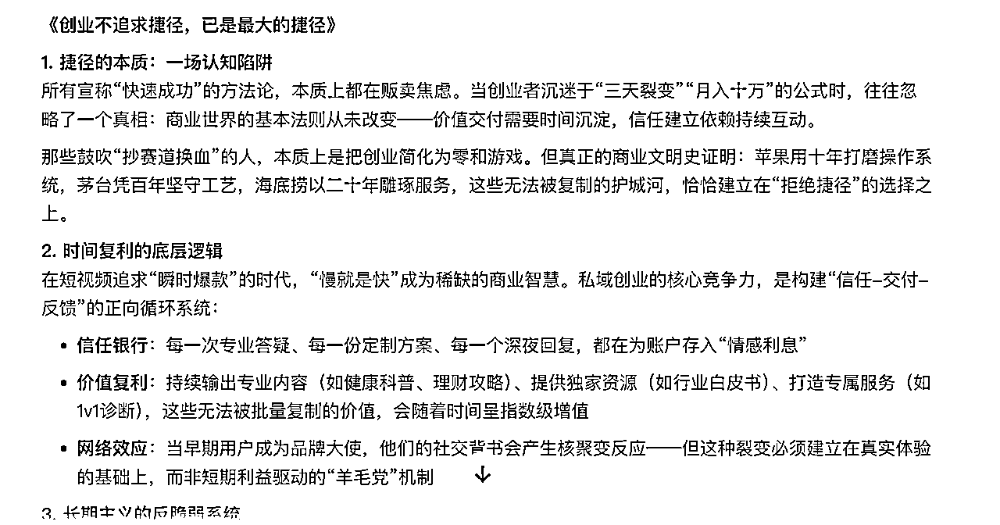

因为之前喂过我的写作风格，这两段很对味的句子我就直接用了：

所有宣称“快速成功”的方法论，本质上都在贩卖焦虑。当创业者沉迷于“三天裂变”“月入十万”的公式时，往往忽略了一个真相：商业世界的基本法则从未改变——价值交付需要时间沉淀，信任建立依赖持续互动。

在短视频追求“瞬时爆款”的时代，“慢就是快”成为稀缺的商业智慧。私域创业的核心竞争力，是构建“信任-交付-反馈”的正向循环系统

（——绿色字为AI参考我文风生成的内容）

当然我也改了。把“信任-交付-反馈”改成了“信任-交付-复购”，因为“复购”对个体创业者来说，更实在、更懂。

AI的东西最后还得自己把关。用专业判断它哪里不对，用认知去校准它是否真符合用户，这一步永远少不了。

最后的成稿是这两篇：

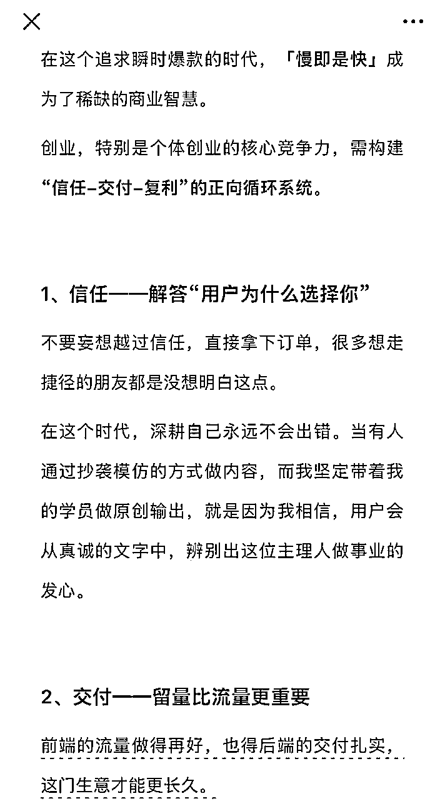

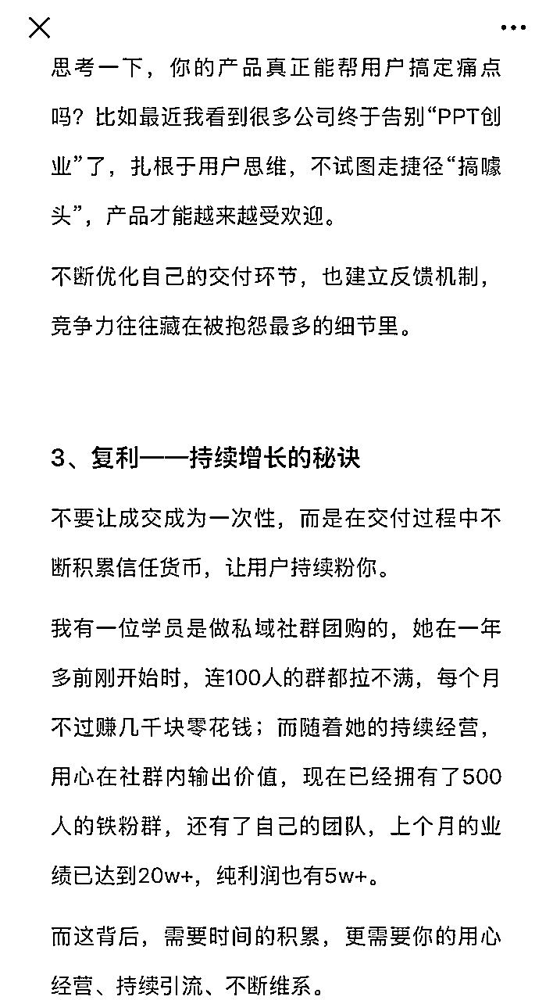

deepseek给了我框架和灵感，第三点的真实学员案例，以及三点的具体展开，全是我自己写的。

你看，一篇成文 = 我的短文案 + AI的扩写灵感 + AI给的框架 + 我自己的故事案例。AI味被稀释得很淡，效率却翻倍。

所以可以借鉴我的做法：AI负责快成文，你负责讲故事留钩子。别过度依赖它，它不一定对，也读不懂你和你用户的微妙需求，专业和判断力还是要自己握在手里。

# 七、结语

今天这些，是我基于deepseek创作的一点小总结。技术会一直往前跑，未来一定会有更像人的AI模型出现。

比如Sam Altman最近说的那个擅长创意写作的新模型，可能上线那天，这篇心得就过时了；也可能出现新的“AI味”，就像deepseek刚来时我们也被惊艳到，意识到它太像AI也不过一个月。

AI在进化，我们也要跟着长。

如果后面大家还需要，我还会继续拆解怎么把文案写得更像人。

有收获的话，点个赞呗～