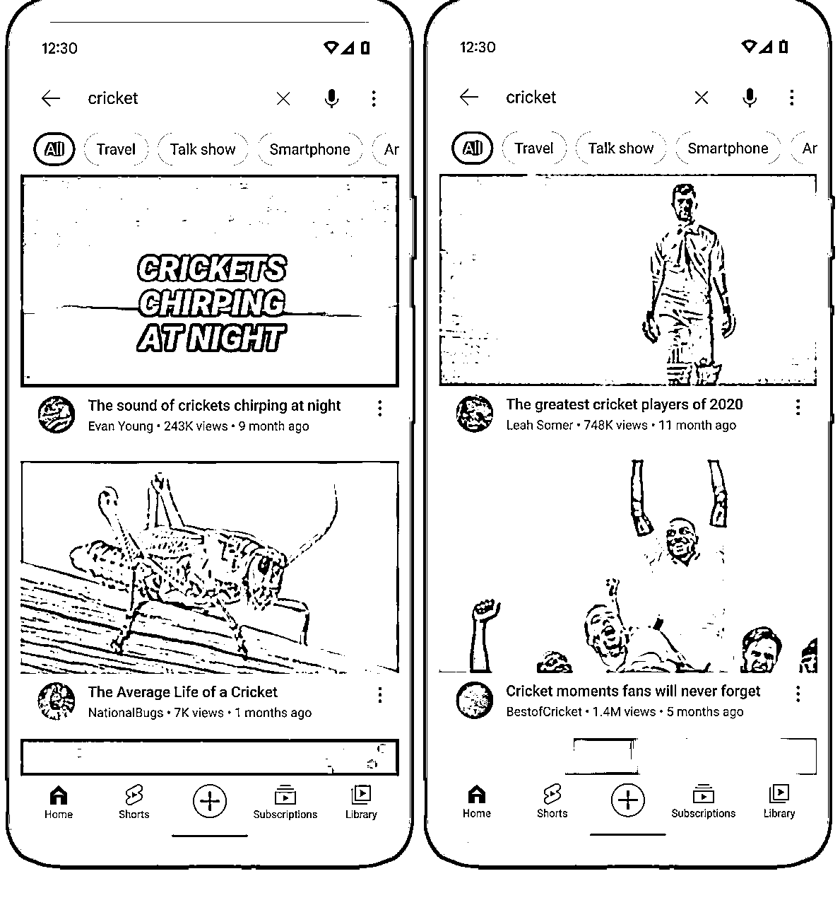
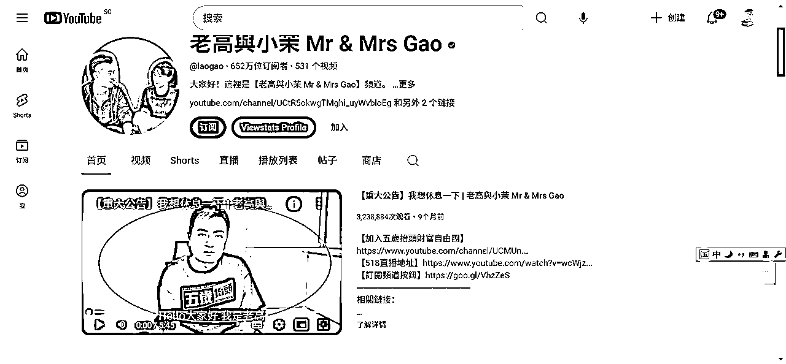
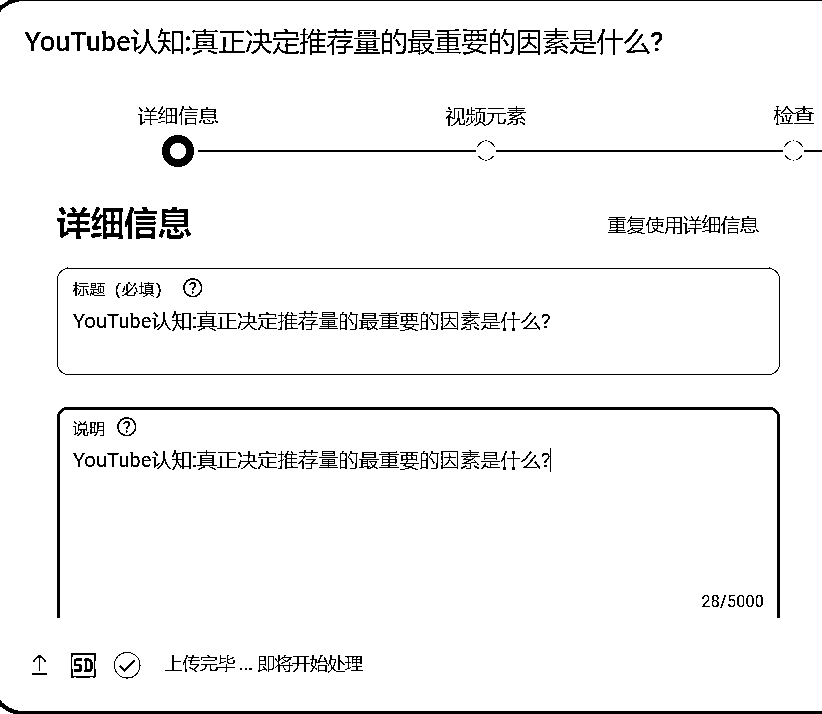
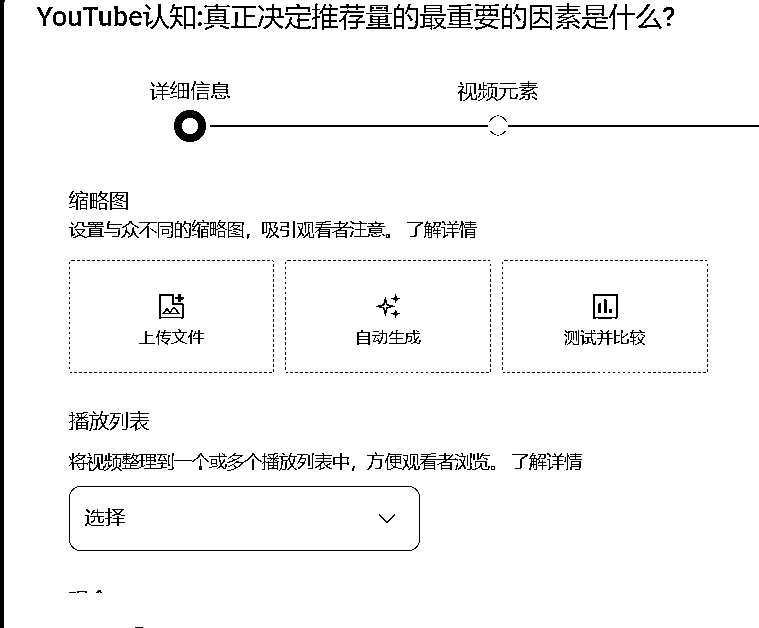
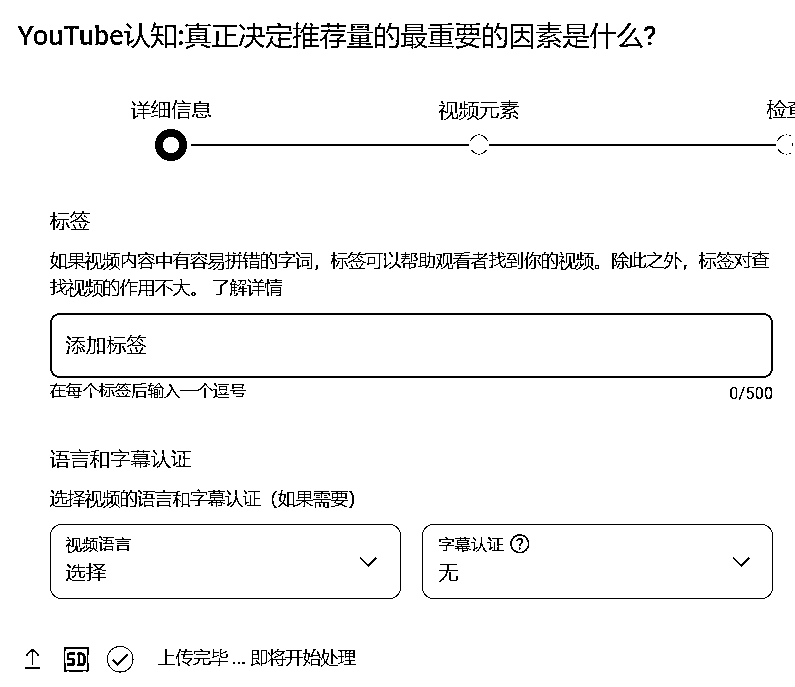
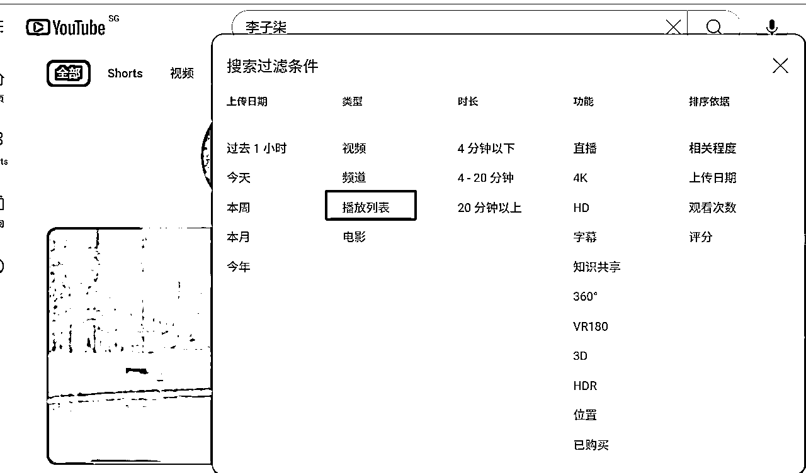
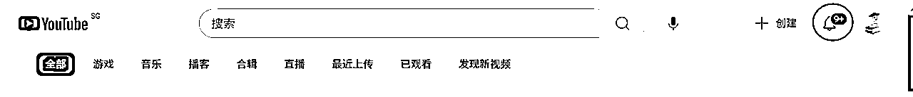
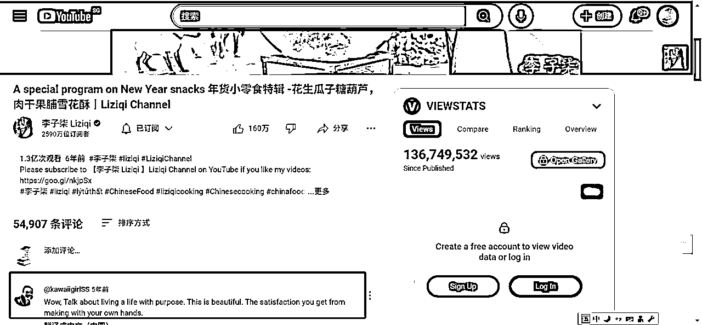
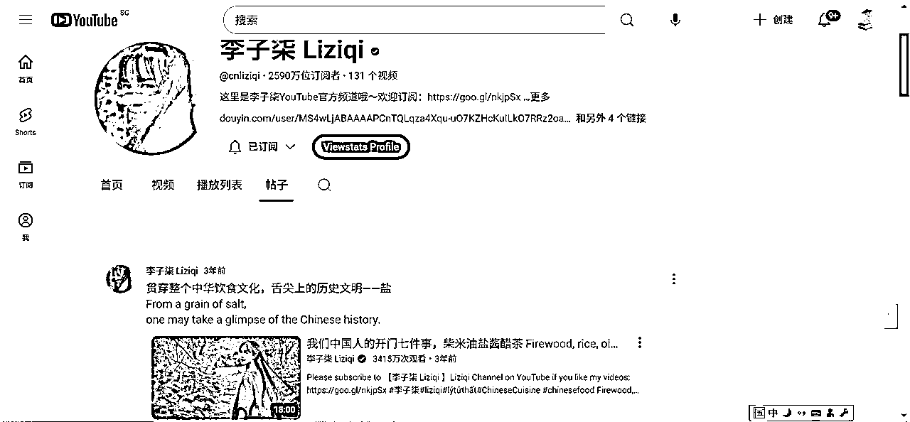

# YouTube频道如何起量？把推广拆成三条路径，收好不迷路

把引流思路抽象一下，其实就三类打法：等来、自己上、付费买。

1、被动型
2、主动型
3、付费型

### 1、被动型

被动不等于躺平，而是先把基础设施搭好，然后像钓鱼一样守着位子等鱼上钩。准备工作做完，后续的曝光和订阅就交由平台机制和用户决策。

被动型可操作的三个支点：

#### 1、做搜索可见的SEO

先琢磨用户会用哪些词来找内容，尤其是长尾词和当下热搜，围绕这些词来定题和产出。目标很直接，让检索的人能找到你。

选题阶段要紧跟关键词和趋势。

补充说明：YouTube 搜索排序的逻辑

YouTube 每分钟就有 500 小时以上的视频在上传，人工根本梳理不过来。

YouTube 的搜索分发系统负责给海量内容打标签，通过排序呈现与搜索意图最贴合、最有用的结果。

在搜索场景里，平台主要看三件事：相关度、互动度、内容水准。

不同检索场景下，三者的比重会浮动。判断相关度时，会参考标题、标签、描述以及视频画面与检索词的匹配程度。

互动信号是判断相关度的重要参考。比如针对某个查询，某个视频的平均观看时长更高，就会被视为更相关。

在质量维度，系统会识别频道在特定主题上的专业性、权威性和可信度。

YouTube 不会因付费就提升自然搜索位，也不会给自家内容开后门。

以外，还会兼顾个性化。如果你开启了搜索和观看历史，排序会结合你的过往行为进行微调。

因此同样的关键词，不同人看到的列表可能不同。下面就是因这些因素导致结果差异的例子。

比如一个常看体育内容的用户，搜“板球”，大概率会得到板球运动的视频，而不是自然界的蟋蟀相关视频。

官方文档链接

#### 2、把频道主页装起来

无论是通过检索还是推荐进来，当用户产生订阅念头时，都会点进你的频道首页。这个触点就是你的门面。

频道里有首页、视频页、播放列表、频道页、社区、简介等多个入口，都要填满信息。

我见过不少频道首页空空如也，新号可以理解，发了几十条还在空白就说不过去了。

好的频道设置能让访客一眼明白你的定位。你有没有写好简介？关键词有没有补齐？默认页面都完善了吗？播放列表是否清晰，能快速展示你的内容板块？看懂了，订阅的可能性才会提升。

频道装修单独拎出来也是一个专题。这里只点一下：首页最好放一个频道预告片。若有自己的产品，这个预告片就是自我介绍的名片。如下图这个视频，就是专门给未订阅用户看的。

没有产品就放播放表现好的代表作。有产品就用来宣传个人IP。频道设置的细活后面会另外写。

#### 3、打磨视频元信息：封面、标题、说明、标签等

这些要素必须具备吸引力。

YouTube 给你一次曝光，封面丑到让人直接划走，这次机会就浪费了。所以元信息的精细程度，直接决定算法能不能识别你并推你。

被动型推广的本质就是把可控的部分做到位。做到位之后，视频最终有多少播放、多少人订阅，就不是你能完全掌控的了。

下面补充之前的内容，视角会不一样。

为什么你的视频冷启动不起来？看这三点：封面、标题、内容本身

视频能否被更多人看到，核心看三点：封面、标题、内容质量。

别用主观臆断代替用户行为。用户看到视频的第一步是扫封面，第二步是读标题，只有两者都对上需求才会点进来。

封面和标题是一组组合拳。封面负责抓眼球，标题负责给信息，共同决定点击率。

YouTube 早期更看重点击，所以不少人靠夸张封面标题拉量。后来平台把观看时长和完播率的权重提高了，单纯的标题党就不好使了。

广告是基于观看产生的，所以内容质量也很关键。

提升播放量常用多版本测试，给封面和标题做A/B对比，看哪个更能拉升点击。至于封面更关键还是标题更关键，没有标准答案，只能测。

标题还要兼顾SEO。用户有明确需求时会用关键词检索，所以标题既要吸引人又要包含核心词，这本身就是门手艺。

前48小时很关键。YouTube 更偏爱新内容，观众也更愿意看新鲜东西。想获得更多初始观看，开局就要用心打磨。视频发布后再去改封面标题，平台推荐会更偏向新片而不是旧片。当然这不是绝对，有些长青内容也会在后期爆发。新闻类内容时效性极强，更要在一开始就做到位。

视频质量不是指清晰度。1080P 在 YouTube 已足够，4K 大多数场景用不上。更核心的指标是完播率，尤其是开头30秒。把最精彩、最能吊胃口的信息前置，才能降低跳出。

内容也要避免过于单调。比如一个人从头讲到尾不做镜头切换。MrBeast 有 3.07 亿订阅，他的视频能拿下播放量，核心就是节奏快、镜头切得快，在观众疲劳前就切换。

##### YouTube 心智：真正决定分发量的关键是什么？

常见误区：很多人觉得推荐算法是为创作者服务的。其实它更偏向观众的兴趣和行为。推荐不是从创作者角度出发，而是根据观众偏好，从新旧视频里匹配内容给他们看。简单说，算法是为用户服务的，不是为UP主服务的。

上传时需要填写的信息

1. 视频说明
说明重要吗？不算核心，但有空还是要认真写。这是向平台介绍视频内容的机会。现在用 ChatGPT 很好写，把字幕丢进去让它生成摘要再粘贴即可。

2. 标签
标签作用有限。对已有垂直定位的频道，标签几乎可忽略。新频道初期可以加一些帮助平台理解内容的标签，建立起来后作用就很小了。不要乱堆不相关标签，正确用法是精准简洁。

3. 类别
类别对推荐影响很低，随便选一个大致相关的就行，不用纠结。

4. 视频文件名
文件名对推荐没有任何影响。英文、数字、下划线都无所谓，算法根本不看这个。

5. 上传时间
固定时间上传对老粉有帮助，能养成观看习惯。但对推荐量没有加成。做到就能发，别纠结几点发。

总体来看，元数据远没有想象中重要。真正决定留存的是选题、封面、标题、视频前30秒，类别、标签之类的属性权重很低。

封面和标题决定第一眼是否点击。后台有一个关键指标是前30秒跳出率。建议把视频的精华或悬念前置，用公众号爆文的套路来留人。

我个人认为，视频质量是第一位的。看过《10倍比2倍更简单》提到 Mr Beast，记录了他的10倍增长思路：

1、以指数级、非线性方式思考
2、极致追求质量而非数量
3、组建团队处理80%的工作，自己专注提升核心技能

Mr Beast 很早就清楚自己要什么，这点很稀缺。他现在的订阅已超1亿，做的极好。

书里一个观点很有启发：一个视频做到500万播放，比50个视频各100播放要容易得多。做一个精品，远胜于做100个平庸内容。

我看过他的作品，好在镜头节奏快，在观众感到无聊前就切走了。这体现的思路是，把时间花在打造精品上，而不是分散在大量普通内容上。

关注核心的20%，把80%的执行交给团队。比如把剪辑外包，剪辑师能全职投入，你就能腾出时间思考更有价值的事。

这也提醒自己：哪些是该自己盯的20%，哪些是可以外包的80%。问出这个问题，就已经解决了一半。

### 2、主动型

主动型就是自己出门找流量。分两块：平台内主动、平台外主动。

#### 1、YouTube 内部主动

##### 1、求转发

在视频里直接呼吁观众转发。转发的本质是把视频搬到别的平台或群组，扩大触达，回到 YouTube 的点击也会随之增加。

##### 2、频道互推

找同类或相关频道互相引流。直播连麦时把对方频道链接放在简介，并口头提及，让对方也回推你的频道。

补充：频道设置里的精选频道可以挂互推对象的频道地址。

##### 3、用播放列表抱大腿

原理：播放列表也能被搜索到。

1、原理
在搜索结果里，播放列表是一个独立类型。

2、“投毒”
把播放列表前几个位置放大V的视频，第3、4个位置放自己的视频，形成“投毒”。

3、等待
观众看完大V的视频不退出，会自动连播到你的视频。

补充说明：播放列表要围绕一个主题建，你的视频主题与大V一致。这样观众看完大V再看你，YouTube 会把你和大V关联起来，后续更可能把你的视频推给这类用户。相当于你把观众带进了自己的频道。

##### 4、去大V视频下留言

思路和上面类似，就是去大V频道留言，注意情商，做一个让人舒服的人。

细节
1、订阅目标频道并打开小铃铛
能第一时间收到更新通知。

2、第一时间看并留言
视频刚发时留言更容易留在前面。大V视频评论量巨大，晚了就沉了。像李子柒的1.3亿播放视频，第一时间留言，曝光接近100%。

3、提供有价值的评论
评论对观众有帮助，有机会被大V点赞或置顶。评论者点进你的头像，如果你的内容符合他们口味，就可能订阅。

4、别做硬广
不要写“来我频道看看吧，我也做了类似的”，链接直怼。太生硬会招黑，大V可能拉黑，甚至发动粉丝举报。

为什么有效？
1、精准且体量大。去大V那留言，你和大V的受众高度重合。
2、自然导流，印象好。不是硬广，而是像课堂笔记一样整理重点，别人顺着评论点进你的频道，信任感更高。
3、频道关联利于推荐。你长期在大V视频下高质量互动，YouTube 会把你的频道和大V关联，后续大V粉丝看内容时，你的视频也会被顺带推荐。

##### 5、直播间评论引流

比视频留言更有效。直播有实时性，观众会注意到活跃评论者，好奇点进主页，符合预期就会订阅。

社区帖写作也有类似效果。

##### 6、写社区帖

社区帖不一定只在频道页出现，也可能出现在首页。写有意思的内容引发互动，互动者里就有潜在订阅者。

补充：社区投票形式很简单，选一个有意思的话题就容易火。

#### 2、YouTube 外部主动

针对平台外的引流，即把外部流量导进 YouTube。

##### 1、告知链接和社交媒体传播
直接告诉人你的频道名字和链接。在微信群、电报群、Facebook、Twitter、博客等渠道发布最新视频截图、链接、关键词，让用户能准确搜到并产生观看订阅行为。

##### 2、在网站嵌入视频
自建网站或在他人网站上嵌入你的频道视频。

### 主动型和被动型的区别

主动型所有动作都是你去冲。投入越大，回报通常也比被动型更好。

尤其是从平台外引流，YouTube 会给你额外加码。因为你帮平台拉来了新用户，它自然乐意回馈流量。

### 付费型

付费推广最直接。总体来说，付费的效果通常会比免费的被动、主动推广更好，但不是绝对，效果取决于很多变量。

关于付费推广，其实大体可以归纳为两大方向。

#### 除 Google Ads 之外的付费玩法

YouTube 本身很欢迎外部引流，但现实是，如果你没资源，靠自己在博客或微信发帖之外，想让其他社交媒体的大号免费帮你宣传，基本不现实。

这种花钱买流量的思路，和主动型外部推广本质上是一回事，只是把“免费”换成了“付费”。

第一种是走 YouTube 外部。花钱请社交媒体大号发条帖子带你引流，或者在一些垂直网站上买广告位来导流。

第二种是在 YouTube 内部找同行合作。直接付费给头部频道，让他们把你的频道放在自己的频道页推荐位里。每个频道都有自己的频道页面，频道主完全可以放一波友推，这也是很多频道组合盈利的手段。

想让大频道帮你推，直接私信问报价就行。价格合适就试试。类似的操作还有让对方在社区区发一条宣传帖，费用双方私下谈。

还有一种更柔和的形式是付费采访。频道主在采访你的过程中，自然会提到你的品牌、频道或产品，顺带完成曝光。

#### Google Ads

提到付费推广，很多人脑子里第一反应就是谷歌广告。所以把它放到最后，也是想提醒你，渠道远不止它一个。

谷歌广告上手门槛低，任何创作者都能自己注册账号，给频道或单条视频投钱曝光。

不过要分情况。如果只是想小额体验下系统，花几十上百块自己瞎玩一下是可以的。但如果目标是认真做频道或视频的投放，千万别自己硬上，一定要找懂行的专业人士来操盘。

广告后台坑很多，不熟悉的话很容易烧钱，还会得出“Google Ads 根本没用”的错误结论。实际上用对了，效果是非常好的。这里不是推销，也不是专家，只是善意提醒。

不管是被动、主动还是付费，这三类推广都只是后面的 0，内容本身才是前面的 1。节目质量还没稳定下来之前，谈推广都是本末倒置。

怎么判断内容够不够格？看一个核心指标：完播率。如果你的视频完播率长期徘徊在 20%-30%，就先别分心去想推广，更别花钱投放，那只是在浪费时间和预算。

以上内容仅是一个框架，还有不少玩法没展开，篇幅也差不多了，后续会慢慢补充。

抛砖引玉，如果你手上也有私藏的好方法，欢迎补充，也希望这篇文章能给你一点启发。