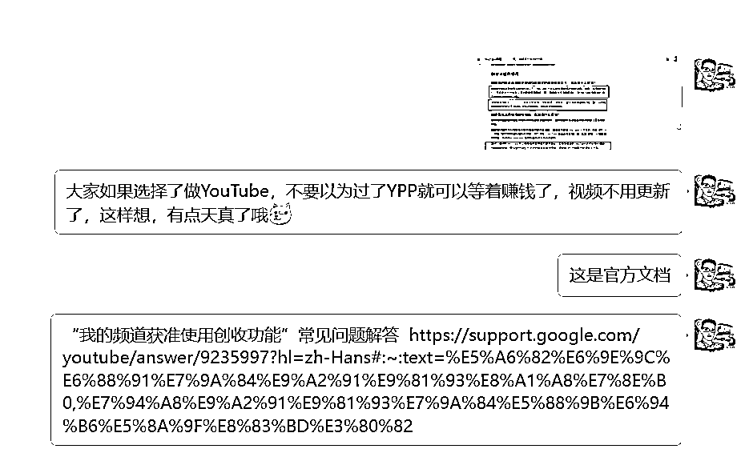
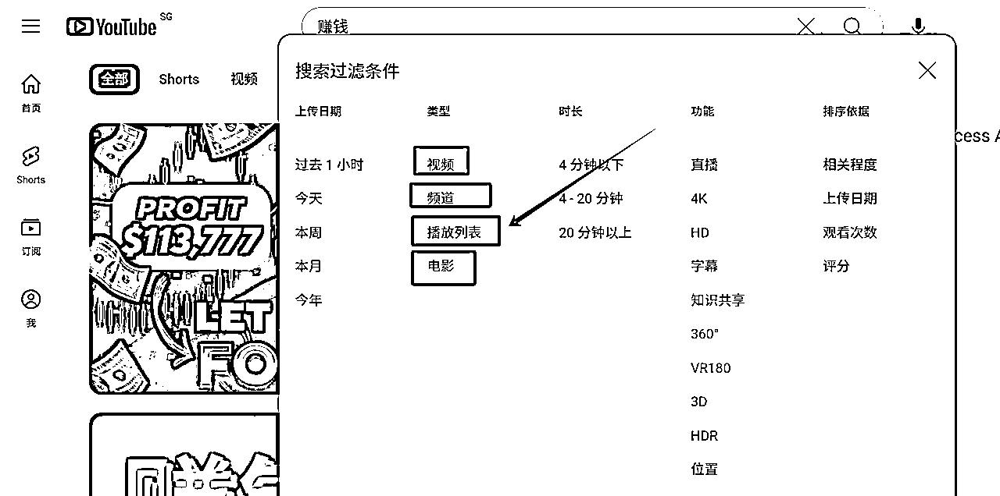
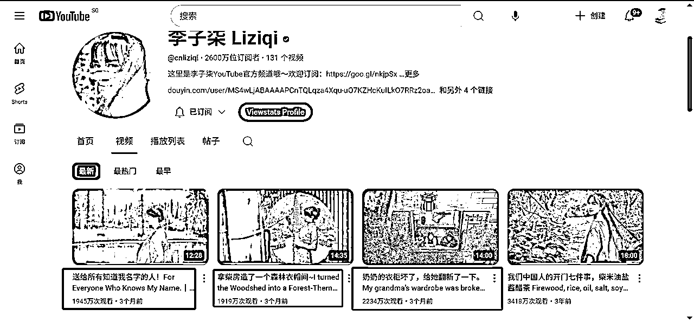

# YPP通过以后别掉以轻心，这个坑踩中就直接被拔掉收益
作者：龙哥

官方在《我的频道已获创收资格》的帮助中心里，专门列了常见问答，我把最核心的那一段提出来。

### 频道数据跌破门槛会怎样？

YouTube 明确说，表现下滑到最低线以下，并不会立刻自动关闭你的变现权限。但有两个例外会让你直接被踢出：
一是频道长期休眠。如果连续半年的时间里你既没上传新视频，也没发社区贴，平台有权自行终止你的收益资格。
二是触及政策红线。只要违反了《YouTube 频道创收政策》的任何一条，不管你有多少订阅、多少时长、多少 Shorts 播放，收益资格照样会被收回。

这里所说的最低门槛，指的就是合作伙伴计划概览页写的入选条件。

## 入选条件到底是什么

搞清楚规则后，你就可以开始投放长视频或 Shorts 来冲标准。想让系统主动提醒你达标，可以在 YouTube 工作室的“收益”模块打开通知。一旦满足下面任意一条，就会收到邮件。

1. 过去一年内订阅破千，并且公开长视频的有效观看时长累计到 4000 小时；或者
2. 过去 90 天内订阅破千，并且公开 Shorts 的有效观看次数累计到 1000 万次。

提醒一下，计算那 4000 小时长的时候，Shorts 在 Shorts 频道的观看是不计入的。

关于长期不活跃的判定，官方说法是半年内没有任何上传、发帖动作就算休眠。上传视频、发社区动态、甚至新建播放列表都算活跃。播放列表能否算活跃目前表述有点模糊，过去有人用列表刷存在感来保持活跃。

像李子柒这种头部账号基本不用担心。就算长时间不更新，仍有源源不断的新观众在回看，订阅早就远超一千，观看时长自然也常年在线，远离了危险区。

再补充两个实操中很容易踩雷的点：

1、刚达标提交申请后，粉丝数掉回 999 了，或者手贱把几个旧视频设为私密导致时长跌破 4000 小时，会不会被拒？

不会。审核一旦启动，就以你提交时的达标状态为准。后续小幅波动不会导致申请被打回。真正导致拒审的，通常是内容违规，踩到社区规范或创收政策。想在平台赚钱，第一件事是遵守规则。

2、YPP 已经通过了，但觉得原赛道没流量，想换赛道，甚至直接买了个已变现的账号来做新内容。

最忌讳的就是一上来把历史视频全部清空。我身边就有人拿了个一万粉的号准备转型，一股脑把旧片全删了。那个号当时还没过 YPP，所以没事。但如果是已经通过 YPP 的账号，操作就很危险。

为什么危险？因为审核通过时你的时长和粉丝是达标的，一键删除或批量设私密，时长可能瞬间从 4000 小时变成接近零。平台是有权事后取消已授予的收益资格的，虽然官方用的是“可能”，但真实案例确实发生过。

想安全转型，正确的节奏是：先用新赛道的内容持续更新一段时间，等新内容开始带来时长的同时，再慢慢处理旧内容。可以保留，也可以设为不公开。逐步过渡能保证在转型期，你的整体指标不会断崖式下跌，从而保住已有的变现权限。

最后多说一句，YouTube 本质上是长线生意，玩法很多，也值得长期深耕。如果你本就在国内做内容，多分一条流水到 YouTube 并不会增加太多成本。半年不更一次，对长期收益来说是不合适的。