# 2万元出发，4个月走过3国：一份适合年轻人的极限省钱旅行攻略
作者：龙哥

去年6月底裸辞，9月临时起意，带着约2万元踏上旅程。没想到这一走就是4个月，国内一路经过重庆、成都、甘肃、新疆、西藏，随后前往尼泊尔和韩国，最后回到深圳。

大致路线如下：

深圳——重庆——成都——兰州——武威——张掖——嘉峪关——乌鲁木齐——北屯——布尔津——哈巴河——白哈巴——喀纳斯——禾木——吐鲁番——库尔勒——库车——阿克苏——喀什——红其拉甫——莎车——叶城——大红柳滩——日土——阿里——冈仁波齐——萨嘎——聂拉木——加德满都——博卡拉——日喀则——拉萨——那曲——格尔木——西宁——西安——首尔——釜山——济州岛——南京——杭州——义乌——深圳。

全程交通、住宿、饮食和游玩加起来，花费大约2万元。

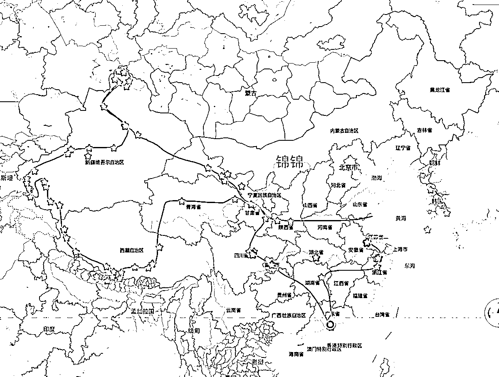

下面把我的省钱方法整理出来，想低预算旅行的朋友可以参考。

# 一、交通：最容易省钱，也最值得花时间研究

## 1. 国内火车：优惠券、盲盒和分段接力

### 先把优惠券用起来

买火车票时不要只盯着一个平台，可以同时看看去哪儿、携程、同程、飞猪等软件。很多时候平台会提供5—10元优惠券，支付宝里的12306小程序有时也会出现优惠。

付款之前，记得查看支付宝的支付消息或优惠提醒，说不定就能直接抵扣。

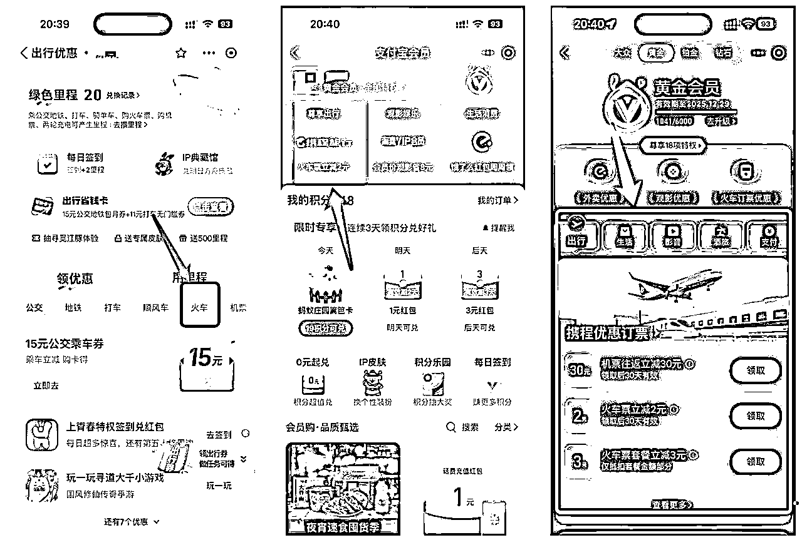

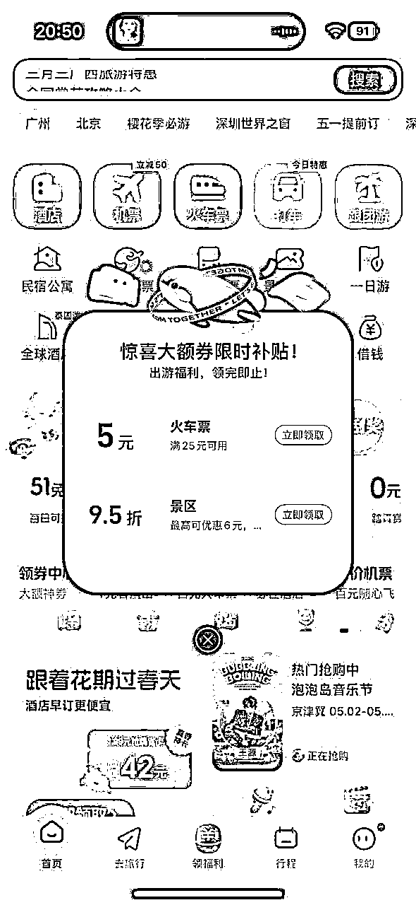

锦锦水印

### 火车盲盒适合时间自由的人

同程有9元和28元的单人火车盲盒，也有双人版本。它的玩法是自行选择出发地，目的地则由系统随机安排，通常会在未来24—48小时内开出车票。

盲盒开出的目的地不一定很远。旺季时，很多票可能只是出发地附近几站，价格大多在几十元到一百多元之间；运气好的话，也可能抽到原价几百元的车票。

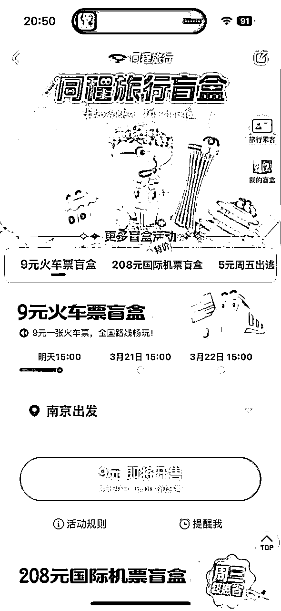

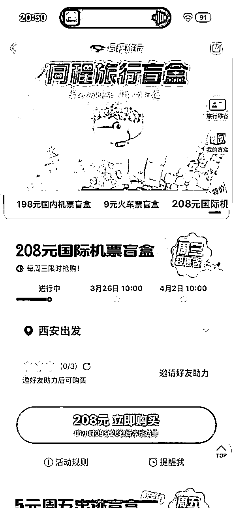

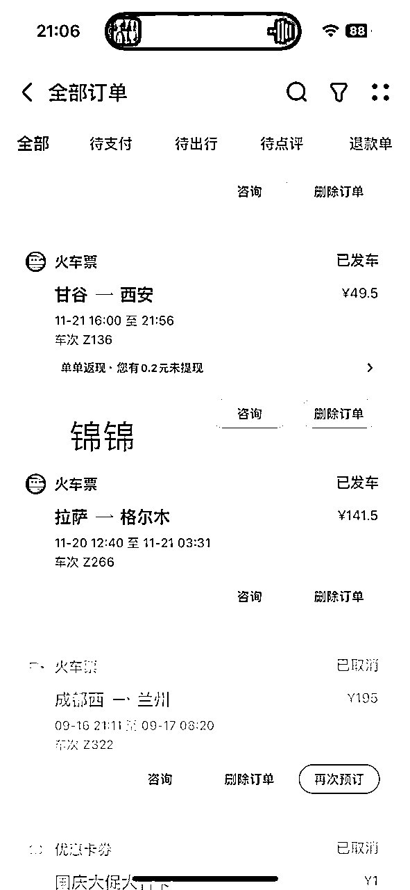

比如从拉萨出发时，我曾经开到那曲、林芝、格尔木等方向。虽然距离不算远，但如果本来就要去这些地方，还是非常划算。

如果抽到的票价很高，即使暂时没有出行计划，也可以考虑锁定购买。因为购买车票还能累积火车积分，用9元换几百元票价对应的积分，性价比不错。

9元盲盒和28元盲盒的主要区别是：

- 28元盲盒需要3位好友助力，每天上午10点开售，不需要抢购；
- 9元盲盒每天15点开放，需要拼手速，但卡准时间通常能够抢到；
- 两种盲盒可以同时购买。

锦锦水印

### 使用盲盒前必须了解这些规则

1. 每周只能购买一次。盲盒开出车票后，会有15分钟考虑时间：需要就锁定，不需要就放弃，超时也会被视为放弃。锁定车票每月只能使用一次。

   如果想乘坐4月3日中午的车，那么开盲盒的时间要控制在4月1日中午到4月2日中午之间，才有机会开到对应日期的车票。

2. 盲盒车票通常可以改签。退票则比较麻烦，需要联系客服甚至投诉，而且退票后可能无法继续参与盲盒活动。

3. 同一张身份证只能对应一个账号使用。即便注册多个手机号，车票也必须由绑定实名的本人乘坐。

4. 开盲盒之前，可以先查看目标日期的车次、时间和途经站。如果没有抽到最终目的地，但抽到了中途站，也可以先买票上车，再补后续区间，有时同样能省不少钱。

### 智行：适合做短途衔接

智行也有36.8元火车盲盒，通常会开出热门短途路线，例如西宁到兰州、南京到杭州、拉萨到那曲等。

它一次可以开7个盲盒，初始通常会赠送3次机会。若还没有抽到合适的路线，就需要邀请好友助力。抽到并付款后，一般要在24小时内兑换具体车次。

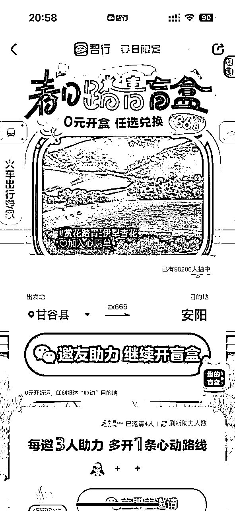

智行的优势是可以自行选择时间和车次，因此很适合拿来和其他平台拼接路线。

我曾经先用同程开出拉萨到格尔木，再通过智行继续抽格尔木到西宁，并且选择同一趟列车，实现无缝衔接。

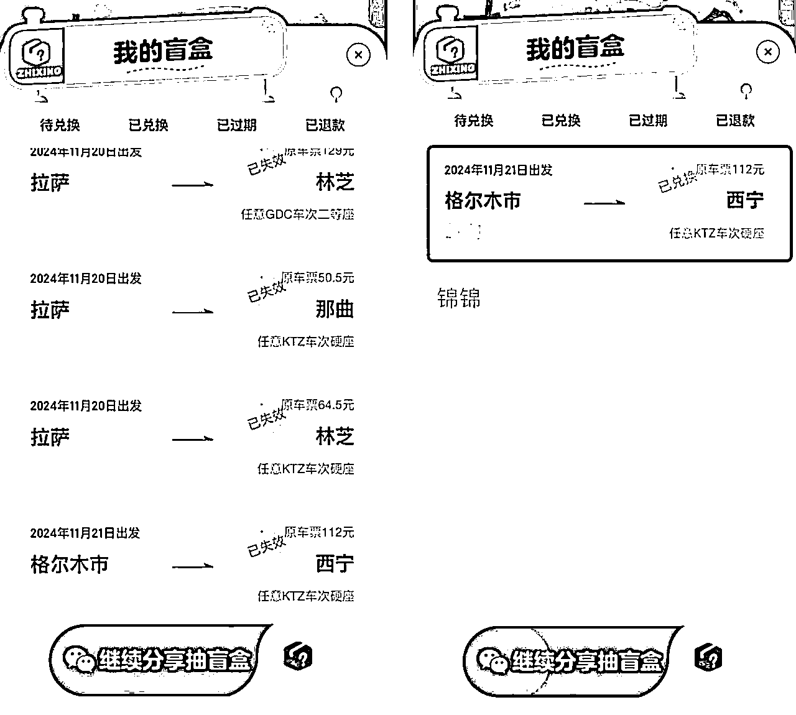

### 马达出行：继续完成分段接力

当其他平台的盲盒次数用完后，还可以看看马达出行。它的火车盲盒价格为9元，每天邀请2位好友助力后即可购买，整体规则和同程比较接近。

当时我从西宁前往西安，最后一段就是靠马达出行接力完成的。

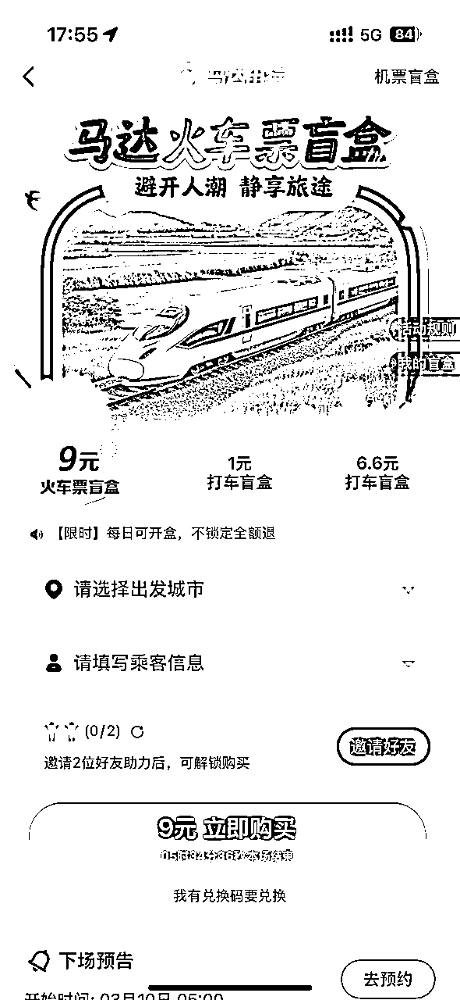

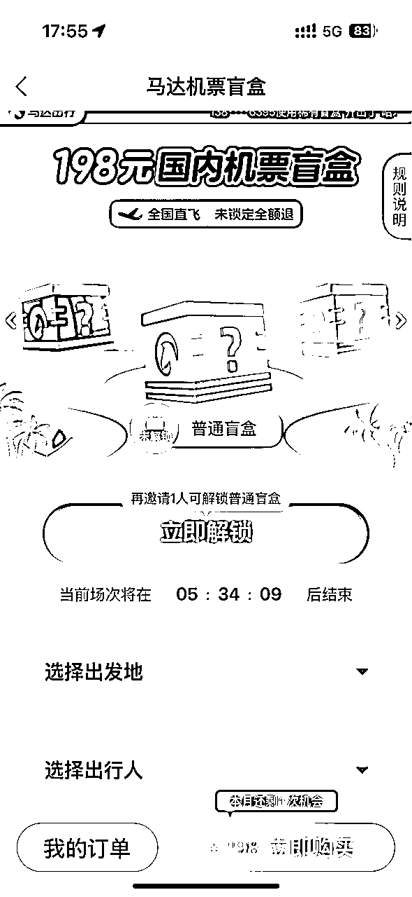

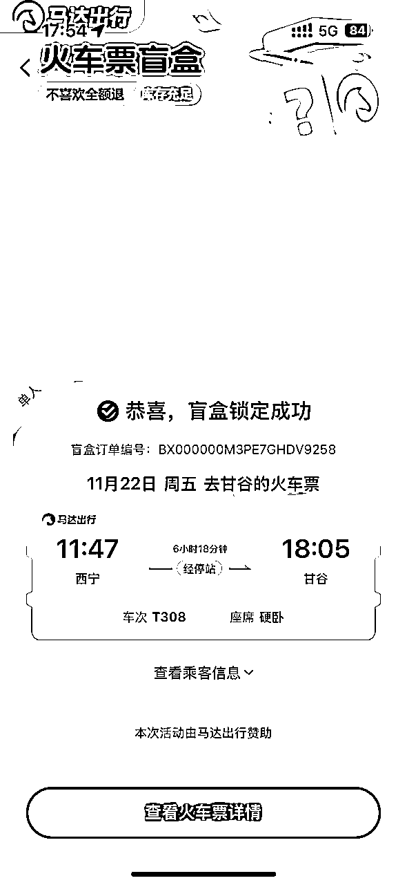

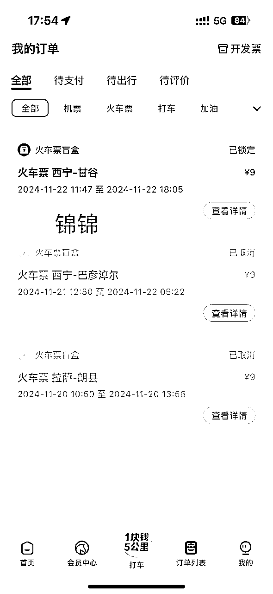

如果直接购买拉萨到西安的完整车票，需要293.5元；而我当时开了3次盲盒，最后花了70多元才拼出来。

当然，也有人运气特别好，9元就能开出拉萨到长沙的车票。如果目的地在中途，直接提前下车即可，整段行程可能只花9元。

所以，这种方式最大的前提就是：你不赶时间，并且愿意接受目的地随机。

锦锦水印

## 2. 海外火车票：官网通常更便宜

国外铁路票大多建议直接去官方平台购买。网上搜到的很多购票网站，其实是类似携程的第三方代理，价格未必最低。

具体国家的铁路官网，可以通过📕搜索，一般都能找到教程，操作也没有想象中复杂。

不过也有例外。部分线路在淘宝或闲鱼购买，可能比官网便宜。例如日本新干线，有时能够少花两三百元。

# 二、飞机：盲盒、错峰和中转都能省

## 1. 机票盲盒

同程曾经推出过198元国内机票盲盒和298元国际机票盲盒，价格通常包含机建和燃油费用。

它和火车盲盒的最大区别，是可乘坐时间通常在购买后的3—30天之间。我开出的机票大多集中在一周左右，所以如果有固定出发日期，最好提前至少一周尝试。

机票盲盒并不是完全没有规律。系统通常更容易开出原价几百元的航班，因此可以先观察某个出发地近期的低价航班，再判断盲盒可能对应的城市。

例如从拉萨出发，比较容易开到绵阳等方向，票价大约在300—400元。到了旺季，因为拉萨飞往其他城市的机票普遍昂贵，平台甚至可能暂时关闭拉萨这一出发地。

锦锦水印

## 2. 普通低价机票怎么找

### 多平台对比，重点关注早晚航班

我个人买机票通常会先看去哪儿，很多时候价格比较有优势。

不论淡季还是旺季，提前一周左右观察机票，往往更容易碰到低价。早班机、晚班机，以及不包含托运行李额的航班，通常会更便宜。

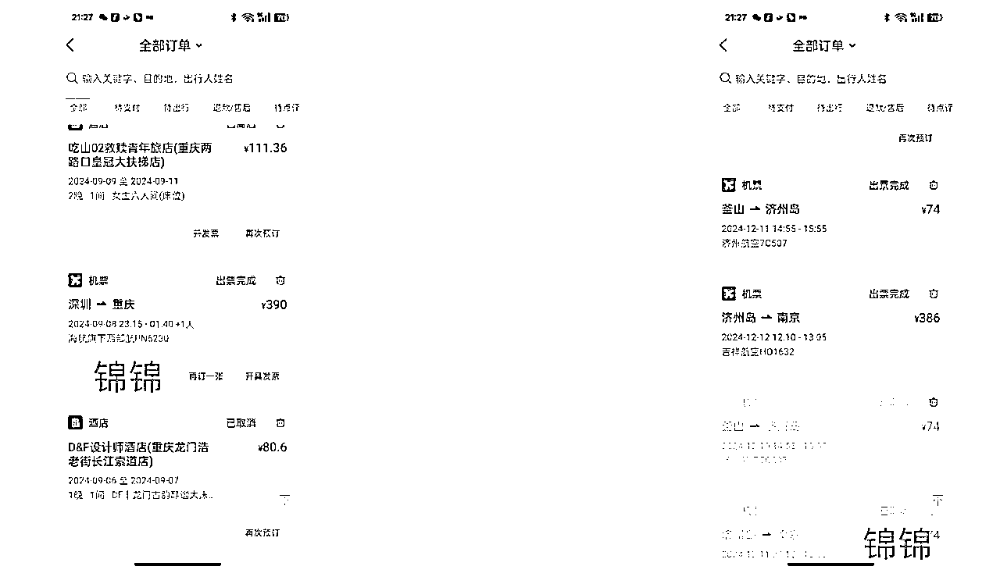

### 试试搜索平台优惠券

闲鱼和📕上经常有人整理机票优惠券。平台有活动时，很多人可能根本不知道领取入口，可以直接搜索“某某平台机票优惠券”，有时联系客服就能领取，不一定需要购买。

### 临近出发仍在降价，可以继续观察

如果某趟航班距离出发只剩1—3天，页面仍然显示有较多余票，价格也没有随着出发临近而上涨，甚至持续下降，说明航班可能还有空位。

这种情况下，出发前12小时内有机会买到非常便宜的票。

### 反向航班有时更划算

热门方向不一定越早买越便宜。比如春节期间从泰国返回中国的航班，可能会先涨后跌，临近出发前反而出现大幅降价。

我曾经提前一周买到600多元的返程机票，而出发前一天再看，价格只剩300多元；同期其他人购买的价格基本都在1000元以上。

### 行李额可以灵活处理

很多航空公司看到乘客只是背包，或者携带20寸左右的行李箱，未必会主动称重。即使70升徒步包装得比较满，也有可能顺利登机。

当然，不同航空公司的规定不同，大家还是要以官方要求为准，不要因为省钱影响出行。

如果支持网上值机，可以提前完成值机，到机场后直接在自助设备打印登机牌，再前往安检和登机，通常不需要排队办理柜台手续。

### 深圳飞国际，可以比较香港出发

从深圳前往东南亚、日本等地时，不妨比较一下香港机场的航班。很多时候会比深圳直飞便宜几百元。

我曾经从香港往返日本，机票只花了几百元，而深圳直飞需要1000多元。

从福田口岸出发，可以使用护照通关，不一定需要港澳通行证。过关后搭乘公交或机场大巴前往香港机场，全程大约一个半小时，费用只需20多元，中途可能需要换乘。

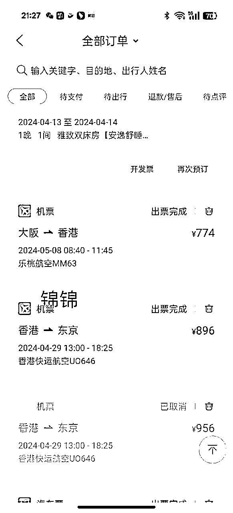

### 把中转时间变成游玩时间

中转航班往往比直飞便宜。如果中转时间超过24小时，还可以顺便在中转城市玩一天。

例如我从西安前往首尔，选择了在深圳停留26小时的航班，机票只花了400多元。中转时间正好在白天，还能回家吃饭、换衣服、补充装备。

有些机场还会为符合条件的旅客提供免费住宿。比如我曾经乘坐深圳飞重庆的航班，凌晨1点多抵达，机场安排了酒店和接送车辆，第二天再送回机场。酒店通常是标间，后续入住的人可能需要拼房，但一般会安排同性旅客。

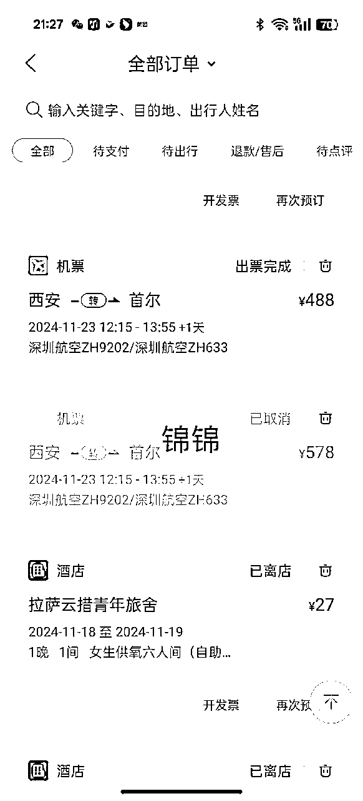

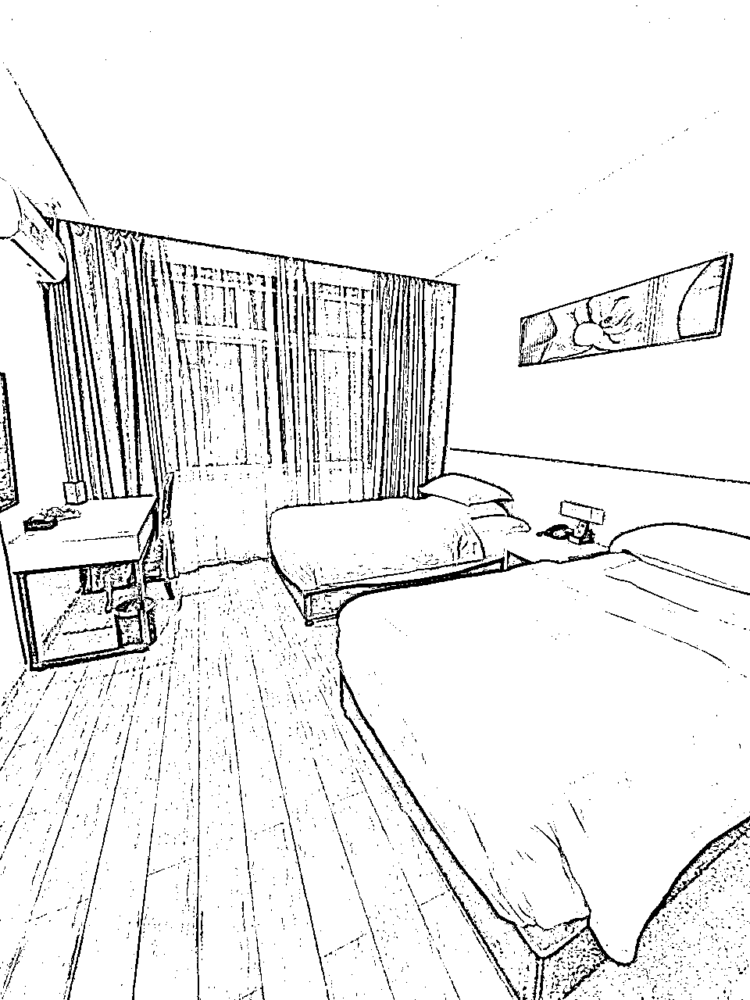

### 机票有时还能兑换当地福利

在韩国，部分机票可以兑换交通卡。凭机票免费领取一张交通卡，自己购买可能需要20多元，而韩国日常乘坐公交、地铁时，交通卡非常方便。

韩国交通的具体玩法，之后可以再单独整理。

### 通过第三国中转，整体成本可能更低

前往韩国、日本时，可以比较杭州、上海、青岛等城市的航班；前往欧洲，也可以考虑先飞到其他国家，再转机前往目的地。

比如韩国飞日本有时只要200—300元，日本飞伦敦也可能只需1000多元，而国内直飞价格可能超过2000元。

省下来的机票钱，甚至可以再多安排一个国家。有些国家还支持凭联程或后续机票办理短期过境签，部分情况下美签也能帮助满足过境签条件，具体要提前确认当地政策。

锦锦水印

# 三、汽车、大巴和其他交通方式

## 1. 长途出行优先看顺风车

长途打车可以先比较顺风车。嘀嗒出行价格通常不高，但偶尔会遇到司机私下要求加价，这种情况不必纠缠，直接换下一位司机即可。

高德、滴滴等平台现在也有顺风车服务，建议多平台同时查看。

## 2. 市内打车别忘了优惠券

高德和滴滴是比较常用的打车平台，小程序“花小猪”有时能领到大额无门槛优惠券，可以和其他平台搭配使用。

## 3. 新疆、西藏坐大巴要先问清价格

普通大巴可以在各大平台查询，但新疆、西藏一些地区的交通信息还不够集中，往往需要通过网络搜索，或者到当地后询问司机和居民。

尤其是新疆旅游旺季，部分司机可能会对外地游客报价偏高。上车前一定要先问清楚当地正常价格，最好在📕搜索，或者直接向本地人打听。

我从哈巴河县前往白哈巴村时，正常价格大约70元，但司机看到我们是外地人，开口就要100元，同行的另外两位女生甚至被收了120元。下车时司机还以不付100元不能下车为由纠缠。

所以，千万不要什么都不问就上车。

## 4. 搭便车要谨慎

在公路边竖起大拇指，就是常见的搭车手势。遇到顺路车辆时，有可能免费搭乘。

我在西藏的一些路段就是这样出行的，不过这种方式存在安全风险，只能作为个人经历分享，不建议盲目模仿。无论选择哪种交通方式，安全都要放在省钱之前。

# 四、住宿：低预算旅行的核心是灵活

## 1. 青年旅舍适合独自旅行

青旅床位通常在30—90元之间，40—60元这个区间就能找到不少不错的选择。

很多人担心青旅的安全问题，但我目前住青旅没有遇到过财物丢失。最常见的不便，可能只是碰到打呼噜的室友。

青旅的优点也很明显：

- 很容易在群里找到同行伙伴；
- 适合一个人旅行时临时组队；
- 不同店家的装修、氛围和老板风格各不相同；
- 能接触到来自不同地方的旅行者。

如果是多人一起出行，也可以合住酒店，几个人分摊后价格同样不高。

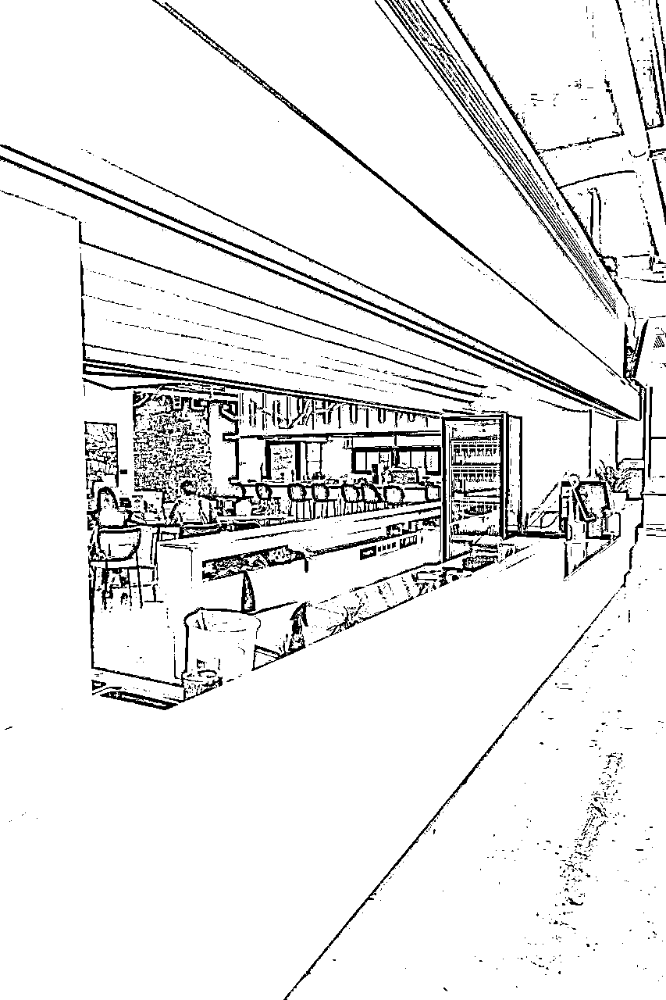

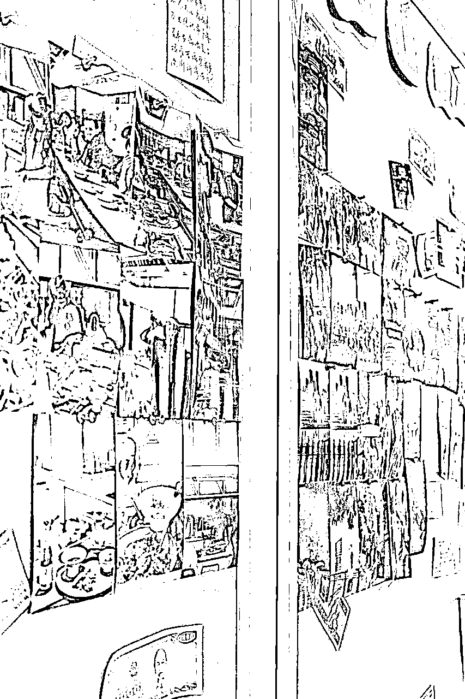

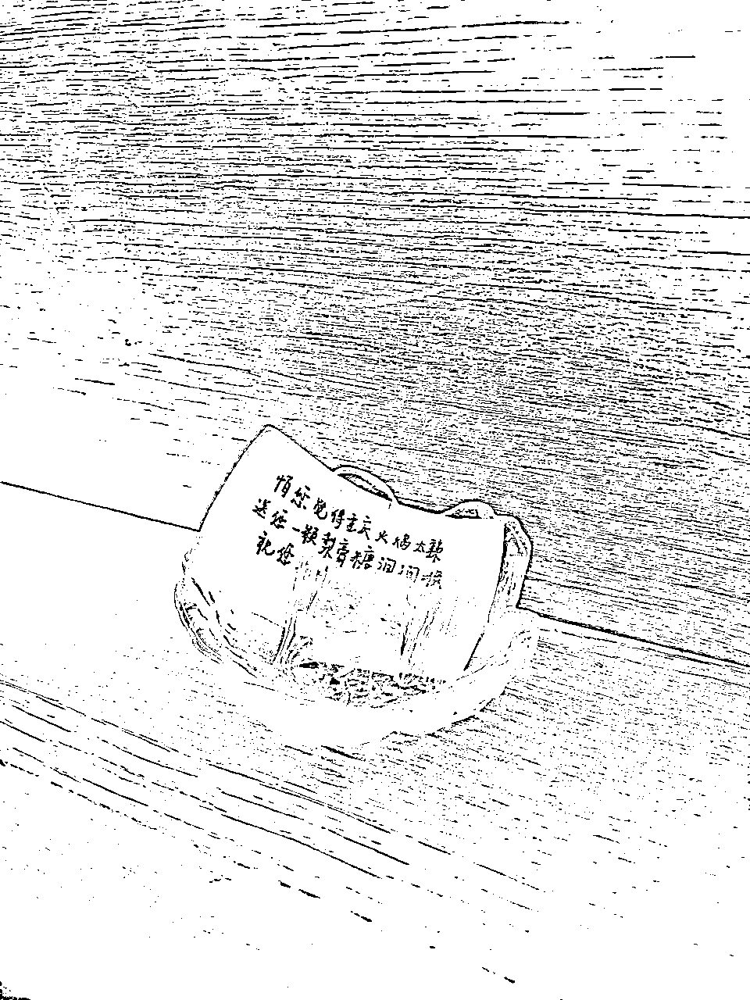

## 2. 淡季可以直接到店谈价

旅游淡季入住酒店时，可以尝试到前台询价，有时比线上平台便宜几十元。

节假日则建议提前预订，否则容易出现喜欢的酒店没房，或者临时价格大涨的情况。

## 3. 国外可以尝试沙发客

在国外旅行时，可以使用Couchsurfing寻找当地接待者，住进当地人的家里。这也是早期背包客文化中比较常见的方式。

我在韩国旅行半个月，就住过几位陌生人的家，不仅节省了几千元住宿费，还认识了当地朋友。

不过，陌生人住宿一定要认真评估安全风险，提前查看对方资料和评价，必要时把行程告知家人朋友。

锦锦水印

## 4. 筛选酒店的几个重点

### 看开业或装修时间

尽量选择近三年开业，或者近期重新装修过的酒店。新一点的房间通常在设备、床品和卫生条件上更有保障。

### 位置比装修更重要

优先考虑靠近地铁、市中心或景区的住宿，出行会方便很多。

如果每天游玩结束后已经很累，住在景区附近，花少量打车费回去也比长时间折返更省力。

同时要注意酒店是否靠近主干道，可以结合住客评论判断夜间噪音情况。

### 不要只看好评，重点研究差评

评论数量很多、配图特别精致的内容，真实性不一定高；但极端负面评价也可能来自同行竞争。

更有参考价值的是差评中反复出现的问题：

- 10条差评里有5条以上都说隔音差，说明酒店大概率比较吵；
- 偶尔出现床单不干净等个别问题，不一定意味着整体不能住；
- 查看追评和老板回复，能看出商家是否愿意处理问题。

### 看酒店提供哪些服务

可以关注是否有免费停车、早餐、正规前台、大堂环境等。

能提供早餐和停车场的酒店，通常管理和硬件不会太差。当然，最终还是要结合价格和评论判断。

酒店图片与评论结合起来看，适用于青旅、酒店和民宿等各种住宿类型。

如果想知道我具体住过哪些地方，可以在评论区留言，我会整理到后续内容里；也可以关注👸号“锦上野火”，📕会持续更新真实入住照片。

# 五、吃什么：用工具提高命中率

## 1. 📕适合找灵感

📕上有很多本地美食推荐，但不要看到一篇笔记就立刻相信。

可以观察博主是否认真回复评论，主页有没有正常生活内容；还可以搜索同一家店，看不同笔记是不是都在重复同一套文案。

## 2. 高德地图负责整理路线

看到📕推荐的店后，可以直接在高德地图里搜索并收藏。

当你把想吃的店都标记下来，就能通过地图看到它们分别集中在哪些区域。游玩某个景点时，可以顺便查看附近有没有收藏过的餐厅。

高德上的收藏人数，也可以作为判断一家店热度的参考指标。

## 3. 国外优先使用Google Maps

在国外，Google Maps基本相当于国内的高德地图加大众点评。

搜索附近餐馆时，可以看到位置、评分、菜单和用户评价。很多地区的评分参考价值比较高，适合用来寻找当地餐厅。

## 4. 观察当地人，比盲目看网红推荐更可靠

我个人很喜欢骑自行车在街区里慢慢逛，看到哪家店本地人多、排队的人多，就会进去尝试。

一家店如果主要是当地人在吃，往往比清一色游客打卡的网红店更值得关注。

# 六、行李：少带一点，旅行会轻松很多

## 1. 一次性用品可以提前准备

一次性内裤等用品可以在1688购买，价格相对便宜，质量也比较容易挑选。

## 2. 速干浴巾很实用

速干浴巾卷起来体积小、重量轻，洗完后也比较容易晾干，特别适合长期旅行或需要频繁洗漱的情况。

## 3. 折叠拖鞋不能少

折叠拖鞋或人字拖都很方便，占用空间小，住青旅、酒店、民宿时都能用到。

## 4. 酒精湿巾适合应急清洁

旅途中不一定每天都有舒适的洗澡条件，酒精湿巾可以用来简单清洁身体和物品。

## 5. 常用药建议备一些

感冒药、布洛芬、氯雷他定、头孢以及止泻药等，可以根据个人情况准备。长途旅行对体力要求很高，换环境、睡眠不足或饮食变化，都可能导致身体不舒服。

用药前要确认自己是否适合，必要时咨询医生或药师。

## 6. 折叠衣架适合长期出行

带三只左右的折叠衣架，洗衣服后晾晒会方便很多。

## 7. 衣物不要带太满

短袖、抓绒衣、防风冲锋衣、速干裤和秋裤，可以根据目的地气候选择。

我通常不会一次性把所有衣服都带齐，而是在路上根据需要购买。即使连续旅行几个月，一个20寸行李箱也基本够用。

真正建议大家给箱子留出空位，因为旅途中很容易忍不住购物。

## 8. 品牌装备可以找优惠券

迪卡侬背包、始祖鸟等品牌商品，可以先去闲鱼搜索优惠券，有时能便宜不少。

其他旅行用品则可以在拼多多搜索“旅行必备好物”，经常能发现很多实用又便宜的小东西。

锦锦水印

# 最后想说

不同国家和地区的文化、交通、饮食习惯差异很大，尤其是交通方式，往往和国内完全不同。

之后我会按照国家和地区，把日本、韩国、尼泊尔以及国内不同地方的具体玩法、交通细节和旅行故事继续整理出来。

如果你也想尝试低预算旅行，或者正在规划某个目的地，欢迎留言提问。我会把自己踩过的坑、用过的方法和真实体验尽量分享给大家。

（放一点自己拍的照片嘿嘿）

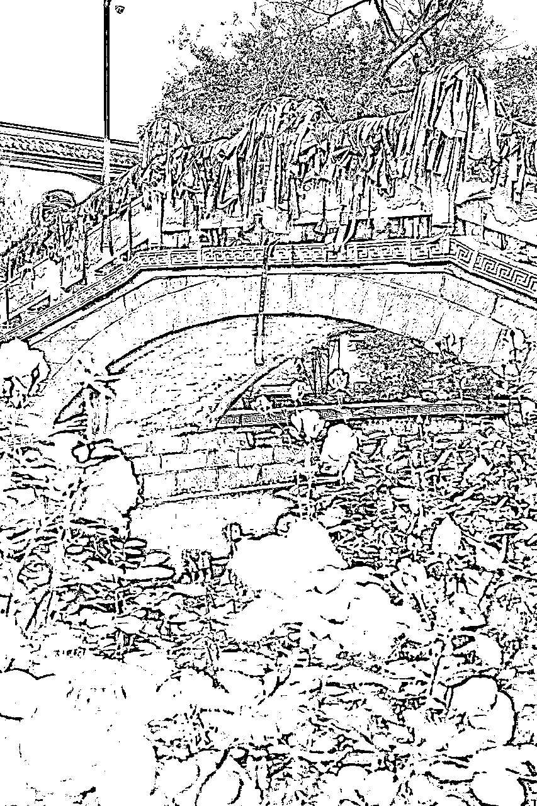

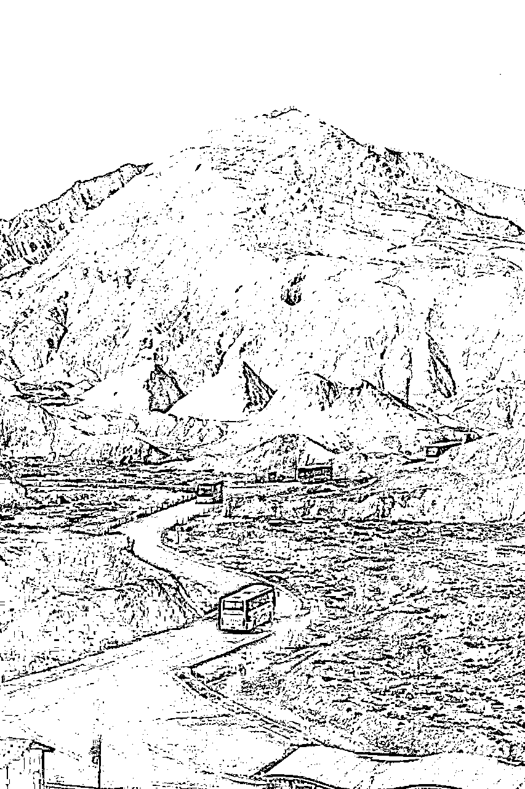

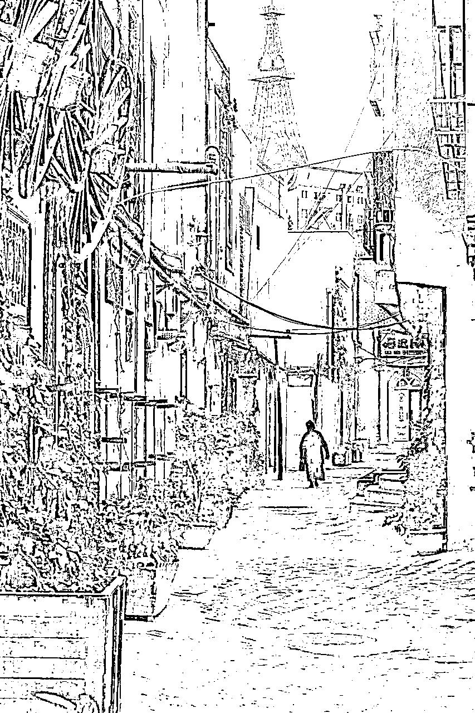

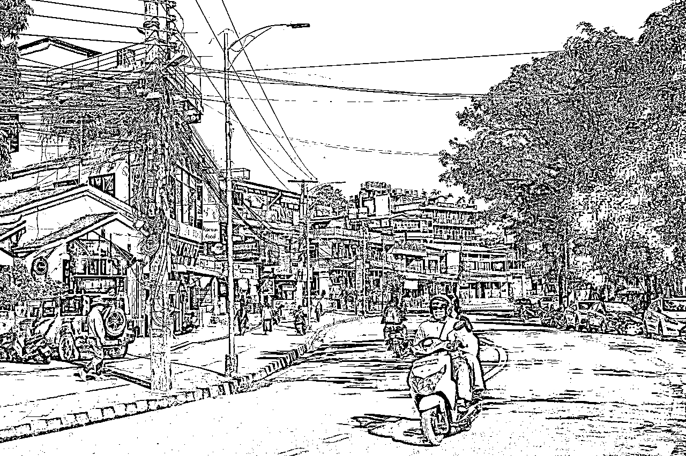