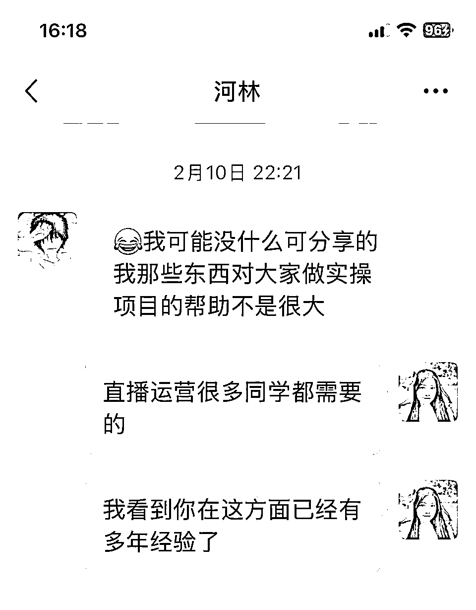
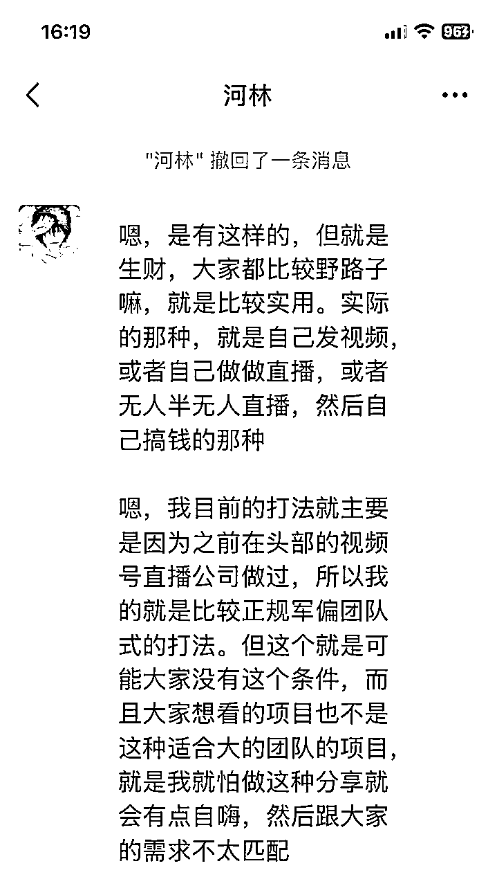
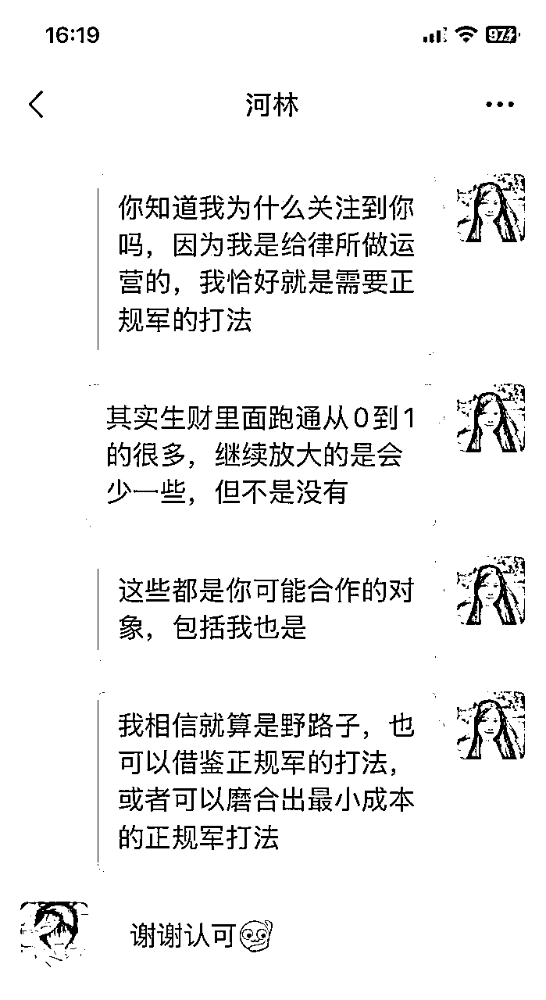
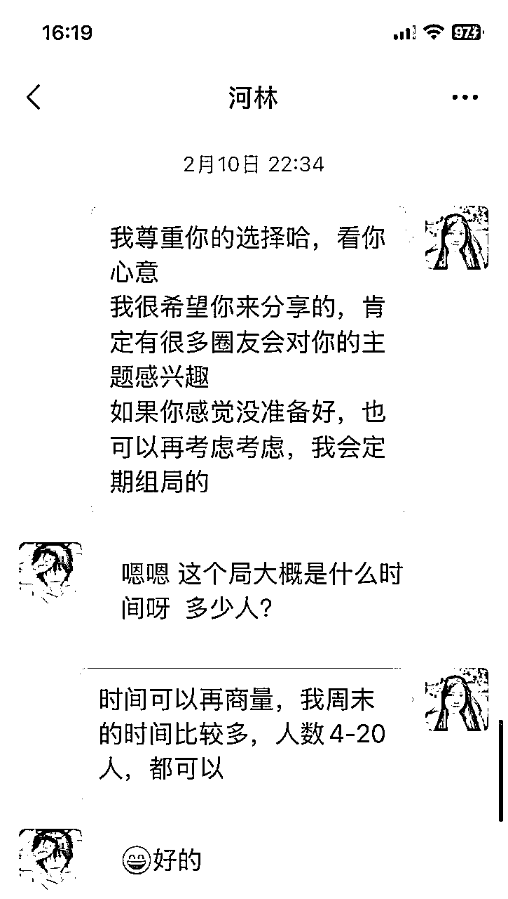
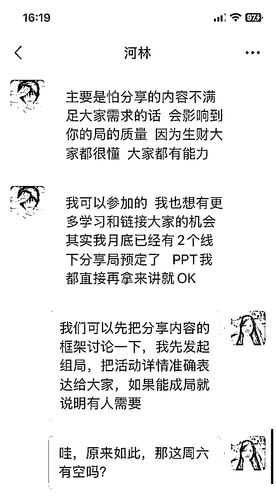
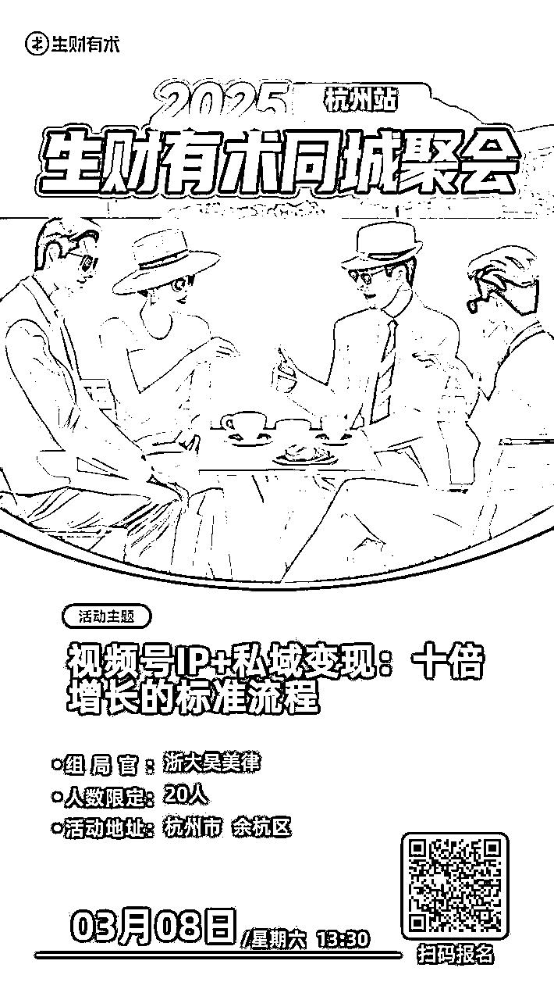
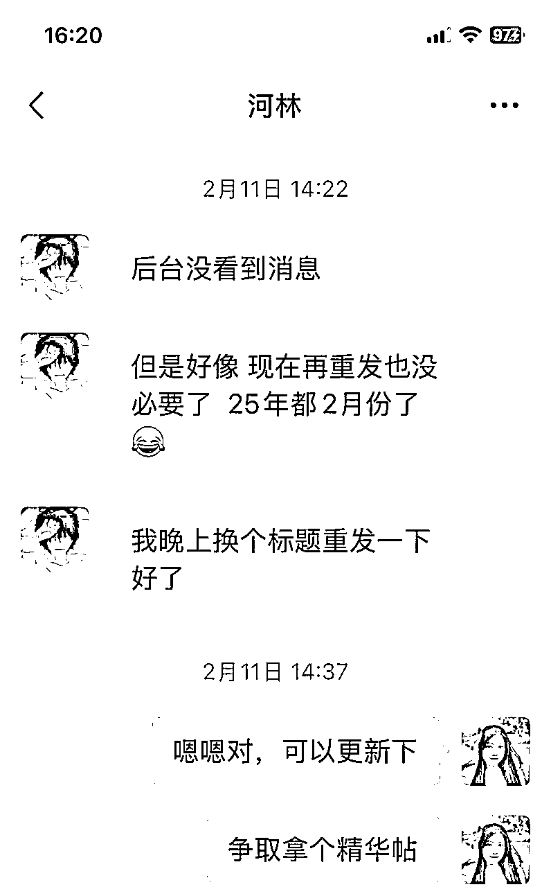
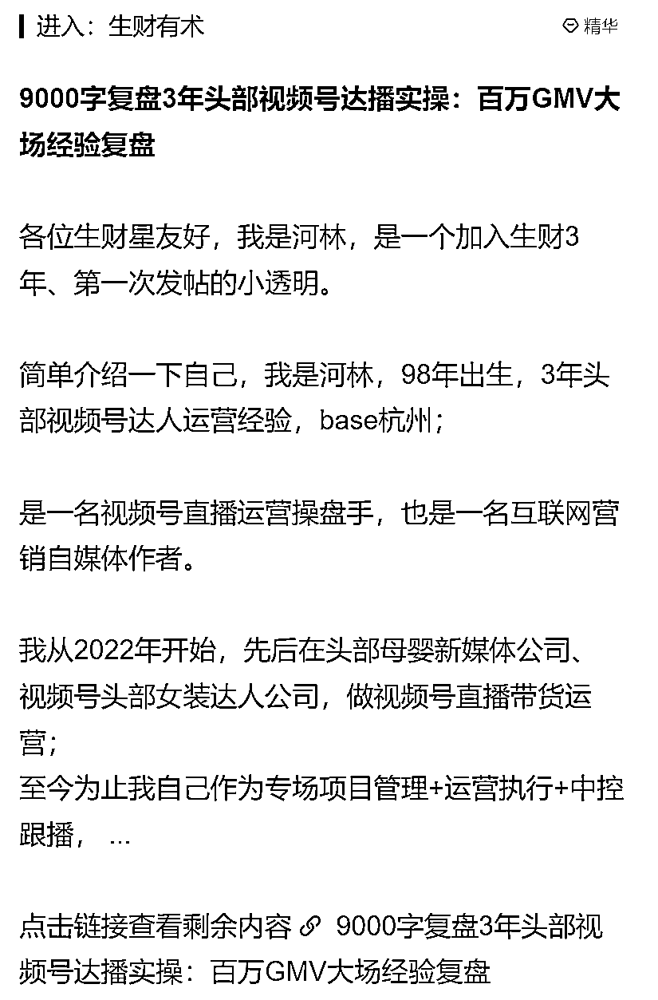
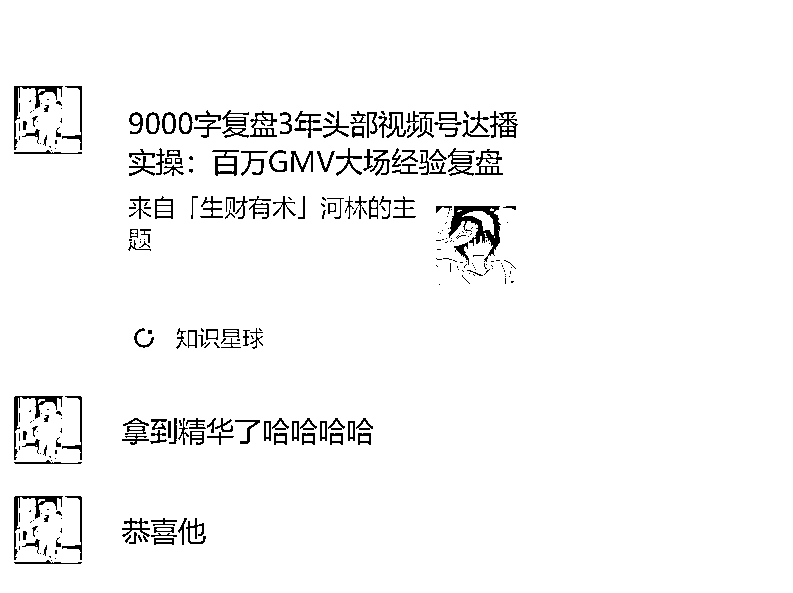
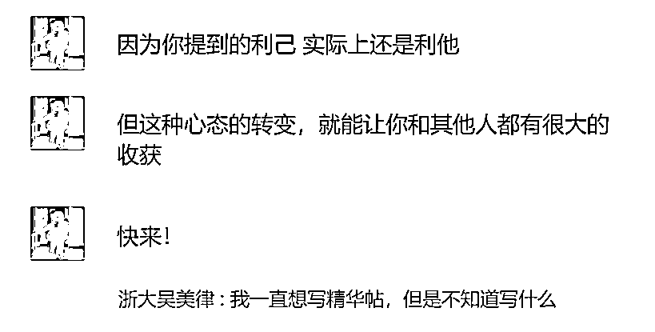

# 从利他到利己再到利他：说服高岭之花来当分享嘉宾的实操笔记

大家好，我是浙大吴美律。最近和赚钱团队的子安木木聊了聊，才发现自己今年筹办线下活动的心态，和去年截然不同。经她鼓励，我把这次心路和经验整理出来，希望能给同样做活动委员的朋友一点参考。

去年赚钱开始倡导多做线下，我也冲劲十足，甚至和圈友打赌一年要办多少场。那时我把办局看成纯情怀输出，热情来得快散得也快。面对一堆不确定和杂事，很快就泄气了。说出来有点惭愧，去年我一共只办了不到十五场，离自己定的目标差很远。

有一次和常常聊天，他很郑重地提醒我：美律，要留住你对办局的热爱。当时我挺有感触——即便是办过几十场的常常，也会觉得办局消耗大。虽然线下对圈友、对赚钱的意义很大，但办局人的精力才是最稀缺的资源。

于是问题就来了：如何让办局这件事不再透支自己，甚至越做越轻松？

我的体会是：先顾自己，再顾他人。换句话说，先从自我出发，再去创造价值。

就拿最近邀请河林老师来做学习局的经历说起。坦白讲，今年首场局的出发点很自私：其一要赶学习局内测的截止；其二我想请教视频号。刚好听了涛哥的视频号私享直播，他提到视频号投放很稳，但我自学进度慢，赚钱索引里也找不到足够新的方法，就想借线下把人请来，当面把我的困惑砸给嘉宾。

我便在赚钱整理的杭州同学录里按视频号关键词检索，锁定了几位候选。没想到首轮邀约就被婉拒了，大家看河林怎么回的：

（本文聊天截图已获授权）

拒绝得相当真诚，我都快哭了。但我脸皮厚，又继续追。秉持嘴甜不用成本的原则，展开了第二轮：

邀约时可以点出对嘉宾的好处，比如分享本身就是一次曝光，或许能碰到潜在合作对象。

当然选择权始终要留给对方，先进一寸，再退半步。

这时河林问了我具体人数和时间，我心里一亮，有戏！

到这里，如果你之前不了解河林，会不会以为他没分享过？主业做运营，从未上台？完全不是。

深入聊才知道，他在别的社群已经排了两场分享，PPT都是现成的。赚钱真的卧虎藏龙，找到优质嘉宾也是学习委员的职责。这么一个宝藏人，必须争取到。

可他前面为何那么冷淡？还写那么长的小作文拒绝？我后来才明白：嘉宾口头的谦逊不可全信。只要你觉得他能讲，就大胆去约。最后务必尊重对方意愿和时间。

河林担心到场的朋友用不上他的内容，所以我在活动说明里特意加了提示：

“提醒：河林老师此前在头部视频号直播公司服务品牌方，属于团队化正规打法，不太适合纯无人直播的朋友参考，报名前请自行判断是否匹配。”

结果很多个人作战的朋友还是报了名，结束后都说收获不小。看来我们想多了，一线经验和前沿信息，没人会拒绝。

接下来的筹备就比较顺了。我心里其实有点忐忑，会不会没人感兴趣？

海报一发，很快满员。我找鱼丸加了五个名额，依然秒满。上周另外两场也是如此。但预订的邈墨茶馆坐不下了，后排几位只能搬小板凳。连赚钱团队的七天可爱多也来了，倍感荣幸。

这说明什么？办局人的窗口期到了。现在办局不用拼命宣传，不用到处找人扩散，市场已经教育到位，圈友想来线下，但好局太少。现在发起，立享六小时满员的尊贵体验。

大家不愿意发起，多半卡在几个顾虑上：

**1、担心流局**

今年办局比去年容易。圈友对线下的需求大幅上升，办局的人反而变少了。

今年赚钱对线下的支持也更强了，有活动委员群交流心得，也有官方城市群招募，到处都在内测激励机制。

流局很正常，有的主题本身小众，也会遇到天气、行程冲突等不可控因素。我们能做的，是在能力范围内把价值讲清楚，吸引目标人群。

我的做法是：周二审核通过当天，就在朋友圈和各群发海报。若报名慢，就第一时间和嘉宾沟通，调整标题和内容，之后持续几轮招募。海报发得多，总会有人看到，我每次都能多拉几个人进来。

标题也很关键。

海报上最显眼的就是标题。好标题要短、要准、要勾人。关键词一定要选对。比如今年视频号很火，内容相关就一定要在标题里体现。

标题还要用大数、写具体。比如《做好XXX》就模糊，《实现XXX十倍增长》就清晰。但要避免标题党。

标题里的核心概念要聚焦。像下图的IP、私域，就是分享的核心，概念准了预期才不会错位，分享也更有针对性。反之，《AI搞钱》这类就太宽泛，容易散。预期不一致，评价自然参差。

实在怕预期偏差，就加一段特别提醒，写清适合人群和不适合人群。办局人尽到告知义务，圈友自己不仔细看，那就另说。

**2、场地难找**

场地确实是痛点。我的经验是：

1）选区。以杭州为例，余杭靠近赚钱氛围好；西湖、上城、拱墅居中出行方便；滨江企业多，局少，圈友渴望。各有利弊。也可以按嘉宾就近或自己就近定。

2）具体选址。平时逛街看到合适的茶馆就记录；活动委员群里问，大家都很热心；赚钱也有场地库。很多老板嘉宾也会主动提供公司场地，省去费用。

3）订位时机。人还不确定时，怕订大浪费，订小坐不下；要付定金的怕流局亏钱。解法是多准备plan B。和店家谈好人少怎么算、能否换小间、人多加板凳多少钱，一家订不到备选在哪。备选多，心才稳。

人数一般到周三就能基本判断。爆款局一天就满。

我通常审核通过后再订，成局门槛四人并不高，所以招募别拖。若周三下午还未成局，就要全力拉人，别等周四。

用自己人场地就更灵活了。我之前几次新人局就在赚钱总部办，带新朋友参观，大家对赚钱的好感度直线上升，对我的印象也变好。

去年四月的新人局认识了树哥、姜文总、瑞思白，那个群到现在仍活跃，很幸运。

细节也要注意：费用提前说明；交通环境让商家提供指引；提前和嘉宾对流程，有资料就备份；需要投屏就提前确认设备，苹果电脑准备转接头。

**3、害怕冷场**

冷场对内向人格是灾难，但大可不必怕。你不尴尬，尴尬的就是别人。

办局的目的是让大家有所得。你不擅长控场，也不用硬撑。与其尬聊，不如放宽心态，把话筒交给众人，营造安心氛围。

主题明确的局，大家都是冲着这个来的，都有表达欲或问题。我们只需要把这些欲望和问题带出来就行。

我一般会提前收集问题反馈给嘉宾。现场冷下来，我会点名：“XXX你之前提过这个问题，和刚讲的内容能连起来。”或我替大家问：“我好奇为什么XXX？”

问完嘉宾答完，通常就会有人接话。提问的氛围就起来了。千万别说“大家一定要提问”。一旦提问变成任务，就会失去魅力。很多人怕提问等于承认自己不懂。真正的交流是聊天出来的，更该点燃好奇心。

怎么提好问题也是一门功夫。嘉宾若有精华帖，我会放在详情页，建群后再发，让大家提前了解。

流程可参考：一分钟自我介绍+主讲+集中答疑+自由交流。集中答疑能降低心理负担。

**4、请不到人**

我的建议是：做海王。打开同学录搜关键词，把想请的嘉宾全部加一遍。手里备选多，剩下的就是排期，像经纪人一样从容。

**5、看不到意义**

办局的红利远超想象。

河林的那场分享非常专业，像上一堂大课，大家都说值。有几位朋友对视频号运营需求很强，问的问题很落地，我也问得毫不客气，河林都耐心解答。

表面上我只是办局人，提问积极些。实际感受是：如果我只是加了河林微信上去问，哪怕送红包，收获也远不如线下。先完整听完分享，再针对性追问，这种信息密度线上很难达到。这就是线下的能量。

另外，作为办局人向嘉宾提问，不会不好意思，这点太重要。

当天现场有几位朋友没开口，包括之前提过问题的。不知道他们是否得到解答。我自己以前提问总担心：会不会太蠢？会不会浪费时间？私下问会不会更好？

如果没有办局人这个身份，我大概不会追问那么多。但那天我问得很爽，是我办局以来最爽的一次。

所以有句话很贴切：沉默是表达者的红利。换到这里就是不提问的人，成全了提问的人。而办局人正好能享受这份红利。这就是从自我角度看办局的价值。

目前赚钱的办局榜竞争不激烈。一年52周，每周办一次就能进前列。榜上有曝光，海报上有名字，被反复看到。作为贡献者，赚钱团队会逐渐熟识你，前沿信息也能提前知道。活在信息中心的感觉很好。

而这一切，不需要你年入千万，也不必从零建社群。你只需要在赚钱这个现成平台里，经常发起局，借助平台资源和筛选好的嘉宾，召集团队一起聊聊。没体验过的人不会懂有多爽。

顺带一个插曲。邀请河林时他说之前在赚钱发过帖，我却搜不到。

原来去年年底起，圈友帖子里不能留微信，帖子被秒删，他本人都没发现。后来和子安、鱼丸沟通后重发，现在精华帖到手了。

传送门：9000字复盘3年头部视频号达播实操：百万GMV大场经验复盘-知识星球

若不是这次邀约，我们会错过一篇好文章，也会错过一位优秀的传述者。

老话说，生活不缺美，缺的是发现美的眼睛。有水平的嘉宾其实也缺曝光，他们因谦卑或低调，很少意识到自己的价值，这是资源浪费。

赚钱有上万人，藏着大量人才，等着被发掘连接。若每个人都亮出长处，能量会非常可怕。

复盘下来，这是一次很成功的局：嘉宾有曝光，圈友得干货，我解决了自己的问题。对学习委员而言零内耗。从自我角度我占了便宜；但正如子安所说：

我的自我某种程度上也是利人。这就是帕累托改进：没有人变坏，至少多方都变好。

这样的局不嫌多。

下一步我想做的是跟进资源整合，把线下的短暂相遇延伸成线上的长期互动，通过办局筛选同路人一起前行。

最后说句真心话：真诚利他是赚钱的精神，但别让利他成为负担。心怀真诚时，利己和利他并不冲突，可以找到平衡点。

每次聚会我都说：有感兴趣的主题告诉我，我来组织。

但我更希望大家亲自下场尝试，在实践中找到适合自己的节奏。正如我自己是办局的受益者，我也很期待你们能体会到办局人的独特荣耀与魅力。鞠躬。