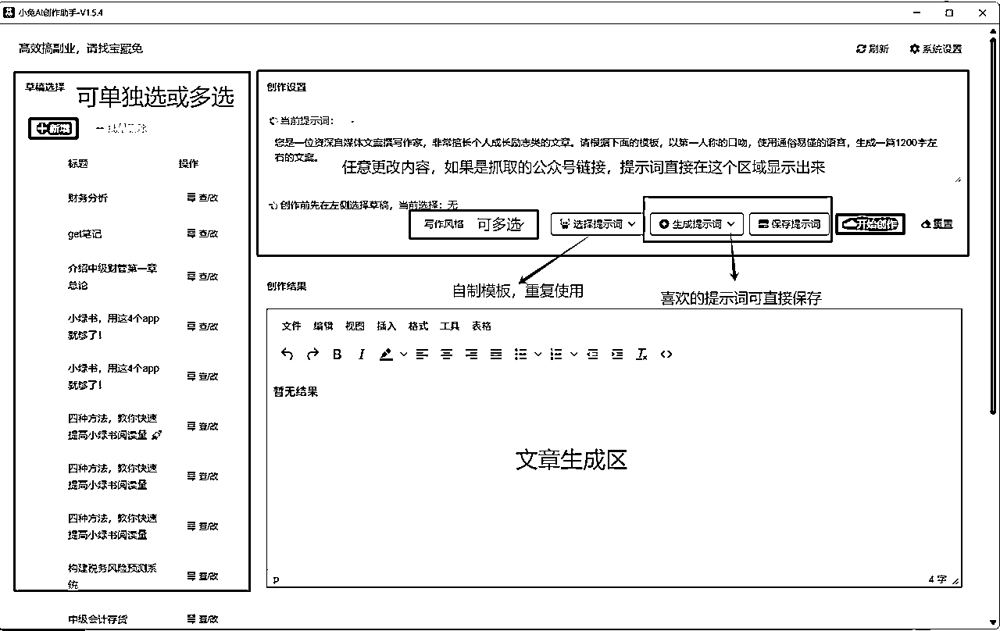
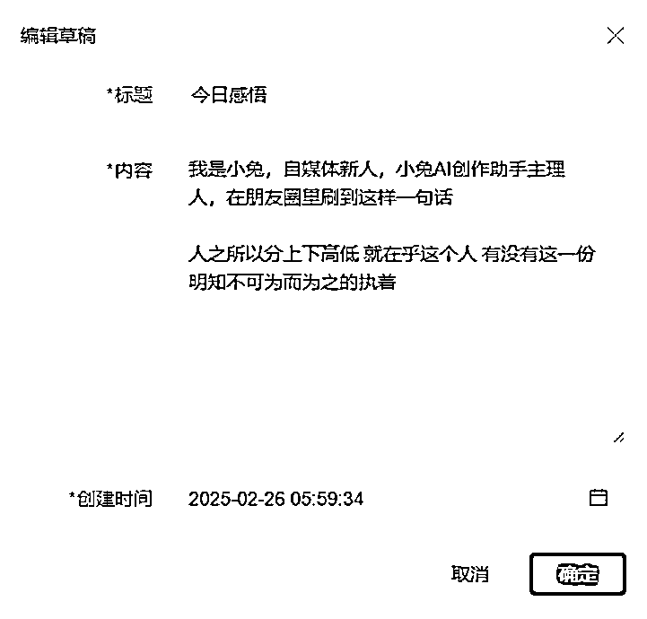
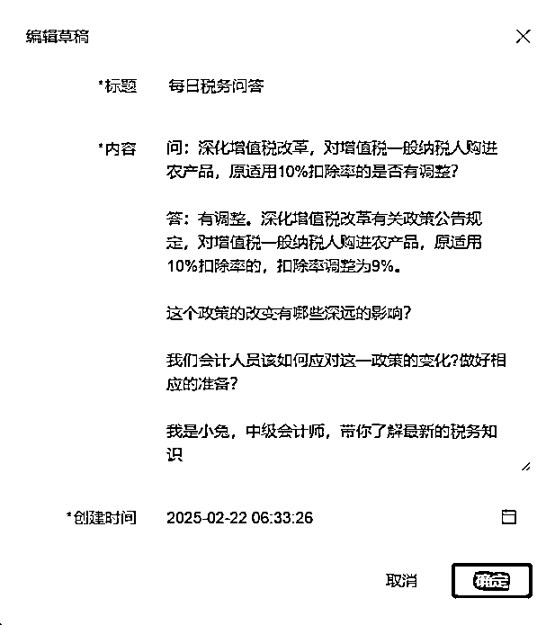
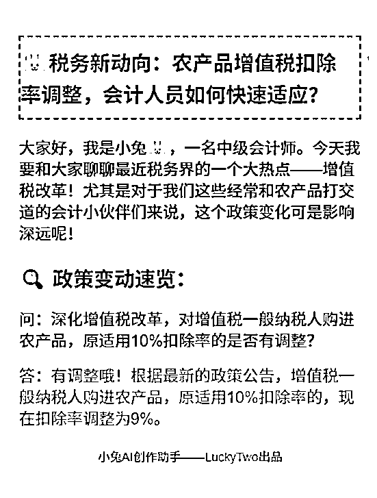
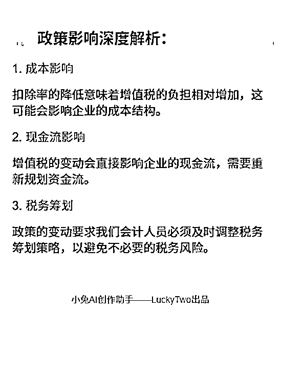
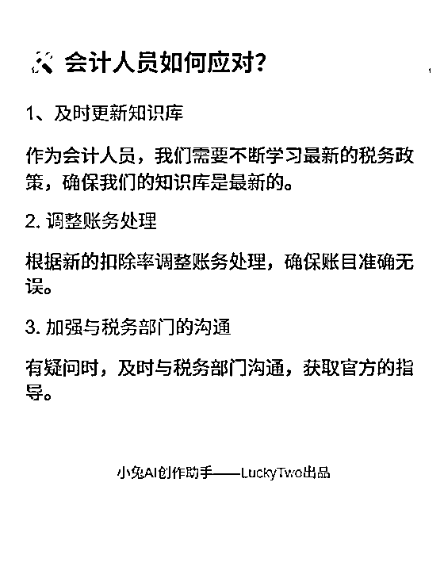

# 用cursor做出AI写作软件，接口是大热的DeepSeek，目前GMV2万+
作者：龙哥

你知道吗？三个学会计的姑娘加一个程序员，用Cursor编程，自研了一套大模型，再接入最近爆火的DeepSeek接口，就这么拼出了一款AI写作软件，还取了个名叫LUCKYTWO。57天，卖出去30套，营收两万多——这事听起来像天方夜谭，但真就发生了。

先简单介绍一下我们。我是龙哥，去年底刚刚学了Cursor编程，另外三位合伙人都是会计出身：姜宁管销售，醒醒盯战略，舒雅负责售后和细节。再加上一位有20年经验的技术大佬浩哥，我们四个女生加一个男程序员，就这样把“小兔AI创作助手”做了出来，定价699一年，从1月4日有想法，到3月1日卖了30套，一步没停。

关于推广，我们真没搞什么大阵仗。自媒体圈子里那种轰轰烈烈的“发售仪式”，感觉不太适合我们。我们就在朋友圈发了预告，拉了4个200人的群，做了场直播，当场卖了7套。在那之前，我们还找了10个内测用户先体验，结果这批人自发帮我们带了一波流量，也成功转化了一部分人成为付费用户。

再说说产品本身的成色，我尽量实话实说。出文质量，比ChatGPT还是差一点，但跟DeepSeek、Kimi、豆包、文心一言这些主流AI比，我们是有优势的。最让我得意的是“无限次提取提示词”——你随便扔一篇文章过来，它就能把提示词直接给你扒出来，市面上几乎没有软件能这么干。还有草稿箱和创作区，一句话就能生成一篇IP文，也能直接出图文，特别适合卡文的时候救急。不过效果因人而异，有人用得风生水起，有人觉得也就那样。

踩过的坑也不少。第一，内测用户才10个人，反馈太少，bug全靠我们自己想，人群不够多，给不了太好的建议。第二，DeepSeek一火，接口直接卡死，我们连夜找了个备用接口才稳住。第三，我们的用户里很多是👸号小白，连👸号都是现申请的，看视频教学根本吸收不进去。第四，软件是一机一码，每天限用20次，有人天天用满，有人一天用不到5次，还有人买回去直接囤着，看着都心疼。

现在的卡点也很多。我们想做一个通用版模型，但功能和宣发都还没想明白，还在憋大招。原本想着用户觉得好用，就会帮我们宣传，结果真正用得好的用户慢慢不吭声了，一开始热情高涨的也渐渐熄火。后来我琢磨，得先带那些愿意坚持的人做出成绩，让大家看到真能赚到钱，动力自然就来了。另外，我自己做自研模型+DeepSeek接口，却不太会宣传。二月份看别人教“本地部署”，我忍不住说了句“本地部署是个伪命题”，结果被一个大V公开批评，吓得我不太敢吱声。后来央视网发了相关文章，我才敢在朋友圈发长文出口气。说实话，互联网新人多少有点卑微，但产品本身没错，路还得继续走。

什么人适合用这个软件呢？第一，想写👸号、但不太会用AI提示词，想解放双手突破发文卡点的人；第二，想快速日更👸号的人；第三，想写IP文的人——把自己的想法、感悟，加上别人的👸号写作手法，融合成自己的原创内容。

回顾一下整个开发过程。1月4日上午，我突然冒出一个念头：用Cursor做一个AI写作软件，而且跟普通矩阵号不同，要能一键改写IP文。和合伙人一商量，当天下午就把技术大佬浩哥拉进了群。1月18日内测，1月26日在社群公布招3个内测员，结果瞬间满员。1月27日定价699一年，当晚就有人付款，还顺手报了我的“小兔三年合伙人”。1月28日软件突然卡死，一问才知道接口用的DeepSeek因为太火崩溃了。1月31日又找了7个内测用户，同时卖了十多套。2月10日正式发售，直播当晚卖出7套。截至3月1日，一共30套。

浩哥作为资深程序员，也写了一段技术思考，我觉得特别值得分享。为什么选DeepSeek？他做过一组测试：处理10万条投诉数据，百度千帆的成本约等于一台某米手机，GPT-4约等于某为旗舰机，DeepSeek只相当于一个手环。语义理解上，DeepSeek能精准识别出“制冷效果像老太婆的蒲扇”是在说“制冷功率不足”，而其他模型只会说“风力不足”或“检查扇叶”。处理万字文档时，ChatGPT频繁掉线，智谱清言输出断层，DeepSeek却能完整输出结构化报告。他还强调，很多客户要的不是大模型本身，而是把技术封装成“开水龙头就有热水”的简单操作。他说过一句我特别认同：成功=70%场景理解+20%模型调校+10%运气，没有最好的模型，只有最合适的解决方案。

最后聊聊软件界面。草稿箱支持一次勾选多个，自我介绍可以重复使用，每个草稿箱还能存一个小故事，生成文章前勾选就行。创作设置直接用大白话，比如“帮我写📕文案”“写朋友圈高点赞评论文”“写👸号低粉爆文模板”。写作风格算是个鸡肋功能，但考虑到客户可能不太懂，还是给加上了。先生成提示词，满意就点保存，下次直接在提示词里选。

至于“一句话写一篇👸号文章”的效果，直接看这个视频。三篇完全不同的👸号文章，五分钟出稿，一字没改直接发布。矩阵大佬除外，普通人发文前还是建议稍微润色一下。

这就是我们57天的故事。AI写作这条路，水不浅，但我们蹚过来了。如果你也在做👸号，或者正被AI提示词折磨得头大，也许可以试试我们这款“小兔AI创作助手”。把复杂的事变简单，才是真本事。至于后面，我们还想把这个赛道做得更细，多做定制版软件，真正卖出更高的价值。

我认识的一个朋友，起初只是个普普通通的打工人，心里却一直藏着一个想当摄影师的念头。起步的时候，他对相机一窍不通，但这并没有让他退缩。平日下班后，他雷打不动地抽出数小时钻研摄影技巧，周末更是扛着相机往外跑。

几年时间过去，他真的做到了。不仅成为全职摄影师，更办起了属于自己的摄影展。他常说：“要不是那份明知很難卻依然要去做的固执，我这辈子大概就默默地在工位上耗完了。”

1.  执着的回馈：从积累到突破

执着的意义，并不只是让你咬牙把一件事做下去，更重要的是，它让你在重复的路上越走越强。

就拿我写东西来说，过去我总怕写得不好，一篇要改十几遍，越改越焦虑。后来我换了个思路：别在单篇完美上死磕，先靠数量堆出来。写得多，才会写得好。

这个转变真管用。产出多了之后，文字变得顺畅，思路也打开了。现如今，写几千字是常态，质量也稳步上来了。

1.  执着的前路：从咬牙到成事

执着本不只是心态，而是一种实打实的能力。它让你在碰壁时不撤退，在受挫时不躺平。

我坚信，只要你守住那份明知道很难也要去做的韧性，梦想迟早会换来答案。

所以朋友们，别被失败吓住，也别被困难劝退。只要持续走下去，好的结果终会到来。

1.  结尾共勉：关注小兔，一起前行

今天的分享就到这里。如果你也在迷茫的阶段，或者正为某个目标拼命，欢迎来关注我的👸号【小兔AI创作助手】，我们彼此陪伴，一起成长、一起追梦。

要记住，决定成败的往往不是智商，而是那份坚持到底的执着。只要你没放弃，梦想就不会缺席。

## 3、图片功能

先用一句话生成初稿，存进草稿箱后插入本地图片，再生成一次就成型了！视频也是同样操作。

## 4、一些培训课件

周末连写了好几篇👸号，都是加速版。内容偏细致，讲解很浅，因为我的学员基本都是年长的会计人员，她们起步连下载安装都不太会，所以我讲得特别基础。

第一篇介绍会计副业文章

第二篇介绍会计副业文章

第三篇介绍会计副业文章

# 五、我自己的不足

说实话，我自己没认真系统学过赚钱航海，👸号运营也不算熟练，提示词的搭建做得也不够好。我觉得这款工具挺好用的，只是我个人能力有限，没发挥出它的全部价值！

希望各位大佬能提点建议。通用版正在设计中，我想加入更多适合懒人的功能！

我对宣传也不太会，这是第一次在赚钱发帖，有做得不对的地方请直接指出！

我长期在会计副业圈子里深耕，但自身的会计专业知识其实很有限，引流来了人却没有具体的业务可以带，0到1也带不动，多少有点尴尬！

这是第一次发文，全是手打的，没有借助软件。感谢大家能看到这里，谢谢！

# 六、赚钱圈友福利

刚刚有位赚钱圈友联系我，希望能提供测试版，我连夜整理好了~

赚钱圈友可以免费体验三天，恳请大家给我一些使用反馈，这是我第一次做工具，还很稚嫩！

最好通过鱼丸联系我，这个福利仅限赚钱圈友，其他人无法使用！