# 🛰️生态银发女装生意复盘：从一年亏掉160万到月销500万

## 起点：一次偶然的试验

这段经历的开端有点偶然。2022年下半年，我的一位学员大周找到我，想验证女装自采自销的可行性。大周是坤哥帖子里提过的人物，当时他在快手做服装混剪，月成交额能到千万水平。

那会儿我在广州大源，家里原本就经营服装档口，对货源渠道这套很熟。大周想做自己的发货链路，但因为订单解密涉及合规风险，我们只在小范围试了试。一个半月左右发出去八千件——这还只是几个店的量，大批订单仍然走代发。没多久广州赶上封控，快递全停了，测试只能中断。

到了2023年，一个朋友喊我回武汉合伙。当时手上的快手无人直播项目因为违规加团队内讧直接黄了。

武汉的办公室签了、人也招了，手里却没项目，慌得很。大周也是武汉人，听说我回武汉，直接把楼上办公室租下来，说要不一起试试他的那个思路。没啥好犹豫的，干。

后来又拉进一个关键人——冲哥（Nora）。这位在抖音做女装混剪做到了100万粉，来公司带了两个月，十个人学，最后只跑出来一个。但就是这一个人，让整个项目活了。

刚开始同时铺快手和抖音，但那会儿赛道已经卷到底了。平台对低质混剪内容持续限流，我们这种后入场的根本起不来。2023年10月，武汉那边撑不住，混剪团队撤到孝感——小地方成本低，办公场地现成，人也便宜，武汉只留投流团队。

11月慢慢有了起色。但回看这一年，已经亏了160万上下。中途还有合伙人看不到希望退了伙。哪有什么一上来就赚钱的事，每一步都像走绝路。

一直到去年5月，项目才真正爆发。中间趟过无数坑：快手做过、混剪做过、场地换过、钱亏过。今天把这些写出来，希望能给各位一些参考。

先给这个项目定个性：它听着不高级，本质就是个拼人力的活。技术含量不高，管理含量极高。

我自己管人的水平一般，超过十个人就开始失控，所以后来选择合伙。人得有自知之明，知道擅长什么、不擅长什么，然后找互补的人搭班子。这个比什么都重要。

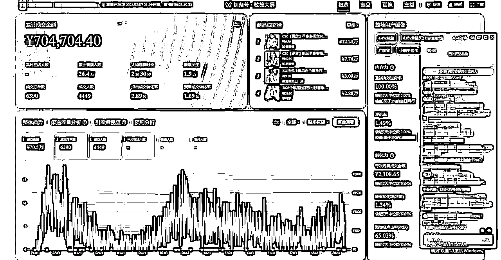

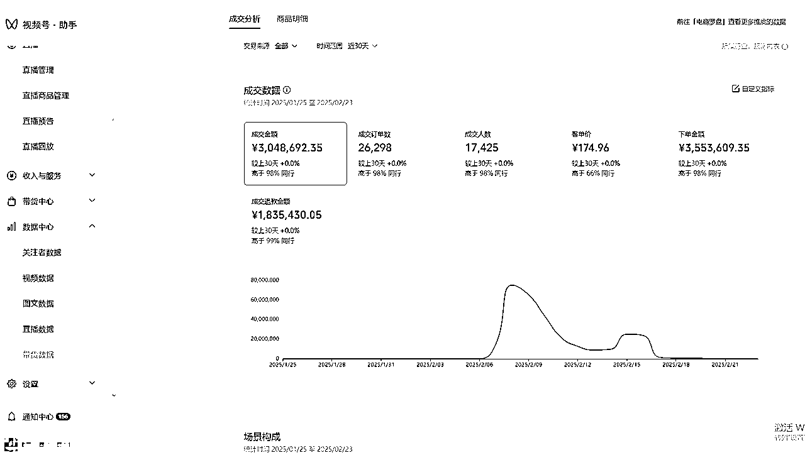

【年初自然流表现最好的号，累计做了接近300万GMV】

## 一、为什么选了这个市场

### 市场观察

选熟龄女装，核心原因是退货友好、人群单纯。这个"单纯"没有贬义——就是售后压力小，买家心态稳。

这两年客群还在往下沉。2023年时40岁以上为主，现在30岁以上的人也明显变多了，大家越来越习惯在🛰️里买东西。从成交数据和平台给的信息来看，购物人群确实在快速增长。

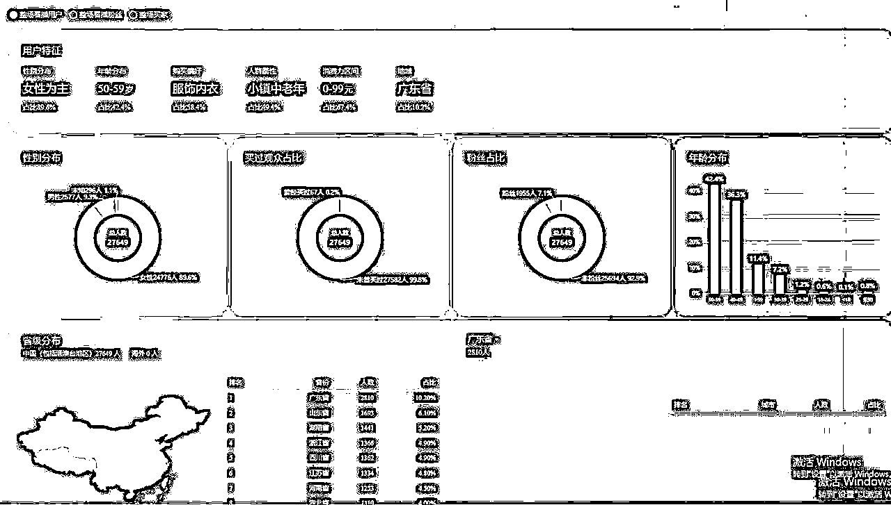

【小声说一句：很多银发用户不会退款，找不到订单入口，甚至买完就忘了。只要产品不太拉胯，基本不会主动退。而且这批人的可支配收入，普遍比年轻人高。】

另外，🛰️生态里缺乏数据监测工具，基本处在灯下黑的状态。女装退货率高，其他类目玩家不愿意碰；同赛道的又看不见我们的操作手法，或者自己也在这套玩法里。这种信息差给了我们生存空间。

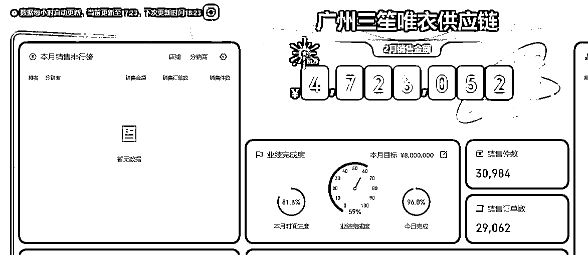

### 玩法逻辑

一句话：堆量。

自营400多个账号，每个号每天发5到6条混剪内容。用漏斗模型筛号——哪个账号数据飘了，剪辑组立刻通知直播组，当天就把直播间架起来，日不落式开播。只要流量不断，播就不停。

我一直觉得爆款不是技术问题，是概率问题。用数量去覆盖足够多的可能性，基数大了，总有几个号能撞上爆发。

剪辑模板非常土：图片转视频，加转场，完事。

## 二、矩阵怎么搭

### 400个号的运营节奏

1. 一个人管20到30个号，四五人一组，给固定模板，组长负责盯。
2. 每周收集各平台当季爆款衣服、爆款音频、爆款图片。
3. 批量做混剪——现在工具能替代，但我们还是人工剪，大家想想为什么。一条视频无非文案、声音、画面三件事。文案定期收集中老年喜欢的表达，音频从对标账号扒，画面全是爆款服装图。比如年底红色衣服好卖，那我们就全剪红色，只要是红的就行。
4. 剪辑的人盯着后台数据，出现异常值马上标记上报。这个表格人手一份。

团队SOP大概长这样：

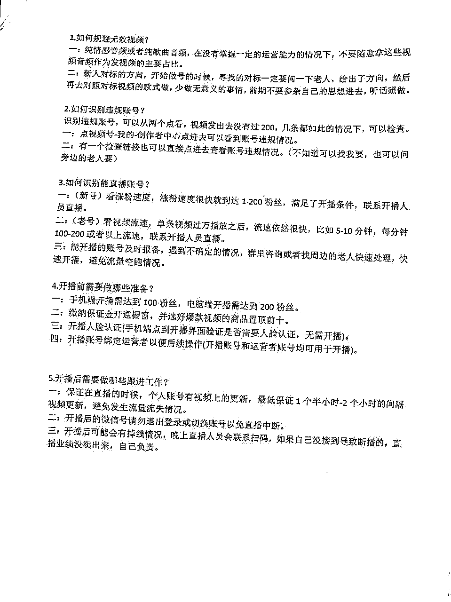

1. 账号数据爆发，直播组马上安排开播，人员设备全部就位。
2. 店铺组把提前备好的链接挂上去。
3. 供应链去找货、找工厂、拍单。有现货拿现货，没现货现做或去拍单。
4. 店铺组处理客服和售后，发货时效跟上。

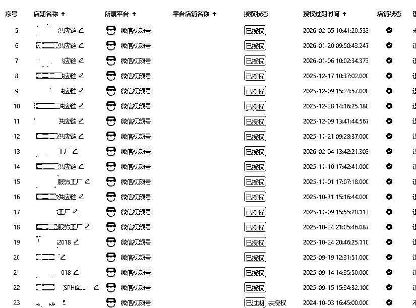

### 24小时接力直播怎么排

中台专门协调剪辑组和直播组的事，处理开播人脸认证、排班表、人员配置这些琐碎问题。

规则很简单：一个号配8个主播，每人3小时一轮，一天至少两轮，合计6小时。

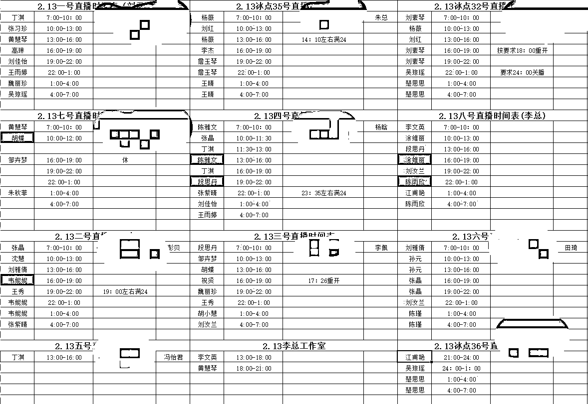

## 三、团队管理才是真正的门槛

### 剪辑岗怎么考核

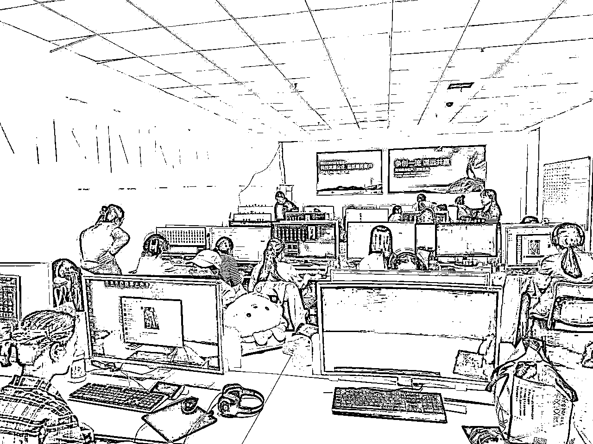

一人20个号，每个号每天5到6条片。

考核跟成交挂钩：当月管的号做到100万、200万、500万，分别有对应的阶梯奖金。销冠有额外月度奖。

奖金和激励是两码事。好的激励政策能赛马——比如这个月剪辑组总共1万奖金，最高的那个组拿走。金额不用夸张，让他们够得着就行，够得着才有拼劲。

### 主播怎么招怎么培

直播做口播，口齿清楚、形象过得去就行。所有新人进来先上三天培训试播，给一段三到四分钟的话术，练会了才算过。

面试环节就是广撒网。前期靠人事在本地招，优先找做过销售的——小城市电话销售一抓一大把。再来就是人推人，宝妈带宝妈，人还是好找的。最开始来者不拒，后面慢慢提高门槛，小地方人口有限，这个转变需要时间。

现在也开始跟学校合作，给学生提供培训机会。

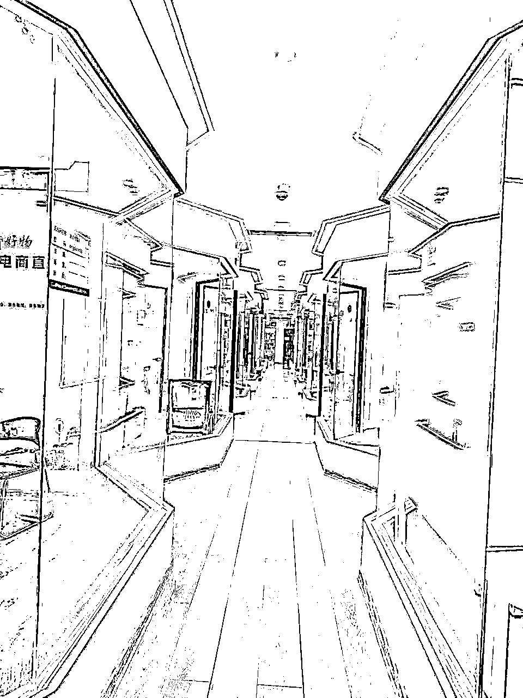

【租的学校直播间，孝感这边的朋友应该眼熟】

培训是老带新模式，先过镜头恐惧这关。能把给的文案清晰完整地对着镜头讲出来就算过关。快的三天，慢的一周，一周还不行直接PASS——说明不适合这条路。

但光会念没用，得加上自己的口语化表达和情绪感染力。

平台规则和违禁词也要讲清楚：极限词不能碰、面料材质不能瞎说、虚假承诺不能给。

后面还有每周复盘和持续改进，让优秀主播出来分享经验，带着其他人一起进步。

试岗环节直接用我们的小号。这一步既是练镜头感，也是查违规风险。流量本来就来自短视频，对主播个人能力要求不高，男生也可以播——我们那个百万直播间就是男主播。

正式上岗就是大量练习，把熟练度堆起来。

### 人员流失怎么办

四线城市流失率其实不高。剪辑和主播基本都是宝妈，这批人稳定性很强。当地平均薪资3000块，我们这边能拿到6000，基本就不走了。

人才储备一直在做：把这个模式复制到周边县城，只要人工成本合适就开点。学校那边也在持续供人，定向培养，毕业就能上手。

### 踩过的管理坑

管理这块我不擅长，我管的是整体规划、技术对接、资源对接。0到1的事我来，1到10的事交给合伙人，管理是门大学问，不能硬撑。

1. 前期主播全是女性，管理一团乱麻。后来打散分组，用小组制度管——剪辑部和主播部的负责人只对接组长，组内自己消化日常问题，组与组之间老带新、互相交流。
2. 年底优化了一批人，同时把激励制度建立起来，让付出有回报。
3. 搞部门轮岗。让负责人知道其他部门在干嘛，而不是各干各的。比如剪辑组号爆了要直播组安排人，但直播组满员了，这时候就要说明白为什么不给你播、为什么给他播，而不是甩一句"没档期"。
4. 不要盲目扩张，尤其直播这个行业。忙起来真忙，闲下来真闲，订单本身就是波动的。能用兼职解决的别找全职——仓库打包、临时拿货这些；主播也是先从外部代播验证，稳定了才开始扩自己人。
5. 人少的时候可以自己顶上去，人多了之后盯着就行，其余放手让下面的人干。如果你成了公司的天花板，那离关门不远了。

## 四、数据背后的账

### 70%退货率怎么还能赚钱

羊毛出在羊身上。70%的退货率确实吓人，但我们毛利普遍做到70%以上，定价直接3到4倍加价。没办法，有流量，就得靠高毛利对冲高退货。

这几年运费险加兴趣电商，把女装退货率从30%干到了80%，个别品类甚至90%。货是批发市场拿的，品质这边改变不了什么，只能从发货和其他环节做差异化。

1. 砍掉代发，自建仓库。你让供应商代发，根本不知道他发了什么、有没有质检。客单价150块的东西，至少要让买家觉得值这个价。
2. 该花的钱不省。统一用气泡袋发货，反正客单价撑得住。另请四个兼职阿姨整理退货、给衣服做质检。
3. 单品销量破100件，就找工厂打版估价——我可以不找他做，但必须知道出厂成本是多少。然后跟档口价比，看怎么划算。档口拿货的好处是能承担部分退货，自己做货就得自己扛库存，所以要算账。比如卖1000件，可能只先做三到四百件发出去。产品本身有60%毛利，做货之后能到70%。
4. 维护店铺分。约定时间内发完，实在发不了就做好物流轨迹，电话通知客户丢件、退款，不让平台罚钱。
5. 这招有点损：实在拿不到货，去拼多多拍单发。客户退货就退回给拼多多商家。一般不做，除非真没办法——不建议大家学。
6. 固定成本是可以算出来的。人工、场地、杂费，心里有数。只要利润能覆盖开支就是赚的——营业额拉上去，人工和场地不增加，利润就出来了。
7. 前端400多个号在测款，同时在盯同行的爆发。所以卖爆的款基本就是那么几个，我只要锁定供应链，就不用担心发不出货。
8. 整条链路跑通后，再抠细节利润。比如退货有返点，一单三毛；有些地区快递发件有返点，一单两毛，最高50万封顶——这个政策是商务局的，可以问问本地政策，我们这边问的是天门的。

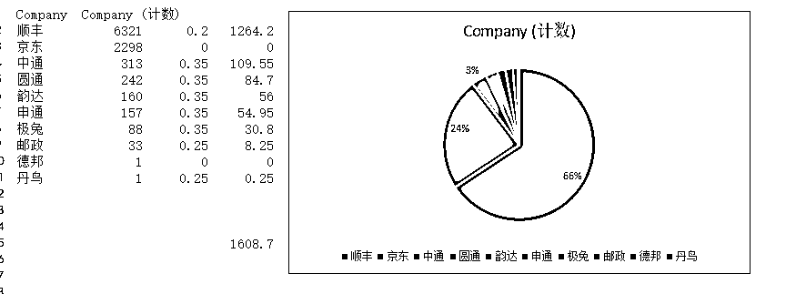

主播团队扩到60人后，自然可以接同行的代播业务。最好的结果是直播部门自负盈亏。

说到底，只要营业额够大、利润够高，很多问题都能被覆盖掉。

### 资金周转的关键

创业者几个要素的排序，我的答案是：现金流 -> 利润 -> 规模 -> 品牌 -> 情怀。

我14年创过业，失败过一次，才明白你所谓的品牌只是个商标。从此只谈利润，不聊情怀。

现金流永远第一位。现在完全自有资金在转，没缺过钱。店铺回款周期大概30天，一个月做500万GMV，需要准备150万左右的货款。合作深了之后，部分档口工厂愿意月结——当然大部分还是现金结算。退货可以退回给供货商，做货的部分自己控库存。

比如一个款卖了1000件，我只做300件，剩下的靠15天预售慢慢发，把退回来的货不断重新发出去。库存压力就这么降下来的。

有些产品是供应商提供的，他们愿意百分百退货或五五退货，这种就直接拿货发，退回来的还给供应商。现金拿货，退回去供应商退现金给我。

我们做得不算大，利润拉高之后，资金周转压力其实还好。

### 什么品值得重点投入

能白嫖就坚决不付费。目前零付费推广，一分钱都没投——还没到需要投流的时候。

从产品角度看，一个品爆了、退货率低、利润还过得去，那就加码做——全部账号开始剪这个品或者同类品。

有些品类坚决不碰。去年羽绒服棉服我们没做，只做毛衣和针织。当时看不出来，后来躲过了年底那波羽绒服风波，才觉得这个选择有多明智。

这里给各位一个经验：夏天不碰连衣裙，冬天不碰羽绒服，全年不碰网红款。凡是对身材要求高、尺码容错率低的款式，一律不碰。做不好就翻车，这不是我们这种玩家能玩的。

我们没有开发能力，本质是拿货卖货。没法从源头控品质，没有网红那种粉丝粘性，把手头能掌控的事做好就够了——女装市场足够大。

### 选品和定价的算法

简单粗暴：淘宝、抖音、快手跑出来的爆款，直接拿过来混剪。

定价3到4倍加价。没办法，退货率太高，只能用高毛利去覆盖。

用图搜图找对应的供应商。举个例子：抖音上某款针织衫卖39.9元。

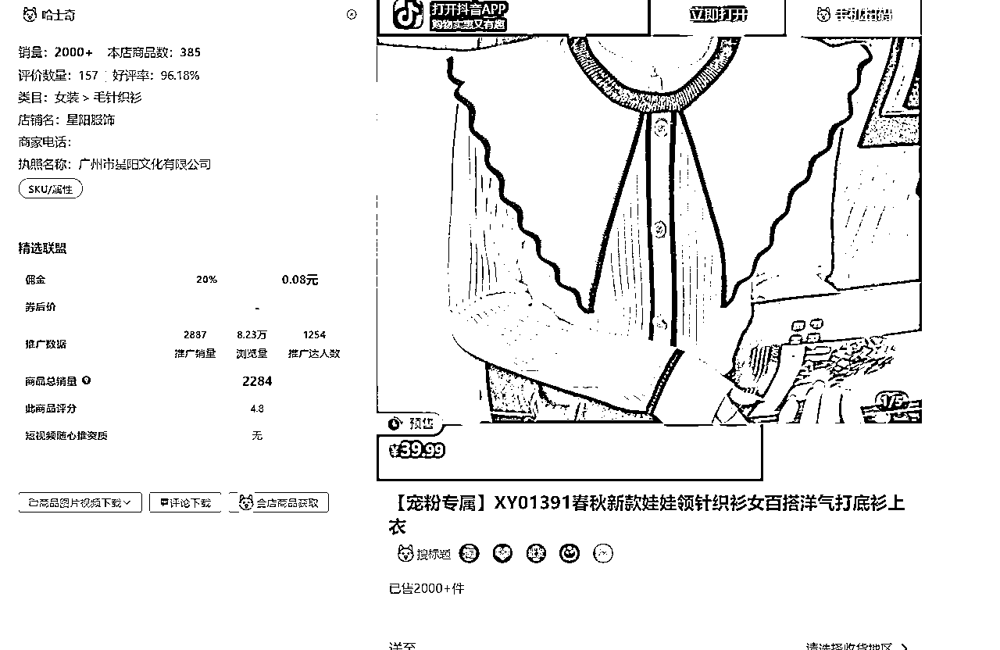

用图片搜，能找到好几个档口有货。

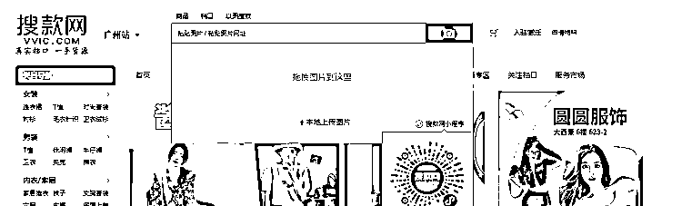

拿货价在20、23元左右，中间的差价就是利润空间。

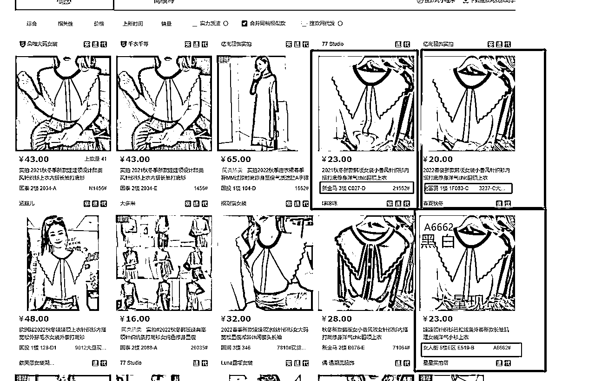

不要选最高价，也不要选最低价，一分钱一分货，选适中的。太便宜的容易品退，把店铺搞挂。

计算公式：成本 × 3 + 10 + 折扣优惠 = 前端销售价。

这个公式很粗放，不同品会细分，这里只是举例。成本从档口那边要，3倍是覆盖退货率，10块是人工加快递加耗材加运费险，折扣优惠是直播间的券之类的。

这是自己带货的版本。如果给达人开佣金，要重新算一遍，总之保证自己的利润。

## 五、入局之前要想清楚

### 最低启动资金

个人玩的话，1万以内能启动。前期主要是基建加时间的投入：10个视频号认证（找亲戚朋友帮忙就行），一部手机装两个🛰️视频号，5部手机就够。再加一台剪辑电脑。

直播会就自己播，不会就找代播。我们带出来的朋友就是这么干的：家里办公，媳妇加小姨子播，忙不过来喊我们代播。最开始我们也是代播和自己播混着来——账号爆发的时间没法预估，号足够多，爆的概率才够大。

市面上有人卖号、租号，刷200粉开播做微付费。我们不做这个，账号太多刷粉是一笔大开支。反正要养号，直接发作品，有了爆款账号200粉几分钟的事。省钱。

总结一下成本：

1. 两个号一部手机，二手安卓400块搞定。10个号就是5部手机，2000元。
2. 一台剪辑电脑4000块，一个人一天能剪100多条。要用AI或RPA，一天2000条都没问题——有这方面技术的大哥们欢迎联系，我们有需求。
3. 前期人力自己做，这项免费。
4. 刷粉的话，200粉大约50到100块。我们好久没刷了，不知道现在行情，可以问问服务商。
5. 账号爆了找代播，一小时40到50块，24小时连播一天1200。自己播的话这笔钱省掉。
6. 服装佣金一般30%。假设客单价100，每成交一单拿30。比如一场日不落直播卖了3万，按最高80%退货算：30000 × 20% × 30% = 1800块。想想如果退货率降到60%、佣金提到40%，数字立马不一样。

个人说完，团队想做的，满足下面条件就能试：

1. 三四线城市，人工成本够低，有办公场地，有其他主线项目养着。
2. 当地有一定人头资源——开号、扫脸、找主播都能解决。
3. 先安排两个人跑，跑通了再放大。

服装电商现在是个苦差事，我更多是劝大家慎重。

### 供应链对接的几条经验

1. 所有沟通必须文字确认。供应商说百分百可退，就让他打字确认。他说的退货比例，你能接受就合作，不能接受就换。
2. 别找最低价的供应商。服装买的是图片，一个款几个供应商有货，但最便宜的不一定质量好。看质量，选性价比高的。
3. 别因为供应商能月结就绑死。自己资金充足就现金拿货，这样供应商不对可以直接换，没有顾虑。
4. 价格不合适就自己打版。打版之后你会发现成本又降了——服装这行从来不缺做货的工厂。

潜水两年多了，今天忍不住冒个泡。

其实不是不想分享，是这三年一直在跑视频号这个项目，数据一直没跑通，真的没脸在赚钱上发声。现在总算看到点起色，有了正向利润，才敢把这段时间的踩坑经验整理出来，感谢龙哥盟给我这个机会，也谢谢各位星友抽时间阅读。

先说供应链和发货这块，我们现在用了两地出货的策略。
湖北的点，综合到手是1.8元，并且已经把人工算进去了；广州的点，快递费是1.9元，人工另算。核心就是把成本压到最低。
因为是产业带，人员需求波动很大，我们的做法很简单：人手紧张就立即找兼职补位，人手充足就全部自营，不死守固定人力，人工必须保持弹性。

这只是其中几个被放大说的重要点，里面藏着不少不起眼的小动作。正是这些细节的积累，才让我们在广州和天门都设立了产业带的发货据点。

关于团队的搭建节奏，我的经验只有一句：先把最小可行的版本跑通，再谈扩张。
每个人的情况不同，节奏自然不同。我们自己就是从23年开始做这个方向，整整亏了一年，才勉强看到活路，同期很多伙伴都扛不住了。资源背景不一样，结果就完全不一样，这个不能强求。

再说资金安全。
我们目前是拿货端，所以最坏的情况就是裁员或者直接止损放弃这个项目，眼下规模也控制得很小。
账户里始终会留足两到三个月的员工和场地支出作为缓冲。一旦出现异常波动，我们会立刻止损，不恋战。

做了三年了，这个项目在不同平台之间来回迁移，未来能持续多久我自己也不敢保证。能做的就是在它还能赚钱的窗口期，尽可能拿到利润，并把这些利润变成下一次启动的弹药。

有什么问题可以直接在评论区问，我会尽量把话拆开，一点点讲清楚。