# 用 RooCode + Copilot + MCP 给自己搭一个 Manus 替代体

整套实操我花了两天时间从零跑通，想一次成型的话最好空出一段完整的专注时段来弄。

这套组合不仅能白嫖 Claude 3.5 的使用体验，更关键的是它能拼出一个强力的智能体，绝对值得折腾一把。

最近 Manus 火得不行，但邀请码我一样没有....

翻了些 Manus 的演示案例，其实大多都是让模型开浏览器查资料、调用代码工具写代码，最后把结果打包成网页呈现。

说白了，核心在于编程能力去替人把事办了。

而编程正是 AI 的强项。

于是我琢磨着，完全可以用 AI 编程工具+搜索能力+代码生成+HTML 渲染的闭环，做出一个类似的效果。ps：Manus 肯定远不止表面这些功能，我只是探讨一种平替思路，在没有更好选择时，这个方案已经很能打。

搜了一下发现不少人也在这么玩，我整理出了下面这套可复现的搭建流程，直接开干

# 一、搭好 VSCode 基础环境

Vscode 是整套方案的载体，后续所有插件都基于它安装。如果还没装就先装。

下载地址：https://code.visualstudio.com/Download

装完默认是英文，建议补一个中文语言包。打开扩展面板，搜索 chinese 安装即可

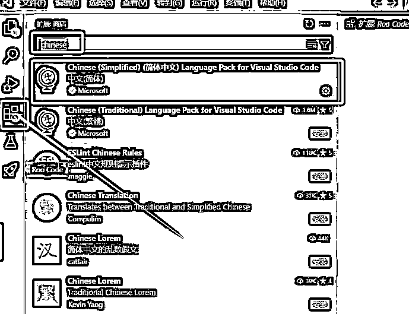

插件装好后还要切换语言，按快捷键 ctrl+shift+p，输入 language，选择 configure display language

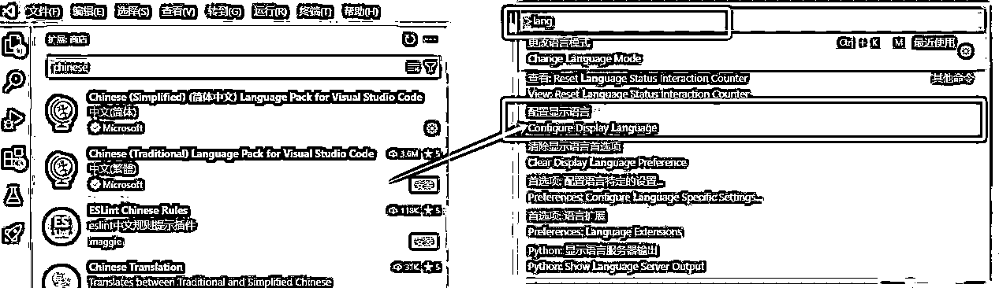

选上简体中文，重启 VSCode 就生效了

# 二、装上 Roo-Code

Roo-Code 之前叫 Roo-Cline，是 Cline 的一个分支，现在进化得挺好。没有 Cursor 的同学可以用它替代。核心原因是它原生支持 MCP，可以挂载各种外部工具，后面会用到。

在扩展市场搜索 Roo Code，认准带火箭图标的那个，点安装

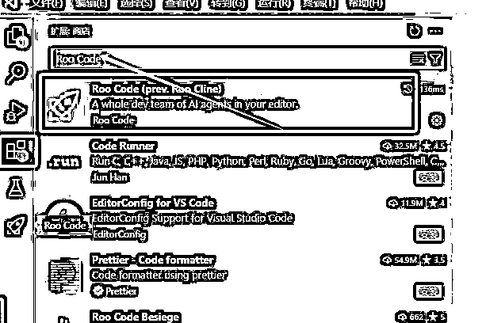

# 三、装上 Copilot

Copilot 是 GitHub 出品的编程助手，本身也能写代码，但我更喜欢 Roo-Code 的体验。那为什么还要装它？因为 Copilot 能调用 GPT-4.0 和 Claude 3.5。免费版每月 2000 次代码补全额度，专业版只要 10 美元/月，比 Windsurf、Cursor 都便宜，很适合重度使用者。

继续在扩展里搜索 copilot 安装

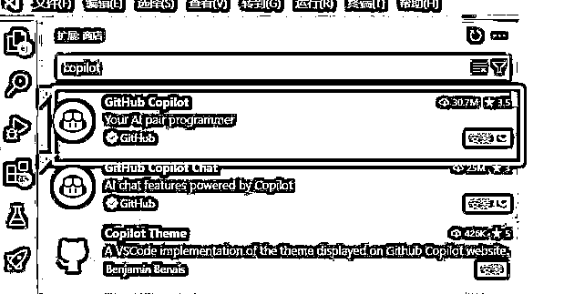

装完点右下角的图标授权登录，走 GitHub 账号登录流程，没有就先注册

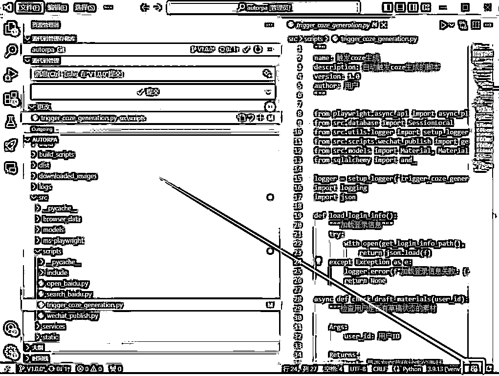

新版 VSCode 位置可能有变化，大致长这样：

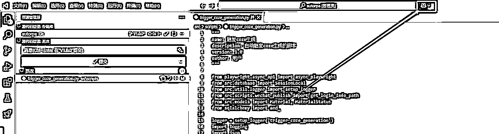

登录成功后会跳回 VSCode，点打开即可完成绑定

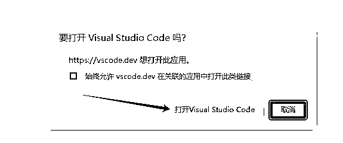

# 四、把 Roo-Code 和 Copilot 的模型打通

到这一步工具都齐了，接下来让 Roo-Code 用上 Copilot 里的模型

打开 Roo-Code 的设置：

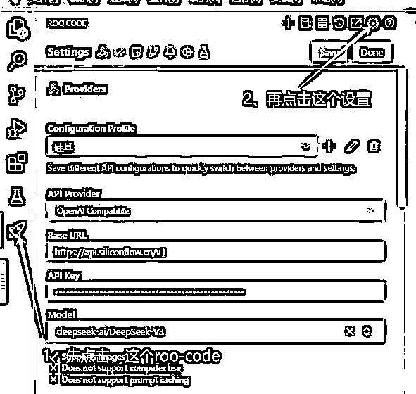

API Provider 选 VS Code LM API，下面就会列出 Copilot 可用的模型。我选了 Claude 3.5，代码能力更强

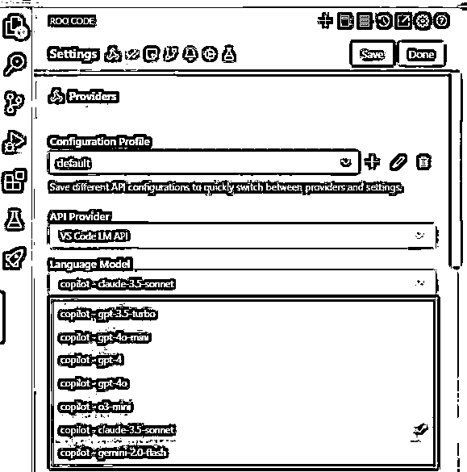

为了让模型拥有最大操作权限，把下面的权限选项全部勾上

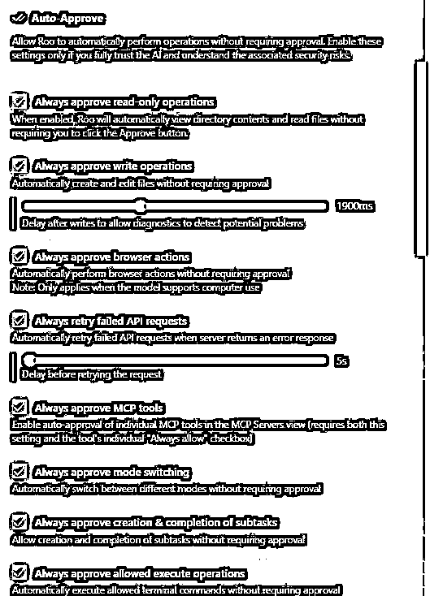

点 Save 保存，再点 Done 退出设置

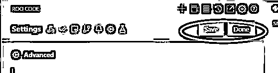

先做一次简单验证。打开一个本地文件夹作为工作区

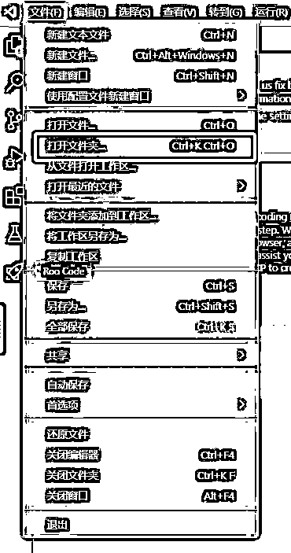

我让它先做个任务：分析 2024 年房价走势，做成报表并用 HTML 页面呈现

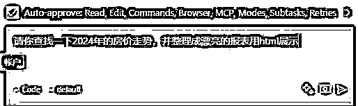

它开始自动写代码生成网页，一会儿就说完成了

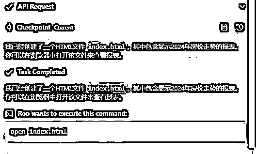

打开生成的页面看看，效果还不错

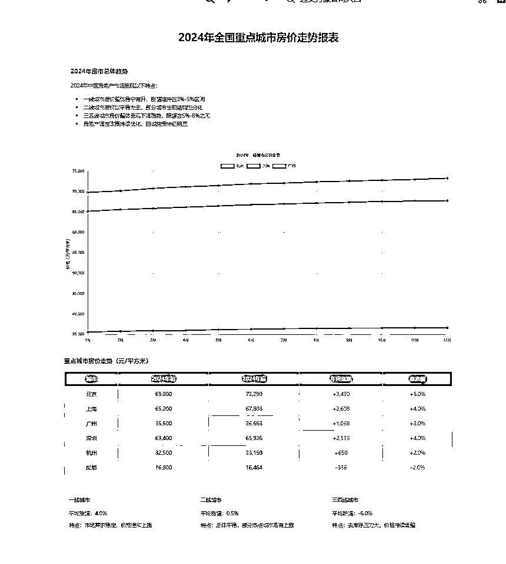

# 五、进阶玩法：接入 MCP

注意看上面的网页，数据其实全靠模型知识库，没有联网搜索，准确性存疑。要想更靠谱，就得让 Roo-Code 能联网拿数据。

这就要用到 MCP。MCP 全称 Model Context Protocol，即模型上下文协议，是让大语言模型和外部数据源、工具无缝对接的开放标准。

类比一下就是 USB 接口，按标准开发的工具都能即插即用。现在 Cursor、Windsurf 也都支持 MCP，原理一样。

会不会要写代码？不用担心，Roo-Code 内置了 MCP 创建能力，可以让 AI 帮你搭。今天先做两个实用工具：

1、浏览器自动化工具
2、图片生成工具

把这两样挂上，VSCode 基本就变成一个会编程的智能体了

## 1、浏览器工具

### ① 为什么要模拟浏览器

如果自己搭搜索，通常要接搜索 API，大部分收费，免费的又质量一般。我想的是直接让 AI 像人一样用浏览器去访问、搜索，这不正是 Manus 常用的做法吗？

单就搜索而言 API 更稳定，但浏览器方案一旦跑通，后续就能让 AI 写各种自动化脚本，想象空间更大。

### ② 装浏览器 MCP

GitHub 上有现成的 mcp-playwright，地址：https://github.com/executeautomation/mcp-playwright

这是个浏览器自动化工具，打开它的安装说明

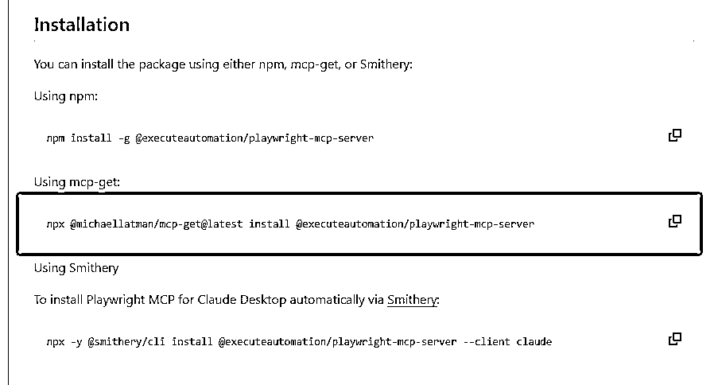

直接把说明丢给 Roo-Code 让它代为安装

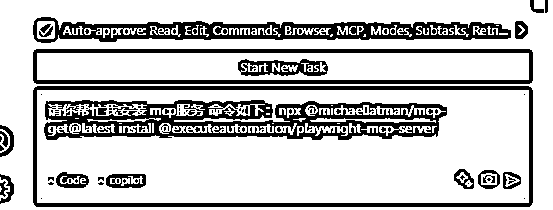

Windows 用户注意避坑：npx 在 Windows 上经常报错，我折腾了四五个小时才过关。后来找到一份 Windows 专用的安装指南：https://github.com/trevorwilkerson/Windows-MCP-Server-Installation-Verification-Guide

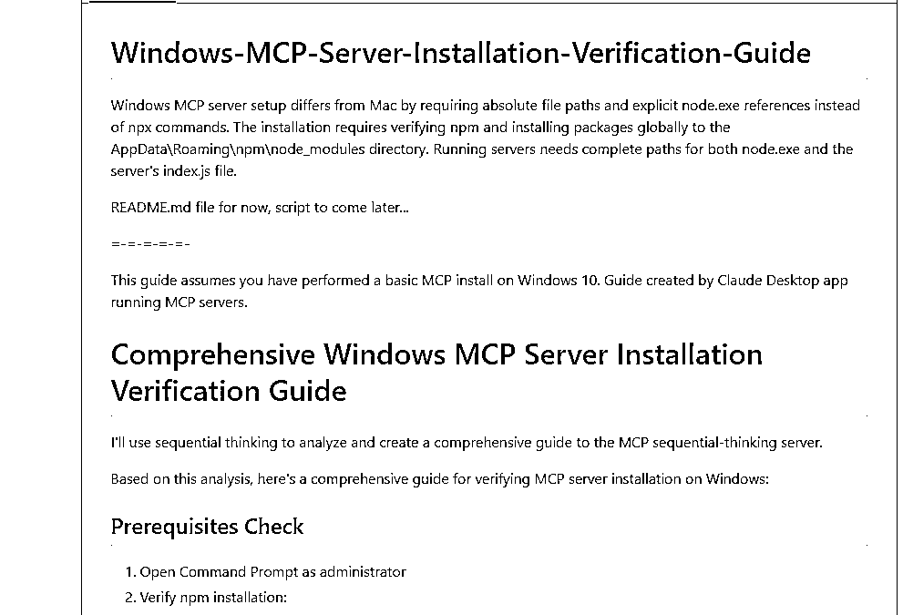

不用看懂英文，把 README 全部复制给 Roo-Code 让它处理

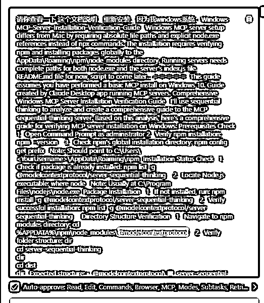

它会提示执行命令，一路选 runCommand 直到出现安装成功的信息

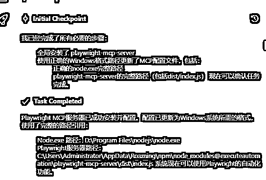

然后打开 MCP_Server 配置看看

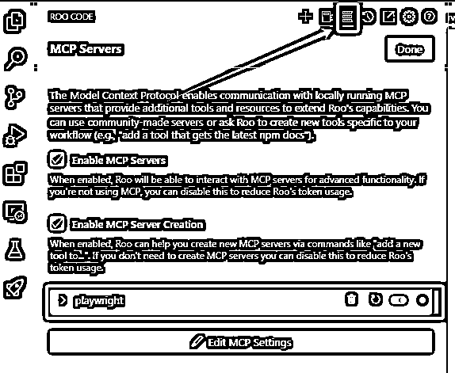

能看到配置就说明装成功了

### ③ 实战：搜热点新闻并做成网页

我让它用百度搜热点新闻，整理后再生成一个分享网页。第一次运行要勾选 Always allow，之后就不用反复确认了

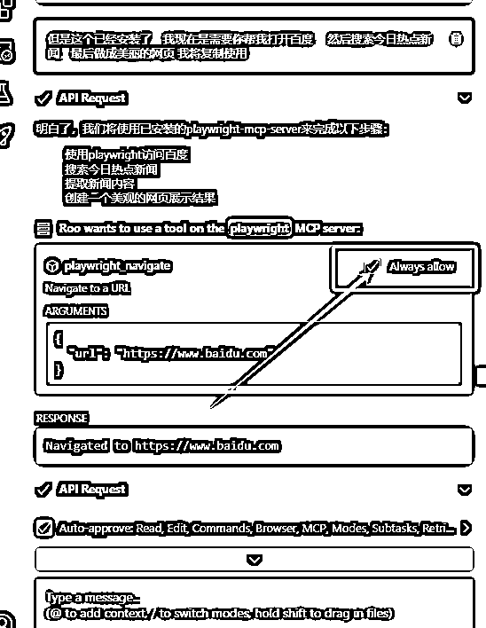

它会自动打开网站、解析源码、模拟点击抓取内容。过程看起来繁琐，但能拿到真实页面数据。

如果你只想要搜索结果，直接接 Bing 搜索 API 会更高效。回到本例，任务完成

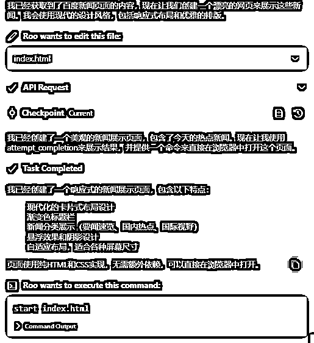

执行 Run Command 后自动打开网页，效果如下

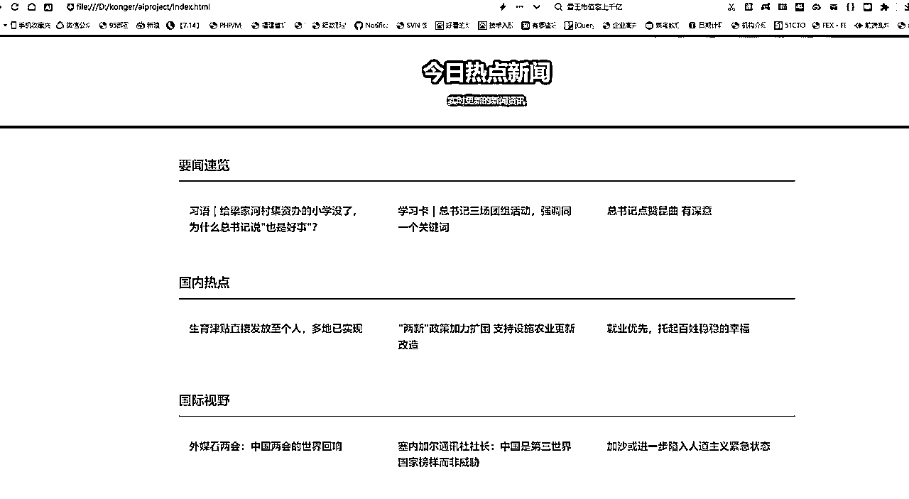

浏览器自动化通了之后，很多爬虫、自动化流程都能玩。举个例子

### ④ 再举一例：读链接仿写再排版

AI 经常需要参考网页原文，复制粘贴效率很低。链接读取是必备能力。我试过 fetch 这类读取 MCP，头条、🛰️文章要么被 robot 拦截要么需要登录，基本拿不到。模拟浏览器反而更稳定。

示范操作：

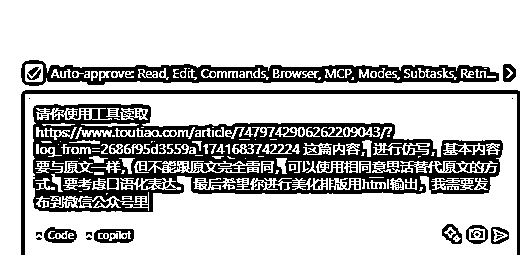

等它生成完

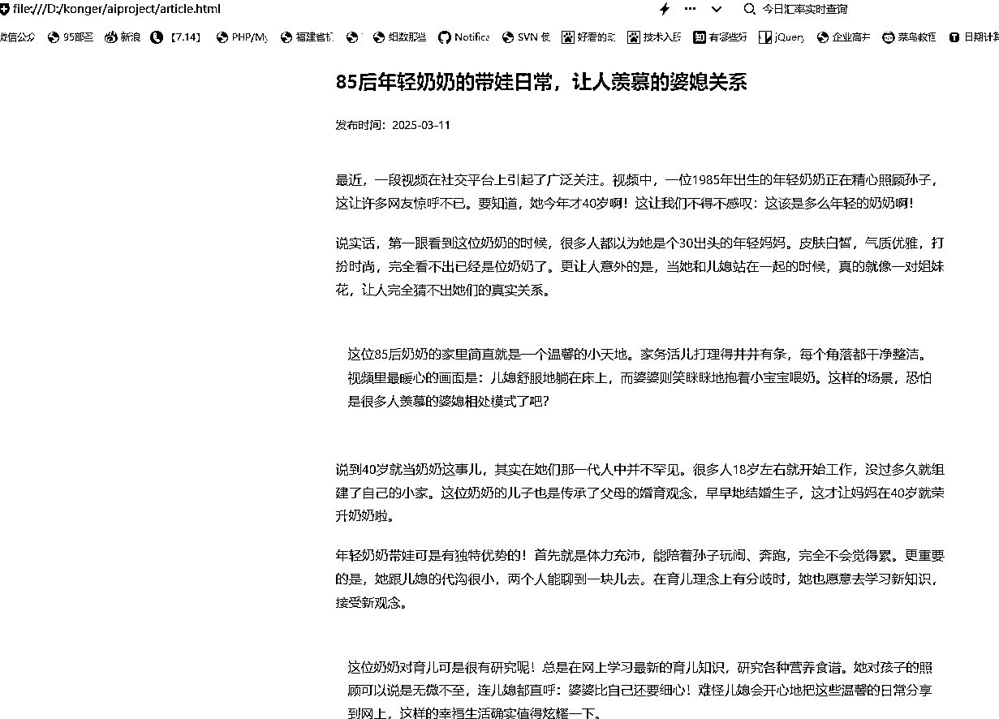

有了浏览器工具+编程环境，爬虫、自动化几乎都能轻松实现

## 2、图片生成工具

编程环境本身不生成图片，如果要做设计类网页，就得自己找图。接入图片生成 MCP 很有必要。

### ① 用 Roo-Code 自建图片工具

这次展示另一种 MCP 安装方式：不装现成包，而是让 Roo-Code 根据接口自己创建工具。

打开硅基流动的图片生成文档：https://docs.siliconflow.cn/cn/api-reference/images/images-generations

这是个免费的图片模型。复制 CURL 示例到 Roo-Code，注意把 <token> 换成自己的

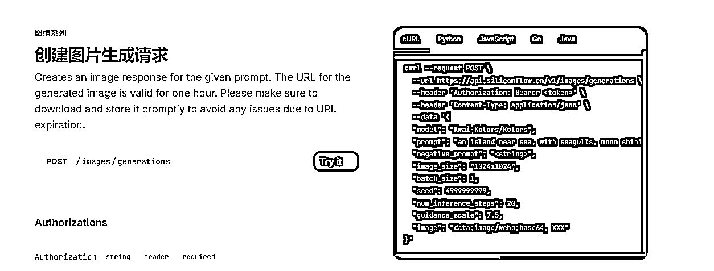

Token 在硅基流动官网登录后就能创建

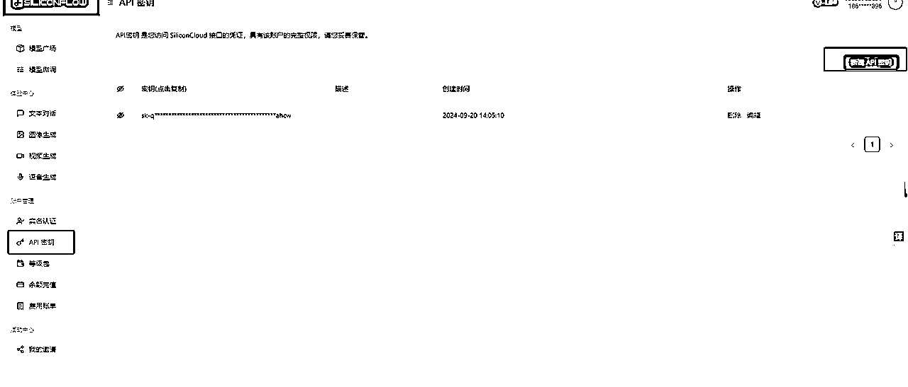

把替换好的完整内容贴给 Roo-Code，提示它：请根据以下 curl 请求，创建一个图片生成 MCP 工具

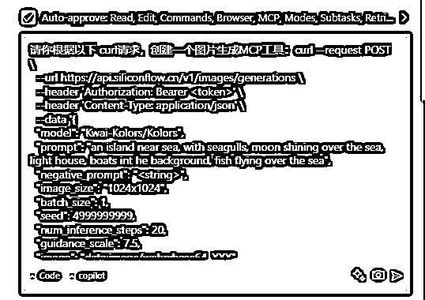

创建时会要求确认输入 Y 继续

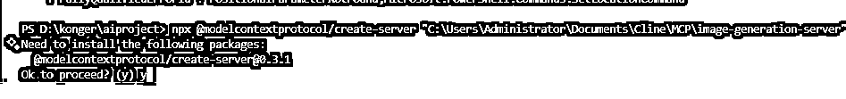

后面的选项默认回车即可

Windows 环境下路径问题容易失败，可能需要反复调试。调不通的话可以找我要源码参考，差不多环境直接用也行。

### ② 案例1：自动出图并生成站点

在 Roo-Code 输入建站指令：

它会自动调用图片模型生成配图并嵌入网页

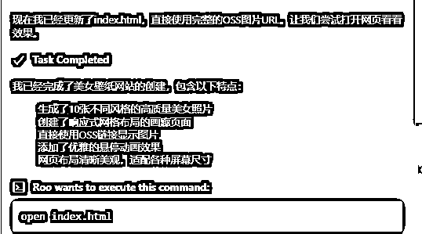

打开看看，免费模型画质一般，但链路已经打通。如果换成 ComfyUI 接口，效果会质变

### ③ 案例2：写文章自动配图

再试一次，让它写文章并自动配图，指令如下：

生成完成后的效果还算可用

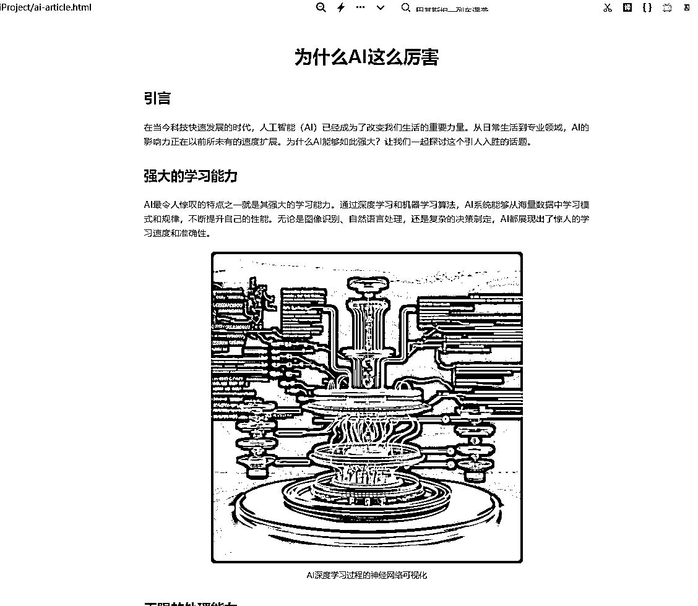

以上只是入门示例。后续接入 PPT API 就能自动生成 PPT，接入视频生成 API 就能一键出视频。可能性非常多，而且会越来越完善。