# 关于做陪跑更好了解学员的情况的一个好方法
作者：龙哥

陪跑教练再也不用远程控制电脑了！用这招轻松查看学员频道数据

做陪跑久了，想了解学员后台数据，很多教练习惯直接远程操作对方电脑。说实话，这样既麻烦又有点风险。其实官方早给了一条“绿色通道”：通过授权，直接访问其他频道的数据。下面手把手拆解，亲测好用。

第一步：进入频道后台，找到“设置”  
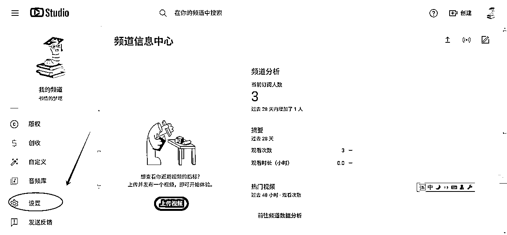

第二步：打开“设置”页面后，切到“权限”，再点“邀请”  
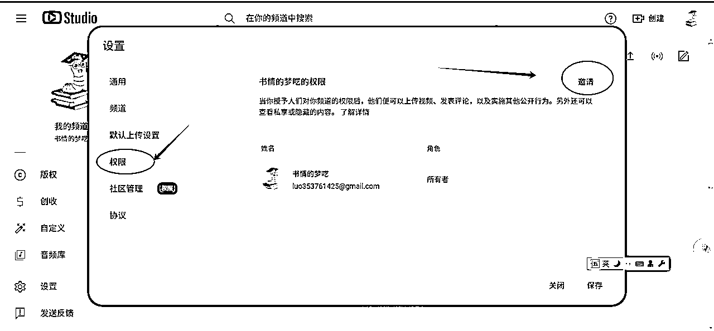

第三步：把邀请人的信息填好  
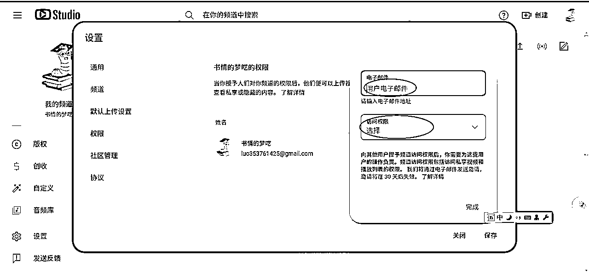

问题来了，访问权限怎么选？下图里已经给了好几种角色。  
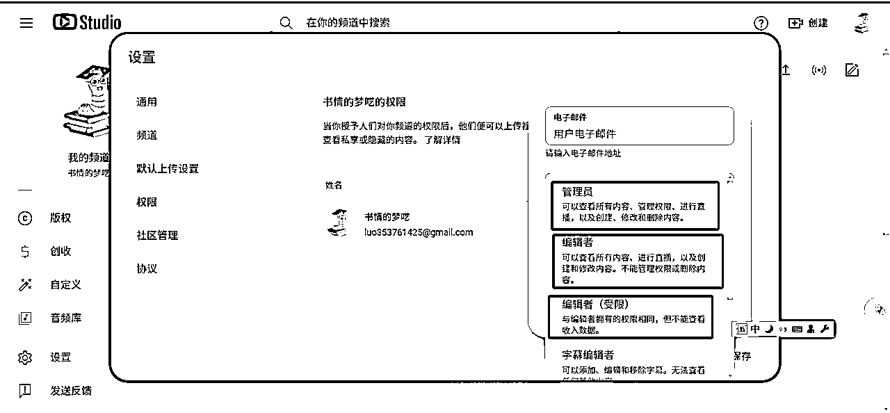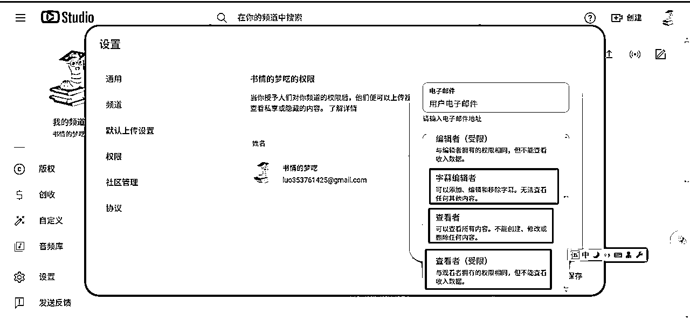

我的建议是，普通陪跑场景选“查看者”就够了。查看者能看到收入情况，这样你就能根据真实数据给学员提建议。

这里有个容易踩的小坑：点完“完成”后，一定要记得再点“保存”，邮件才会发出去。  
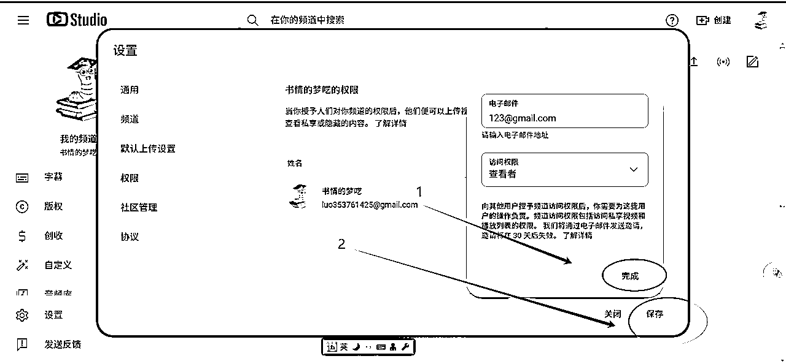

被邀请的一方，要多看看Gmail邮箱。收到邮件后点一下“接受”，页面就会自动跳转。  
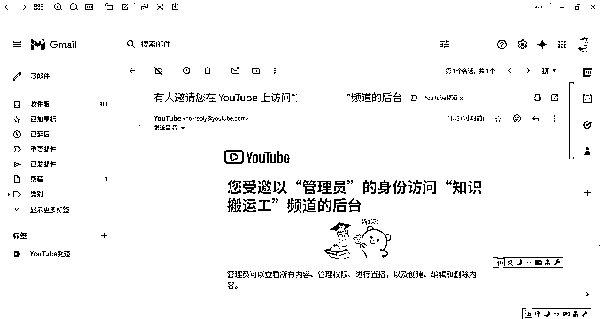

跳转完成后，基本就搞定了。这时候你只要点“切换频道”，就能进到邀请方（也就是学员）的频道页面。  
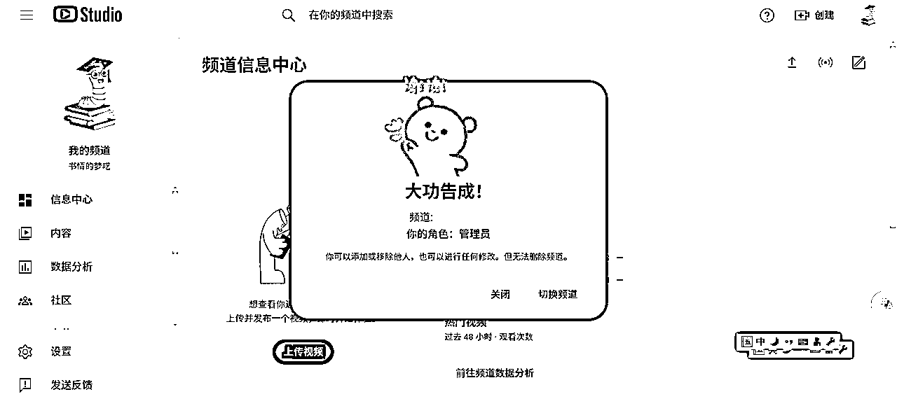

如果带的学员多，也不用一个个切来切去。可以新建一个标签，把不同学员的频道后台都放在侧边栏，点一下就能切换。  
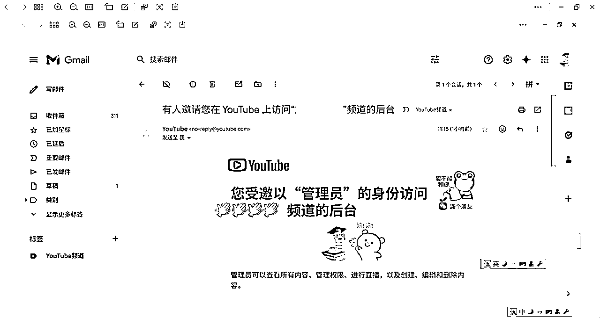

再说个后来踩过的坑：之前一直没细讲买卖频道的事，这里补上。买卖频道一般在这个网站：https://flippa.com/buy/media-communities/youtube  
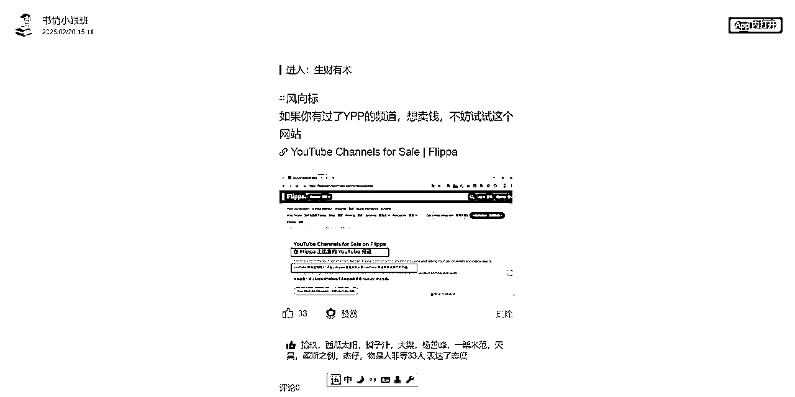

讲买卖，就得提“品牌账号”。你会发现，品牌账号的设置页面和普通个人账号不一样，原因很简单：它已经不是个人账号了。  
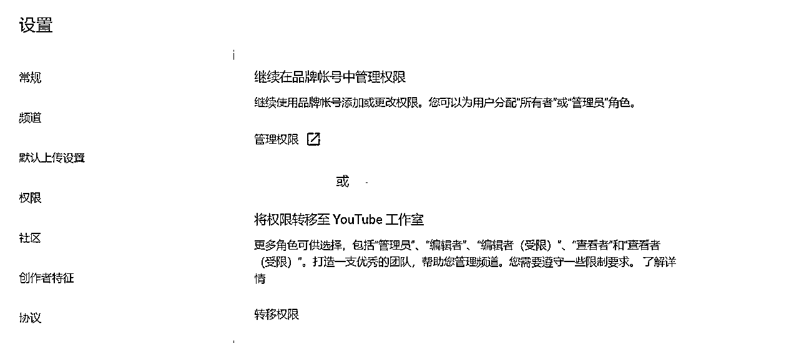

官方对“品牌账号”的说法是：为你的企业或品牌准备的Google账号，可以用于某些Google服务。可以理解成“商业频道”。

这里必须澄清一个概念：
个人账号 = 不支持买卖，对应YouTube工作室。
品牌账号 = 支持买卖。

为什么个人账号不能买卖？接下来就涉及到两类限制。

第一类：频道权限的限制
“所有者”权限看起来很厉害：无限制，能删除频道，也能管理直播和实时聊天。但请注意一个关键点——“无法将所有权转让给其他用户”。这就是前面说的，个人账号买卖是走不通的。

第二类：品牌账号的限制
品牌账号里有一个“主要所有者”，同样是无限制权限。而频道到底算谁的，就由这个“主要所有者”决定。

具体操作还是回到刚才那个页面，点红色圆圈圈住的入口，会进入新页面。  
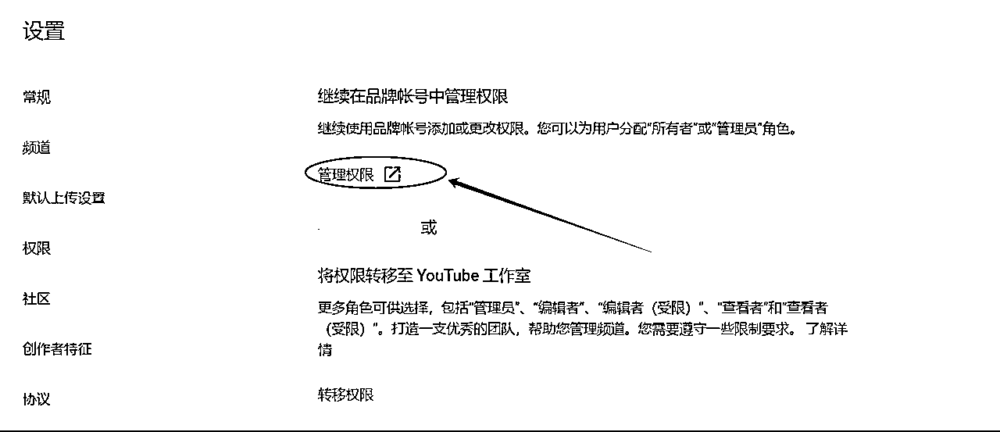

注意：这里的“邀请”和我们前面讲的“邀请”不是同一个功能，别搞混了。  
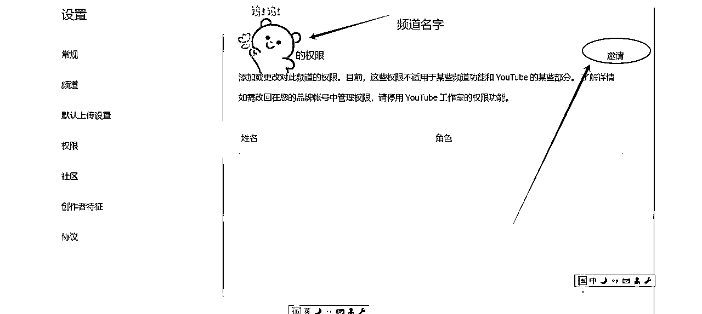

点“邀请”之后，你会进入新页面。  
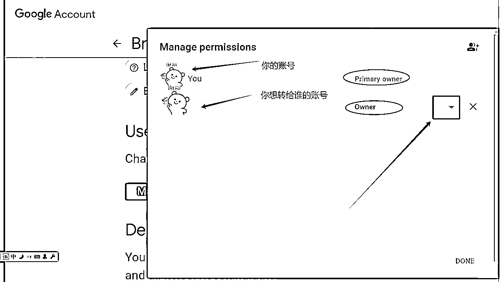

朝着红色箭头指示的地方点开下拉菜单，会看到很多角色选项，注意选择“Primary owner”。  
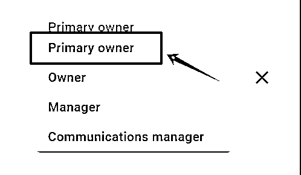

当你把对方设为Primary owner之后，自己原来的Primary owner身份就可以删除了。一旦删除，频道的归属权也就正式移交到对方手里。

以上就是关于用频道权限查看学员数据、以及品牌账号交易的全部心得，表述有误的地方欢迎随时交流。想要更权威的内容，可以查看官方文档：
- 通过频道权限添加或移除对您的 YouTube 频道的访问权限
- 从品牌账号用户访问权限改为使用频道权限