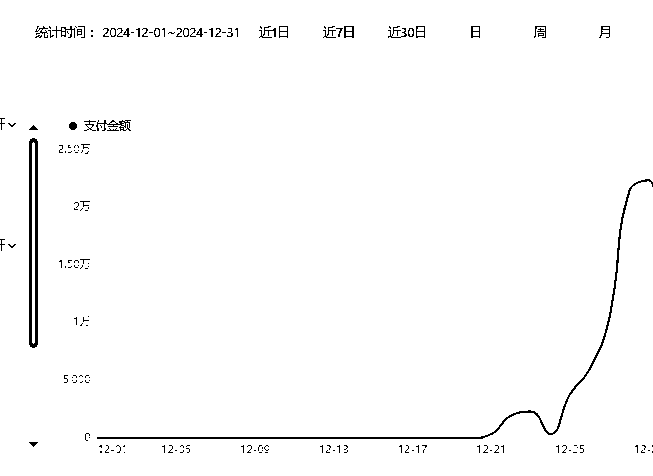
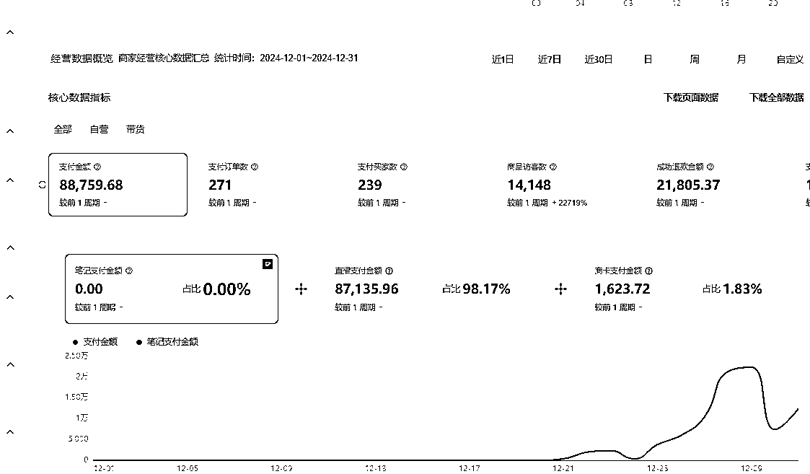
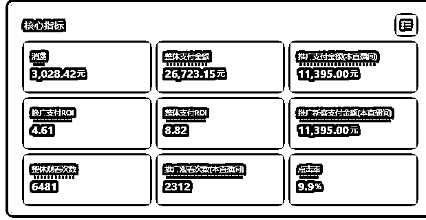
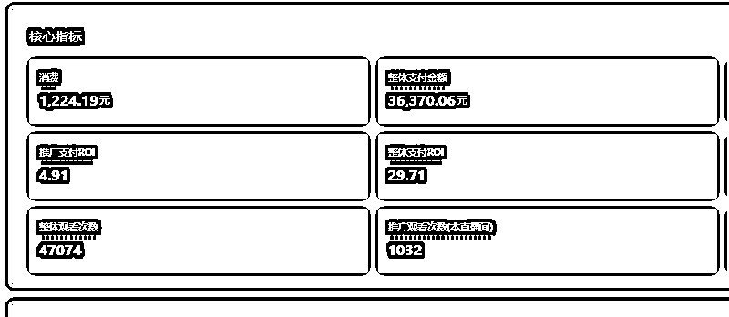
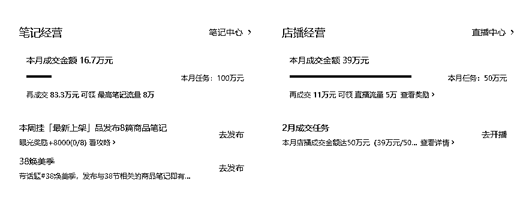
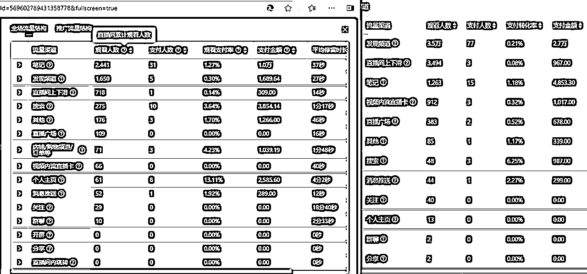

# 📕高客单自然流店播实操指南

最近后台收到好多朋友问：📕上做高客单的店播，是不是真的没机会了？

我反倒觉得，机会一直都在，只是打法要换。

趁着过年在家，把去年年底那次新号实操复盘了一遍，有些心得和主流玩法不一样，写出来和大家聊聊。

* * *

先说个背景。早先我们也做过号，标准的教科书式路线：先养号，再打磨笔记内容，测出爆款，等账号有了权重再挂车，最后开播、付费投流。

这套打法稳妥是真的，但慢也是真的。几个月熬一个号，放在今天的竞争环境里，性价比实在太低了。商家号本来就难做，时间就是成本，我更倾向于“野蛮生长”——快速试错、快速迭代、杀出重围。

但是这么做，问题也冒出来了：

纯新号没笔记，付费投直播间的入口在哪？

新号一天只能发一篇笔记，发多了真会被限流吗？

冷启动阶段直接开播，流量从哪来？

很多疑问缠绕在一起，索性去年年底用行动验证了一次。结果还是挺惊喜的，7天把直播端做起来了，利润也上了个台阶。

从付费到自然的转型路径，大概长这样：

# 一、地基先打好：店铺的基础配置

## 1.1 商品主图

📕现在几乎没有商城流量了，主页的商城入口也撤了，但这绝不等于主图可以随便应付。

尤其是高客单价的产品，图的美感跟不上，后续会很吃力。

- 低客单：重点展示价格优势+痛点（比如9cm增高、春节发货时效）+福利（下单送什么）
- 高客单：营造场景氛围+质感优先

低客单不意味着不需要质感。“高级感”这三个字，其实贯穿📕的每一个商品。

不过千万别P过头，图物差距太大会给自己埋雷。

测图的话，我习惯把图放到直播间5-7号位，3天观察一轮数据。不开直播的时候，用乘风投一下测试点击率，低于8%就淘汰（具体还是参考行业平均水平）。任何数据都要建立在足够的量上，否则没有参考价值。

尺寸方面，平台推荐3:4竖图，很多爆文主图也是这个比例。我用的都是1:1，主要是为了和别的平台统一，省得单独做图。另外3:4的图会有白边，强迫症不太能忍。

如果某些品类（衣服裤子那种）更适合3:4但手里只有1:1的图，用AI扩图工具处理就行，洗素材很好用。

## 1.2 详情页

每个类目的详情页结构不一样，品牌风格也各有偏好，但大致框架是相近的：

- 模板要能复用，最好批量生产，不可能每个新品都重新设计
- 固定位置放品牌调性展示
- 加穿搭场景图+细节特写
- 突出痛点，比如“矮个子福音”“无痛增高7CM”“熬夜党看过来”
- 给解决方案/产品特性：比如增高原理、用了什么技术、美白修复机制
- 动手演示环节：实操展示、对比实验，增强信任
- 材质证明、尺码表：真皮检测、防甲醛报告、工厂实拍
- 最后解决疑虑+逼单：限量库存、赠品剩余、官方资质

文案写作核心：废话少说。用户扫两眼就走了。

场景化：鞋好看？直接上穿搭图。
数字化：显高？写“实测显高5cm”；舒适？写“久走2万步不磨脚”。

## 1.3 标题搜索词优化

搜索词的挖掘渠道：

外部工具：灰豚、5118，哪个便宜用哪个。

内部渠道：📕搜索框下拉联想词；千帆经营的搜索运营模块，商机中心也会给核心词；乘风投搜索词时能看到系统推荐。

标题公式，我个人会在基本词根之外加场景词，这样后面在乘风投搜索场景时更容易匹配，蓝海词的搜索投放往往有惊喜。

我常用的结构：品类词+属性词+人群词+场景词+补充搜索词+货号

举个例子：早春连衣裙女2025新款小个子收腰显瘦约会斩男裙

## 1.4 店铺装修与活动

📕的店铺后台极其简洁，没那么多花活。千帆里搜“装修工具”，主要就是写个标题，不过可以利用这个位置放分类和优惠信息，辅助用户做决策。

活动设置方面，官方活动建议都报名，每个链接都勾上，挂了活动标识的链接能享受平台的流量位。直播间贴片要和当前活动呼应。

优惠券：我一般做两张——直播间专享券+全网自动推广券，功能不冲突。直播间靠券做关注数据，全网券覆盖店铺页。粉丝券、复购券按需配置就好。

店铺任务：登录首页能看到笔记经营和店播经营两个板块。笔记任务给流量，店播任务给流量卡（只能用直播间）。笔记经营的任务都很基础，每月初更新等级（V3到V6按GMV分层），建议都完成。流量卡我建议一张一张用，而且新号不要急着用——那个流量偏泛，新号用了只会泛上加泛。

关于链接优化，有个小技巧：新店前期的销量和评价一定要补。销量1和销量1000的链接，转化天差地别。评论里建议放一条“比价了全平台还是这里性价比高”。绑定商品后的买后评价会出现在评论区且删除不了，所以一定要及时维护评论，不要歪楼。跑量视频的评论区可以花几块钱找人异地评论，那些评论内容应该就是直播间被问最多的问题。

# 二、账号架构：店铺号与直播号分工

## 2.1 为什么需要多号配合

如果你是用品牌号做，这点必须理解。

店铺账号是主账号，专门做自然流笔记和店铺内容，需要长期经营；直播号是用来分担风险的——你想快速起量、暴力测试玩法，但又不想让主账号承担风险，那就让直播号来。

就算某个直播号被限流甚至封了，也不影响店铺和主账号，等于给自己留了个planB。

📕商城流量低，做一两个店铺就够，但围绕这些店铺可以开多个直播号，矩阵化运营。

## 2.2 📕的号起步为什么慢

新号冷启动最大的问题是：没有素材可以投流。

抖音的千川可以投本地素材，测试素材和账号发布无关。📕为了保护用户体验，乘风压根没有这个功能。这看起来不友好，但站在平台角度也可以理解。我们手头有六个抖音号，每个号一天拍10条，最少的也做了一年半了。如果这些都能在📕放开发，整个内容生态都会受影响。

## 2.3 为什么要短期密集发视频

這是我比较想验证的一件事：抖音的打法在📕能不能复制。

刷到过一个垂直的百货号，当时就想：如果抖音的垂直视频批量搬到📕会发生什么？

用品去驱动内容，做火力密集覆盖，一条视频的成本又不高。我们手里的存量视频几万个总有，如果这个模式在📕能跑通，相当于内容成本骤降。

另外一个刚性需求是时间。换款要搭新计划，一天一条两条的更新频率，灵活性太低了。搭一个计划得等5天凑素材，中间还要淘汰一批，新品测试的周期被无限拉长。所以快速测试、快速迭代就变得极其重要。

## 2.4 直播号和店铺号配置

直播号：
- 要有一定粉丝基础，否则扛不住前期批量发视频
- 一天建议发10条左右，直播前一周内发够200-300条素材
- 后续投流账户和店铺账号共用
- 营业执照可用可不用
- 开企业号，之后要被店铺账号绑定
- 付费投流为主，主直播间成交

店铺号：
- 新号即可，不需要粉丝基础
- 内容形式图文/视频均可
- 发布时间一天一篇，后期慢慢过渡到一天两篇
- 开企业号，自然流为主，主要靠图文笔记成交

# 三、直播间怎么做出效果

## 3.1 接受自己的局限性：目标先定60分

商家自播和达人自播有一个本质区别——你被货盘、主播、品牌、供应链、甚至所在城市限制。

四线城市主播都招不到，你非要找个能拉月销千万的自然流主播，现实吗？货盘就那点深度，定个月销千万的目标，自己信吗？

要承认，在📕上把直播间做到60分，已经跑赢大多数人了。60分不重要，重要的是——把60分的直播间做10个。

## 3.2 自然流和付费流都要看明白

自然流起号，要接受它的不稳定；付费起号，要接受利润被摊薄。

但📕有个天然的局限：付费不能稳定放量，流量池也没那么大。有句话说得好，付费的直播间，你的自然流就是别人的付费。

付费直播间的痛点：利润低的品类根本不合适做付费，比如我们就是被利润倒逼才去追自然流。高客单在付费上也有个老大难问题——没法稳定放量。就算你让出投产比，系统也不一定给你量。而且乘风的算法我个人觉得还不够聪明。举个例子：笔记进来一个人买了单，后来尺码不对退掉又重新买，计划会显示出了两单——下一秒消耗就开始疯跑，根本控不住。有时候莫名会空跑，直播间甚至看不到人进来。

高客单还面临决策周期长、用户流失到淘宝的问题。很多人看到一双鞋的价格，第一反应去识货比个价。所以你的价格要有竞争力，或者主播一定要把福利讲到位。

自然流的优缺点：利润高，但流量不稳定。实操中有两种做法，一种是主播做数据拉高自然流占比，另一种是笔记内容爆了给直播间引流。我们测试下来发现纯垂直视频面临一个尴尬：几乎没有笔记转化。

笔记带来的自然流比直播间自然流稳定且精准很多，但对商家来说，笔记爆量是不可控的。商家号等笔记爆，大概率要饿死。商家的流量核心在“品”，而品是不稳定的；买手的流量核心在“人”，人可以持续且表现形式更多元。

最近我们也踩了个坑，好几个视频被判违规——模特以第一人称说话，被系统判定为虚假人设。

## 3.3 三驾马车：健康的直播间生态

到了这里，问题其实已经很清楚了——所有流量模式都有短板。

只做自然流？不稳定。只做付费？利润撑不住。只做笔记？爆发不可控。

所以一个健康的直播间生态应该是：自然流直播间为主+笔记内容流量+付费为辅。

具体来说：直播间要建自然流的生态（主播+货品）；笔记图文内容做好；再叠加买手端流量（买手种草、商家拔草）；付费永远只当辅助——前期用来修正直播间人群模型，后期用来补量。

## 3.4 自然流直播间的关键动作

📕的流速不像抖音那么夸张——违规当场就没流量。📕的反馈是滞后的，现在的动作影响的是下一小时、再下一场甚至两场之后。

自然流和商业流不是对立关系，而是协同关系。自然流直播间的本质，是通过付费撬动自然流量：前期用付费吸引精准流量，用成交修正直播间模型。但一定要有意识引导自然流渠道成交（发现页/上下滑），再通过微付费放大杠杆、拉低整体流量成本。付费打多了就变成付费直播间了。

几个关键数据和实操细节：

**封面点击率**

平台给了流量，你连直播间都没让人点进来，这亏就吃大了。封面的做法就是笔记爆款主图那套逻辑。2025年1月17日起，📕只展示静态封面，不再展示动态封面，而且支持实时更换。

封面状态可以侧面反映货品状态。同样一个爆款封面，如果点击率降了，大概率你的货品也在走下坡路——这时候与其换封面，不如直接换货品。

封面三要素：视觉冲击力（多品组合）、差异化记忆点（比如“增高”这种标签）、看得见的利益（抽奖、送福利）。做好之后可以在乘风批量测试，点击率低于3%系统会提示修改。

标题强化即得利益，公式：[人群]+[限时福利]+[点击领取+具体利益]。利益点排序：价格折扣>独家赠品>明星同款>限时稀缺。

**加粉数据**

粉丝即权重，粉丝即正义。加粉最好用的工具是秒杀，但非店铺账号用不了这功能，那就用直播间关注券（建议做全渠道券一起）。话术上让主播引导：东西可以不买，关注先点一下，关注有买一送一。福袋发品也能做关注。前期这个数据非常关键，中后期可以用来判断品是否进入衰退期。

**60分的主播**

📕自然流没有抖音那么卷。在📕，60分货品+60分主播就能做起来。什么是60分主播？随时可以被替代，但说话正常，形象端得正。更好看更聪明当然加分。

怎么让小白快速到60分？给一套固定框架。

以我们鞋类为例，核心话术分三段：憋单话术、塑品话术、踢单话术。

开播憋单大概5-7分钟，📕的开播流速就在这个时间窗口，10分钟太长了，可以根据流速调整。开价后进入塑品环节，塑品至少5分钟，然后配合库存、福利等做踢单。中控偶尔要帮忙促单——比如“福利还剩几分钟”“今天拍下明天发货”之类的。

塑品时间一定要够长，高客单价用户决策周期长，逼单没有用。流量成本很高的今天，如果有条件配个中控，投产会有明显提升。实测有中控带节奏，直播间整体数据会好很多。一天的时间和运营轮换着来。

整体节奏参考：憋单-开价约7分钟，塑品约5分钟，踢单约2分钟，15分钟走完一轮，之后就是无休止的塑品+踢单。再往后播多久都不用憋了，就只憋开播那一轮。

为什么只憋开播，后面不憋了？

第一，人群问题。现在年轻人什么套路没见过？早期我们请过很厉害的自然流主播按抖音节奏播，结果适得其反。说到底还是货品和主播匹配度的问题。

第二，人效问题。📕直播电商的生态还没那么成熟，高薪的自然流主播播一天，人效太吓人了。实际测试下来，厉害的主播也不一定带来阶级式的增长。不如找几个小白主播轮着播。

第三，品的问题。品是核心，这个放在最后说——但恰恰是最重要的。货品状态好的话，主播的话术都不需要太多，顺势做转化就行；货品不行，再牛的主播也拗不过。

最后总结一下，我们所有的尝试，其实都围绕一个核心：在承认局限的前提下，快速试错、快速迭代、放大优势。📕现在的机会窗口还在，关键看你用什么方式挤进去。希望对大家有帮助。

做📕直播，品、主播、自然流、时长、单量、停留，以及后续的投流和素材，实际上是一套相互影响的系统。没有哪一个指标能单独决定结果，真正重要的是把每个环节逐步搭起来，再通过数据不断修正。

## 一、主播：先把能做好的事情做好

主播能力当然重要，但不能用成熟大主播的标准去要求所有人。很多60分左右的主播，本身还是新手，短时间内很难像抖音主播那样连续憋场20分钟。

对这类主播来说，最重要的不是强行模仿大主播，而是把塑品话术、产品表达和基本互动做好。硬逼着她完成不擅长的事情，往往会适得其反。

如果你觉得主播表现不够理想，也可以换个角度想：她拿到的工资是多少，就应该对应什么样的工作要求。不要用高薪成熟主播的标准，去衡量普通执行型主播。

## 二、自然流：能做一点，就比完全不做强

自然流的核心逻辑是：无论你的“憋流”做得多好，开播后通常都会有一部分自然进入直播间的人群。

即便前期效果不明显，直播间的一些基础动作依然可能帮助后续推流。比如用户一开始看不到商品链接，可能会多停留几秒；停留数据逐渐改善后，系统也更容易继续给你分发流量。

所以，不要因为短期数据少，就认为这些动作没有意义。哪怕每次只多做出一点点数据，也比完全不做更好。

刚开始直播没有成交很正常。随着数据积累，平台逐渐识别你的直播间模型，后续开播时，转化可能会越来越稳定。人群也会慢慢变得精准，成交、数据和流量形成递增，直播间才会真正进入正循环。

尤其要关注自然流渠道带来的成交，这类数据对自然流直播间非常关键。

## 三、直播时长：固定开播，也固定时长

直播时间最好提前规划，并尽量保持稳定。

如果你发布了直播预告，却没有按照预告开播，可能会触发平台规则问题。📕无论是笔记还是直播间，违规后都可能带来比较严重的影响；即便没有明显处罚，也可能出现隐性限流，连续几天的数据都会受到影响。

直播时长是一个很容易被忽视、但平台非常看重的指标。对于依靠自然流的直播间来说，每天做数据递增，延长直播时长是最直接的方式之一。

📕千帆后台会关注GMV和直播时长，达到相应要求后，还有机会获得更大规模的流量激励。

前期可以先连续几天每天直播4小时左右，用来调整节奏、测试产品、磨合主播和优化直播间。等出单数据逐渐稳定后，再把时长提升到12小时左右，例如安排两名主播轮换，每人直播3小时、休息3小时。

当直播时长达到12小时，粉丝数据和成交数据都会有更快的积累。

如果想把强度拉满，可以从早上6点一直播到晚上12点；如果想稍微轻松一些，可以从上午9点播到晚上12点。个人更建议延长到凌晨1点，因为24点到1点这段时间的数据表现有时相当不错。

店播原则上不建议频繁休息。如果确实需要安排休息，尽量放在周一到周三。

## 四、单量与停留：重要，但不是唯一答案

单量会影响店铺排名和直播数据考核，因此是一个不能忽视的指标。

不过，单量也受到客单价的天然限制。高客单商家很难像低客单产品那样快速堆积订单，某些商家也可能通过走款、低价产品来提升单量，但这并不适用于所有业务。

从整体市场看，客单价在100—200元左右的商品，既比较容易成交，也方便提升订单数量。但这并不意味着高客单一定没有流量，很多高客单商家的表现同样不错。

所以，单量更像是综合表现中的一个变量，而不是决定直播间成败的唯一因素。

停留方面，发福袋通常是最简单有效的办法。商品价格较高，可以适当延长福袋等待时间；商品价格较低，等待时间可以短一些。一般来说，一分钟太快，五分钟又偏长，三分钟左右比较合适，只是📕目前没有完全匹配这一时长的福袋设置。

## 五、📕与抖音：投流逻辑并不一样

在讨论乘风投流之前，必须先理解📕和抖音的差异。

抖音，尤其是全域投流，常见的路径是：

先投素材，再出订单；看到几单后，发现投产不错；于是不断加预算，最后却可能因为退货率过高而亏损。

表面上投产很漂亮，实际退货率可能达到70%，一算账才发现利润早已被吃光。平台在某个阶段，还可能不断把“大妈用户”“羊毛党”“冲动下单又退款的人群”推给你，像一套固定程序一样进入计划，形成一种虚假的繁荣。

📕则更像真实的消费决策场景。用户通常会主动搜索、比较、评估，再决定是否购买。她们对商品有相对明确的需求，收货后也更可能基于产品本身给出反馈。

这不代表📕的商业投流体系已经完美，它同样存在各种问题。但至少在很多时候，你不会明显感觉自己是在为一群只看投放、不产生真实价值的人买单。

## 六、笔记种草：用付费筛选素材

店铺账号发布商业内容时，往往很难只靠自然流量突破瓶颈。这时，种草投放就是一个非常重要的工具。

前期素材积累到一定数量后，可以通过聚光进行笔记种草，用付费数据来筛选素材，而不是漫长等待自然流量给出答案。

一种比较实用的搭建方式是：

- 一个广告组放5条计划；
- 每条计划放8个左右的视频，数量也可以根据素材情况调整；
- 每个广告组预算300元；
- 一个广告组最多可以测试约40条视频；
- 搭建5个广告组，约1500元，就能完成一轮素材筛选。

当某条视频开始跑量，预算通常会向它自动倾斜。这样可以比较快地判断哪些素材值得继续制作或投放。

乘风与聚光的区别在于，乘风没有同样灵活的广告组结构。若一条计划只能放5—8个视频，你可能需要搭建25条计划，按照每条计划最低300元计算，测试成本很容易达到7500元，甚至还可能出现预算跑得过快的问题。

因此，可以在这个阶段适当投入预算，用来测试哪些笔记有继续放大的潜力，再反过来优化拍摄、脚本和表达方式。

表现不错的图文或视频，也可以留出长期种草预算。持续投放会让素材积累更多互动和基础数据，从而提高后续竞争力和拿量能力。

## 七、自然流直播间如何使用乘风

在自然流直播间中，乘风投流主要承担三个任务：

1. 前期帮助修正人群模型；
2. 中期或后期补充流量；
3. 商品端承接和收割加购用户。

以下是个人更倾向的投放方式。

### 1. 前期：定向与通投并行

前期通过聚光筛选出表现较好的视频后，可以拿到乘风继续投放。

一组素材可以同时测试自定义定向和通投智能。定向人群有时会过窄，而如果定向计划能够成交，通投智能通常也具备一定机会。

尤其是前期，既然视频本身已经通过种草圈出了一部分人群，就没有必要把投放限制得过于死板。

### 2. 中期：持续淘汰跑量视频

中期的明显标志，是出现了可以稳定跑量的视频。

可以按3—5天为一个观察周期，数据不行就及时删除并换新。素材储备足够多时，淘汰速度还可以更快。

具体标准要结合所在行业的平均水平，同时不要忽视加购相关指标。很多人只看成交，却忽略了加购数据，其实它同样能帮助判断素材是否具备后续转化潜力。

评论区需要及时维护，标题也不能长期一成不变。比如一双运动鞋四季都能穿，12月使用冬季标题，到了春季就可以换成春季场景重新测试。

### 3. 后期：跑量素材增加后布局搜索

当跑量视频积累到一定数量后，可以开始布局搜索投放。

文案中需要提前埋入相关搜索内容，否则后续做搜索计划时会比较被动。此时可以搭建搜索、基础定向、人群定向等多种计划。

搜索词可以分成不同层级，例如上游词、下游词和品牌词。卖雪地靴时，也可以尝试加入“堆堆袜”“鲨鱼裤”等关联场景词。

需要注意的是，批量上传搜索计划时，出价栏可能存在系统问题。即使暂时没有明确出价，也建议填写一个大于0的数字，避免计划无法正常提交。

### 4. 高客单：前期重成交，后期控付费

高客单产品前期可以以出单为主要目标，同时做好直播间基础数据和自然流渠道成交。

到了后期，建议提高投产要求，主动限制付费成交。因为高客单产品很容易在放量后出现成本失控，而且自然流直播间并不需要依靠大量付费单支撑。

自然流的核心不是高强度投放，而是用少量付费去辅助自然流。

如果签了年框，存在一定付费压力，后期可以根据利润、预算和整体经营策略灵活调整。

自然流直播间的高投产，可以为商品端提供一定兜底；商品端则更适合承担放量和收割的角色。

商品投放的重点，是承接买手、直播间加购和已经产生兴趣的人群，并在投放过程中做好利益点引导。但需要提前做好心理预期：商品端的投产通常会低于直播间。

高客单商品很难依靠纯垂直内容直接完成购买。这里说的是纯！垂！直！内！容！的视频。

高客单视频确实应该比普通笔记提供更多信息，帮助用户完成判断。但如果内容只有产品展示，没有真正的种草和决策触发点，购买概率依然不高。

相比之下，“种草+收割”的内容更适合商品端转化。纯垂直内容的优势在于简单、直接，适合批量铺量和火力覆盖；但它在说服用户方面相对粗糙。

如果账号数量不多，后期可以在直播账号中增加一些图文笔记，减少对垂直视频的依赖。如果前期店铺账号一直在持续发布图文，那么后期可以继续加大图文投放。

另外，视频素材不建议一发布就挂车、当天就直接投放。可以先让它自然运行两天，再决定是否挂车。过早引入商业流量，有时反而会影响自然流量表现。

当然，并不是只有经过种草的视频才能投放，新视频直接投也可能成交。但具备基础互动和数据积累的素材，通常更有利于降低转化成本。

## 八、视频和图文，应该怎么选？

新账号如果想尽快开播，前期必须大量准备素材，否则后续没有足够内容可投。

很多品牌在抖音时代已经积累了大量视频，因此起号时会优先发布视频。如果手上有现成素材，先用视频启动是比较自然的选择。

纯垂直视频非常适合批量引流到直播间，表达直接，生产效率也高。

但从本质上看，视频还是图文，并不是形式本身决定结果，核心仍然是内容质量和与商品的匹配度。

简单对比一下：

### 视频的特点

优势：

- 动态展示产品、教程和使用场景，沉浸感更强；
- 更容易提升用户停留时间，符合平台对视频内容的偏好；
- 信息呈现更丰富，适合解决高客单用户的疑虑；
- 更适合短期放量和快速起号。

不足：

- 拍摄、剪辑、配音等环节较多，生产成本高；
- 用户耐心有限，需要不断优化前3秒和整体节奏；
- 信息容易碎片化，重点卖点必须反复强调。

### 图文笔记的特点

优势：

- 制作门槛低，手机配合简单工具就能完成；
- 文字与图片结合，信息密度高；
- 搜索和长尾流量更稳定，适合长期积累。

不足：

- 静态内容互动率相对有限；
- 模板化严重时容易造成审美疲劳；
- 相比视频，平台主动推荐力度可能偏弱，更依赖关键词和搜索优化。

从用户偏好看，约33%的人更喜欢视频，主要因为内容更丰富；约46%的人更喜欢笔记，因为能够更直观地找到自己需要的答案。

如果看周期，视频更适合短期爆发，而笔记更适合长期经营。📕的搜索流量本身就比较精准、成本也相对可控，因此长期来看，图文笔记很难完全放弃。

在客单价方面，视频更适合帮助犹豫中的用户解决问题，尤其适合高客单产品；图文则更适合已经有明确需求、希望快速得到答案的人群。

从付费效果看，视频更容易在短期拿量，适合从0到1启动；笔记则更适合长期投资，尤其当内容积累到一定互动后，搜索流量和后续投产往往更有优势。

高客单商品一开始做付费，笔记通常缺乏点赞、评论和讨论等社会证明，因此转化可能很差。但随着持续投放，内容互动逐渐增加，用户的从众心理和信任感也会增强，投产会慢慢变好。

这段转化较弱的时期，可以交给自然流直播间去承接。直播间提高短期投产，笔记则获得更多成长时间，二者结合，既能维持现金流，也不影响内容长期积累。

## 九、内容策略：让商品驱动素材

我更倾向于“以商品驱动内容”。

对于适合这种模式的品类，可以通过垂直展示产品的方式批量生产素材，保持高频更新和快速迭代。

直播账号不一定适合做泛流量内容。很多商家并不擅长持续输出复杂内容，承认自己的边界，反而更容易找到适合自己的打法。

专业内容可以交给擅长内容的达人或买手去完成，商家账号负责承接、转化和收割。也就是让达人负责种草，商家负责转化，形成“A种B收”的结构。

如果账号数量较少，后期可以在直播账号中补充图文笔记，降低对高强度垂直视频的依赖。

## 十、素材团队：沟通能力比单项技能更重要

影视飓风TIM曾经提到过一个招聘观察点：招聘摄影和剪辑时，会特别看重对方的共情能力。

比如摄影拍出一份质量很差的素材，直接交给剪辑，那么剪辑面对的压力会非常大。很多团队之所以无法顺畅协作，并不是某个人技术差，而是运营、摄影和剪辑之间缺少共同理解。

最典型的情况是，运营只说一句“内容有问题”，但没有讲清楚到底是哪一部分出了问题：

- 脚本不对？
- 灯光不合适？
- 色差明显？
- 款式本身不行？
- 场景不匹配？
- 还是表达方式不符合目标人群？

如果只是笼统地说“内容不好”，摄像和剪辑很难知道下一步该怎么改。他们不一定理解业务目标，也未必知道用户为什么要购买，更不知道什么样的内容才真正能帮助业务。

因此，新人入职前最好能进入业务一线几天，先了解产品、目标人群和成交逻辑。只有知道业务在做什么，才能判断自己怎样拍、怎样剪，才能对结果产生帮助。

另外，把摄影和剪辑长期压在一个人身上，也容易导致精力消耗过大、产出效率下降。项目早期宁可多投入一些人力，也要保证协作顺畅。目标应该是把项目做好，而不是单纯追求一个人完成所有工作。

## 十一、选品：先跟随市场，再考虑超越

以鞋类为例，真正意义上的选品，可能包括设计、找工厂、打样和从0到1开发产品。

但对于月GMV还没有达到100万的团队，我认为暂时没有必要把大量精力放在复杂开发上。更应该先把流量逻辑和转化路径跑通，产品可以优先选择市场已经验证过的款式。

什么卖得好，就研究什么；什么正在流行，就先跟进什么。品牌也可以把其他平台已经验证成功的产品拿来重新拍摄，用成熟模板快速测试。

“先抄后超”并不丢人。能够把已经验证过的东西做好，很多时候就足以让团队活得不错。真正进入“超越”的阶段，还有很长的路。

尤其是独立品牌，不要轻易因为某个穿搭博主火了，就立刻开始做自己的品牌和主理人故事。贴近市场爆款尚且需要能力，真正做0到1的设计开发，压力会更大。

当然，📕在某些垂直领域依然有很强的心智种草机会，值得长期投入。

另外，近期📕对直播间新户的补贴力度比较大，例如新客专享优惠券可以做到8折，最高补贴60元。相同条件下，商家的商品可能因此具备全！网！最！低！的价格优势。我们通常会直接做到减60元，实际使用优惠券的用户比例也很高，因此货盘天然更有竞争力。

## 十二、飞书和DeepSeek：提高素材生产效率

飞书加DeepSeek，可以明显提升文案和素材处理效率。

我平时常用两类模板：

- 一类是把商品链接放入表格后，自动辅助修改文案；
- 另一类是根据材质、颜色等信息生成内容。

每天需要发布多少条视频，就可以在表格中复制多少行，再根据具体商品进行人工调整。它不一定能直接替代创作，但确实可以大幅减少重复工作。

例如，针对德训鞋，可以先输入材质、颜色和商品特点，让AI生成一版穿搭型文案：

【🔥春季穿搭新顶流！这双德训鞋把「松弛感」焊在脚上了！】

春风一吹，脚上的运动鞋就成了整套造型里最轻松的亮点。

✨轻盈又有功能感的松弛穿搭

▫️弹力网布鞋面，透气舒适，减少闷脚感

▫️弧形橡胶大底搭配上翘摇杆结构，走路更省力

▫️适合通勤、Citywalk以及长时间户外活动

🎨不同配色的搭配思路

→奶油白搭配浅色牛仔裤和宽松衬衫，轻松打造Cleanfit风格

→幻影灰配运动卫衣和鲨鱼裤，更有街头运动感

→雾霾蓝搭配西装阔腿裤，通勤也不会过于正式

💡不想费心搭配，可以直接参考：

1️⃣瑜伽裤+长袜+运动鞋，简单就能穿出层次感

2️⃣碎花裙+牛仔外套，加入运动鞋，平衡甜美与休闲

3️⃣工装裤+短T，打造轻松的美式复古风

春夏去露营、踏青或Citywalk，都可以用这类鞋子完成轻便穿搭。

评论区可以分享你的春日配色方案，也可以用抽奖、攻略等方式增加互动。

至于为什么需要这些“穿搭公式”，因为很多时候不是不会拍，而是不知道下一条拍什么。AI可以提供方向，帮助补齐创作盲区，也可以作为拍摄时的灵感提示器。

不过，AI直接生成高质量穿搭图文仍然存在局限。更合理的用法是让它辅助创作、批量生成思路，再由人工结合真实产品进行修正。

## 十三、结语

📕2025年的商业化路径已经越来越清晰，直播正是其中非常重要的一环。

但直播不是单独存在的，它需要商品、主播、自然流、直播时长、内容素材、投流和成交数据共同配合。

前期可以先把基础动作做扎实：稳定开播、积累数据、测试产品、筛选素材；中后期再根据自然流表现补充投流，最终形成“内容种草—直播承接—商品收割”的闭环。

不一定一开始就把所有事情做到完美，先跑起来，再根据数据不断调整，往往比停留在计划阶段更重要。

希望这些内容能给正在做📕直播的朋友一些参考。感谢阅读，也祝大家都能找到适合自己的经营方式，持续把直播间做起来。