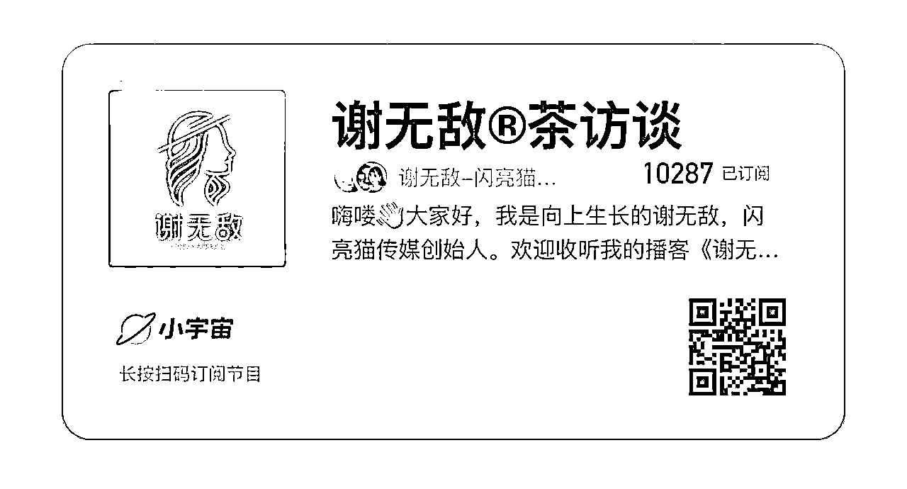
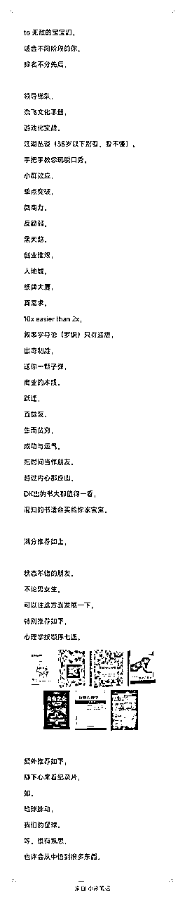

# 300位线下店主实战复盘：小红书到底怎样才能把流量变成客户

大家好，我是谢无敌，闪亮猫传媒创始人。2023年我跟着龙哥盟的播客航海，独立做了档个人栏目【谢无敌茶访谈】，佛系更新的情况下粉丝也破了一万。

做这档栏目的初衷很简单，就是想跟更多在小红书前线操盘的人对话，把不同赛道的流量打法分享给听众。

最近我请来了赚钱圈的大师兄涛哥，一起聊聊2025年小红书的流量走向和变现机会。整场对话干货密度很高，我自己的收获也非常大，所以整理出来跟大家同步。

我们采用你问我答的方式，下面是精华浓缩。

## PART1：底层逻辑篇

#### 无敌问涛哥：小红书上粉丝量重要吗？跟其他平台差别在哪，值得投入吗？

#### 涛哥观点：

粉丝数并非关键，小红书重匹配不重体量

“别被粉丝数绑架。小红书的分发逻辑根本不看你有多少粉，而是看内容匹配度多高。哪怕你是千粉小号，只要精准击中25到50岁高知女性的痛点，转化效果照样能超过头部账号。市面上那些素人账号一条健身教程就能出单，就是因为平台偏爱这种精准种草，推荐权重甚至高于纯技术流。”

平台差异：抖音是面撒网，小红书是精准狙击

“抖音走的是泛流量打法，先把人全拉进来再做转化。小红书是反过来的狙击逻辑。以家居为例，小红书后台七成用户是25到50岁女性，抖音里却以30到60岁男性为主。人群对不上，内容发得再多也是白费。在小红书做深度种草，就像钓鱼要找对鱼窝。”

入局窗口

“现在切入小红书依然是赚的时机。获客成本低、流量精准，红利期至少还能吃半年到九个月。你看无敌妹妹团队，普通人发组对比图都能日入四位数，放在抖音没百万粉根本玩不起来。平台还在扶持新人，赶紧占坑，等算法卷到抖音同款就晚了。”

#### 涛哥问无敌：小红书和抖音本质区别是什么？

#### 无敌观点：

人群画像完全不同

“抖音主要是30到60岁男性用户居多，小红书则是高消费力的女性为主。比如家居赛道，抖音是男性在刷装修案例，小红书是25到50岁女性在找灵感，这批人既会种草也会付费。”

内容形式更灵活

“抖音只能靠短视频硬刚，小红书图文、Live图、短视频都能玩。尤其是新手不会拍视频，直接做图文起号成功率最高，平台上女性用户就偏爱干货型图片。而且小红书一个人就能完成，抖音却常需要主播+编导+剪辑一套班子。”

营销思路差异

“抖音是先用泛流量海捞鱼，再从中筛选客户，费时费力。小红书是直接精准打击，比如做美妆就写给爱美人群看，刷到的人基本就是潜在客户。我们有个减肥案例，标题写《晨跑VS夜跑哪个更掉秤》，精准锁定刚入门的减脂人群。”

选平台建议

“先看你的客户在哪。小红书特别适合美妆护肤、珠宝首饰、家居设计这类离钱近的品类，平台里有大量有闲有钱的女性。比如做全屋定制的设计师，在小红书一条笔记就能接到私信咨询，比在抖音里从几万泛流量里筛人快得多。”

#### 无敌问涛哥：小红书适合哪些人做？

#### 涛哥观点：

人群覆盖面广

“基本所有人都能玩，大学生、职场人、创业者、本地门店、品牌方都行。尤其是本地服务业和长线高客单，比如推拿馆、中医馆、自习室，还有珠宝、房产这类靠线索转化的赛道。像广州一个读书会，单靠小红书链接销售额就过六亿。二线城市的本地生活赛道，比如成都武汉，竞争还很稀疏。”

核心是找鱼塘钓鱼

“找到目标用户聚集的地方。现阶段小红书70%的流量来自搜索，深耕一个低竞争下拉词，比如‘广州海琴湾自习室’，就能带来精准客户。抖音的算法已经把利润压到6个点左右，小红书仍在红利期，普通人选对词就能吃到免费流量，比如‘飞机盒’这种冷门词，算法还没覆盖就先占位。”

#### 涛哥问无敌：小红书有哪些变现路径，怎么选？

#### 无敌观点：

博主与买手

“如果擅长写笔记拍图，可以先做博主接广告，但变现比较单一。升级成买手后则更多元，笔记带货、直播带货、探店合作都能做，平台还会给流量扶持。去年买手大会官方放出500亿流量，现在红利仍在。关键要选对货盘，家居美妆母婴是主流，我们有学员在义乌有供应链，转买手后月入过万很轻松。”

电商玩家

“一种是品牌型，慢慢养号，一年做到几千万变现；一种是卖货型，快速测款靠自然流+投放爆单。但供应链是生死线，80%失败的都是供应链不行。深圳做珍珠的直接上游拿货，义乌小商品一件代发，价格和合规都能控制。”

线索获客

“适合卖高客单的、高需求本地服务、敏感品类。三类典型：高定珠宝私域成交客单价上万；中医馆、推拿馆、自习室做同城笔记引流精准；医美金融等敏感赛道用素人号种草再导微信直播，月增300+客户的案例不少。”

#### 涛哥问无敌：新手老板的最小团队配置？

#### 无敌观点：

“小红书运营建议用1+1模型。一名运营全职或兼职可带2到3个账号，每周稳定发4篇笔记，每篇两小时左右搞定。老板每天半小时参与内容，带两个号绰绰有余，再加兼职能做到4到8号矩阵。我们带新人先做选题库和账号调研，1到2天就能进入节奏。”

成本可控

“北上广深全职运营底薪6到8k，兼职2000到5000即可。关键是把内容流程做成SOP，新人先自查选题，我每周统一把关思路，不需要盯着每篇稿子。”

#### 无敌问涛哥：流量最大化为什么重要？

#### 涛哥观点：

流量核心是精准获客与LTV

“流量的本质是低成本精准获客。比如减肥用户，五年前减过五年后可能还在减，一旦加到私域就能持续变现，普拉提、瑜伽、美妆、医美都能复购，这就是客户终身价值。”

“同样直播卖1000单，我卖减肥他卖零食，客单价都是298。他的用户买完就走，我的用户能反复收割，因为减肥是长期需求。”

转化要点

“内容必须匹配需求。减肥笔记新手关心的是‘七天瘦五斤’这类傻瓜教程，而不是专业动作教学。”

“要持续发帖吃长尾。小红书笔记像店铺，会持续被搜索。抖音内容24小时就掉，钢琴培训一条线索值五六百，一篇笔记带来10个咨询就是五六千。发得越多，关键词占有率越高。”

## PART2：爆款与创作篇

#### 无敌问涛哥：爆文是运气吗？怎么判断爆款？

#### 涛哥观点：

爆款有概率可控

“爆款是概率问题，也叫爆率。入门玩家大概80篇爆1篇，我这种可能50篇爆1篇。提升爆率靠精准选题，比如潘展乐刚火就发《潘展乐190》，靠90%数据分析和10%体感。做健身别发专业动作，要发新手痛点《晨跑VS夜跑哪个掉秤》，封面放对比美女，内文给30天食谱，命中率非常高。”

平台偏爱稳定输出

“小红书奖励持续稳定创作者。像发工资一样日更3到5篇，先从2篇加到5篇。高阶选手天天五更。先堆量再谈技巧，量上来了平台自然给流。算法核心是匹配，标题关键词、内容、受众要严丝合缝。比如‘练肩六个黄金动作’不如改成‘林黛玉也能练出直角肩’，更匹配小白心智。”

#### 涛哥问无敌：跑通流量闭环的关键？

#### 无敌观点：

项目选择离钱近

“赛道必须离钱近，美妆家居在小红书转化最快。去年美拉德风今年巴恩风，我看到国外趋势就加入选题库，流量立刻上涨。有朋友做成长博主分享赚钱技巧，涨粉后开社群变现，细分赛道威力很大。”

能力匹配

“博主需要内容力，电商需要供应链，线索获客需要销售团队。义乌人做电商有天然供应链优势，直接源头合作一件代发挂店管家，价格品控都稳。线索获客做付费拿百个资料粉却没销售跟进，最后只能靠私域直播补救。”

提效工具

“今年AI趋势明显，团队可以精简为1个核心员工+1套AI流程闭环，减少沟通成本，大幅提升赚钱效率。”

#### 涛哥问无敌：实体店老板的节奏怎么排？

#### 无敌观点：

三阶段打法

1. 首月：跑通自然流模型，用自然流量赚钱，同时测试付费流潜力。笔记像店铺，发完能持续产生长尾流量，和抖音的先火后降逻辑不同。
2. 次月：自然流+付费流结合，上信息流广告。算清楚获客成本，越早投放成本越低，要抓住窗口期。
3. 第三月：做矩阵化扩量，多账号覆盖行业关键词，招人养团队，把线上业务做成规模化。账号就是成本，矩阵才能吃透流量。

#### 无敌问涛哥：怎么提升创作效率？

#### 涛哥观点：

复利思维拆分内容

“学会把一篇内容拆成长文、图文、PPT、短视频、问答、音频、知识点卡片等多形态分发，一套内容吃多份流量。小红书笔记像商铺，持续带来搜索流量。”

工具降本增效

“死抠脚本是低效表现。我现在用AI做选题和脚本，时间成本砍70%。豆包、Kimi等AI辅助结合大数据优化，别人一周出几十篇，你一周几篇，流量自然抢不过人。”

## PART3：引流获客

#### 涛哥问无敌：团队主流引流打法？

#### 无敌观点：

付费投放派

“纯靠自然流稳定赚钱不现实。现在小红书主推商业投放，自然流不稳定可能十篇爆一篇，付费流能把日收益算得清清楚楚。平台初期投放成本最低，后期只会涨，要尽早算清ROI。”

人设IP派

“自己打造‘设计师彭老师’这类高价值IP，吸引精准用户主动咨询。需要有经历、稳定更新，每周3到5更，数据好了品牌才会合作。内容是唯一流量入口，小红书要的是稳定优质创作者。”

低成本引流派

“只适合冷启动测试，个人号营销前期流量高但生命周期短，被平台识别就废。过去用A中必收派搞素人种草引流淘宝，现在连老手都不用了。”

## PART4：品牌篇

#### 无敌问涛哥：品牌是投大V还是素人？

#### 涛哥观点：

投放趋势变化

“很多品牌开始分散投放小博主做品效合一，但部分大品牌因流程限制仍砸头部。不过真正能匹配营销目标的头部不多，费用未必划算。小红书和B站更偏向种草而非即时转化，和用户一起成长。”

长期逻辑

“品牌要和用户一起成长，别急着卖货。用小样赠品把用户导到私域沉淀，慢慢养。信任建立后复购和转介绍自然来。种草比直接转化更重要，卖减肥药的客户后续还能买普拉提课、健身器材，这就是长期价值。”

## PART5：2025年展望

#### 无敌问涛哥：2025年哪些项目值得做？

#### 涛哥观点：

本地生活

“二线城市成都、武汉、长沙的本地生活赛道几乎空白。广州‘酒鬼地图’搜个下拉词就爆流，线上导流线下效果极佳。一个人可带两个号，想锁死本地流量至少10号起步，笔记就是海报，发得越多长尾越强。”

高客单价服务

“十几万高定珠宝、几十万房产无法直接成交，但线索获客非常有效。高端教育、留学意向强，一条线索五六百。本地中医馆、自习室这类线下服务线上获客效率很高。”

垂直电商

“电商成败看供应链。深圳珍珠、义乌小商品跑产地两三天就能拿到一件代发，挂店管家自动发货配合直播，爆款自然来。没有供应链做电商等于空谈。”

IP私域化

“美妆健康客户价值最高，第一次买减肥药，后续推普拉提、瑜伽，私域里反复转化LTV极高。流量不是流走的水，而是留住的人，加到微信的才是真资产，私域复购率远超平台成交。”

## 涛哥推荐书单

“阅读是普通人突破圈层的唯一路径。我甚至认为人与人的差距，本质上是信息量的差距。”——涛哥

