# 从上班到创业：认知、流量与影响力的实战复盘

# 开场

各位赚钱的伙伴们，大家好！我是广西群的群主刘掌柜。很激动，也很感谢赚钱官方把城市见面会带到了我的家乡南宁，让我有机会一次性见到这么多圈友，和大家当面聊聊搞钱的方法。

先简单交个底：我在流量这块摸爬滚打了六年，业务方向换过三轮，从代运营到知识付费，再到现在的自营业务。代运营那段日子，人累得半死，却也没攒下什么钱；知识付费吧，有成材率的问题，容易砸口碑，后来也放下了。现在做自营，流量和获客自己解决，后端去找靠谱的伙伴合作。

2022年，我从公司出来单干，到现在总算做出了一点小成绩。今天想分享的，就是我从上班到创业这一路，关于认知、流量和影响力攒下来的思考和打法总结。

# 为什么是这三个话题

当初霜仔老师联系我的时候，我就特别激动，现在站到台上还是有点控制不住脚，哈哈。我之所以选这三个话题，是因为现场来的圈友来自各行各业，但思维认知、引流获客、影响力搭建，几乎是大家变现路上都会遇到的共通点。希望这场分享能给大家一点启发。

我以前每年都会出去参加一些商业博主的线下课，参加多了就发现，真正精华的内容五分钟就能讲完，对自己有增量的可能只有一两个点。但就是这一两个点，未来很可能引发蝴蝶效应。所以，希望大家都能从今天嘉宾老师的分享和圈友们的链接里，收获自己的“精华5分钟”。好，我们的分享正式开始。

# 一、认知思维：先让脑子跟上钱

## 职场阶段：怎么用航海手册和精华帖给主业赋能

这一块我拆成两部分讲，职场和创业，分别对应21年上半年和22年下半年。

先看当时的背景。21年我在一家乙方公司做拍摄剪辑，4月初父亲确诊直肠癌中期。因为大学时乱投，每个月要还2600元负债，房租1500。当时月薪4500，加上副业2200，一个月勉强活下来。

那是我人生第一个地狱时刻。直到现在，有三个画面还很清晰：第一个，父亲第一场手术做了8小时，中途亮了一次红灯，我妈吓坏了，跑回住院楼把我爸平时干活穿得最多的那件红衣服抱在怀里；第二个，医生来通知第二场手术，医院住院部那条黄蓝相间的走廊，安静得吓人；第三个，父亲术后发烧不退、一直吐，我妈不忍心看，一个人坐着哭。

是的，我是在这种状态下加入了赚钱。

当时我最怕的一件事，就是万一出了特效药，自己负担不起。我更不想将来因为钱而失去什么。这个话题很沉重，对当时的我来说，像大山一样压着。

但我想，再没有比那时更糟的情况了。其实我19年就知道赚钱，两年都舍不得下手，因为不够痛，所以没有行动。经历地狱时刻之后，心力真的会变。21年我动手了，再差还能差到哪去？万一有机会改变呢？所有翻盘的契机，其实都藏在信息层里，但只有真正去执行，才能把它们变成现实。如果你也正在低谷里迷茫，勇敢往前迈一步，就是柳暗花明。至于怎么用手册给主业赋能，我们接着看。

落地过程里，我最大的体会是：局部最优解高于全局最优解。大多数人都想找全局最优解，张口就是长期主义。但我认为，对大多数普通人、草根创业者来说，真顾不上什么全局和长期。没有比1-3个月内看到钱更实在的事了，先盯着当下。

具体到职场选择：局部最优解，就是选工资高但没成长的工作，短期赚得多；全局最优解，是选工资低但能学技能的工作，长期发展好。在我看来，职场的成长无非两块，一是思维认知，二是专业技能，而这两块，其实都可以付费买到。那要怎么快速拉高薪资？跳槽，拿溢价，选工资高的岗位进去。

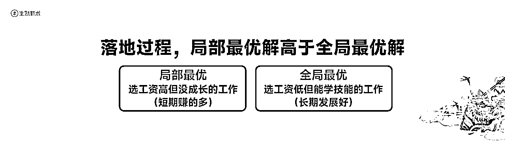

最初我只会新媒体运营（文案），外加拍摄剪辑。去面试前，我做了三个动作：

第一，翻出当时最早一期的抖音商业IP1.0航海手册，从头看了一遍；
第二，把赚钱当成搜索引擎，专门搜了同城实体方向的精华帖；
第三，把相关工具、表格、文档都下载下来，装进iPad当资料库。

这一套组合拳打完，面试岗位直接拿下。所以我建议，那些刚入圈或入圈一年的朋友，都可以先去争取局部最优解。

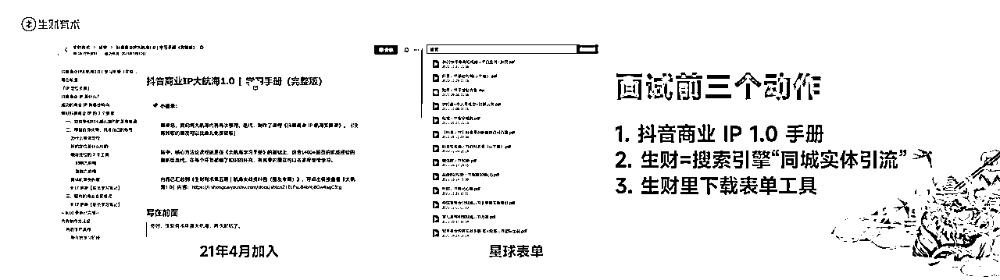

航海手册和精华帖不仅帮我拿下了入职，还能用来积累优质人群、搭建基础信任。赚钱就是一座巨大的信息宝藏，但优质信息只有在传递过程中才有价值。这里我优先推荐四份航海手册：抖音1.0和2.0、小红书运营、朋友圈运营、时间管理。

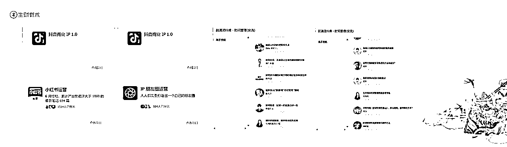

为什么推荐这四份？读完之后，公域、私域、个人管理基本都覆盖了，到外面从运营层面给建议，完全没问题。时间管理是新上线的，鲁大魔有句话很扎心：普通人用时间和精力去撬动财富。时间对草根创业者来说太重要了，手册里各位嘉宾分享的高效时间利用率方法，值得反复实践。

精华帖还能用来出门社交。我常用的方式是活动行App加小红书搜索，搜“读书会”“创业群”“自媒体群”这类的线下活动。

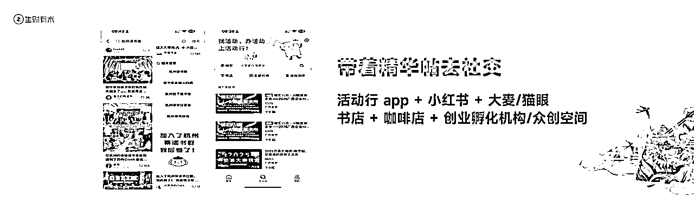

线下见面其实是拓展客户最快的方式，也是建立信任最直接的方式。我自己最常通过活动行App和小红书找渠道，经常能看到南宁本地的读书会、沙龙、自媒体交流会。年前我参加了一场聚会，现场有个做酒的广西老板说，以前他根本不用出门跑客户，客户自己就进店了，现在不知道为啥少了很多，大家都在加线下场景，消费都发生在熟人圈，走内循环。

那线下最关键的一点，是成为未来客户的兴趣专家。你的客户是宝妈，你就聊育儿、聊家庭关系、聊资产配置；你的客户是老板，你就聊组织管理、聊股权架构、聊流量渠道。

我每次出门前都会看两三篇精华帖，把内容凝练成“精品五分钟”，全是增量。交流的时候，再把自己准备的内容丢出去。讲多了，慢慢就成了C位。

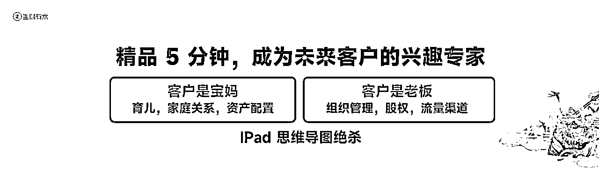

精华帖对我还有一个特别大的作用。创业之后，我一度有点小地主心态——以前从没想过自己一天能赚到父母一个月的收入，于是开始得过且过，每天只工作三四个小时。每天看看精华帖，让高密度信息在脑子里炸开，人很快就能进入工作状态，也会清楚地知道：人外有人，天外有天。

## 创业阶段：用面试去撬动同行老板的阅历

到了创业中期，我偶尔会遇到流量下滑、账号频繁被封的情况。不知道干什么的时候，就先干点什么。同龄人给不了什么增量，于是我想了一个办法——去面试。

面试前有三步：找对目标、制作简历、投递简历。人有一项很重要的能力，就是抄正确答案，做流量也一样。面试的过程，就是我们不断寻找正确答案的过程。

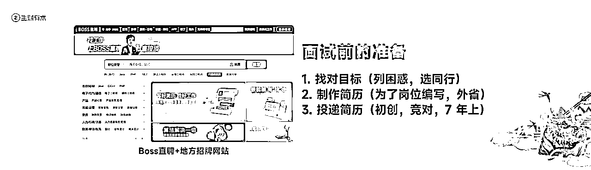

找对目标：先把你遇到的困惑列出来，同行那里就是最好的答案。优先从同行里挑三家，作为面试目标。

制作简历：直接照着公司Boss直聘上的岗位要求来定制简历，目标定位中高层。这里有个提醒：广西各城市HR之间是有群的，为了防止进黑名单，你就说自己是从外省某城市来的。

投递简历：7年以上公司、竞对公司、初创企业，一圈问下来，多少都有答案。7年以上的公司不用多说，能活这么多年，领头羊一定有两把刷子。

面试中高层的话，要提前问清楚有几轮，一般是一二面，大公司还有三面。基本上会经历人事、部门总监、总经理或股东这三关。

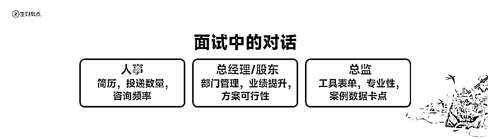

人事那关过不了，问题多半出在简历和咨询频率上；总监那关，要看你准备的工具表单、专业度、案例数据，有没有时间卡点；总经理或股东那关，会问你入职后怎么干，部门管理、业绩提升，以及方案可不可行。

只要你准备充分，又带着从赚钱里看到的信息去，基本都能走到最终轮。能走到这一步，说明他们认可你了，这时候找准时机，把你的困惑问出来，答案就都有了。

面试这个技能用好了，回报远不止这些。再延展两点。

第一，加个人背书。可以把面试过程素材化，比如拍进公司的视频、拍老板茶桌。有影响力的公司其实是在正衬你，行业圈子就这么大。打个比方，如果我们能跟杨涛老师、龙哥老师合个照，至少圈友眼里的你是积极向上的。很多商业线下课也讲究跟IP本人合照，就是这个道理——客户和粉丝能感受到你好学、靠谱，为你付费是值得的。

第二，客户眼中的你，往往由你的朋友圈决定。别人刚加上你，怎么知道你是怎样的人？如果你带着这些图片素材，再加上自己的观点，朋友圈像电影一样有画面感，信任就很容易建立起来。

再往下走，甚至可以“卧底”式地打通瓶颈链路，了解相关参数。真正的高手，能靠基础层的信息找到破局点。哪怕只是在直播间连个麦，每天点0.1元的灯牌，也是一种观察。如果你还能争取到当天或次日的试岗，那收获就更大了。要知道，好的内容形式模板都是有流量周期的，一个模板发得越多，流量就下降越多，客户量也跟着掉。这时候就可以去看看竞对公司的模板和话术，认真记录，慢慢积累成自己的弹药。

# 二、流量实战：把流量当成一场战役

## 抖音小红书通用的流量矩阵打法，高客单客户日引流200+

前面聊的是职场到创业的细节，接下来进入流量实战。一般讲到这儿大家可能有点困，可以喝口水清醒一下。

先说我们自己的流量困局：花钱投流，买不来正向投产；不花钱做自然流吧，团队里的编导和运营又只能眼睁睁等着，咨询付费一点不给力，客户也没见几个。

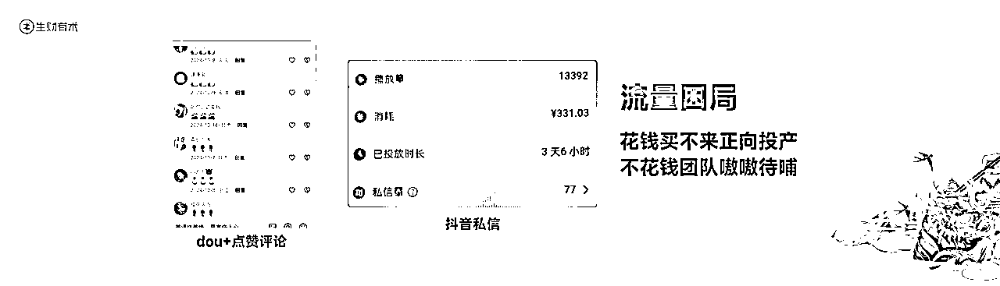

那付费和自然流到底怎么权衡？付费其实是省心的，核心就是算账。投五千，能做出四万营业额、一万五利润，这种单子毫不犹豫直接上车。但大多数公司团队没这个能力，真有能力的，早就自己干代投了，不会安心待在你公司。自然流矩阵就得紧跟平台步调，变数虽多，胜在成本低，性价比不低。

我的建议是：初期偷流量、做矩阵，虽然有些玩法其实是在对抗平台，甚至不算合规；等条件允许了，再转向付费买量，顺着平台规则来，路会越走越宽。

再说说“A种B收”。怎么理解？说白了就是两个号配合，A站在用户视角圈人，B用素人号做不带利益关系的推荐。用大白话讲，一唱一和，自己给自己当水军。

举几个例子：
① A发视频吐槽长痘影响颜值，B说自己以前也这样，用了闺蜜推荐的某产品好了；
② A吐槽老公说她胖，B问拿的什么产品；
③ A发布去实体台球厅的视频，B问位置在哪。

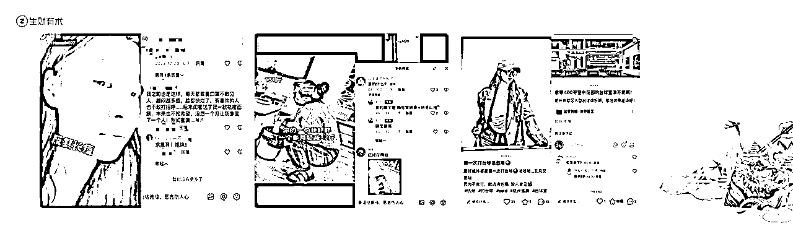

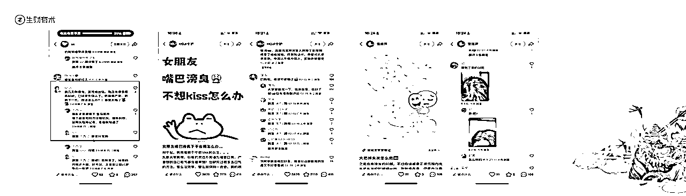

注意中间那张图，评论里写着“已经买了，希望别是骗子”“大家盯着点，我买完会来反馈”——都是拿过来就能用的文案，简短、有力，完全站在用户视角解决问题。评论区马上就跟着一堆留言，全是精准的潜在客户。

总的来说，A用自己的遭遇故事表达痛点，B发出共鸣和理解，顺势植入产品。

为了矩阵分发，素材通常还要做去重。我们常用的去重动作有：画中画、调节调色、删除原声、变速调节、转场、画中画、尺寸放大，导出时选1080p、帧率50fps。

再说矩阵内容。1月份的时候，广西一位群友在群里发了张截图，吐槽所有账号的链接最后都落到他一个人身上。矩阵最大的好处，就是能用同一个内容——IP、产品、门店、服务——多次触达同一个人。人对经常接触的东西接受度更高，会慢慢从了解到购买。

这就像我们在朋友圈做赚钱拉新一样：一个人发，你可能觉得是广告；一群人都在发，你就会想，这东西真有这么好？牛人和朋友都在发，那我是不是也该试试？

那我们的矩阵到底怎么做？

核心是四件事：账号数量、笔记数量、关键词网、发布时间。账号和笔记数量都好懂，一个是号多，一个是量大。关键词网，要把下拉框词、小关键词、搜索关键词全部织进去。发布时间要看行业和用户活跃周期，前期可以先把作品铺满全天各时段，再根据数据找出黄金时间。

## 小红书案例：单月成交150万的素人矩阵怎么搭

先说内容组合。我们那些成交很顺的号，通常按这几个阶段来铺内容：

种草安利：目的是撩起用户的需求，发产品介绍、选我理由、产品能解决什么问题。

发现看见：用客户见证和使用体验，去蹭每日热点、同城热点，给账号做流量。

信任搭建：理性信任靠专业、案例、售后、团队、背书；感性信任靠情绪、热心、原则、缺点、热点、故事。

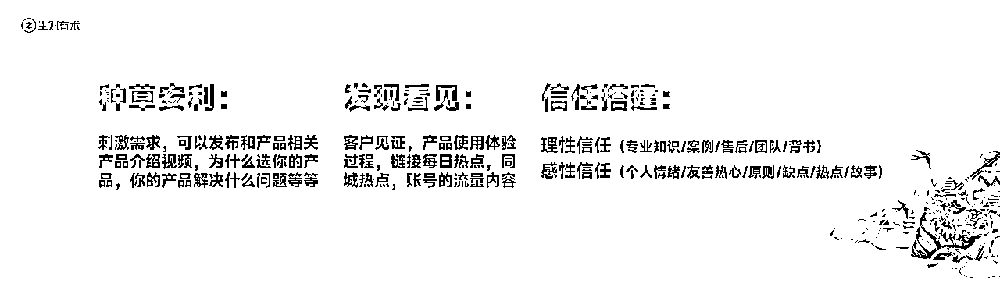

大家常刷到的那些“十年体”，比如“一个普通女孩的十年”“二十年餐饮人的独白”“你为什么要做这个”，都属于信任搭建。

内容组合的核心，是让账号像真人。拿职场女性账号来说：

情绪流量内容：真的崩溃、我第一次哭、好生气啊；
日常生活内容：产品遭遇、大学生身份、工位出勤、旅游；
同城热点内容：看热点榜、看微博；
产品推荐合集：这个最关键。比如做别墅设计，可以先去几家别墅设计公司沟通体验，最后一家再引出自己家的产品。

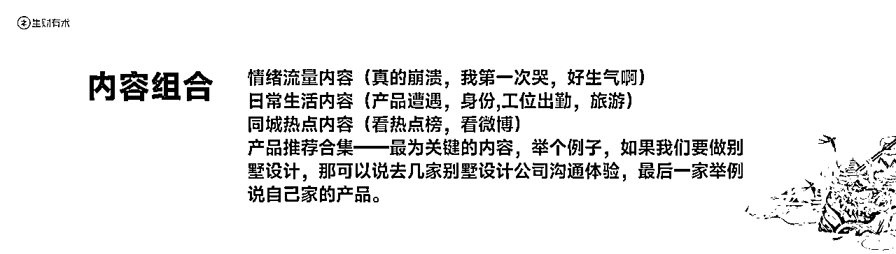

接下来说矩阵执行。三要素是网络、设备、模板。

网络，我们会选软路由（跳IP）。你直接跟宽带公司说，他们会帮你解决。真要问软路由是什么，我也不太懂，反正发布作品就用这个网络。

设备，优先苹果，我自己目前在用8P。

执行过程中我们也验证了一些细节，不敢说百分百对，但确实是跑出来的：

账号优先用厅卡靓号，注册前先搜一下这个手机号有没有注册过平台；
贵一点的设备，流量表现也会更好；
要经常带设备出去逛逛，连一下其他地方的网络。如果手机一直不动，IP永远是同一个，也会有影响；
流量遇到瓶颈、一直卡在几千播放量时，可以换个地方发，比如五公里外，或者换个人发，因为剪辑的网感不一样；
不能一直吃老模板，前面要有人持续测试新的内容类型。

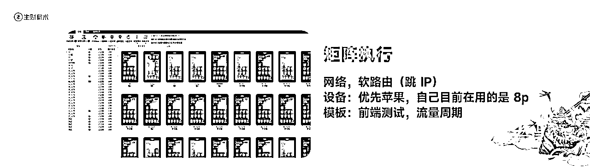

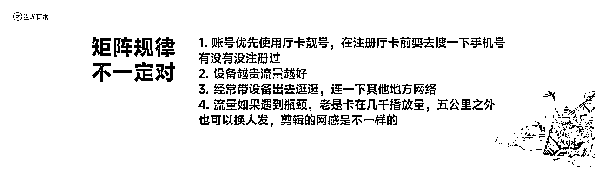

# 三、链接撬动：让他人愿意为你付费

## 线上：每天五分钟，塑造影响力

链接撬动赚钱，说到这里我又要感慨一句：龙哥盟真是巨大的信息宝藏。如果说信息是权力，那影响力就是资产，无形的资产。罗永浩的《真还传》，就是最好的说明。这里说的“五分钟影响力塑造”，是指每天花五分钟，就能提升自己的影响力。

我相信不少群友和我曾经一样，付费了就等于学到了，之后很少再打开，偶尔想起来才翻一翻。你知道赚钱好，但赚钱在你没行动之前，几乎没什么作用。而这五分钟影响力塑造，行动成本很低，效益却很大。

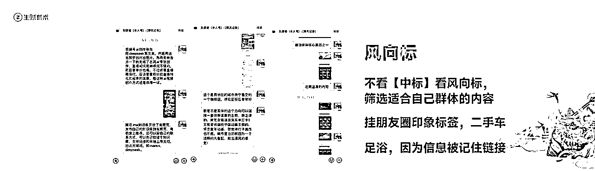

先说风向标。风向标单独拿出来，就是一款非常好的产品，信息领先互联网市场半年！满屏都是金矿。我们可以利用碎片时间筛选，然后发到朋友圈。我实操下来的体会是：老板们不用只在“中标”里筛，多看看风向标，因为有些圈友发出来的信息虽然没中标，但可能正好是你想触达的目标人群感兴趣的。

动作很简单：每天上班前，筛选两三条发朋友圈。久而久之，别人对你不只是“某某行业老板”的标签，还会多一个“信息前沿”。打个不太恰当的比方，不知道大家有没有刷到一个二手车账号，那个老板不拍车，就拍自己足浴打卡。别人会因为你有价值的信息输出而记住你，有需要的时候自然会来链接你。

再看收藏夹。很多人在刚进圈时才频繁打开赚钱，混成老油条后反而很少看了。但有一个栏目，连老油条也容易忽略——龙哥的收藏夹。

我觉得这个栏目，是践行龙哥那句“去影响少数人，也长久地陪伴大多数”的燃料之一。传递价值，本身就是形成影响力的一种方式。而赚钱最不缺的就是价值信息。你可以把龙哥收藏夹里的内容读透，结合当天的工作或个人阅历，做一次表达。

早期很多传媒公司老板的朋友圈都是这么来的：读到价值信息，加上自己的观点再发一遍，但关键词不会改。这也是为什么我在早期实践不多的时候，也能做出一些高质量表达。

综上，如果老板们时间更充裕，可以单独拉个群，效率会高很多，还能形成以你为中心的沟通场。群里一定会有那么一两个原点客户，能带来辐射效益，帮你成交一大批客户。最后，就算大家什么都没执行，只要把上面这些小动作做到位，对未来事业也一定有不小的帮助。说不定某一天，它就会发光。

## 线下：带着赚钱的信息去社交

日常社交里，最重要的就是把你在赚钱看到的信息带出去，在线下见面和交流中建立信任、输出价值。当你持续成为那个能提供增量信息的人，机会和客户都会主动向你靠近。

赚钱带给我的最大收获，其实是社交上的底气。印象特别深的是2020年那次去南宁，和一家做金融的公司老板聊交流，我整个人都缩着，讲了两句就想撤。现在回头看，区别就在于心里有没有东西。哪怕过去再狼狈，只要提前把一两个项目的思路框架搭起来，脑子里装着干货，站出来时就是不一样的姿态。

真正高效的社交，本质上是价值的对等。我越来越觉得，支点成果才是最关键的杠杆。社交场合也是实力为王的。如果你只是去听故事、长见识，那当然没问题。但如果你想在现场就建立有效链接、拿到对自己真正有用的东西，那光听是不够的，只会吸收越多越焦虑。

当你有能被更高层看见的结果成绩时，认可自然会来，新的信息维度会打开，资源也会开始向你靠拢。

### 商业线下课 / 论坛峰会 / 区域交流

提问是一门手艺。要先研究清楚对方的专业版图，提前准备好高质量问题，带着自己初步的判断和看法去问，这样大咖才会记住你。问题要具体、清晰，时机要把握好，倾听和回应都要到位，别占用大家整体的时间。《关键对话》《提问的力量》这两本是我常用的工具。

自我介绍也得有设计感。怎么让现场的人记住你？就是把你提炼过的核心精华，用赚钱的方式给自己贴上一个清晰标签。比方说我想被认为懂流量，我就会提前沉浸式研究四五个小时，整理出三到五个看了自己都觉得有增量的打法带到现场。抓住分享的窗口，大概率会让人眼前一亮。最好准备一两句有记忆点的金句。

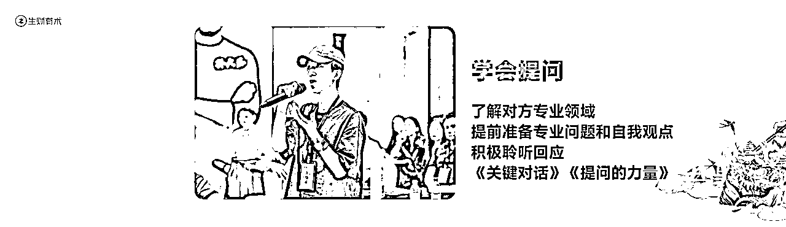

我个人觉得最值钱的环节，永远是最后那场小范围交流，也是我每次出差学得最多的时段。就是第二场闭门对谈，要提前锁定目标人物并建立关联。之所以珍贵，是因为大家是同场参会的伙伴，才有这种近距离碰撞的机会。大佬在这个时候说话，会更真诚、更落地、更实在。

我加入赚钱的每一年都有明确的小目标。2021年我想拿到精华帖，2022年实现了；2023年我想进入龙珠群，也就是现在的航海家，2024年达成了；2024年参加线下时我给自己定的目标是，有机会在赚钱的伙伴面前做一次分享，今天也完成了。接下来希望能做到双倍、三倍的增长，继续龙哥盟。感谢大家，我的分享就到这里。

———————————————————————————————————————————————————————

下面这段话曾发在朋友圈，既是激励自己，也想和所有圈友共勉：“也许你的遭遇很不幸，很不公，但是，请跑到终点了再哭......”

那天上台，我差点就哭出来了......

15号有幸受邀上台做嘉宾分享，讲我为什么创业。因为特别怕因为缺钱失去一些东西，那些人生的至暗画面到现在都还在脑中：

2021年四月，父亲做了第一场八小时手术，手术室的警报响起，我妈吓得跑去拿我爸那件红工装抱着坐在门口喃喃说“你爸没事的”......几天后医生告知情况不乐观需要第二场手术，医院里黄蓝相间的走廊安静得瘆人......讲到这一页PPT时，我直接哽咽了，只能强压情绪。

一场大会算不上什么，以前也经历过。但赚钱不一样，它是在我一无所有的时候就一直在。我在医院通宵陪床的时候看精华帖；跳槽谈溢价用的是赚钱的信息；项目卡住了就去问大师兄涛哥......

直到15号下午真正站上台，我有一种孙悟空对唐僧说“师傅，我也能收徒了”的骄傲，也有一种解放军把孩子从灾难里救出后，十多年孩子参军回敬军礼的那种自豪。所以那天的夜话我几乎是掏心掏肺，把知道的全都说了。

“跑到终点了再哭”这一杯酒，敬我自己。

