# 从1000到2万+，我靠这套私域发售流程，变现几十万

> 来源：[https://ie5wfc519n.feishu.cn/docx/Hmp6dt97voG32ex6GgOcCGkrn4e](https://ie5wfc519n.feishu.cn/docx/Hmp6dt97voG32ex6GgOcCGkrn4e)

做自媒体这行，不会玩私域裂变就等于赤手空拳上战场。过去这一年，我亲自操盘了十几场发售，好友从当初的1000人涨到了现在的2万多，累计变现大几十万。说实话，私域发售就是IP撬动高收益的核心杠杆。

最近好多人在咨询时问我发售到底该怎么做。与其一个一个回答，不如把我这些年踩坑总结出来的经验整理成一套标准化模板，你直接照着套就行。

整个发售可以拆成三个阶段：准备期搭台子、预热期攒人气、发售期集中转化。下面我用最常见的公开课发售来做演示，其他品类的逻辑完全相通。

## 准备期：把地基打牢

### 1、课程海报怎么做

先给你一套可以直接抄的海报文案框架（拿我自己的案例展示）：

主标题：自媒体变现公开课

副标题：帮你赚到自媒体生涯的第一桶金

讲师背书：

自媒体IP成长导师

小报童付费订阅类目销量榜首作者

靠自媒体带货年入百万以上

上课时间：X月X日至X月X日 每晚

授课形式：

专属微信群直播

三天课程内容：

第一天：从零搭建你的知识付费产品，搞懂小报童的赚钱机制，摸清平台每一项核心功能

第二天：学会用分销赚取收益，赚到你在自媒体的第一笔钱，掌握小报童分销的高阶操作，用分销盘活朋友圈和社群，让睡后收入成为现实

第三天：学会自己操盘一场发售，水龙曾靠小报童10天做到10万+收益，这套低客单价发售打法，一招就能抬高你的IP势能

海报制作的两种选择：预算有限或者赶时间，用稿定设计这类在线平台找个模板直接改；不差钱的话，就找专业设计师给你精细打磨。

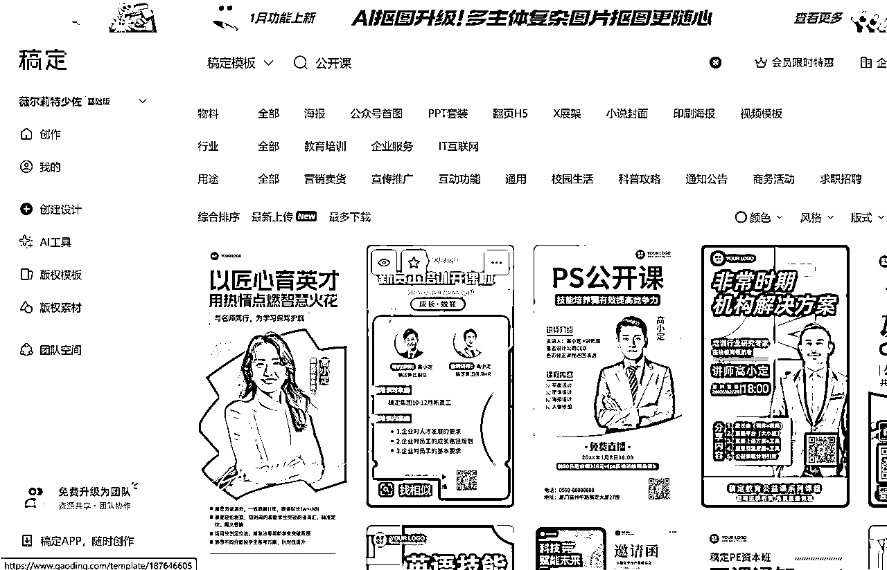

### 2、群公告这样写

第一种：邀新大佬群（奖励规则一目了然）

先感谢大家的信任，欢迎来到大佬群。本次公开课的奖励机制如下：

基础档位：

拉1人进群 送《订阅3500+，GMV破10万的保姆级小报童发售教程》PDF文件

拉10人进群 送自媒体专栏一份（可转赠）

拉30人进群 送价值199元的自媒体创业社群（可自用或续费一年）

拉50人及以上 送价值399元的新个体俱乐部名额（可自用或续费一年）

邀请榜彩蛋：

第1名 288元

第2名 188元

第3名 88元

前三名还能享有水龙公众号和朋友圈的名片推荐福利。

第6-10名 各得18.88元

第二种：公开课学员群

欢迎大家来到水龙主讲的《XXX实战变现》三天公开课👏👏

入群须知：

1、进群先加群主微信，免费领取老师准备的教学专栏，这是上课必备的资料，别忘了领！

2、6月1号前是拉人阶段，群里暂时禁言，不过你可以邀请朋友进来一起学，邀请好友还有额外大礼。

邀请有奖：

邀1人进群 得《订阅3500+，GMV超10万的保姆级小报童发售教程》PDF

邀10人进群 得自媒体专栏一份，可转赠

邀30人进群 得价值199元的自媒体创业社群，可自用或续费一年

邀50人以上 得价值399元的新个体俱乐部名额，可自用或续费一年

#领邀新奖励请添加群主微信

——⏰三天课程安排⏰——

6月1号晚8点：

拆解小报童的赚钱底层逻辑，带你玩转全部功能，打造属于自己的专属专栏

6月2号晚8点：

解锁小报童分销高阶玩法，用分销撬动你的朋友圈和社群，实现睡后收入，轻松赚到自媒体的第100块

6月3号晚8点：

水龙首次公开小报童3500+订阅的发售秘诀，破解低客单价发售的核心逻辑，一招提升IP势能

授课方式：微信群直播

———🔔温馨提示🔔———

1⃣ 希望大家在群里保持积极的互动氛围

2⃣ 注意边界感，不乱加人、不乱发广告

建议把本群置顶，重要消息别错过！

直播没有回放⏰，务必珍惜这次机会。

核心要点：公开课的目的就是搞裂变、圈私域，把人沉淀到自己的微信，做长期转化。

### 3、要不要请嘉宾站台（加分项）

嘉宾怎么选？两个方向：一是从你买过的高客单产品的主理人里挑，这些人势能比你高、自带流量；二是从你学员里找成绩特别亮眼的，真实案例更有说服力。

确定好嘉宾后，要敲定直播时间和分享主题，然后给嘉宾做一张专属海报。以我之前邀请洋哥为例：

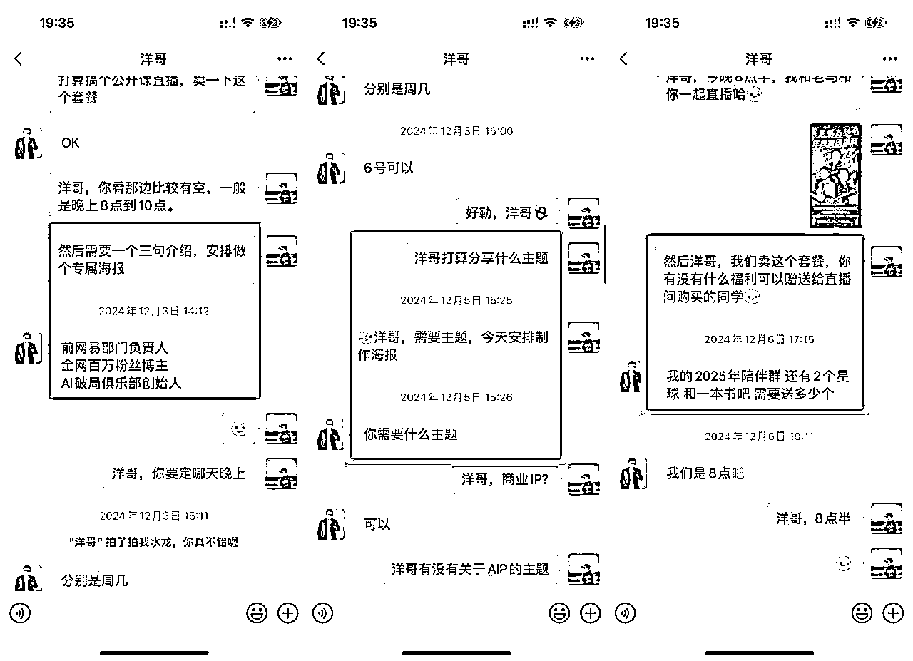

信息收集完就做成嘉宾海报，方便KOL转发朋友圈做预热（两种海报版式可以参考）

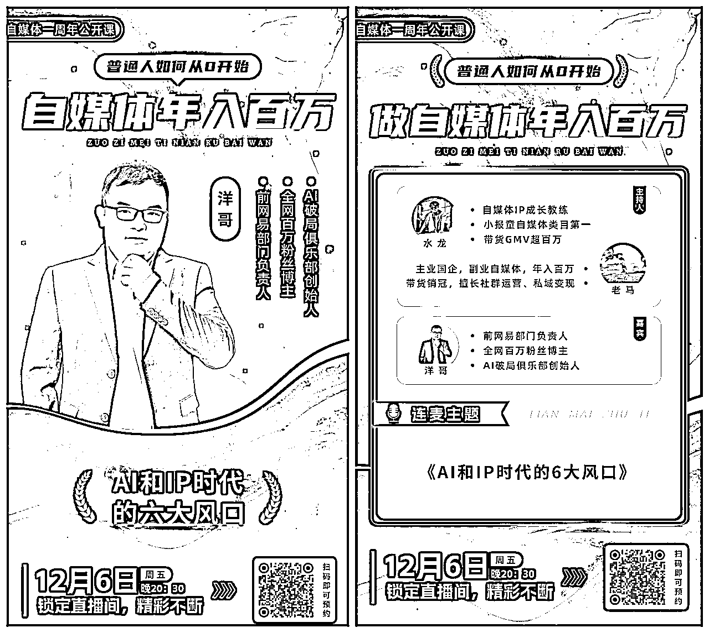

### 4、课件和内容怎么准备

IP信任素材：个人IP故事文章必须写，也可以拍成“十年体”短视频。目的就是让进群的人随时随地了解你、信任你。

公开课干货：两种来源，一种是从你卖过的付费课程里抽精华出来讲；另一种是让成绩好的学员来做故事+干货分享。建议准备5到7篇备稿。

直播连麦技巧：和嘉宾连线时，把自己当采访者，提前摸清对方的经历，把问题备足，别等开播了冷场。

提问的万能结构：

1、挖背景

请先做个自我介绍，让直播间的观众认识您。

是什么契机或什么人让您走上了这条路，还拿到了现在的成绩？

您这个领域最难啃的骨头是什么？您是怎么啃下来的？

创业路上有没有哪些经验教训，是您特别想分享给大家的？

您平时怎么保持学习和成长？有没有什么独门方法？

2、聊行业

您觉得现在行业的大趋势是什么？有哪些变化让您特别关注？

您怎么看待当下的市场格局和同行竞争？

您对未来行业的走向有什么判断？哪些变化会在接下来发生？

有没有哪些行业痛点是被大众忽略、但实际很重要的？

3、谈成长

您是怎么抓住机会一步步实现跃迁的？

支撑您一直往前冲的动力是什么？

您怎么设定长短期目标来保持自己的行动力？

有没有哪本书或哪个资源对您影响特别大，想推荐给大家？

您有没有一句座右铭，一直激励着您？

……

### 5、团队分工：三类角色必配

执行助理：找靠谱有耐心的人，负责建群和分群。把群二维码发给邀新KOL（记得提前给KOL做拉群指引）。建群后要设置好群名、群公告、管理员，禁止乱改群名和群昵称。可以用微友群活码设置不可重复进群。日常还要做社群管理（禁言）、素材收集、奖励发放。

水军：从你的社群、合伙人、熟人中挑。他们负责在群里带节奏、制造分销氛围、维护秩序，提前把问题准备好交给他们提问。

福利官：专门核对邀约人数，做排行榜，发奖励。

### 6、文案和海报提前备好

朋友圈文案：用红包激励KOL把自己写得好文案发到分销群里，让其他人跟着学、跟着发。

学员入群海报（用来造势）：

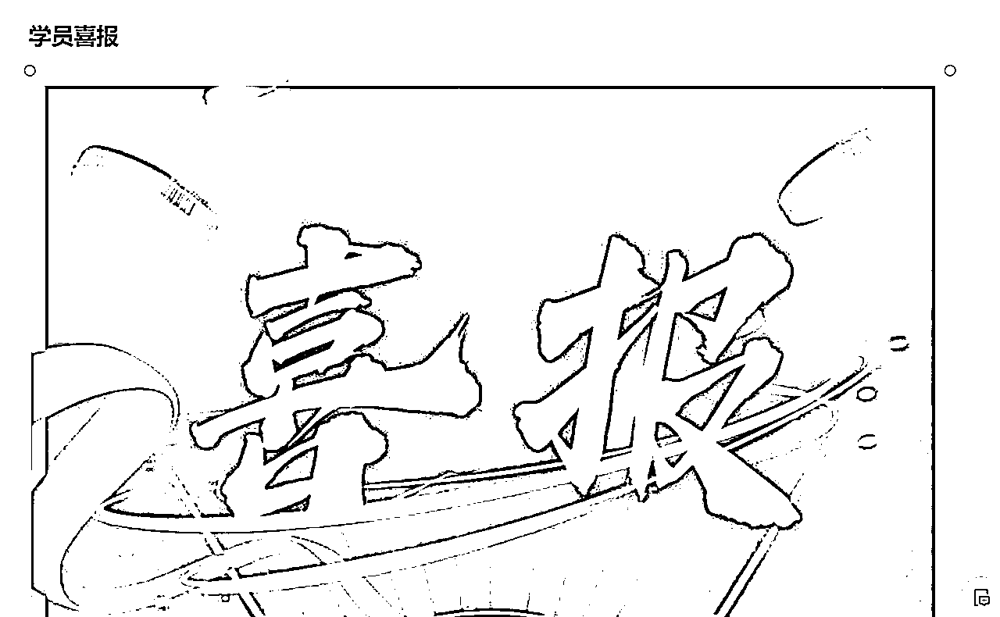

涨价倒计时海报：

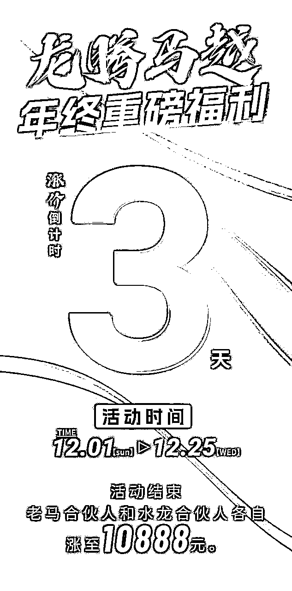

## 预热期：把势能拉满

### 1、盘活私域流量

存量社群裂变：把原本的社群用户引入KOL群，快速启动裂变。

1对1私聊邀约：给潜在用户发定制化邀请，千万别用群发。比如“看到你最近经常XXX，正好这次公开课有XX福利，别错过”。

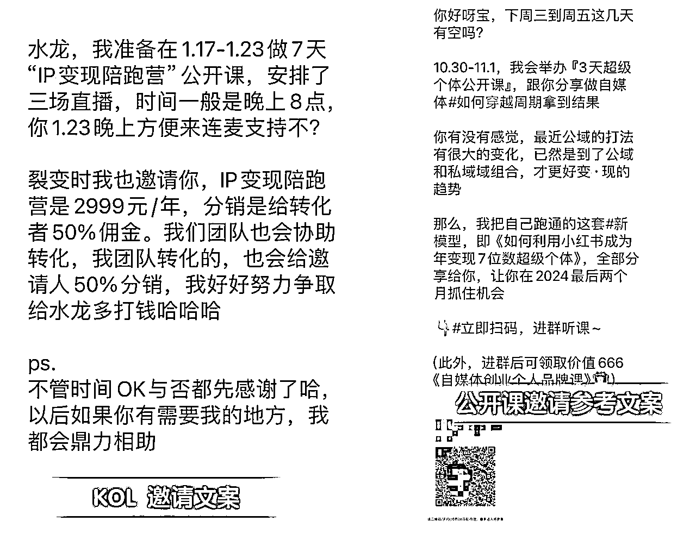

朋友圈宣发：在朋友圈邀请KOL和目标用户进群。邀约文案要短平快，让人一眼看到重点。

### 2、制造悬念

倒计时海报：每天丢一个课程亮点，比如“揭秘百万大V的写作心法”。

直播预告：提前放出公开课时间，强调“限时免费”或“名额仅限XXXX个”。

## 发售期：临门一脚的转化

这场以临公子的公开课发售为例：

### 1、社群氛围这样造

开群引导：进群先领资料加V，把私域沉淀下来。

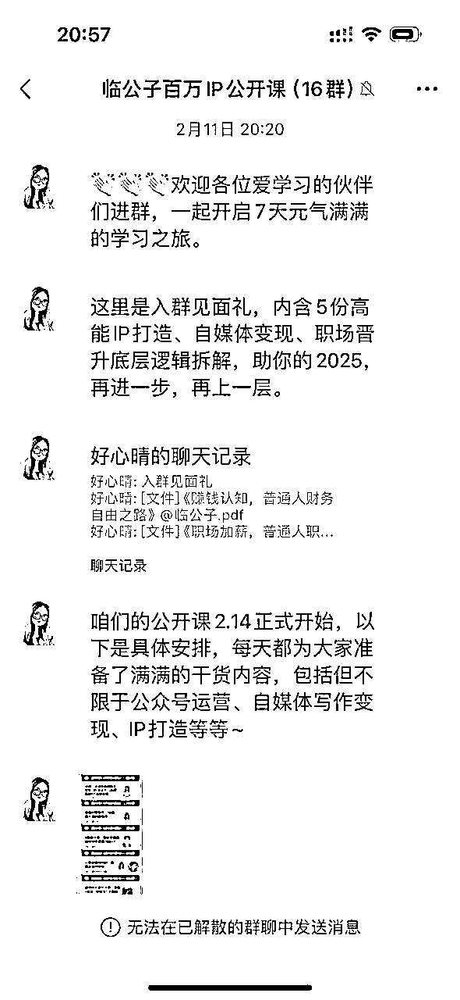

广告管理：不在群里和用户吵架，但也不能让广告破坏群氛围。

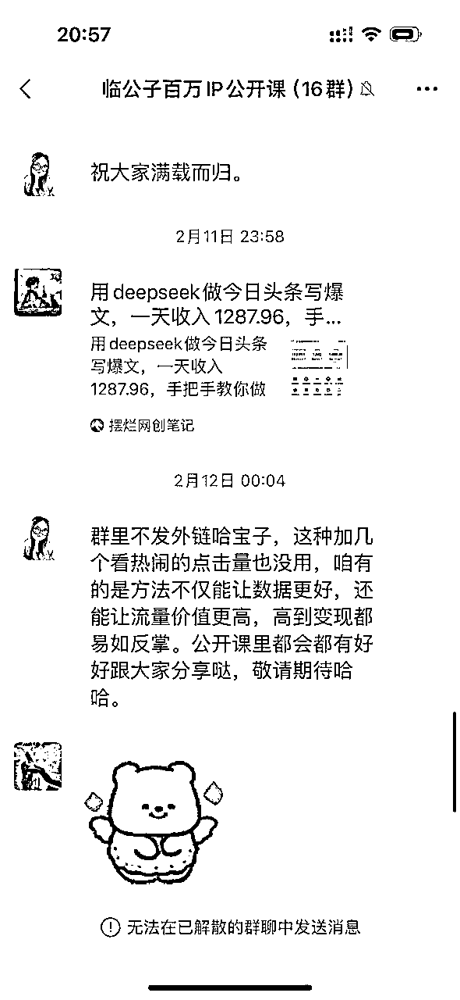

内容预告：提前让用户知道要讲什么，吊足胃口，拉高直播到场率。

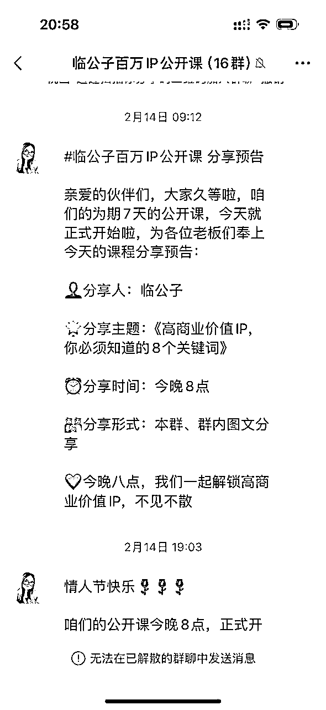

干货答疑：把用户问得好、答得好的内容同步到群里，展示专业度，加固信任。

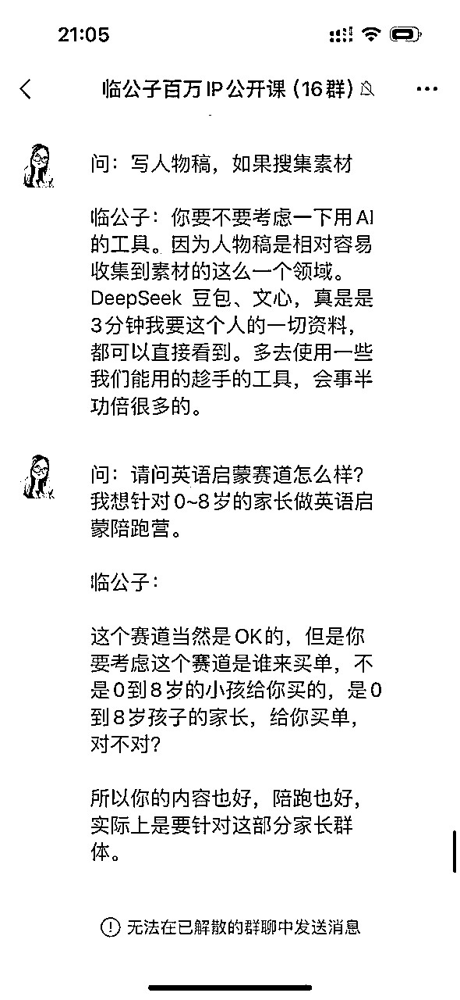

产品植入：嘉宾分享完，顺势推出你要转化的产品。

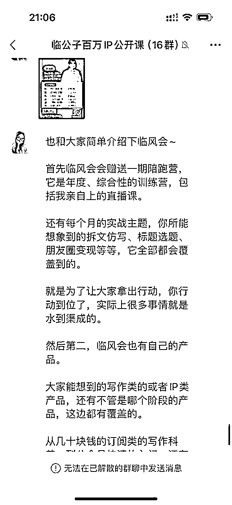

### 2、成交转化动作

晒单刺激：发购买截图，点燃潜在用户的购买冲动。

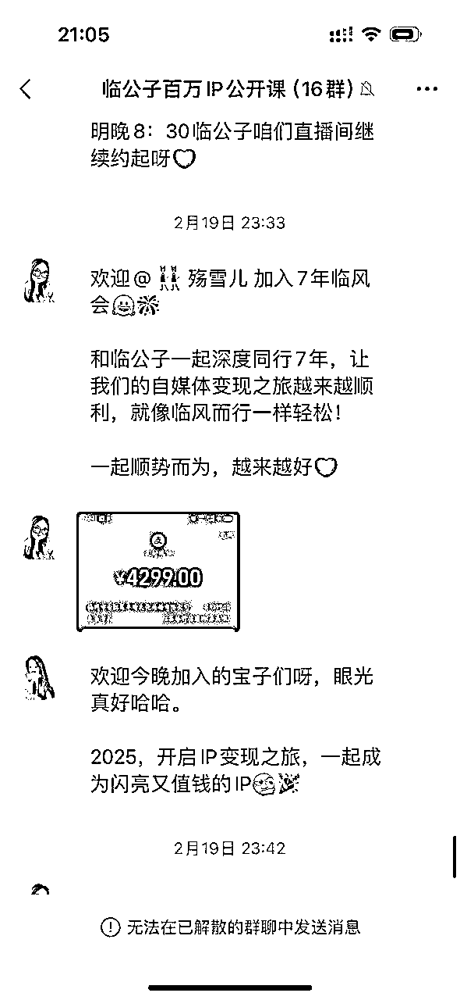

限时赠品：不同嘉宾给不同限时福利，用稀缺性逼单。

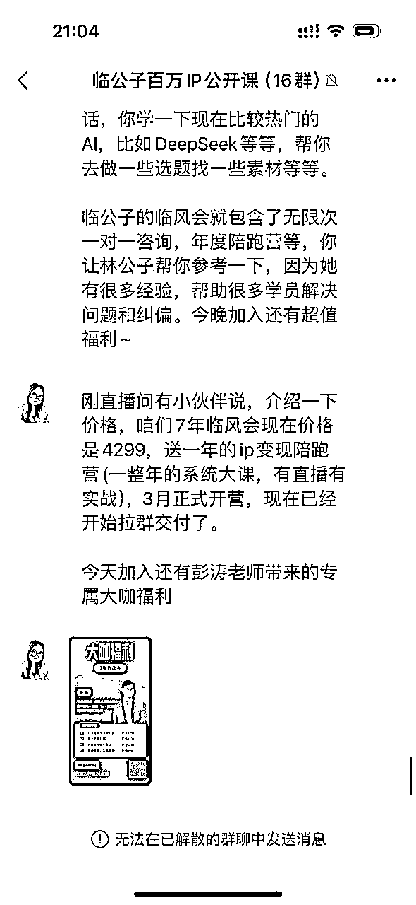

学员接龙：让已报名学员在群里接龙，营造大家都在买的氛围。

实时答疑：团队在群里秒回问题，打消顾虑。比如“课程适合小白吗？”

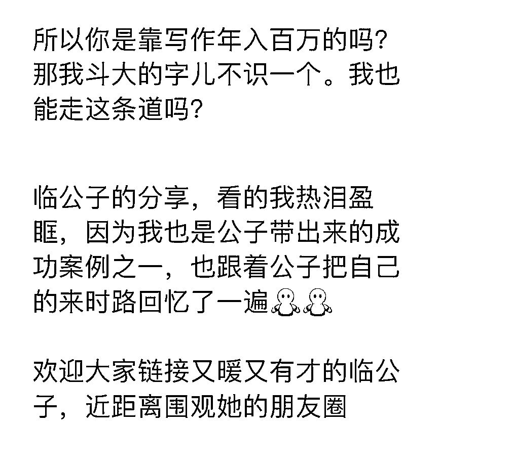

限时逼单：倒计时+名额递减，比如“最后1小时！早鸟名额只剩15个”。

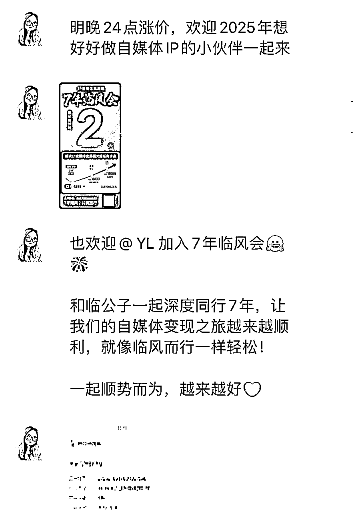

### 3、私域追单

犹豫用户：发专属优惠券，或者直接1对1语音沟通，解决他们个性化的疑虑。

朋友圈轰炸：团队统一发学员好评、报名盛况，强化信任感。

### 最后三点提醒：

信任是底层逻辑：别过度营销，用真实的案例和过硬的专业度打动人。

紧迫感是催化剂：限时、限量、专属福利，三件套缺一不可。

闭环思维是终局：从引流到交付，每一步都要为下一步做铺垫。