# 在赚钱潜水5年，我把建筑师的工牌换成了📕卖货链接

大家好，我是龙哥。2020年4月第一次上岸赚钱，到现在已经续费了整整五年。这五年里我一直在看、一直在试赛道，却一次都没在社区发声。直到最近几个月在📕电商这条路上有了点像样的结果，我才觉得可以把经历摊开讲一下。

# 想讲这件事的两个理由

#### 一、可以被复制

我觉得这条路径门槛不高，单人或者小团队都能上手。

24年4月我才第一次摸到📕电商，之前对电商一窍不通。📕在我这里长期就是个搜索引擎，账号粉丝屈指可数，连笔记都没发过。也就是最近三个月，GMV已经稳定过百万，净利能维持在20%以上。跟干了多年的老手比不算什么，但对一个要带两岁多女儿、没法全职扑进去的零基础新手来说，我已经挺满意了。

我没有电商背景，也不是做护肤出身的，更没先花时间做IP养号。第一篇直接就发了带货图文，粗暴直接，上手快，普适性强，特别适合个人或小团队去深耕。

下面是近三个月的GMV走势，1.27号前后低谷是因为过年，我给自己放了个假没在运营。

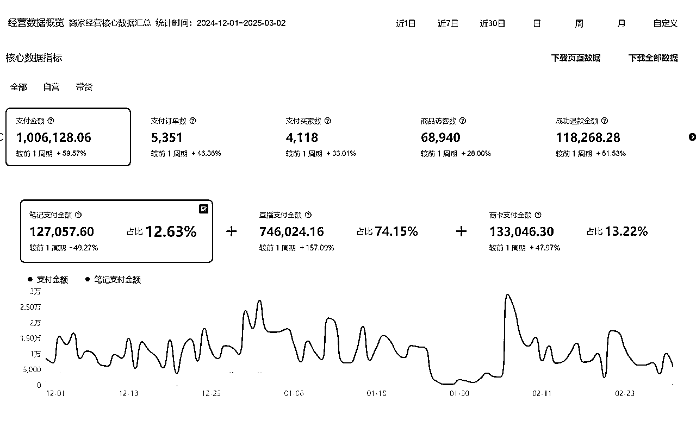

为了验证是否真的能复制，年前的空档我拉了两个前同事一起试。同样是没做过📕的小白，连样品都没囤，直接在网上找图我手把手教他们去重写文案。A同事第二天就出单了，B同事第五天出单。A后续又连续出几单，但白天忙炒股，行情好就躺平，行情不好才写写内容，最终GMV也就一万左右。B工作太忙基本没持续，偶尔让我帮代发一单。

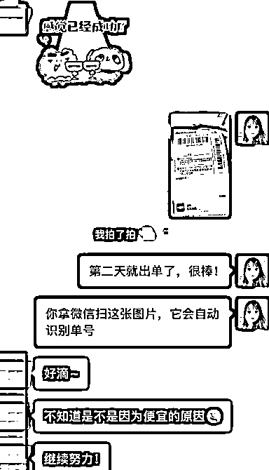

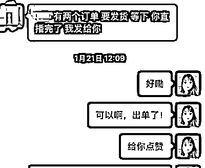

结论很简单：只要持续发，单就会来。网感稍微好一点，能快速模仿爆款笔记的核心逻辑，距离大单就不远了。

#### 二、赛道本身很友好

美妆护肤这个赛道在📕有天然的优势，哪怕跨行也能快速起效。

##### 种草到下单非常顺滑

平台本身就是美妆种草的主场，用户已经被教育成看到好东西就下单。虽然仍有一部分人会去淘宝比价，但我们不需要服务所有人。喜欢到处比价、只认旗舰店的客群不是我的目标。更舒服的客群是怕麻烦、不想为十几块到处跑的。那种“看着喜欢就买”的用户，才是📕电商最优质的人群。平台上拼价格不如拼种草能力，淘宝很多商家把利润卷到5%以内，我的利润基本能保持在20%以上。

##### 客单质量高，售后压力小

📕用户信任成本低，没刷单没评价也会买。很多买家平时淘宝只在旗舰店下单，C店、拼多多完全不碰，却愿意在零粉丝零订单的我这里下单。买到低价正品后信任感会累积，他们会主动催我找新货。整体售后率在10%左右，其中大部分是未发货的仅退款，真正的退货很少。

##### 正反馈快，容易坚持

即便不懂护肤专业知识也没关系。30-50岁、有一二线城市的中年女性，有消费能力也愿意为护肤买单，她们并不需要高深的专业科普，只要讲清楚“能解决什么问题”就行。不会拍视频、不会剪辑也完全能做。只要坚持堆量、不断提升手感，出单是迟早的事。正反馈来得快，人就更愿意坚持下去。

##### 启动成本低，天然副业

全程自然流，没花一分钱买量，也没刷过单评价。用最朴素的方式做内容就能卖货。起步阶段一件代发即可，不需要囤货。只要一部手机搞定配图写文案发笔记，加台电脑处理订单就够了。很适合当副业，认真做的话很容易超过主业。

##### 细分赛道竞争不激烈

抖音有大量MCN和专业团队卷付费流量，淘宝拼多多卷价格。📕更像一片待开发的净土。我这种完全跨行、没直播经验的普通人，都能在短时间内做出结果，关键就在于选对了细分品类。很多头部达人光环是“7年淘宝店、10年美妆人”，我没有任何背书，也不想做假人设。选品比包装更重要。我主打的是小众贵妇品牌的效期品，线下专柜大几百，效期临近打折出售，后面会具体讲。

# 一、我的📕电商初体验

#### 当时的困境

一直想创业不想打工，但“刚好够用”的工资把我困住了。相信很多人跟我一样，舍不得放弃稳定工作，生活琐事又占掉大部分精力，副业无从下手。总想着等副业超过主业再辞职。可直到现在我才明白，我是属于要破釜沉舟的类型。

2020年4月加入赚钱，五年间大大小小试过很多。视频号起号做过万粉，选了动漫赛道，最后发现没变现路径，血亏一个教训：先想清楚怎么赚钱再选方向。后来跟着赚钱航海做过快团团，本地生鲜团购当时已在下坡，坚持半年放弃。算是懂了一点电商逻辑。

这几年建筑行业越来越卷，早九晚十的节奏根本没时间做副业。央企都开始拖欠工资，行业寒冬让副业变主业的念头在我脑子里越长越旺。

#### 裸辞后的转折

2024年三月底，我决定拿完年终奖就走。回头看这个止损点抓得不错，后面公司就开始拖工资了。辞职时我并没有一个能稳定赚钱的项目，但我对自己有绝对的信心。

辞职后我参加了赚钱三个小航海，其中之一是📕百货。按教程注册店铺，混剪百货视频。机缘巧合，一个朋友在美妆代理公司，说有款小众面霜的货。📕是护肤种草天堂，于是我把这款面霜直接发到了📕。

#### 第一篇笔记第二天就成交

发第一篇时我连样品都没有，图是网上找的，自己学着去重和模仿爆款写文案。没想到第二天就出了第一单！账号粉丝不到10个，没有成交记录没有评价，也有人下单。我当时又惊又喜，对📕的好感度直接拉满。

出单后我买了样品回来自己拍，每天更1-2篇。一个星期后第四篇笔记开始小爆，订单逐步上量。

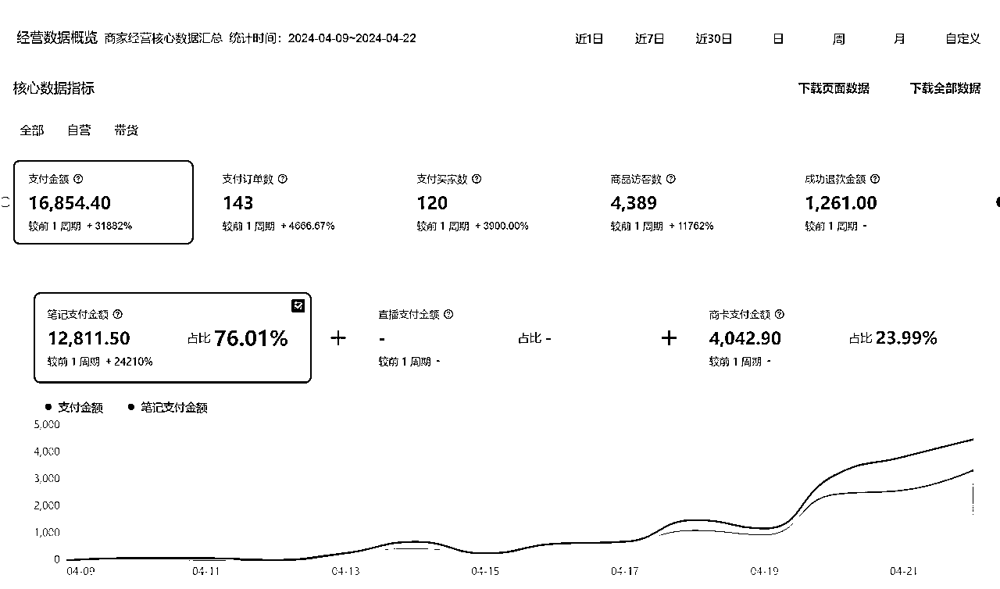

📕很慢热，我的笔记基本不是发出来立刻起流量，多数是一周甚至两周后才起来。每天持续更新，前面笔记流量衰减，后面笔记接力起来。一个月下来卖了9万多。

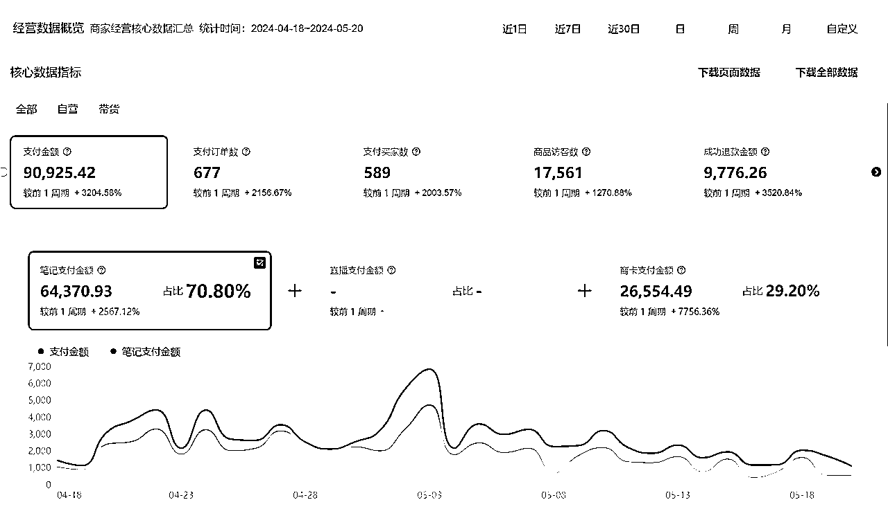

# 二、618踩坑后在赚钱找回方向

#### 618的教训

📕618从5月20号开始启动。我没搞懂规则，店铺优惠券叠加平台300-50，结果亏本卖了十几单。没有电商售后经验，被弄得焦头烂额。虽然大部分买家愿意补差价，但也有人专门薅羊毛。我设置的店铺券领了就无法取消，越想越亏，直接把商品全部下架。

受挫后正好赚钱开启新航海，我报名视频号长航海和另一期📕百货。了解到书豪教练的📕无人玩法，投入大量时间研究视频号剪辑和无人直播，长时间没更📕笔记，订单逐渐减少。视频号又因重复内容被限流，心累到不行。

#### 线下活动给我续上能量

那段时间赚钱线下活动很多，我报了好几场。和上海的小伙伴们交流，从迷茫到逐渐坚定。

真正让我彻底定下来的是参加了一场线下大会。嘉宾孙圈圈说她今年全力投入IP操盘手孵化，把之前的业务全部割舍，纵使那些业务仍有收益，她也毅然放弃。

那一刻我明白了：不要东试西试。我的📕护肤赛道不是快钱，但是一步步积累老客户、把账号做扎实的生意。慢慢来反而更快。

# 三、第一个大爆款来了

#### 7天GMV11万+

8月份我重新日更，熬了一个月才迎来大爆。一个月里每天就几百GMV，煎熬但坚持住了。

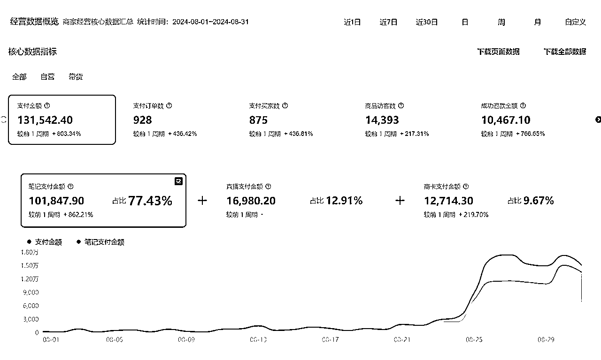

📕真的慢热，一个月前的笔记被翻出来直接大爆。所以别删笔记，哪怕数据难看，也可能在未来某一天爆发。

运气也好，大爆前一天我还在想怎么备货，提前跟快递谈了价，按月400单谈的，心里其实挺虚的。谈好第二天就出了80多单，第三天直接150单。7天GMV干到11万+。

那一周非常焦虑：缺货、缺包材、自己打包、处理咨询售后，忙得脚不沾地。但那种充实感和快乐感是真的。

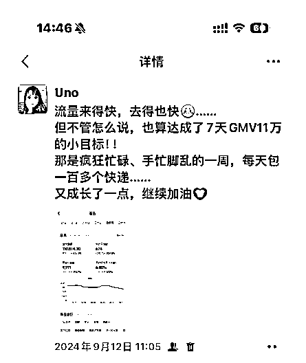

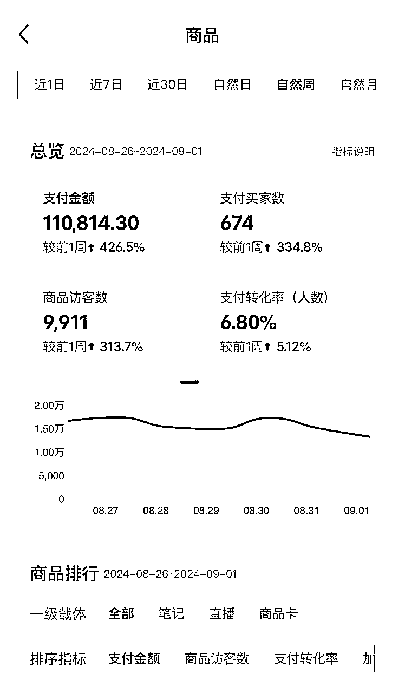

这次爆单之所以猛，是因为我写了一个月同款商品20多篇笔记，其中一篇爆了，带动了其他笔记的流量。爆得快退得也快，一周后日GMV回落到5000+左右。

# 四、直播加持后业绩更稳

#### 被逼上直播

7月📕办电商link大会，明确表示直播流量会倾斜。我一直拖着，零经验、镜头恐惧、不会自嗨。笔记大爆的时候我知道必须迈出去了。

第一次直播环境很简陋，阳台上铺块桌板放样品，手机直播电脑处理订单，下面还晒着女儿的衣服。

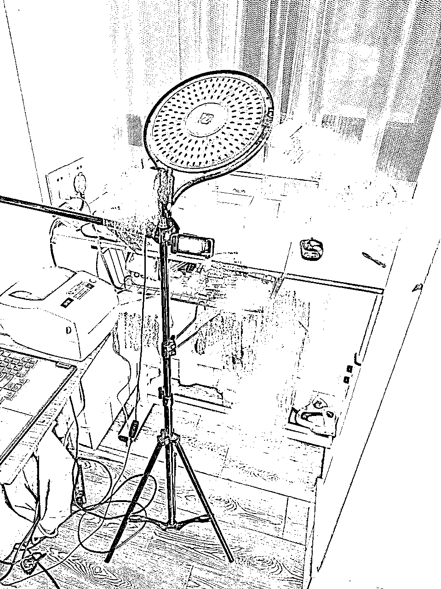

当时直播间非常友好，有时候我出门散步，挂着直播也有成交。排名蹭蹭涨。当然现在平台管控更严了，但比视频号还是宽松。

#### 找到自己的直播调性

📕直播的氛围和其他平台完全不同。来的客人说我听着舒服、很温柔、很真诚，所以下单。我不会喊口号逼单，就是慢慢聊品牌、聊产品、聊感受，像章小蕙、伊能静那种娓娓道来的感觉。

#### 日GMV趋于稳定

靠笔记出单波动很大，爆则爆、冷则冷。每天稳定2-5小时直播后，业绩趋于平稳。除了过年前停播数据骤降，基本日常GMV在1万左右，月入30多万。有人接力肯定更好，但现在我自己时间吃紧。

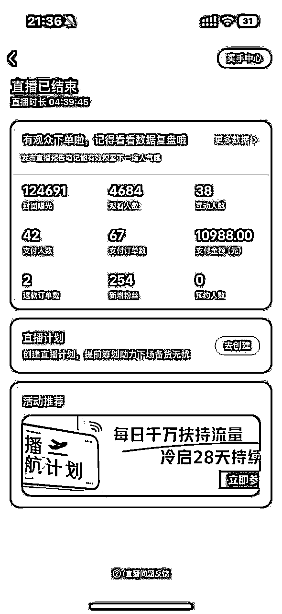

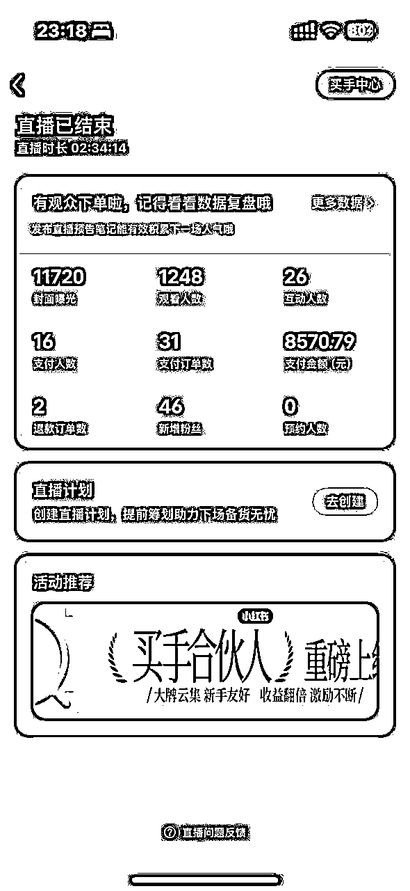

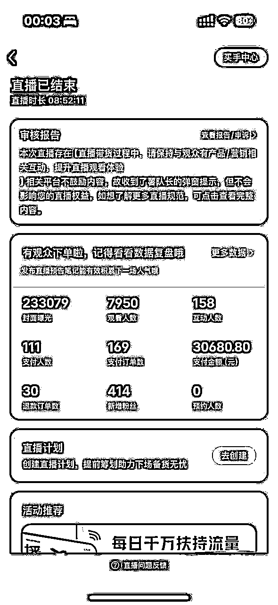

# 五、现在的焦虑

从0到1、从1到10是快乐的，现在进入平台期开始焦虑了。第一次出单很兴奋，第一个月10万很开心，7天11万几乎要炸。现在月GMV稳定下来，我知道还有很多地方可以优化、加杠杆，但心有余而力不足。想做的事太多，不知道从何下手。

下面是我的经验总结。

# 经验总结

# 一、选品

选品等于选赛道。彩妆和护肤里，护肤起步更友好。彩妆专业性强、品类多、迭代快。护肤我分三类：高端贵妇、上千；小众贵妇、几百；平价学生、百元内。

高端贵妇类没有资源和专业背景很难拿货，除非已有贵妇人设。

我做的是小众贵妇类。参考章小蕙的带货逻辑，看她在📕推什么。

货盘结构：2-3件引流福利品，利润15-20%；十几件利润品，利润30-50%；其余按20%控价。也有利润做到80%的。

引流福利品可以是贵妇品的临期清仓，官方专柜500，效期原因2折出。账号就是靠它起来的。

利润品是品牌给的利润高且控价严格的品，靠能力卖。

小众品有时能做到100%利润。我曾包下百来个临期小众品牌货，拿货145，卖349，后期效期临近降到299，利润依然可观。

定价不要参考淘宝，淘宝全是卷王。可以参考📕，但不必追求最低。我一个引流品在📕定120+，淘宝90+，我的销量几千，对方几百。说明📕推流与价格关联不大，用户也不是比价党。这也是现在入场的机会点。

其实之前我也认真琢磨过要不要碰这个类目，后来因为时间实在排不开就搁置了。但这个生意的利润空间真的非常诱人。拿29.9的售价来说，批量采购加上包装、人工和快递成本，总共也就14.9左右，算下来毛利率差不多46%。而且这个价位几乎不需要用户犹豫，下单率很容易做起来，备货的资金压力也不大，对新手起步来说是很友好的方向。我手头现在也有一些低价清仓的货源，完全够再养一个号专门来做，可惜还是精力问题，暂时没启动。

## 开店这件事

一旦赛道定下来，开店流程非常简单。📕对粉丝数没有门槛，0粉就能开，而且不用先交钱。普通商品类目会有一笔1000元的保证金，但这笔钱不用急着交，等到要提现了再补上也不迟。就算之后不想做了，保证金也是能退的。具体怎么操作，赚钱的圈子里已经有很多手把手的教程了，大家可以直接翻一下往期小航海里关于📕电商百货的航海手册。

## 怎么写爆款笔记

无论在哪个平台做内容，有个规律一直很灵：火过的东西，大概率还会再火一次。

但要注意，不同赛道、不同目的（比如卖货还是引流），写法是完全不一样的。引流相关的玩法，圈里很多大佬都聊过。

如果是纯卖货笔记，找对标的思路可以参考这几步：

1. 优先选爆款，赞藏量至少100起步；如果这个产品的高赞笔记特别多，就把标准提到500甚至1000以上。最好找那种低粉爆文，大V的爆文参考价值不大——人家粉丝基数摆在那，封面文案平平也有几百赞，学不到东西。
2. 一定要选挂了商品的笔记，这点很关键。
3. 笔记发布时间不能太旧。

先找同时满足1+2+3的；找不到就退一步找1+2或者1+3；要是产品实在太冷门，那就先凑合按1来找。找到对标以后，从封面到标题再到正文，认真模仿，等自己的号有影响力了，再慢慢做原创。

这里有个很实用的种草公式：情感共鸣（戳中痛点场景）+ 权威信任（名人或品牌背书）+ 专业价值（成分、功效）+ 价格刺激（折扣、对比）。这个套路刚好契合📕用户“一边理性研究、一边感性下单”的特质。

## 图片素材从哪来

图片可以自己拍，也可以去别的平台找。📕百货类的对标素材，大多来自抖音。护肤赛道我也试过到抖音挖素材，但实践下来发现，得物、淘宝这些电商平台的评论区反而藏着更多好东西，图片又好看又实用，记得做一下去重处理。当然，如果条件允许，自己买样品回来拍是自由度最高的。

另外，卖货的账号如果直接亮明“我就是有货”的身份，引来的流量会格外精准。

## 评论区也要用心

评论区不能撒手不管，适当维护很有必要。比如之前玩过的“惊喜盒子”“大数据请记住”这些互动，都能有效带动氛围。

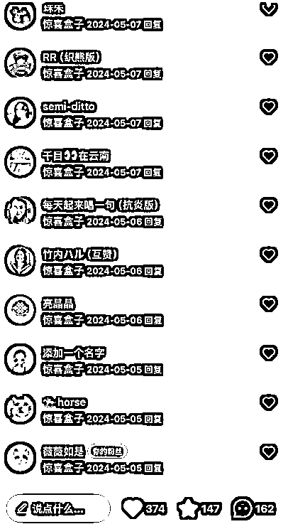

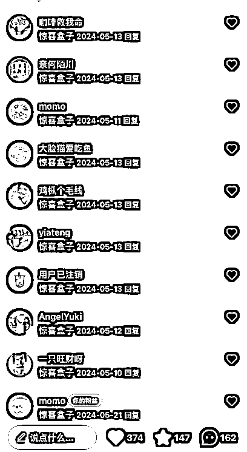

## 坚持写，量变总会质变

爆款这种事可遇不可求。在它来之前，你只能持续地写。我8月份能迎来7天11万+GMV的那波爆发，前提就是我把同一个品老老实实写了快一个月。后来爆了我也没停，天天接着写。到现在这个品还经常是我每天GMV的大头，长尾流量真的感人。

## 别隐藏笔记

看到点赞收藏数据不好，千万别冲动把笔记藏起来。我们做的是带货号，不是达人号，不需要拿数据给广告主看。带货笔记该盯的是有没有出单。我有不少笔记点赞收藏都只有个位数，但过去好几个月了，还在持续出单。

## 别把粉丝量当命根子

带货过程中能同时涨粉当然是好事，但千万别本末倒置。从第一天起，目标就要明确：出单。不要写那些跟商品无关的内容去引流涨粉，真没必要，老老实实写商品笔记就够了。我记得自己卖了500多单的时候，粉丝还只有几十个。

## 每一篇笔记都算数

这个观点是参加黄小刀老师的航海时学到的。拿我自己举例：8月份我写了20多篇笔记才等来大爆，那波7天做到了11万GMV。简单算一下，110000除以25等于4400——这么一看，每一篇笔记其实都能带来4400的产出。这么想，坚持就没那么痛苦了。每写完一篇就告诉自己：又赚了4400！哈哈。

## 直播，把影响力放大

笔记爆了以后，就可以顺势开直播。笔记带来的GMV像过山车，爆的时候爽翻天，平淡的时候特别磨人。直播能提供相对稳定的GMV，让人没那么焦虑。如果你是自由职业或者自己创业，直播一定要安排上，每天看到稳定进账，动力也会更足。再说📕官方最近对直播的扶持力度也很大。

## 别准备太久，先播了再说

很多小伙伴对直播有恐惧，或者有点完美主义，总想先学一堆课、准备充分了再上。我的建议是：先开播，边播边学。我第一次直播时根本不知道怎么讲产品，就拿另一台手机打开商品详情页，照着品牌故事、产品成分、使用方法念。虽然讲得磕磕巴巴，很尴尬，但还是有人下单。后来慢慢根据观众反馈调整话术，到现在我手头随便干着别的活儿，嘴里也能不卡壳地讲出来。

当然，不建议注册新号就立刻开播。我跟📕官方的人聊过，他们也建议先写笔记把号养起来，有了一点影响力再播。不然开播没几个正反馈，很难坚持下去。

## 直播涨粉，品牌主动找上门

我现在1万多粉丝，其中9000多都是靠直播涨起来的。直播的涨粉效率真的很惊人。粉丝多了以后，很多跟我卖的货调性类似的品牌就开始来联系我，尤其粉丝过了5000之后特别明显。因为我卖的东西里很多是章小蕙同款，所以不少贵妇品牌主动寄样品给我。

一开始我也不太会跟他们打交道，有人上来直接问佣金怎么看。目前我接触下来的佣金基本在30%到45%之间。有个德系品牌说他们平时只能给15%左右，后来我不愿意上，他们给申请到了30%。直播间的机制也能聊，更好的机制自然能带来更好的销量，具体能谈到什么程度，取决于你自己的带货能力。现阶段我还是以卖自己店里的产品为主，因为性价比高，做达人带货一个月大概能赚几千块佣金，这块我还在摸索中。

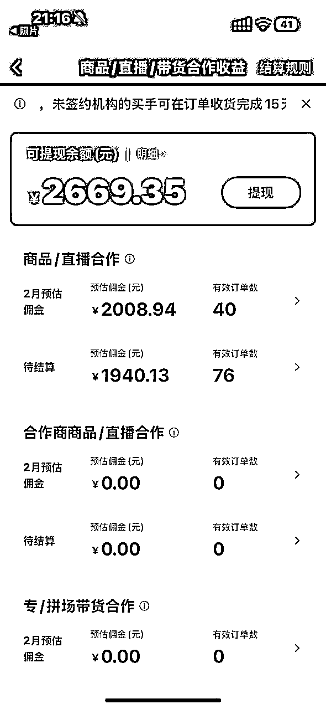

## 产品供应链

### 货源怎么找

在公域渠道，我只卖大贸货，也就是普通贸易商品。这种货有中文标签，属于正规进口，清关文件、检疫证明、采购发票一应俱全。还有一种跨境货，没有中文标，没人投诉就没事，但一旦有人较真，基本一投一个准。我不想冒这个险，所以店里全部上大贸货。

另外还要留意效期问题。国内大部分护肤品都是按三年效期来的，但有些品牌会拿“国际5年效期”当幌子，卖其实已经过期的产品。这种货利润确实高，我不碰。我一直觉得，想把账号做大做稳，就要记住“慢就是快，合规才能长久”。

如果你是新手，没有专业背景，可以从下面几个方向找货源：

### 1688找靠谱货源

1688上确实能找到一些护肤品货源，但贵妇品牌很少，大多是针对学生党的平价国货。重点是一定要核查资质，主要看检疫报告、报关单，还有商标注册证、备案信息这些，越齐全越好。万一卖了假货，账号就毁了。

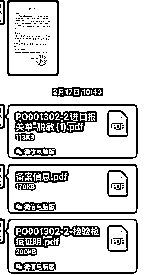

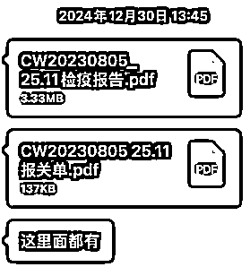

### 闲鱼找品牌代理商

我有一个引流品卖爆之后，就是在闲鱼上找到了它的上级代理商。跟她聊的时候，她把我的收货地址准确说了出来，我这才知道原来我订的货就是她们品牌代理公司发的。

### 参加美博会

每年各地都会办美博会，大品牌小品牌都会去参展。到现场可以直接找品牌方要名片、加代理联系方式。

### 起量以后，品牌主动对接

账号粉丝到1000之后，就有很多不同规模的品牌主动来寄样品了。其中有不少小众但很贵的贵妇货，比如一千多一盒的美肌饮（章小蕙同款）、三四千一套的高端院线护肤礼盒、大几百的安瓶、精华、面霜和面膜，还有粉底、唇釉、章小蕙同款身体护理全套，洗发水沐浴油身体乳更是用不完，最近还收到了生发头皮精华。这些品牌都很大方，只要表示感兴趣，就会免费寄。

## 发货方式的三个阶段

### 第一阶段：代发，不囤货

我是低成本创业派，不管做什么，一开始都不想投太多钱，除非已经验证可行、跑通最小闭环。所以最开始我全部用代发，自己不碰发货。

好处是很省心，只管在前端搞流量。坏处也有：一是发货时间不受自己控制，尤其周末很多代发都不发，容易影响时效。现在各大平台对发货时效都查得严，📕是发货后24小时内揽收就行，所以遇到爆单，可以先把单号填上去，只要24小时内快递揽收就没问题。二是如果顾客一次买好几个不同的产品，包裹可能从不同地方发出，收货体验会打折扣。

### 第二阶段：自己囤货自己发

8月份我的一篇笔记突然爆了，正好赶上跟本区快递老板谈价格，我按每月400单谈到了3.5元一单发全国，新疆西藏海南这些偏远地区10元。我就直接订货回来自己发了。因为我很清楚，想做大做强，这一步迟早要迈出去。

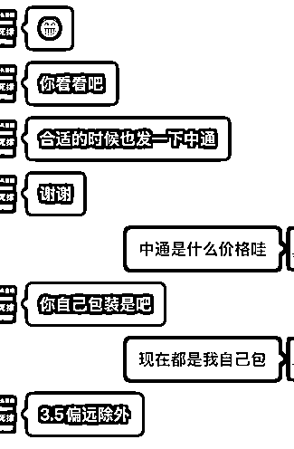

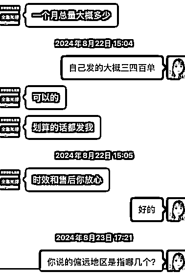

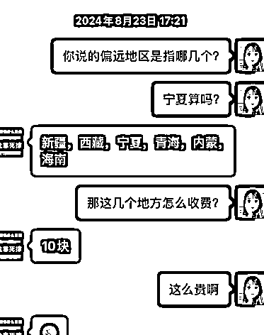

一开始货就放自己家里，自己打包，确实很累。单量多的时候，每天基本要花一两个小时处理订单和分拣。后来单量慢慢上来，就开始请小时工来家里帮忙，好让自己把时间花在搞流量、搞货源上。当时找的钟点工是25块钱一小时（快递老板推荐的），在上海这种城市能这个价格找到人，我已经很满意了。这位钟点工做事负责又细致，几乎没出过错。

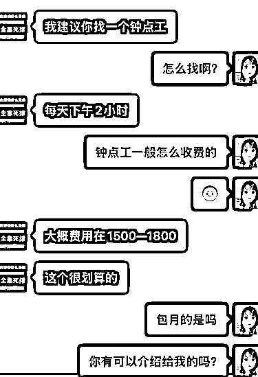

### 第三阶段：云仓代发

后来家里的货越来越多，客厅堆得乱七八糟，两岁的女儿连活动的地方都没有，保洁阿姨来了都无从下手。这时候我了解到了云仓。云仓就是大型仓库，大家可以根据需求租一小块地方。云仓有专业的入库、发货系统。我从品牌代理那里订货，直接发到云仓，他们会清点入库，有专人分拣、打包、快递，还能自动回传单号。专业的事交给专业的人，我除了日常处理订单审核，其他都交给云仓了。

关于找云仓，有几点可以留意：

1. 一定要找直营的，别找中介，也别找加盟店。直营最靠谱，能省掉后续很多麻烦。

2. 报价是可以谈的。我用的这家云仓，日均50单以上免掉10平米仓储费，快递费按阶梯报价，分拣费这些也都能商量。最后谈好的报价一定要让他写进合同里。

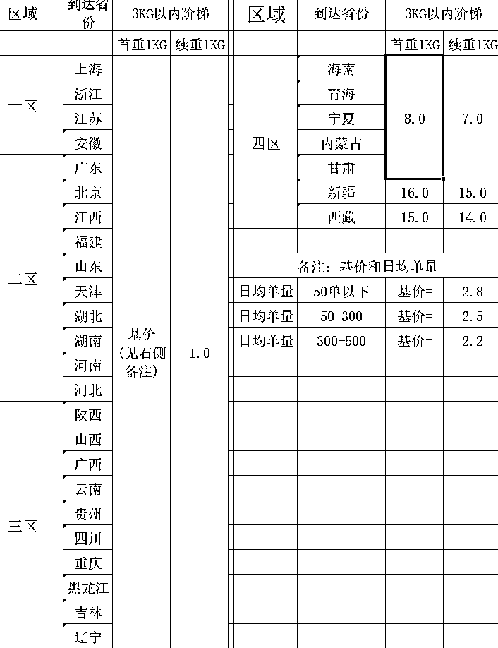

3. 在费用可接受的前提下，尽量选离自己近的云仓，去盘点、送货都方便。

## 售前售后怎么办

📕的售前咨询有100%回复率和3分钟回复率两个指标。100%回复率达不到会被扣钱，不过平台已经接入了咨询机器人，能在一定程度上减少漏回。3分钟回复率达标能拿“金牌客服”称号。目前客服就是我自己，实在没办法做到每次都在3分钟之内回复。

售后方面，📕做得还算公平，没有特别偏袒某一方。比如买家拿“过敏”当理由要退货退款，我以“影响二次销售”来拒绝，大概率能成功。我跟一些做淘宝、拼多多的同行聊过，他们都觉得📕简直是“一片净土”。

## 写在最后

选品、运营、商务、主播、客服……我全是一个人扛下来，其中任何一项拿出来，对以前的我来说都是完全陌生的领域。条件这么简陋都能做到现在的成绩，可见📕电商护肤卖货这个赛道可复制性有多强。它特别适合个人或者小团队，非常友好。

希望这篇分享能给赚钱的小伙伴们带来一点启发，也想给那些想找一份几乎零成本、正反馈又快的副业的朋友一些借鉴和帮助。如果对哪个部分感兴趣，欢迎来问我，我们可以一起探讨。