# 低成本搭建 YouTube 24 小时直播：从服务器到循环推流
作者：龙哥

## YouTube 直播收益表现

YouTube Shorts 的曝光和推荐能力很强，但普遍存在单价偏低、流量容易集中到印度等情况。我开始做 YouTube 后，除了短视频，也陆续制作横版长视频。部分账号获得推荐、满足开播条件后，就可以尝试用直播增加收益。

直播推流有两种思路。第一种是在自己的电脑上安装 OBS，再通过本地网络推流，操作比较直接，但会持续消耗机场流量。我测试过播一个下午，流量就用了约 300GB；如果每月套餐只有几百 GB，很快就会用完，因此长期来看并不经济。

更省心的方案，是租一台不限流量的海外服务器。推流对配置要求不高，通常 1GB 内存、甚至单核配置也可以尝试。

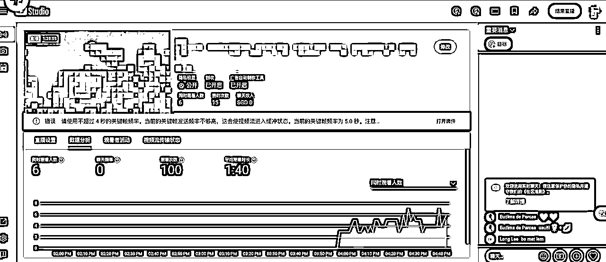

目前我的测试结果是，横版长视频直播的千次收益约为 0.7。竖版直播的单价可能会低一些，我暂时还没有拿到相关数据，后续有结果再补充。


最近几个月，我又有两三个账号通过了 YPP。视频推流和流量增长都很快，账号具备条件后，可以考虑尽早开播。制作方式也不复杂：把已有内容整理成一个较长的视频，如果素材是短视频，可以剪辑拼接成大约一小时的片段，再设置循环播放。具体时长可根据自己的内容安排。

# 直播搭建步骤

## 一、准备一台海外服务器

首先需要租用一台海外 VPS，地区选择比较灵活。我使用的是莱卡云的一台美国服务器，配置为双核、1GB 内存，并且没有流量限制。

服务器商并不一定要选这一家。我的选择主要是因为之前注册过，购买流程比较方便，支持🛰️、支付宝付款；部分海外 VPS 则需要使用海外信用卡，对一些用户来说不太方便。香港、韩国等地区的服务器也可以作为选择。

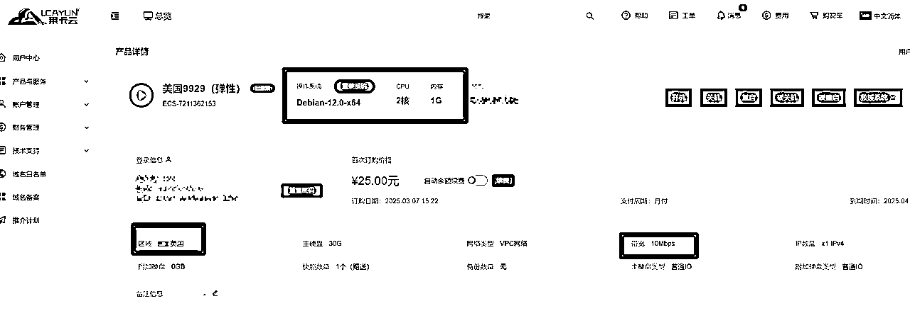

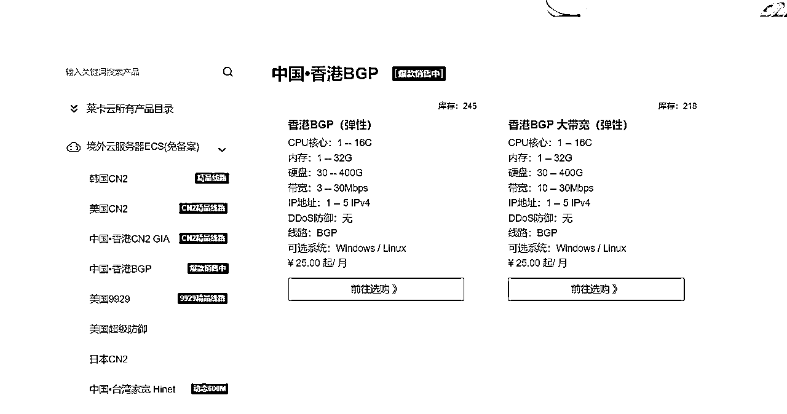

## 二、准备脚本和远程连接工具

搭建时可以借助 AI 工具，例如豆包、Kimi 或 DeepSeek。遇到系统配置或安装报错时，把问题信息发给 AI，通常能更快找到处理方法。

循环推流脚本可以参考作者的网站：

**FFmpeg 循环推流脚本：lala.im**

脚本内容比较详细，不过不同服务器和系统可能需要做相应调整。

此外，还需要一款 SSH 连接软件。我在 Windows 上使用的是 MobaXterm，网上可以找到相关版本，这里也提供一个绿色版下载地址：

软件链接：https://pan.quark.cn/s/a7c1d5dcce6c

## 三、连接服务器并整理视频文件

打开 SSH 工具，登录服务器后，左侧会显示服务器文件目录。默认通常进入 root 目录，删除路径中的 root 并回车，即可进入 VPS 的主目录，找到 home 文件夹。

在 home 目录里新建一个文件夹，名称自行决定。我创建的文件夹叫 `xh`，随后又在其中建了一个 `video` 文件夹，用来存放准备循环播放的视频。

将视频上传到 video 文件夹后，脚本会按顺序逐个播放，并持续循环推流。上传时可以点击工具里的上传按钮选择文件。需要注意的是，文件过大时上传容易中断，建议单个视频控制在 2—3GB 左右。

我的服务器实测可以稳定处理 720P 视频；如果使用 1080P，CPU 和内存占用会明显升高，是否能流畅运行需要结合服务器配置测试。

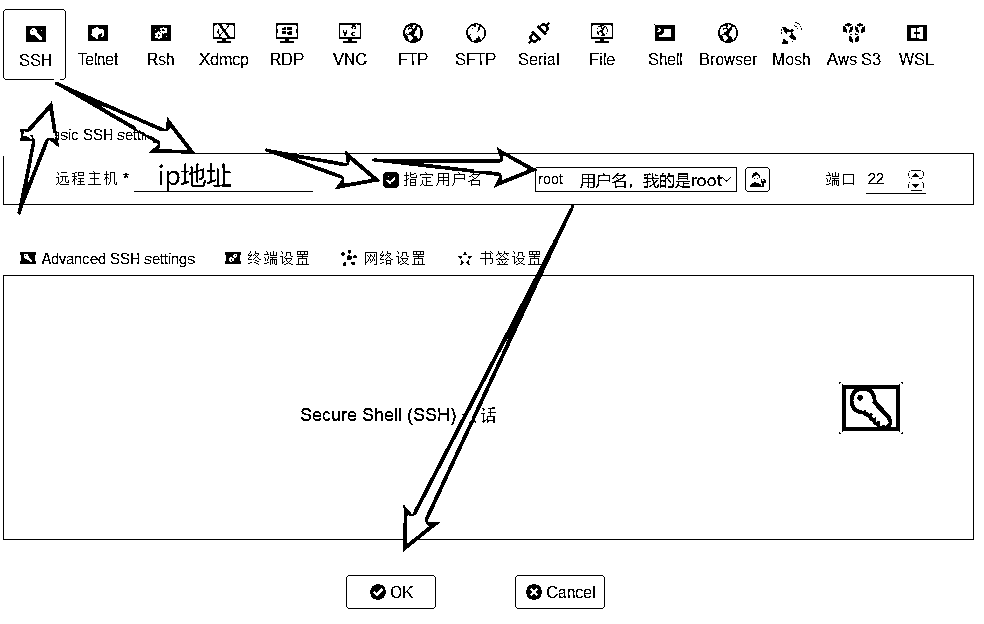

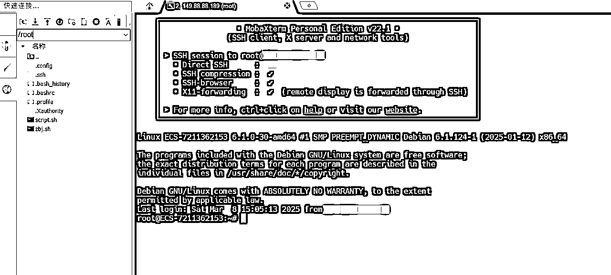

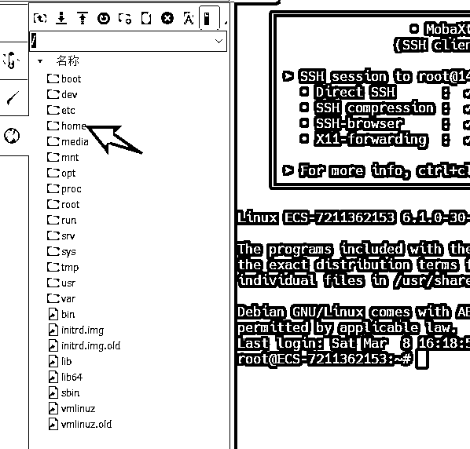

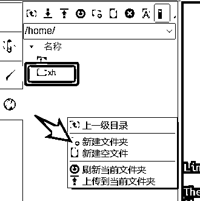


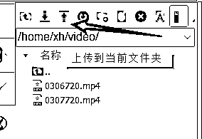

## 四、安装并配置推流脚本

前面的服务器、文件夹和视频准备完成后，就可以开始安装脚本。

建议先把脚本原文以及 VPS 的操作系统版本一并发给 AI，让它根据你的环境修改命令。原始脚本可以从“FFmpeg 循环推流脚本 lala.im”页面复制，最好从头到尾完整提供。我使用的是 DeepSeek，让它按照服务器系统调整后，再逐步执行。

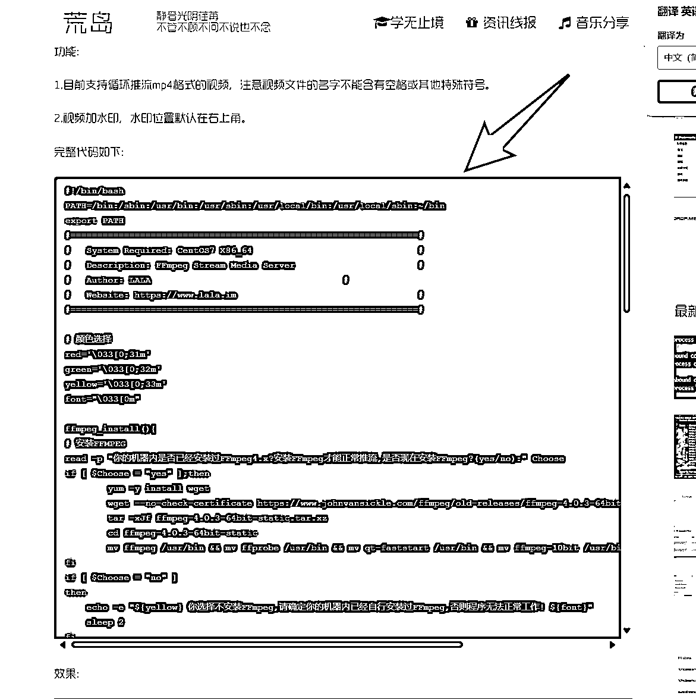

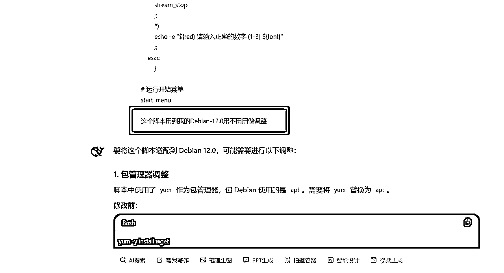

整个过程主要会用到两个工具：`screen` 和 `FFmpeg`。AI 会给出对应的安装命令，将代码复制到终端并回车即可。终端开始下载和运行内容时，等待其完成就好。

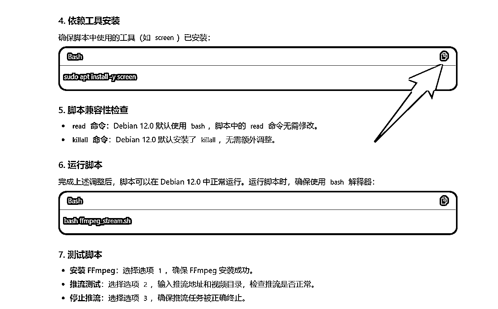

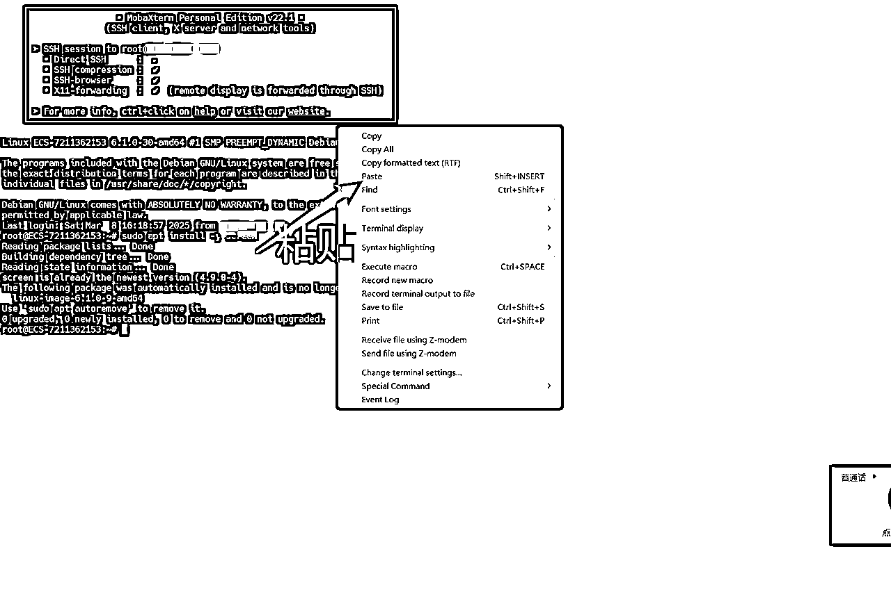

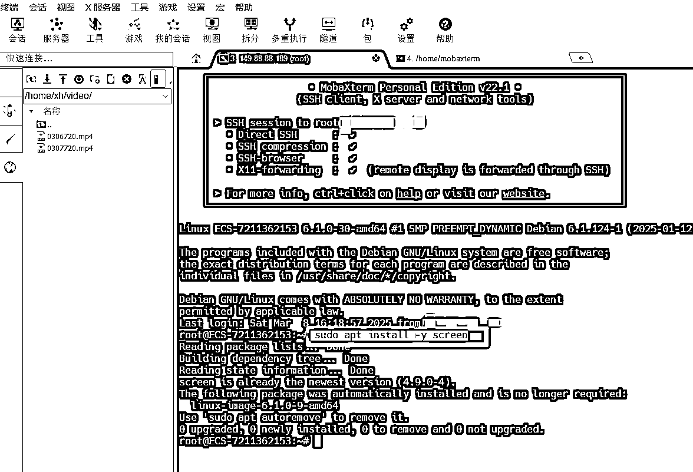

如果安装途中出现错误，把完整报错复制给 AI，通常就能获得下一步的修正建议。

具体操作大致分为以下几步：

### 第一步：创建 screen 会话

先新建一个 screen 会话。可以把它理解为后台运行的独立窗口，即使退出 SSH，推流任务也能继续运行。

按 AI 提供的命令复制、粘贴并回车即可。

```
screen -S stream
```

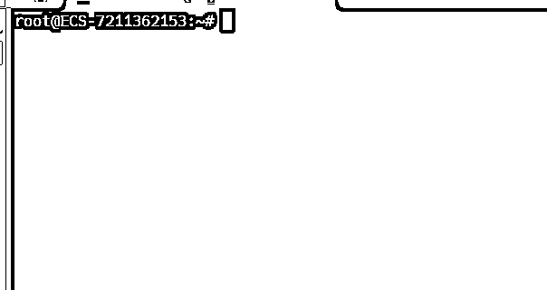

### 第二步：进入存放脚本的目录

使用 `cd` 命令进入之前创建的第一个文件夹。我的目录名是 `xh`，你的目录则需要替换成自己设置的名称。

```
cd /home/xh   #xh是你自己前面创建的文件夹名字 我的是xh
```

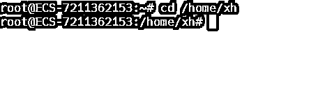

### 第三步：安装脚本

把 AI 根据系统版本调整后的脚本命令复制到终端执行即可。如果你的服务器配置和系统版本恰好也是 Debian 12 x64，也可以参考我现成的代码。

下方图片中的命令就是我通过 AI 调整后的版本。

```
#!/bin/bash
PATH=/bin:/sbin:/usr/bin:/usr/sbin:/usr/local/bin:/usr/local/sbin:~/bin
export PATH

# 颜色定义
red='\033[0;31m'
green='\033[0;32m'
yellow='\033[0;33m'
font="\033[0m"

ffmpeg_install(){
    echo -e "${yellow}Checking FFmpeg installation...${font}"
    if ! command -v ffmpeg &> /dev/null; then
        echo -e "${green}Installing FFmpeg...${font}"
        sudo apt update
        sudo apt install -y ffmpeg
        echo -e "${green}FFmpeg installed!${font}"
    else
        echo -e "${yellow}FFmpeg already installed${font}"
    fi
}

stream_start(){
    # 推流参数验证
    read -p "输入RTMP推流地址 (rtmp://): " rtmp
    if [[ ! $rtmp =~ ^rtmp:// ]]; then
        echo -e "${red}地址必须以rtmp://开头${font}"
        exit 1
    fi

    read -p "输入视频目录 (绝对路径): " folder
    if [ ! -d "$folder" ]; then
        echo -e "${red}目录不存在${font}"
        exit 1
    fi

    # 编码参数配置
    frame_rate=24  # 根据实际视频设置
    GOP=$(( frame_rate * 2 ))  # 2秒关键帧间隔

    video_params=(
        -c:v libx264
        -b:v 2500k
        -maxrate 2500k
        -bufsize 5000k
        -preset veryfast
        -tune zerolatency
        -g $GOP
        -r $frame_rate
        -x264-params "nal-hrd=cbr:force-cfr=1:keyint=$GOP:min-keyint=$GOP"
    )

    audio_params=(
        -c:a aac
        -b:a 128k
        -strict -2
        -ar 44100
    )

    # 水印处理
    read -p "添加水印? (yes/no): " watermark
    if [ "$watermark" = "yes" ]; then
        read -p "水印图片路径: " image
        if [ ! -f "$image" ]; then
            echo -e "${red}水印文件不存在${font}"
            exit 1
        fi
        filter="-filter_complex overlay=W-w-30:30"
    fi

    echo -e "${green}推流启动中... ${yellow}(Ctrl+C 停止)${font}"

    while true; do
        for video in "$folder"/*.mp4; do
            [ ! -f "$video" ] && continue

            # 构建命令
            cmd=(ffmpeg -re -i "$video")
            [ "$watermark" = "yes" ] && cmd+=(-i "$image" $filter)
            cmd+=(
                "${video_params[@]}"
                "${audio_params[@]}"
                -f flv "$rtmp"
            )

            echo -e "${yellow}推送: $(basename "$video")${font}"
            "${cmd[@]}" || break
        done
    done
}

stream_stop(){
    pkill -f "ffmpeg.*rtmp"
    echo -e "${yellow}已终止推流进程${font}"
}

# 主菜单
main_menu(){
    clear
    echo -e "${yellow}=== FFmpeg直播控制中心 ==="
    echo "1\. 安装FFmpeg"
    echo "2\. 开始推流"
    echo "3\. 停止推流"
    echo "4\. 退出"
    read -p "选择操作 (1-4): " choice

    case $choice in
        1) ffmpeg_install ;;
        2) stream_start ;;
        3) stream_stop ;;
        4) exit 0 ;;
        *) echo -e "${red}无效选项${font}"; sleep 1; main_menu ;;
    esac
}

main_menu
```

可复制版本：https://www.wenxiaobai.com/share/chat/89f3642a-f351-4b49-b030-880effed3227

```
#!/bin/bash
PATH=/bin:/sbin:/usr/bin:/usr/sbin:/usr/local/bin:/usr/local/sbin:~/bin
export PATH
#=================================================================#
#   System Required: Debian 12.0                                  #
#   Description: FFmpeg Stream Media Server                       #
#   Author: LALA                                    #
#   Website: https://www.lala.im                                  #
#=================================================================#

# 颜色选择
red='\033[0;31m'
green='\033[0;32m'
yellow='\033[0;33m'
font="\033[0m"

ffmpeg_install(){
    read -p "你的机器内是否已经安装过FFmpeg4.x?安装FFmpeg才能正常推流,是否现在安装FFmpeg?(yes/no):" Choose
    if [ $Choose = "yes" ];then
        sudo apt update
        sudo apt install -y ffmpeg
    fi
    if [ $Choose = "no" ]
    then
        echo -e "${yellow} 你选择不安装FFmpeg,请确定你的机器内已经自行安装过FFmpeg,否则程序无法正常工作! ${font}"
        sleep 2
    fi
}

stream_start(){
    read -p "输入你的推流地址和推流码(rtmp协议):" rtmp
    if [[ $rtmp =~ "rtmp://" ]];then
        echo -e "${green} 推流地址输入正确,程序将进行下一步操作. ${font}"
        sleep 2
    else  
        echo -e "${red} 你输入的地址不合法,请重新运行程序并输入! ${font}"
        exit 1
    fi 

    read -p "输入你的视频存放目录 (格式仅支持mp4,并且要绝对路径,例如/opt/video):" folder
    read -p "是否需要为视频添加水印?水印位置默认在右上方,需要较好CPU支持(yes/no):" watermark
    if [ $watermark = "yes" ];then
        read -p "输入你的水印图片存放绝对路径,例如/opt/image/watermark.jpg (格式支持jpg/png/bmp):" image
        echo -e "${yellow} 添加水印完成,程序将开始推流. ${font}"
        while true
        do
            cd $folder
            for video in $(ls *.mp4)
            do
                ffmpeg -re -i "$video" -i "$image" -filter_complex overlay=W-w-5:5 -c:v libx264 -c:a aac -b:a 192k -strict -2 -f flv ${rtmp}
            done
        done
    fi
    if [ $watermark = "no" ]
    then
        echo -e "${yellow} 你选择不添加水印,程序将开始推流. ${font}"
        while true
        do
            cd $folder
            for video in $(ls *.mp4)
            do
                ffmpeg -re -i "$video" -c:v copy -c:a aac -b:a 192k -strict -2 -f flv ${rtmp}
            done
        done
    fi
}

stream_stop(){
    screen -S stream -X quit
    killall ffmpeg
}

echo -e "${yellow} Debian 12.0 FFmpeg无人值守循环推流 For LALA.IM ${font}"
echo -e "${red} 请确定此脚本目前是在screen窗口内运行的! ${font}"
echo -e "${green} 1.安装FFmpeg (机器要安装FFmpeg才能正常推流) ${font}"
echo -e "${green} 2.开始无人值守循环推流 ${font}"
echo -e "${green} 3.停止推流 ${font}"
start_menu(){
    read -p "请输入数字(1-3),选择你要进行的操作:" num
    case "$num" in
        1)
        ffmpeg_install
        ;;
        2)
        stream_start
        ;;
        3)
        stream_stop
        ;;
        *)
        echo -e "${red} 请输入正确的数字 (1-3) ${font}"
        ;;
    esac
}

start_menu
```

把这段代码复制完整后，直接丢进代码块里敲一下回车执行就行。

脚本跑起来后最底部会把操作流程列得很清楚，第一步强调要在全新的 screen 会话里运行，第二步是检查 ffmpeg 是否可用。ffmpeg 我们前面环节已经装好了，没装的话就按提示装一下，脚本自带一键安装，缺失时选 1 即可。

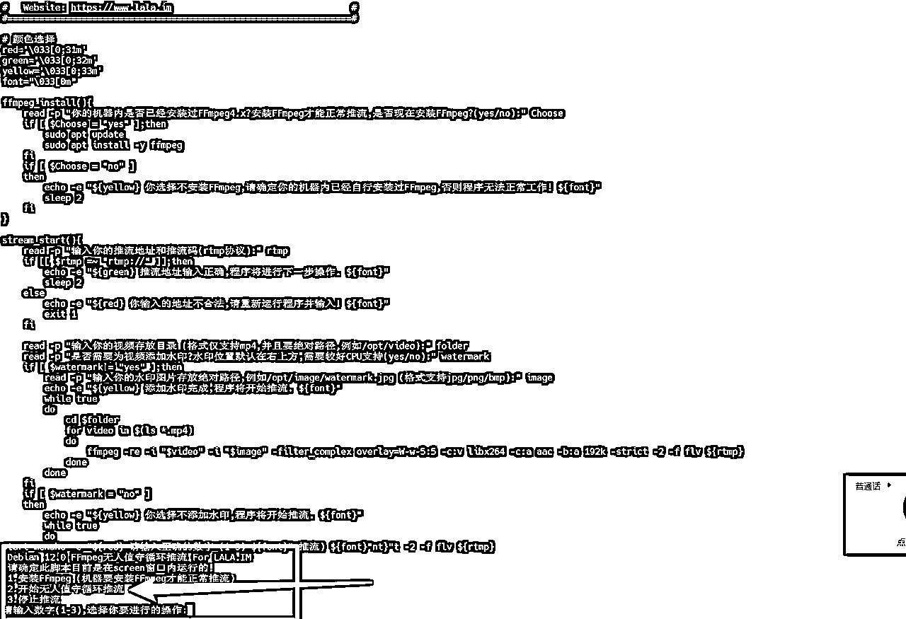

我这边 ffmpeg 早就有了，所以这里直接按 2 跳过，然后回车继续。


接下来去油管找推流用的 Rtmp 地址和串流密钥。打开油管页面点右上角的创建，再点开始直播，就能看到直播服务器地址和 Stream Key。服务器地址基本都是固定的，真正起作用的是那串唯一的直播密钥，记得保密不要外泄。

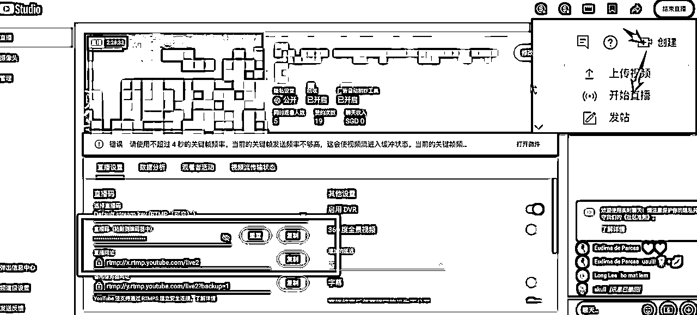

把拿到的信息整理成下面这种格式保存好。这种推流方式并不局限于油管，b站、抖音等任何能提供 Rtmp 地址和密钥且允许素材型直播的平台，都可以用同样的方法接入。

```
rtmp://x.rtmp.youtube.com/live2/XXX-XXX  #后面的XXX-XXX。就是你的直播码。直播网址跟直播码中间有一个斜杠。
```

整理好的地址和密钥，按照格式填进代码区域对应的位置。

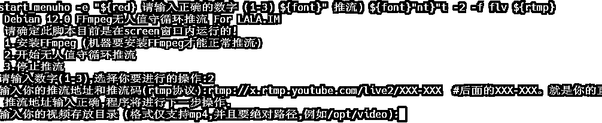

粘贴完成后再按回车，程序会提示你输入素材视频的存放目录。这个目录我们之前已经提前建好了。

```
/home/xh/video  #根据你自己的视频文件目录填写。
```

把目录路径也贴进去按回车，如果配置没问题，控制台立刻就会显示推流已启动。

这时候你完全可以关掉当前电脑的 ssh 客户端，推流会一直在服务器后台稳定运行。

万一到这一步报错，把报错日志原样丢给 AI 分析，它会给出对应的修复办法。

我实测开一个直播后，服务器 CPU 占用大概只有 4% 左右，内存占用 0.2G 都不到。要是想多开几个频道，后续我再研究怎么批量跑。

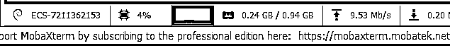

# 总结

祝大家在油管上都能吃到红利。按我这几个月的经验，账号开通普遍在一月左右，也有小部分号养废了，主要是发了好几条视频数据都很平，没有被推，自然就放弃了。整体还是看运气和号的体质，只要账号能开 VIP 且推流权重够大，就可以大胆尝试开播。希望这份教程能帮到想做自动化直播的朋友。