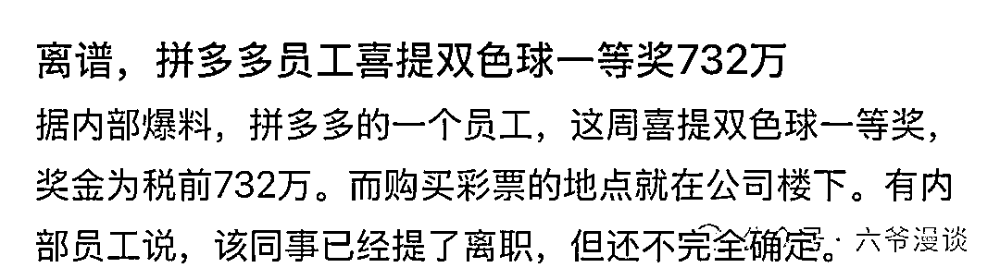
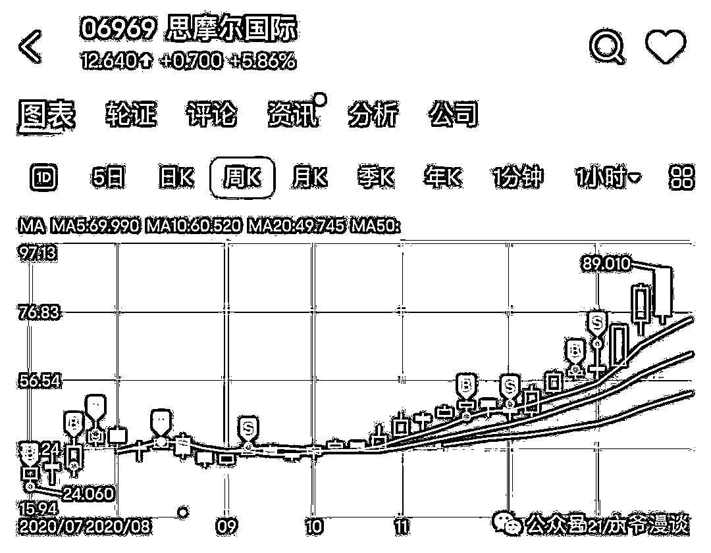
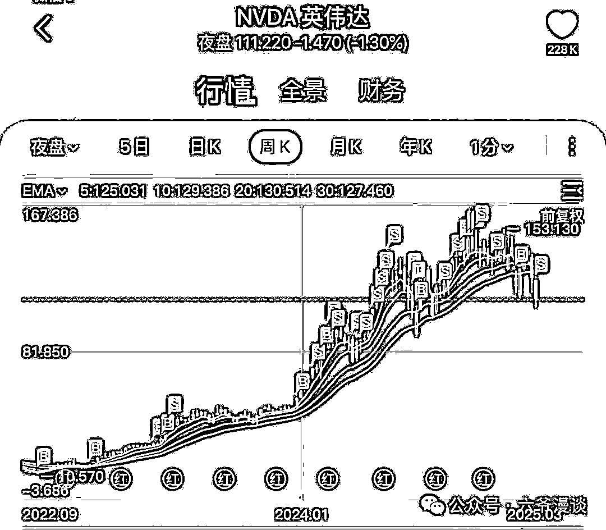

# 赚到千万后，我们应该干些什么？
作者：龙哥

最近身边连续出现两个“天降横财”的故事：一位老同事买彩券中了600万，当场告别工位；另一位老同事发离职信，说自己的账户已经达到八位数。

当这样的消息近在咫尺，很难不让人心里波动。很多人最关心的可能是“如何挣到八位数”，但作为一个有些经历的人，我更愿意聊聊：假如真有了这笔钱，后面应该做什么。

头等大事：先把手里的盈利留住。这些年我见过太多人，账户从几十个W滚到八位数，又从高点坠落，最后清零。靠运气赢下的钱，常常会因实力不足而交回去。所以过了高点就要及时收手，先落袋再说。

第二，稳住心神，别急着做决定。突然拥有一大笔钱，最怕的是飘。不妨把节奏放慢，给自己足够的冷静时间，等冲劲散去后再思考下一步。

第三，是否要辞掉工作？这里建议结合当前职业来定。如果你在大型科技公司拿高薪，其实不用着急离开。让我回到2020年，我会继续留在公司里打拼，同时也不放弃理财。裸辞以后，我很快碰上一轮持续下跌，损失不小，后来市场转好，反而缩手缩脚。说到底，有稳定薪水的人，才有胆子在关键时候下注。外加外界多少会依据职位来判断你的价值，自由职业并没有想象中体面。而且一旦停掉工作，日子容易失去方向和步调；身边的人都忙着，自己待在屋里，时间长了会空虚，甚至郁闷。所以哪怕不再工作，也得给自己支个摊子。像我现在依然写文章，也带一个社群。

第四，该不该购房。看城市。在二三线城市，花三到四百万，城市中心的好房子基本随便挑。一线城市则不太一样，一千万并不宽裕：郊区大户型700多万，市区旧房300多万，城市核心位置的旧房五六百万，品质好一些的次新房普遍在800万以上。如果只花一小块资金，不影响生活质感，那可以入手。年初那会儿我谈过楼市，当时主张再等等；如今反而可以开始留意，因为价格已经到相对低点。可如果购房之后再加上停止工作，剩下的钱太少，那确实没必要。房子带来的财务回报不算好，租金回报率能达到2%已经不错，未来也很难复制过去那种几倍的涨幅。相比之下，租房子反而轻松，光靠利息就能覆盖房租。

第五，之后钱往哪里放。关键在于，这次赚钱的办法能否再次使用。依赖老路容易固步自封，不过在熟悉的行当里反复做，赢面还是会大一些。比如你是靠一只翻十倍的标的赚到钱，那就可以继续寻找下一只翻十倍的标的。

但如果这笔收益来自过高的杠杆，我更建议尽早换成保守玩法。吃惯重口的人，总有一天会肠胃不适。

第六，该不该提高生活开销。适当享受是应该的。以前不敢去的地方、不舍得住的酒店、不舍得买的东西，都值得尝试。不过等体验完，你多半会感叹一句：原来如此。我自己就有这种体会，有人说是滤镜碎了，有人说是祛魅。想让一个东西失去光环，办法就是得到它。

第七，该不该让家人知道。我的态度是千万别。大笔横财容易引来嫉妒，也会把亲友的关系变得复杂。一旦消息走漏，今天这个来借钱，明天那个来借钱；你拒绝，就会背上“忘本”“冷血”的标签。何苦呢？

---

接下来是大家可能更感兴趣的：如何实现财富跃升。以下内容来自我🛰️里数万科技公司朋友的经历，以及个人的观察。这些人本身就是相对优秀的一群，所以可能不适用于所有人，但至少能提供一面镜子。

其一：买彩券。这是概率事件，低到几乎没有样本，更别谈复制。

其二：自己开公司。早年间相对容易，现在门槛高了不少。我自己也翻过车：23年做了一个相亲方向的小应用，没几个月就没了；23年底上线了一个AI方向的网站，虽然抢先入场，最后还是因为各种原因关停。身边成功开公司的人不少，但成功率真的很低。

其三：做内容创作者。这条路相对友好。和我同届（16年毕业），甚至比我晚几届的朋友里，已经出现了不少在短视频平台做到七位数粉丝的人。只要你敢在公开平台开口，能容忍恶评，持续发布内容并不断调整，积累一批观众是可以期待的。

其四：留意在境外上市的中国科技公司。近两年它们坐了一轮剧烈的过山车，很多股票先涨十倍，然后又几乎跌回原点。Bilibili就是一个例子：从十来块涨到150多块，又掉到10块以下。许多人在上涨中亏钱，就是底部时不敢上车，涨高了反而拼命追。

反过来，一些公司业绩改善、重新被资金看好，走出了惊人曲线。Xiaomi在2021年时还有36元，2023年跌到8元，后来一路走高到58.7元，接近7倍涨幅；POP MART翻10倍；Alibaba一个月内涨50%；老铺涨15倍；MAOGEPING涨2倍。我周围不少人吃到肉：星球群一位朋友靠POP MART赚了七位数；另一位靠Xiaomi赚了几百万；群主用MAOGEPING赚了七位数；置业群有位老大在Alibaba上赚了2000万。

其五：在美国市场找机会。这波行情让很多人收益丰厚。NVIDIA的回报超过10倍，Meta接近8倍，Nasdaq整体也有可观涨幅。

其六：加密世界的机会。这里的故事更刺激。听说有Tencent的校招新人靠TRUMP币拿到了2000万。但这样的机会极其罕见。相对容易参与的是比特币：2024年初约3万美元，最高接近11万，现在8万多，依然有超过100%的收益。只是钱不会凭空生出来，它只是从一些人手里换到另一些人手里。加密圈任何一个造富故事的背面，都躺着不少亏损者。

其七：靠员工股权激励翻身。我有一部分朋友，当年加入了PDD、Shopee、NVIDIA这样的公司，去得早，拿到不少股权，伴随公司成长，最后成功变现。在职时间越长，拿到的股权越多。像NVIDIA这种外资企业，新毕业的人一进来就能拿到股票，我认识几个这样的新人，才工作没几年，已经有了几百w身家。但这条路对判断力要求很高，因为绝大多数公司根本没有上市机会，股权迟迟变不了现，最后只能当纸看。

其八：进入大型科技公司上班。这可能是最接地气的路。和我同届的很多人，靠持续努力做到核心骨干、组长甚至总监，年薪已经到了大几百万。所以，去大公司工作，依然是普通人实现阶层跃迁非常有效的方式。

以上就是我的一些个人看法，未必正确，但希望提供参考。最后提醒，写这些不是劝你立刻进场炒股，市场风险很大，每一次出手前都要想清楚。人生不该只盯着赚钱，不论账户里数字多少，生活都能过下去，重要的是选你自己真正想要的生活。

觉得有用就常来逛逛，咱们随时聊天。