# 7天把龙哥的风向标跑通，1000块到手

手绘漫剪这个赛道，最初是上个月底我媳妇刷到后跟我说的，她觉得形式挺有意思，也打算闲暇时试试水。

后来龙哥在赚钱把这个风向标点出来，我就跟着搭了一把手。7天内就把流程跑通，变现破千。接下来把我这几天的实操经过，还有市面上399课里不会讲的细节，都摊开说说。

# 我是怎么试的

一开始我没当回事，由着媳妇自己玩。她发了十几个号，发了十来条，确实小爆了一次，粉丝冲到100，开了创作者分成，但钱少得可怜，一天就几块，还经常因为去重没做好被判非原创，广告也跟着掉。

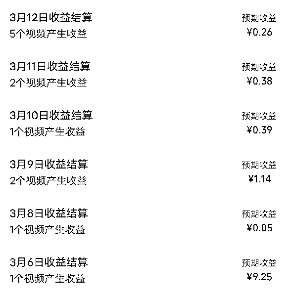

后来赚钱上龙哥把这个方向又推了一次，我跟媳妇开玩笑说，你这眼光跟赚钱老板一模一样。

有了这个背书，我就认真研究起来。发现耗时并不高，一条大概20分钟就能搞定，于是就跟她一起上了。

12号我发的第一条，直接破了百万播放。因为是新号还没开通广告分成，所以没产生收入。

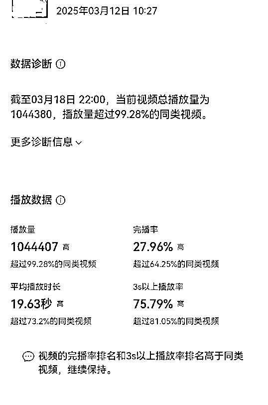

不过号是活了，这一条就涨了1000多粉。为了尽快拿到分成资格，当天我又连发了三四条。

视频号的规则是发满10条才能申请分成，但优质内容涨粉快的话，系统会提前邀请。我就第二天就收到了邀请。

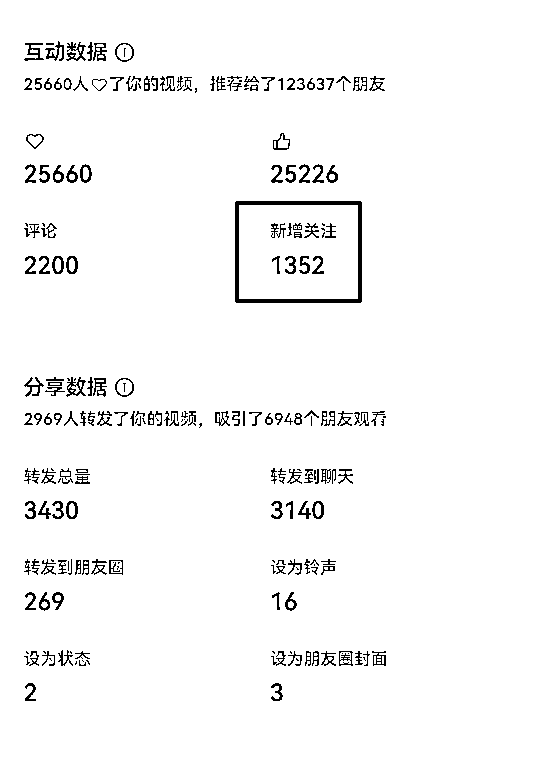

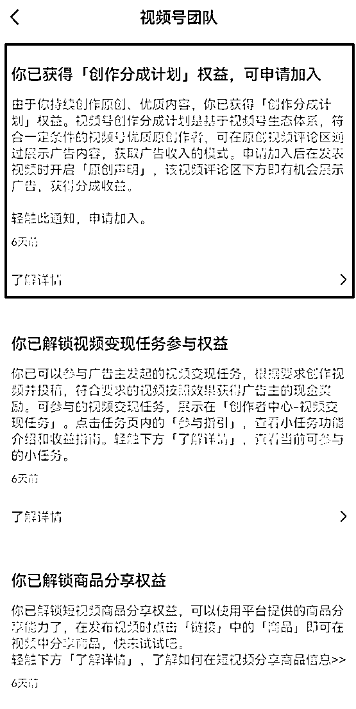

此后每天抽半小时左右做一两条，中间偶尔会碰到原创审核不过、广告被下等问题，边做边优化。

第四天来了个大爆，一天播放破了1000万，点赞10万+，单日涨粉1万。

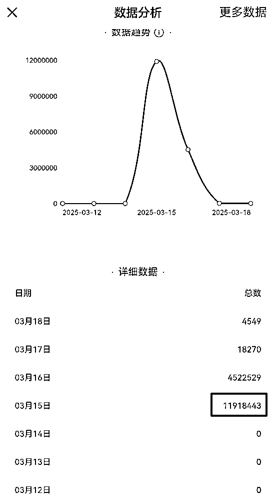

正准备高兴，第一个坑就来了。

晚上看数据暴涨，马上要看到广告收益，结果视频号弹出了出镜人核验提示。

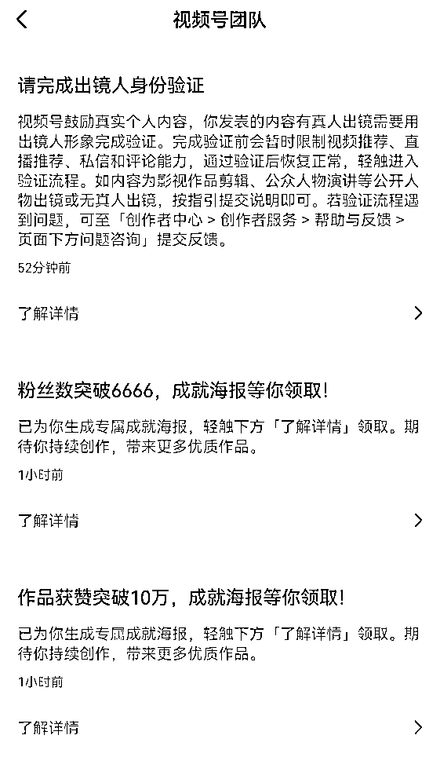

我之前做过视频号带货，身份证已经被占用了，一个证件最多只能实名两个号。这个号当时没实名，开分成就没要求。

但一旦视频里出现了别人的真人画面，爆了之后就很容易触发出镜人身份验证。

我翻遍了赚钱以前的视频号分成手册，把能找到的办法全试了一遍。

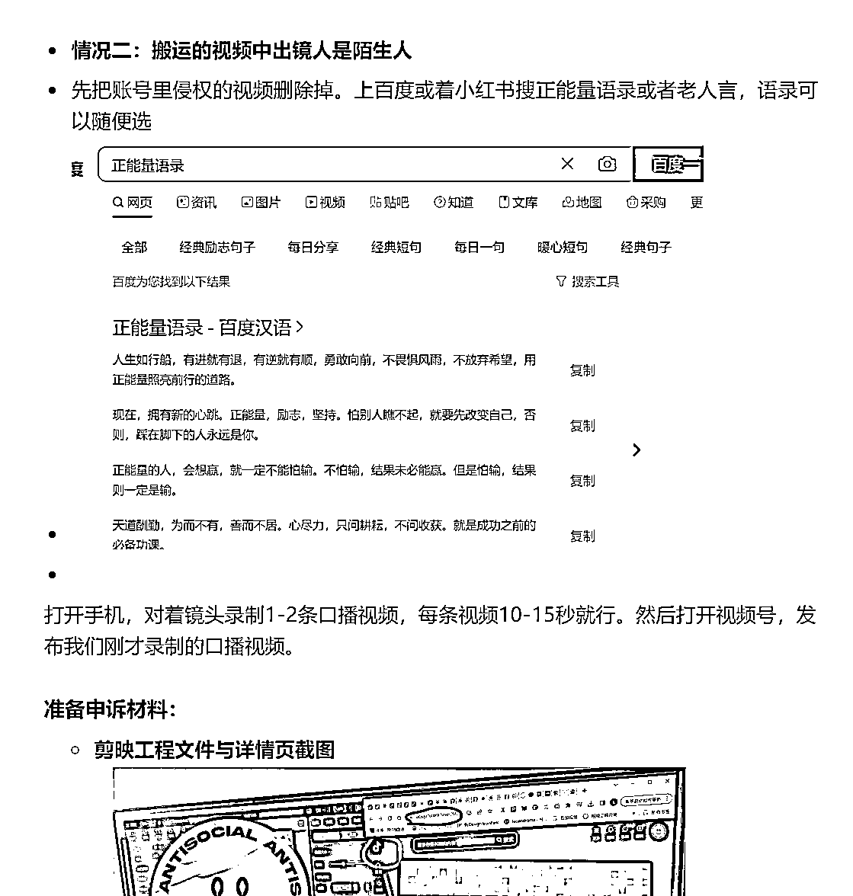

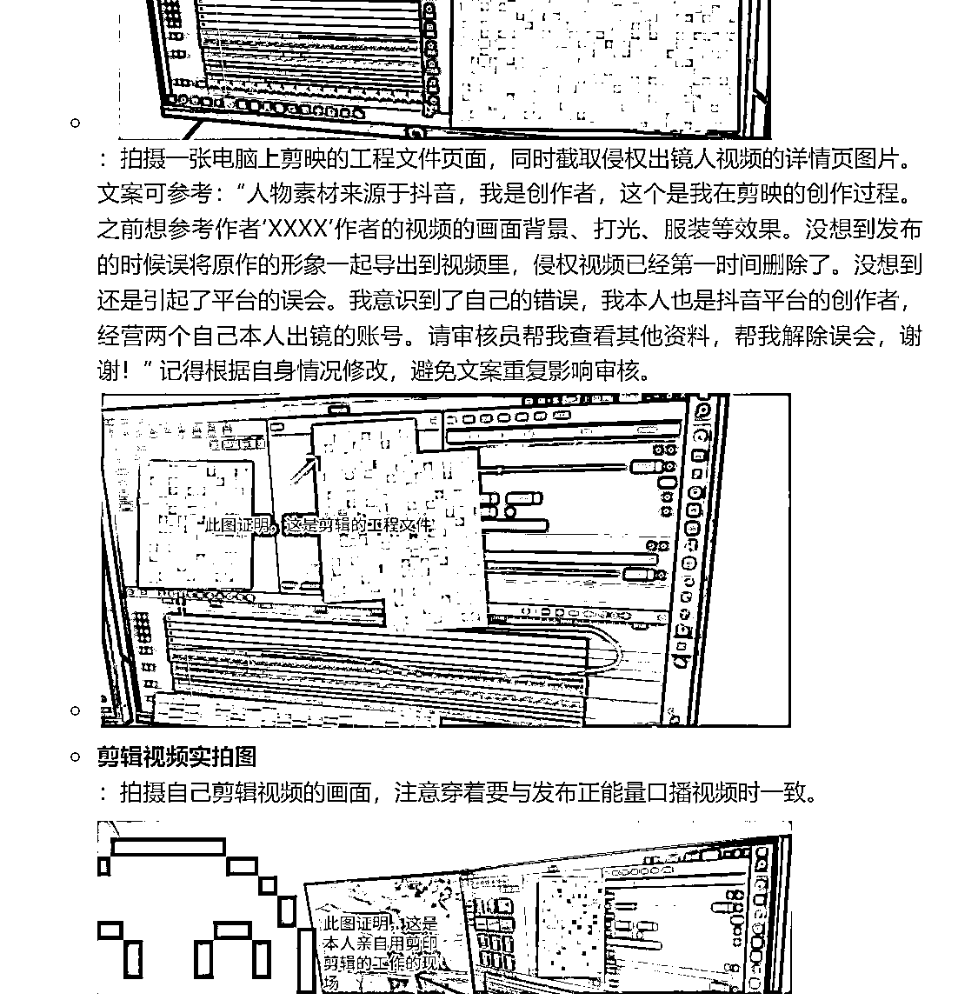

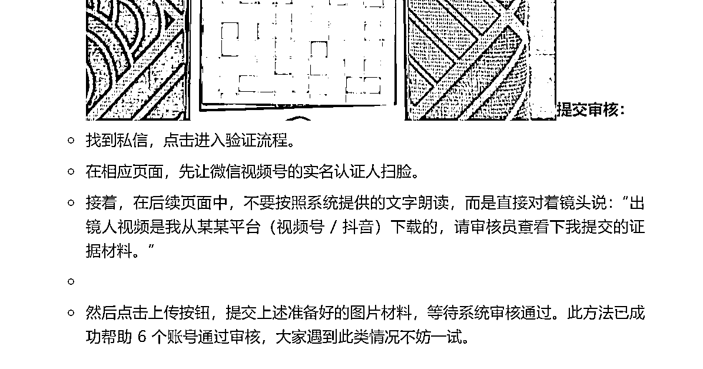

还是没用，方法基本都失效了，提交都被打回。系统已经记录了那条出镜视频，即便把视频删了，验证时仍然要我照着那个出镜画面拍验证。

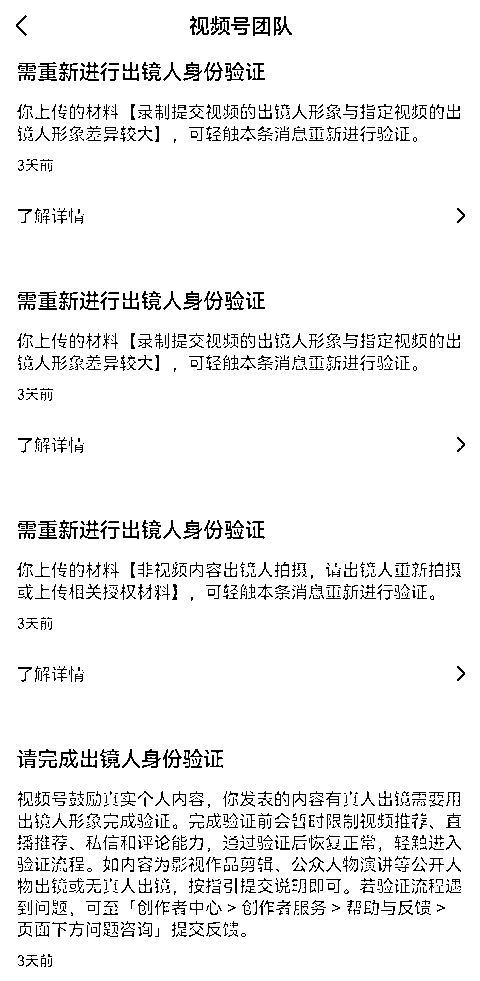

验证不过，账号的全部收益权限都被冻结了，冷藏30天。

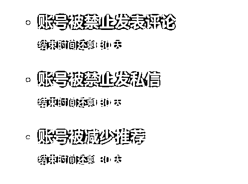

那条爆款的广告不知道什么时候就没了，虽然视频还在持续爆，但没广告等于白玩。最后这条只拿到300多元，按播放量推算，七八百万播放的收益才算到手，至少一半被浪费了。

这段时间我又去问了一个做其他赛道的视频号朋友，他也说没招，非本人出镜触发提示基本就废了。只能等30天解封看能不能恢复，不然只能注销。

第一次大爆之后，我又开了一个新号，发了两条就爆了，很快到100粉。但10条视频的限制还没解开，分成还没法开。

这时候我有点想投机，用老号给小号授权，用非原创快速堆数量。因为我发现很多新号即便不标原创，也有流量扶持，很容易起飞。

于是我拿同一批素材发到两个号上，等小号凑够10条再转原创去开分成，省时间。

如我所料，发了2条原创、3-4条非原创后，号就被邀请开通分成。赶紧找家人身份证实名了。

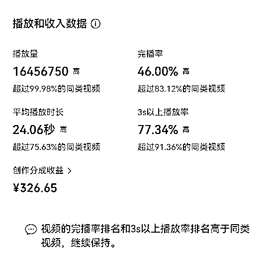

结果第二天，视频号直接识破了。

提示作品原创度不足，暂时关闭创作者分成，需要再发10条原创优质作品才能恢复。

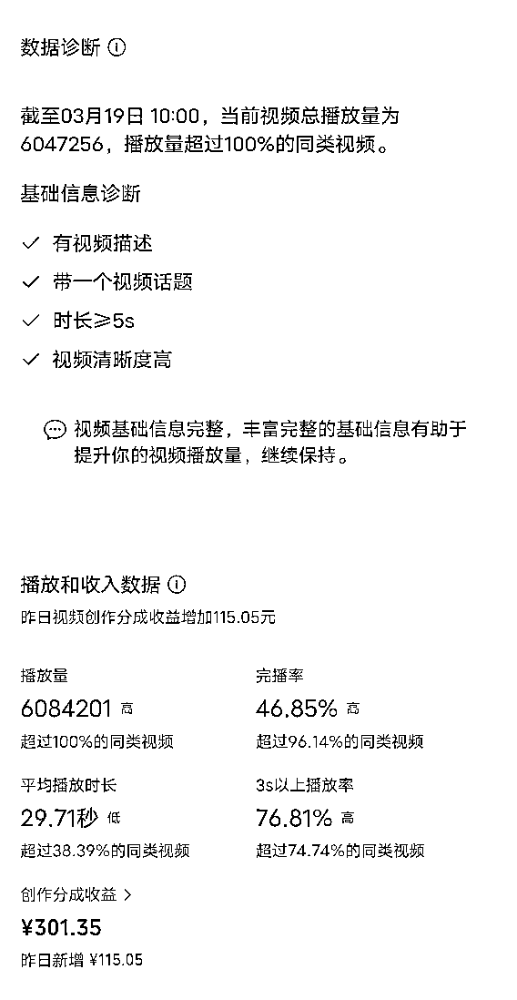

授权也没用，必须单独给这个号做新内容。这是第二个坑，白费了不少时间。

我不死心，继续干。

这次换了我媳妇的账号重新发，又爆了，600万播放，收益终于稳定了。

再用我媳妇的身份证认证了一个老小号，再发，继续爆。

几个号加起来，目前收益大概1000左右。

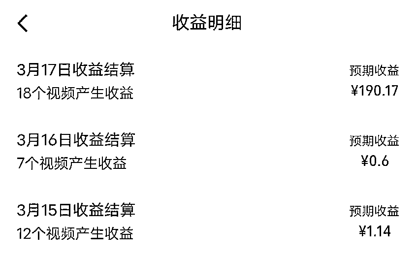

感触很深，一个看起来简单的项目，也要经历这么多波折才能见到钱。

下面按四步把这几天的实战心得梳理一下，也讲讲为什么我这几天的爆款率比较高。这几天基本每天都能出一个爆款，隔一天就有一个万赞大爆。

# 实操核心

## 一、选材

### 1、盯10万赞以上的素材
视频号创作者分成的单价不高，大概一万播放0.5元左右。以前手册说1元，现在明显降了，平均200万播放才100元。

这类视频虽然数据好，但要冲收益就得找大爆款，10万赞起步才有意义。

找素材时尽量挑评论多的爆款，因为广告在评论区，互动越多收益越好。

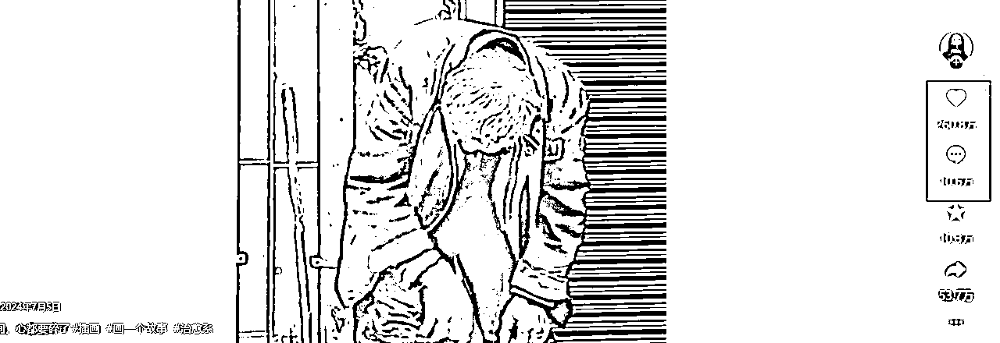

### 2、跨平台找切口
视频号上10万赞约等于1000万播放，大家基本都刷过了，直接搬运很难再爆。

所以要去找视频号还没火，但抖音、📕已经火的素材。

我基本在📕和抖音上扫，看到后去视频号搜同行有没有做过。

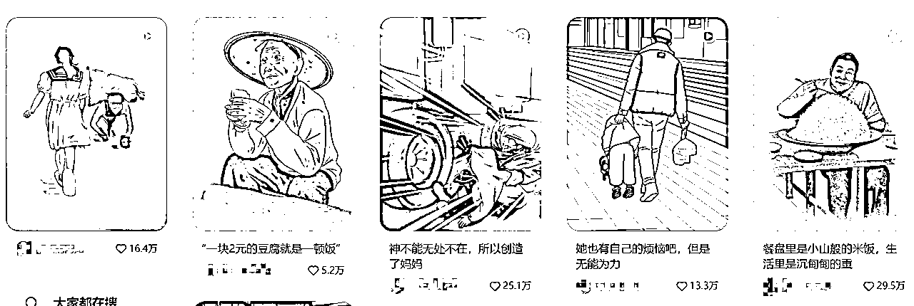

有同行已经大爆就不做了，没做过就做。有小爆的也看看画风和剪辑，觉得自己能做得更好就上。

思路就是，别跟视频号同行卷，先他们一步做得更好。

### 3、跨赛道借势
这个项目的底层是借势二创，把已经验证过的爆款用手绘漫画重新包装。

爆款之所以爆，是因为符合人性，换个形式再讲一遍依然容易爆。

所以不要局限在同赛道，可以跨赛道拿素材。

比如情感混剪、故事混剪、娱乐混剪的大爆款，拿来加手绘漫画再剪一遍就行。

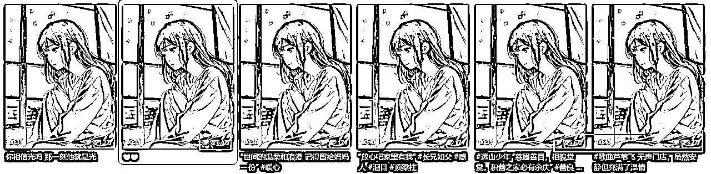

跟上面逻辑一样，别盯同行，盯新的爆款源头。

## 二、做手绘漫画

### 1、工具
不用即梦、可灵那些要积分会员的，直接用豆包就行，免费无限制。

### 2、万能提示词思路
豆包能解析图片。你喜欢什么插画风格，就把图丢进去问它用什么提示词能复刻手绘漫画风格。

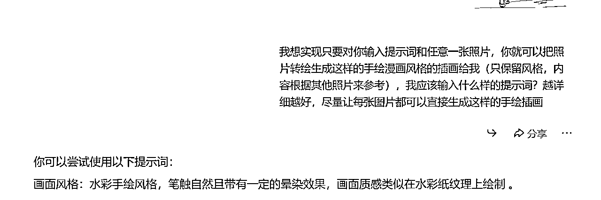

学会这个，基本所有风格都能套。

实在画不好的，再去即梦生成一下，回豆包用同样风格渲染。

比如我常用的提示词是：

请将这张照片转绘成具备下列特点的插画

画面风格：水彩手绘风格，笔触自然且带有一定的晕染效果，画面质感类似在水彩纸纹理上绘制 。

人物：以简洁、圆润的线条勾勒人物轮廓，保留人物主要特征，面部表情简单但生动 ，比如用简单的圆形、弧线表示眼睛、嘴巴等。

色彩：整体色调柔和温暖，饱和度适中，颜色过渡自然，类似浅米色背景搭配低饱和度的人物服装颜色。

构图：保持画面简洁，突出主体人物，人物动作自然，如有背景，背景元素简单不复杂。

### 3、绘制流程
拿到提示词后，用豆包的图像生成，以原视频截图当参考图，选好比例就出图。

第一次不准就详细描述画面内容，图片不清就加文字描述。不满意就再抽几次，对局部不满意点“局部重绘”微调即可。

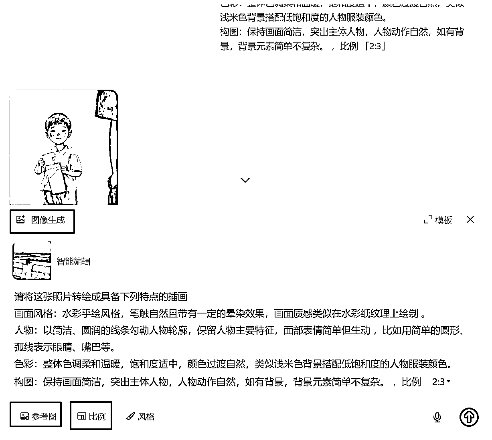

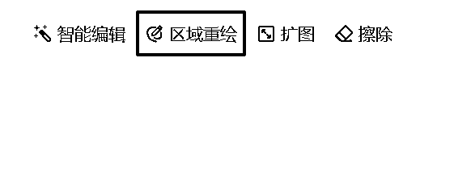

出来的漫画效果是这样的。

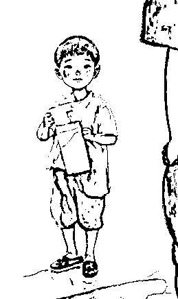

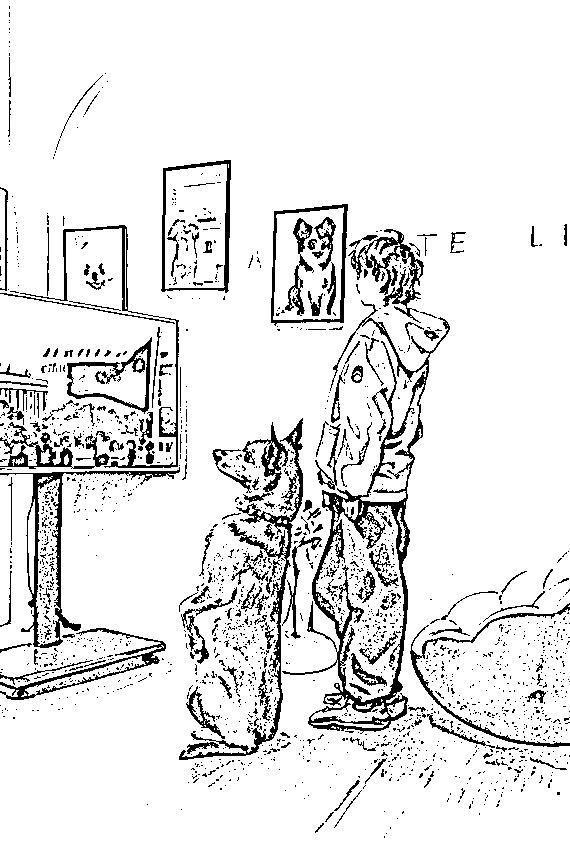

只要有参考图，就能快速形成自己的专属风格和提示词库。

## 三、剪辑

最开始我们也用市场上流行的去重手法，还是会时不时被判非原创，甚至有收益后被下广告。

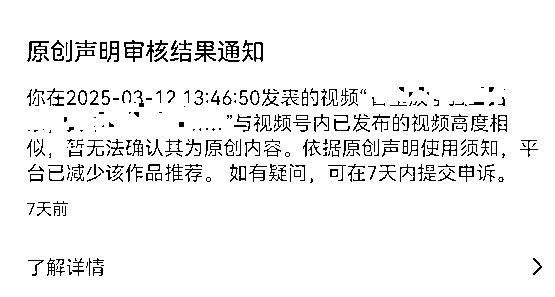

后来我换了个思路，效果最好的是不去重。

找到爆款素材后，去抖音搜到该素材的原视频。找不到原视频就找一版最干净的，别带字幕、别加特效，越干净越好。

用去水印工具下载，导入剪映后，对照参考的爆款混剪视频重新剪一遍。

爆款用哪段画面就用哪段，配什么音乐就用什么，字幕和转场都照抄。

细节如果自己剪得更好可以微调，剪得不好的话就完全模仿。

最后末尾加上手绘漫画，用关键帧做点动态，配上背景音就完事。

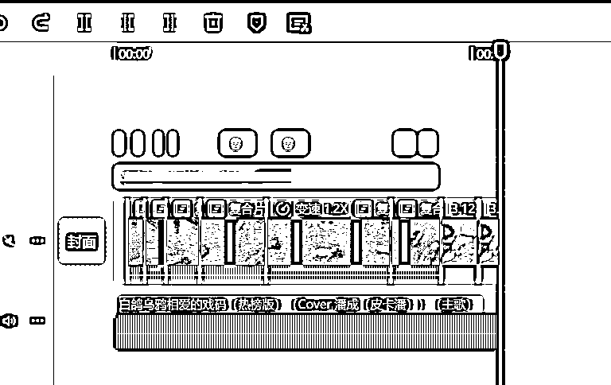

这样做的视频内核是你自己对原视频的二创，只是参考了爆款的叙事逻辑，再叠加了漫画。原创度绝对没问题，不用担心去重，也不影响观看体验。

我之前也试过直接跨赛道搬运加漫画去重，还是偶尔会被判。以上这套就没出过问题。

## 四、评论区运营

发出去后自己先评一条，找爆款视频下边争议大、点赞高的评论复制过来。用小号顶一下，热议区堆起来，完播和打开评论区的概率都会提升。

而广告就在评论区，评论越热，收益越高。

# 其他注意点

### 1、实名、原创、侵删与健康提示
号起来后赶紧实名。目前实测，千粉后也可能二次要求扫脸认证，扫一下就行，不影响流量。没实名的号一旦爆了，很可能随时触发审核。

创作者分成要的是原创，原创度不够广告会被关。也不需要买粉刷量，按流程走，10条以内基本能涨到100粉。

为长久运营，很多创作者都会加上侵删声明，对争议内容加一句 “素材来源于网络，非不良引导，勿过度解析” 之类的提示，更稳。

### 2、赛道变种
这个项目的本质是借爆款的势，二创。爆款每天都在产生，形式可以一直换。

手绘漫画火一阵后可以换别的包装。

比如正能量混剪、西格玛男人燃剪

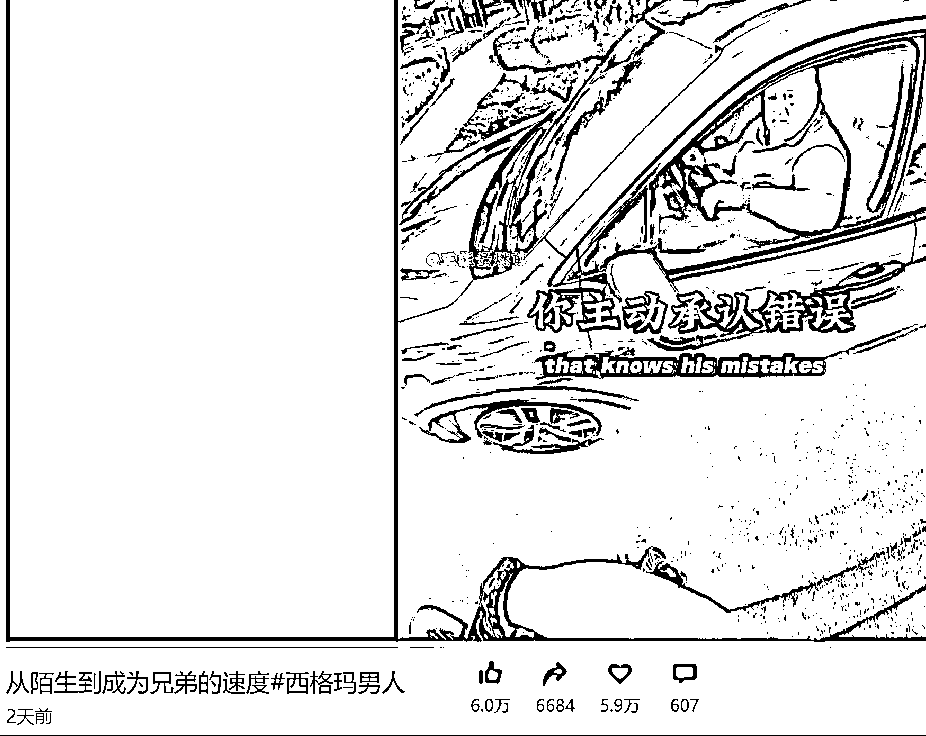

儿时回忆混剪：

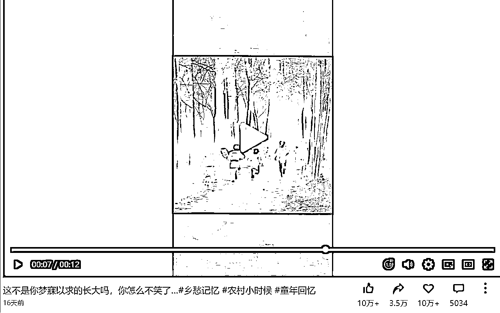

吃瓜混剪：

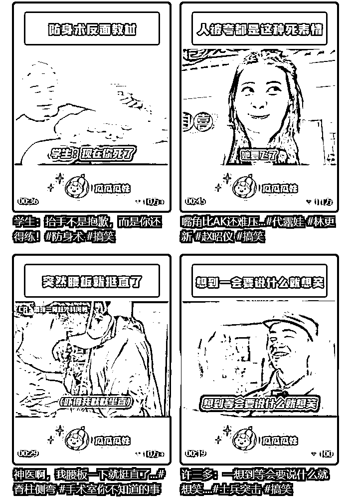

娱乐搞笑解说：

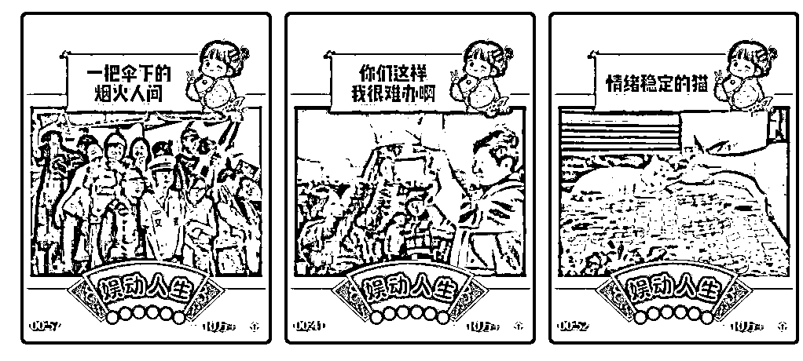

真人出镜爆款视频解说：

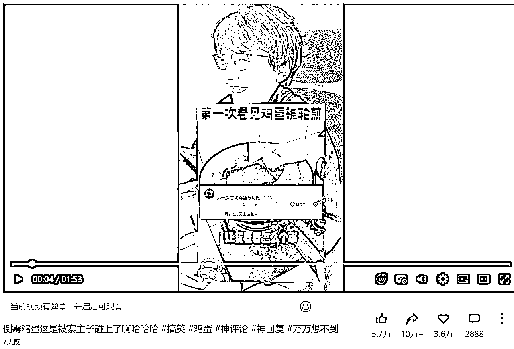

借热点的势做二创，单号有做大的可能，矩阵做也能放大收益。把坑踩少一点，赚钱有道。