在江湖数据推出的江湖工具箱中，XHS提取软件是一款主打小红书数据分析的工具。它和市面上那些专门扒别人内容的“搬运软件”完全是两码事——这款软件的核心是帮创作者研究竞品数据，看看别人的作品为什么曝光高、哪些地方值得借鉴，进而做出更有质量的原创内容。数据来源全部基于XHS网页端的公开信息，很多创作者用下来都觉得顺手，而且开发方承诺会持续迭代更新，让数据分析更省心。

下面，我就把这个软件的常用玩法从头到尾捋一遍，纯干货，建议收藏。

## 一、主页提取：从找链接到开抓

### 1. 先搞定作者主页地址

**电脑端操作：**
先打开XHS官网，有两种路径能摸到作者主页。一是在发现页的信息流里，鼠标左键点作品的封面或作者名，就能进入个人主页；二是在某篇作品的详情页，点击作者头像或昵称跳进主页。无论哪种方式，进入后直接复制浏览器地址栏里的整串网址，那就是主页地址。

要把手机上的链接同步到电脑？很简单：电脑先登录微信，手机把链接发到“文件传输助手”，电脑端微信里同步一下就能拿到。

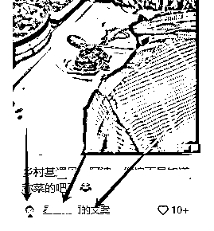

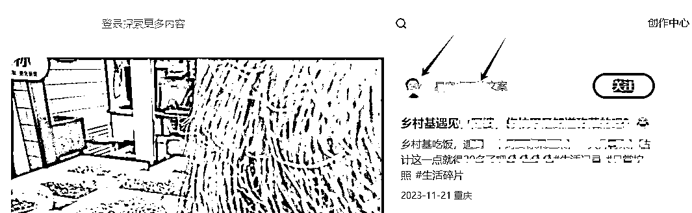

**手机端操作：**
打开小红书APP，找到你想采集的作品，点击作者头像进入对方主页；接着点主页右上角的“三个点”按钮，会弹出一个下拉菜单，选择“复制链接”，主页地址就到手了。想发到电脑端，同样用微信文件传输助手中转即可。

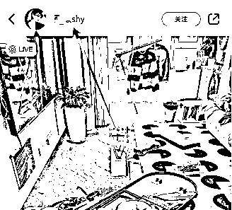
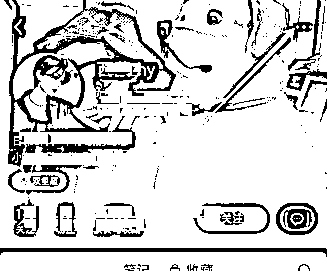
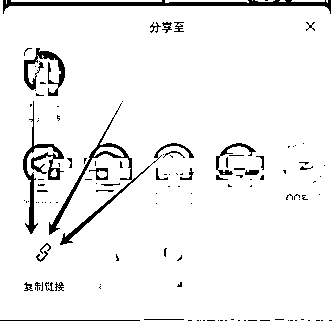

### 2. 添加主页到软件

拿到地址后，粘贴进软件添加即可。添加成功后的列表里，每一列都很有讲究：

- **选择框**：用来勾选作者，配合提取、删除、修改等操作；顶部的选择框可以一键全选或取消全选。
- **序号**：按你添加的先后顺序自动生成。
- **作者信息**：来自网页公开数据，这里不多解释。
- **本地视频作品数量 / 本地图文作品数量**：统计的是本地已下载的作品。软件会按你设定的保存目录识别，只要中途不换目录、不删作品文件，每次打开都会自动统计；如果删了其中一个，下次检测到标题不存在，数字就会自动减1。
- **备注**：添加后有个默认值，你可以右键单改，也能批量修改。
- **添加时间**：记录的是加主页那一刻的本地电脑时间，和网络时间无关。

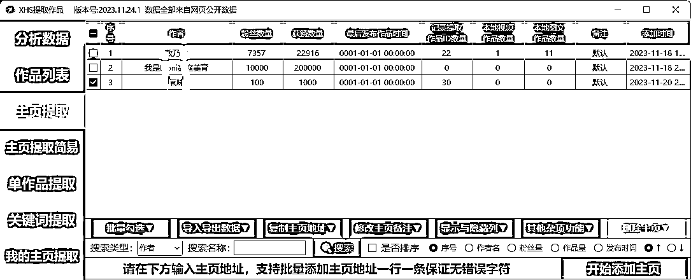

### 3. 列表右键的实用操作

在任意一行主页记录上点右键，会弹出一系列菜单：

- **向上移动 / 向下移动**：调整该作者在列表里的位置。
- **清零记录提取作品数量**：把已经记录的作品ID清空，数量归零，方便重新抓取。
- **复制全部记录作品ID**：复制当前作者已经抓到的所有作品ID；如果刚才清零了，就复制不到。
- **打开本地数据目录**：打开作者信息记录文件，如果没改过下载设置，作品保存目录也在这里。
- **复制主页地址**：一键复制该作者的XHS主页链接，粘贴到浏览器就能访问。
- **复制作者昵称**：复制名字用。
- **删除当前作者主页**：从列表移除该作者，本地作者信息也会一并删除，但已下载的作品文件不会动。
- **修改主页备注信息**：推荐按领域分类，比如“动漫”“小说”“沙雕动画”，备注好之后，抓作品时还能按备注目录保存，自动归类。

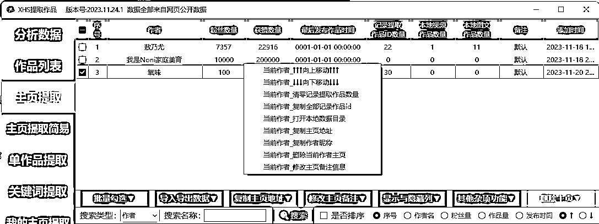

### 4. 批量勾选▼

批量勾选按钮会弹出一个菜单，目前只有一个“备注”分类选项，也就是前面说的按分类圈选。举个例子：你有一千个主页，分别标记了动漫、小说、沙雕动画三类，想处理某一类，直接点对应备注，就能把这一类的全部主页勾上。注意：这个操作不会自动取消之前的勾选，所以勾选前最好先用顶部的全选/取消框清空一次。

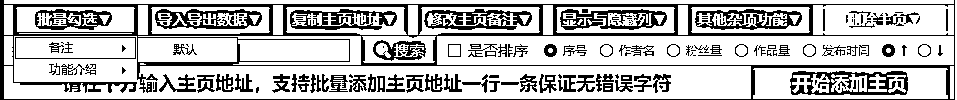

### 5. 导入导出数据▼

- **导入/导出的作品数据TXT**：TXT格式支持重新导入，Excel表格不支持导入。
- **导出作品列表全部数据TXT**：把列表里所有主页数据导出为TXT，格式是JSON，适合做大数据分析。
- **导出作品列表勾选数据TXT**：只导出勾选的主页数据，同样是JSON格式。
- **导出列表全部数据Excel表格**：把全部主页数据生成Excel，方便表格查看。
- **导出列表勾选数据Excel表格**：把勾选的主页数据生成Excel。

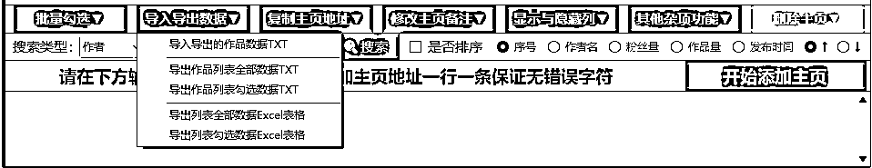

### 6. 复制主页地址▼

可以一键复制全部主页的网址，也可以只复制勾选的主页网址，看你的需求。

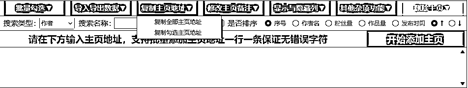

### 7. 修改主页备注▼

支持“修改全部主页备注”和“修改勾选主页备注”，点击后会弹出输入框，填好新备注，确定即可统一更新。想单改的话，右键列表里的作者更快捷。

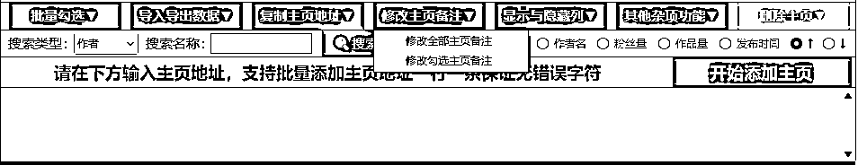
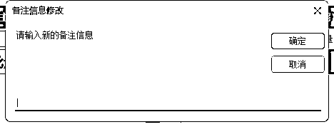

### 8. 显示与隐藏列▼

点开后能看到主页列表对应的每一列，通过勾选或取消勾选来决定是否显示，不想看的数据列直接隐藏，界面更清爽。

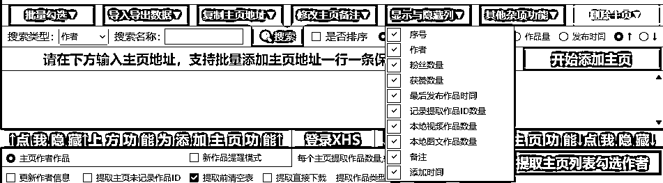

### 9. 其他杂项功能▼

- **重新加载本地文档、作者信息与作品数量**：比如你手动删了某个作品，列表没刷新，点一下就能重新加载。
- **网络更新列表信息对比报告**：只更新作者信息，不去抓作品，更新后会给出新旧数据对比报告。
- **打开作者对比报告**：如果有新旧报告，可以打开查看参考。
- **清零全部记录提取作品ID数量**：清空列表全部作者的记录ID。
- **清零勾选记录提取作品ID数量**：只清空勾选作者的记录ID。

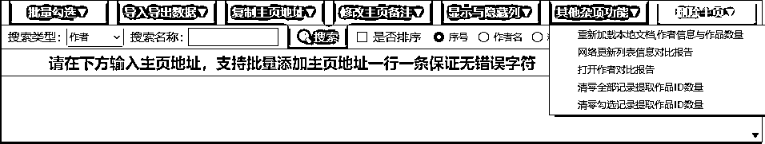

### 10. 删除主页▼

“删除全部主页”会移除列表里所有作者及本地保存的作者信息，“删除勾选主页”则只移除选中的作者，但两种情况都不会删除已下载的作品数据。

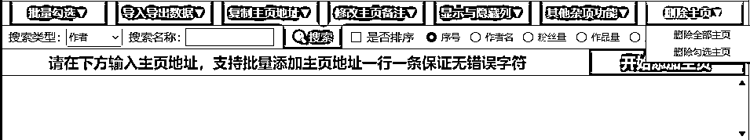

### 11. 搜索与排序

在搜索框输入关键词，切换“搜索作者”或“搜索备注”，点击搜索后软件会模糊匹配，找到的结果会自动勾选。比如列表里有“江湖数据工具箱”的作者或备注，输入“江湖”两个字就能搜出来。

排序功能：勾选“是否排序”后，按你选择的字段自动排列。左右箭头表示方向：↑升序，↓降序。

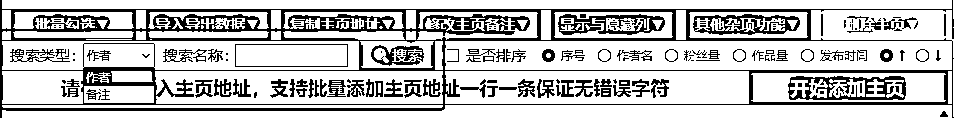
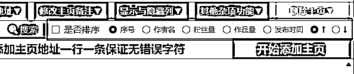

### 12. 隐藏/显示添加主页、登录XHS、隐藏/显示提取主页

界面上有三个红色框按钮。最左边是“隐藏添加主页”，不用的时候可以收起来，让列表多看几行；中间是“登录XHS”，点击会弹出软件内置浏览器并自动打开XHS官网，扫码登录后稍等几秒就提示成功；最右边是“隐藏提取主页”，同样用于折叠界面。

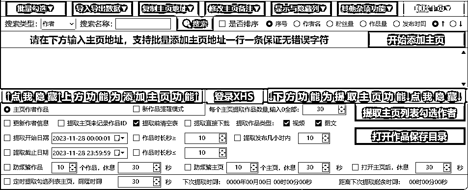

### 13. 开始提取主页作品数据

下面进入重头戏——提取作品。先看一段教程视频，秒懂。

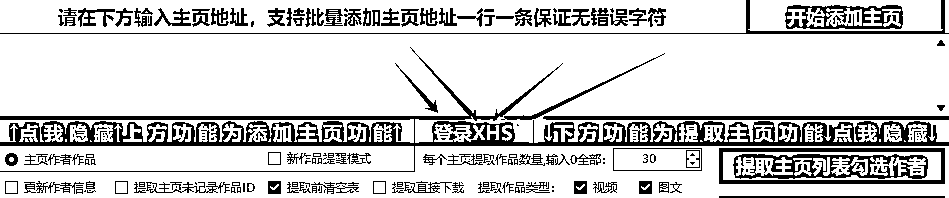

特别提醒：如果不登录XHS，很可能抓不全作品。登录必须用软件内置的浏览器扫码，外部浏览器是不算的。

**新作品提醒模式**
勾选“新作品提醒模式”后，软件会自动把“主页作者作品”和“提取主页未记录作品ID”一起勾上，还可以配合“提取直接下载”“提取作品类型”等条件，再设置“定时间隔时间”（比如10个主页循环完休息多少秒），最后勾选“定时提取勾选列表主页”，就能实现全自动盯新作品。前提是软件得一直开着。

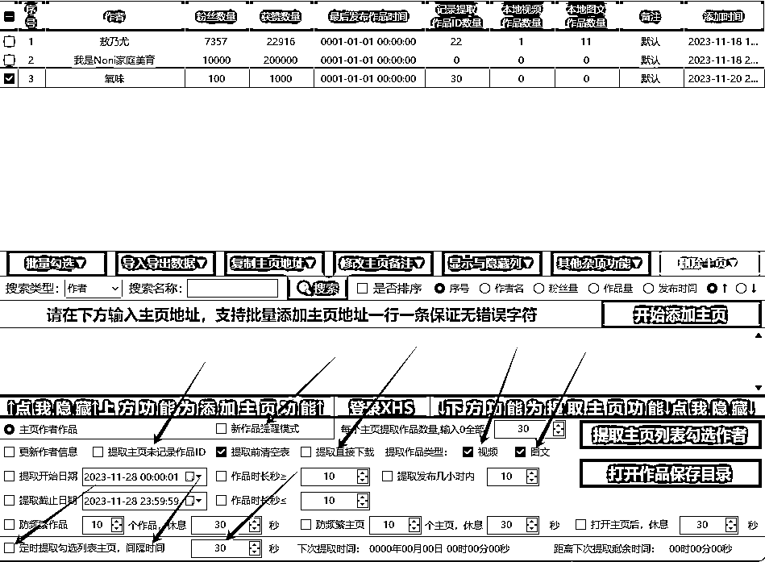

**微信推送**
想第一时间收到新作品通知？在软件设置的“新作品消息推送微信设置”最下方有教程，按教程配置好微信Webhook地址，设置完务必点“发送测试消息”验证，能收到推送就说明没问题。

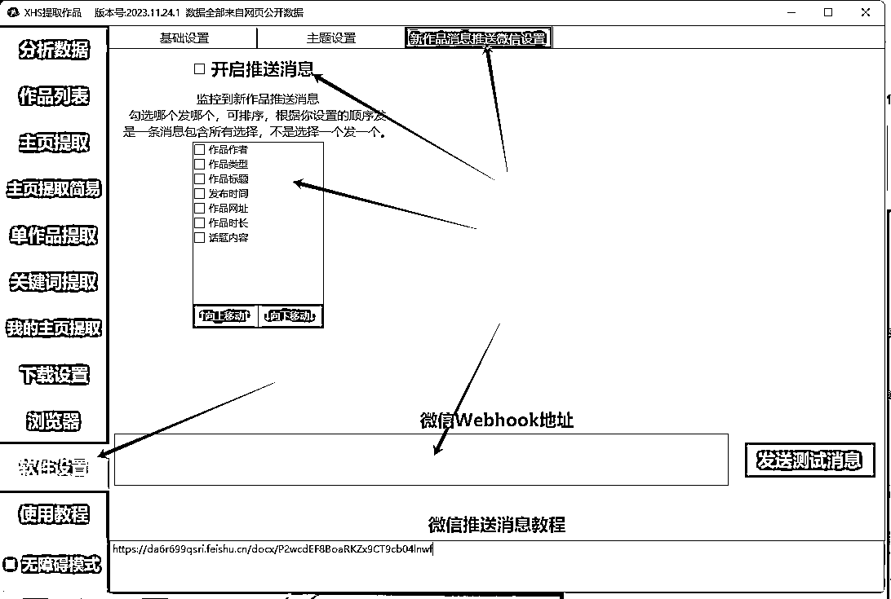

**筛选条件详解**
其余筛选条件都在这里了。

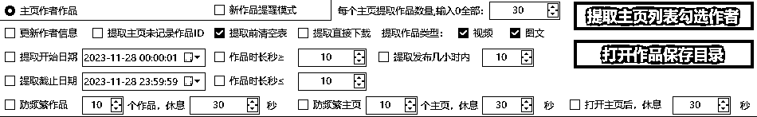

**提取作品数据数量**
每个主页要提取多少个作品？填0代表全部；如果填10，就只抓每个主页最新的10个（含置顶）。比如列表里有10个主页全部勾选，数量设为10，那总共会提取10×10=100个作品。

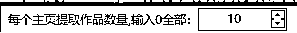

**更新作者信息**
勾选后，每次提取主页数据时，主页列表的信息也会同步刷新。

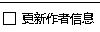

**提取主页未记录作品ID**
这个功能适合增量抓取。第一次提取时，软件已经把所有作品ID记录下来了；第二次再提取，已经记录过的ID不会被重复抓取，只提取新出现的作品ID。这样可以高效记录每次更新，避免重复劳动。

**提取前清空表**
勾选后，点击“开始提取”时，软件会先把作品列表里旧数据全部清空，只保留本次提取出来的结果。

**提取直接下载**
勾选后，提取的同时自动下载作品；不勾就只提取数据不下载。

**提取作品类型**
视频和图文可以二选一或全选。比如只勾图文，只抓图文笔记；只勾视频，就只抓视频。软件会自动保留互补项——如果你把视频取消，又把图文也取消，它会自动帮你勾上视频，防止一个条件都不满足。

**提取开始日期 / 提取截止日期**
开始日期表示作品发布最早时间，截止日期表示最晚时间，两个可以同时勾选，也可以单独勾选。设置后精确到秒。

举例：同时勾选开始日期为2023年8月8日08:08:08，截止日期为2023年9月9日09:09:09。那么，作品必须同时满足“在该开始时间之后发布”和“在该截止时间之前发布”才算达标。比如8月8日08:08:07发布的不达标，08:08:09发布的达标；9月9日09:09:08发布的达标，09:09:10发布的不达标。

只勾选开始日期时，只要晚于设定时间就算达标；只勾选截止日期时，只要早于设定时间就算达标。

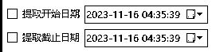

**作品时长秒≥≤**
这里用来筛选视频时长。大于等于某秒、小于等于某秒，只对视频有效；图文作品不参与时长判断，直接视作达标。

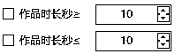

**提取发布几小时内**
按当前提取时间倒推N小时，只抓这个时间点之后发布的作品。例如现在上午11点，若按图上的配置，则只提取凌晨1点之后发布的内容。

**防频繁作品N个作品，休息N秒**
勾选后，每抓满N个作品就自动休息N秒，再继续下一轮，减少因请求太频繁被限制的可能，尤其是定时提取场景下很实用。

**防频繁主页N个主页，休息N秒**
同理，每访问N个主页就停N秒，避免触发平台风控。

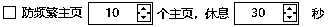

**打开主页后，休息N秒**
勾选后，软件每次打开浏览器访问完一个主页，会停N秒再执行下一步。

**定时提取勾选列表主页**
开启后，软件会按设定好的间隔时间自动点击“开始提取”，方便持续掌握最新作品。界面上还会显示下次提取时间和剩余时间。注意：列表里必须至少勾选一个主页，定时才有效。

## 二、主页简易提取【新手推荐】

不想搞那些复杂筛选？那就用简易模式。不需要添加主页，直接把主页地址一行一条粘贴到文本框里，点“开始提取主页作品”就行。全程没有任何条件设置，适合刚上手的新朋友。提取完的作品数据会自动进入作品列表，去那边查看即可。

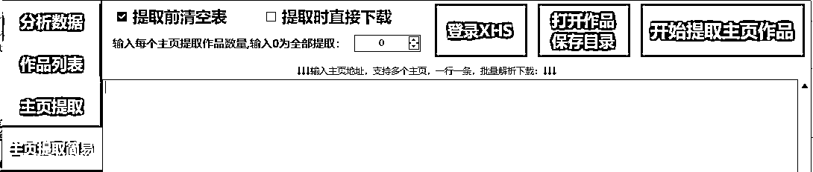

## 三、单作品提取

想单独采集某几篇作品？把作品地址一行一条输入文本框，点击“开始提取作品”，提取结果同样会自动进入作品列表。单作品提取也有一些功能设置，比如“提取前清空表”等，按需勾选即可。

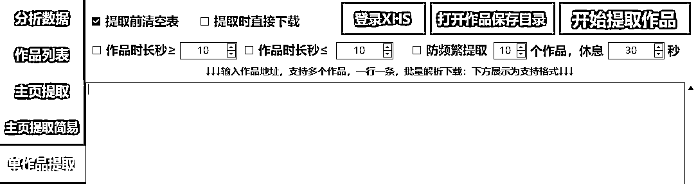

以上就是XHS提取软件的完整使用指南，希望对你有帮助。如果还有不清楚的，多试几次就熟了。

关于清空列表的说明
是指你按下开始提取的瞬间，工具会先把作品列表里原有的所有记录全部清空，只保留本次抓取到的新数据。

### 提取时直接下载
这个选项打勾后，抓取过程会同步触发下载；不打勾则只抓取数据不下载。

### 作品时长秒 ≥ / ≤
作品时长秒 ≥ 的完整含义是作品时长秒大于等于【？】秒
作品时长秒 ≤ 的完整含义是作品时长秒小于等于【？】秒
该条件只对视频生效，图片类作品默认全部通过。

### 防频繁 访问 间隔
启用后会按你设定的节奏自动休眠。
举例说明：每抓取10条作品，程序自动暂停30秒后再继续，如此循环。
作用是降低高频访问风险，定时任务时尤其有用。

* * *

# 关键词抓取数据操作指南

## 关键词抓取数据操作指南
在左侧输入框填入要检索的关键词，一行填一个。设置好筛选规则后直接点开始提取关键词即可运行。若不做筛选也可以直接运行。

特别提醒：XHS官网需要登录后才能看到较全的作品，请先点击登录XHS完成扫码登录。

## 关键词抓取筛选规则详解

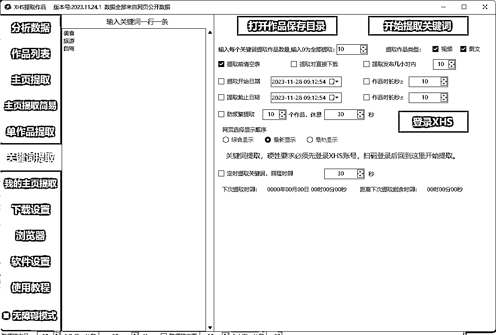

#### 每个关键词抓取数量

设置每个关键词要抓取多少条作品，填0表示不限额，按官网返回多少抓多少。若填10，则每个关键词只取前10条。这10条不一定是最新，按网页的排序方式决定。
例如输入10个关键词并设为10，则10个关键词各取10条，共100条。

#### 抓取作品类型

勾选视频和图文后，同时抓取两种类型。
只勾选图文则仅抓图文，去掉视频勾选则只剩图文。
只勾选视频则仅抓视频，去掉图文勾选则只剩视频。
系统会自动兜底，不会出现两种都未选的空状态。若你把两种都取消，程序会自动补选视频，确保有可执行的抓取条件。

#### 提取前清空表

点击开始提取时，工具会自动清空作品列表的全部历史数据，仅保留本次提取结果。

#### 提取直接下载
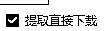

勾选后开始提取会即刻跟随下载，未勾选则不下载。

#### 提取发布几小时内

例如当前为上午11点开始提取，若启用该条件，则只有凌晨1点之后发布的作品才会被视为符合。也就是只保留在设定时间窗口内的新发布内容。

#### 提取开始日期 与 提取截止日期

提取开始日期 = 作品发布日期的下限
提取截止日期 = 作品发布日期的上限
两者可单独用也可一起用。

同时使用举例：
开始日期设为2023年8月8日08:08:08
截止日期设为2023年9月9日09:09:09
只有发布在2023年8月8日08:08:08之后且在2023年9月9日09:09:09之前的作品才算达标，精确到秒。
2023年8月8日08:08:07 不达标
2023年8月8日08:08:09 达标
2023年9月9日09:09:08 达标
2023年9月9日09:09:10 不达标

仅用开始日期举例：
开始日期：2023年8月8日08:08:08
发布在该时间点之后即达标，之前的不达标。

仅用截止日期举例：
截止日期：2023年9月9日09:09:09
发布在该时间点之前即达标，之后的不达标。

#### 作品时长秒 ≥ ≤

作品时长秒 ≥ 全称：作品时长秒大于等于【？】秒
作品时长秒 ≤ 全称：作品时长秒小于等于【？】秒
该筛选只作用于视频，图片作品不受此限制直接通过。

#### 防频繁抓取

启用后抓取过程中会按设定的间隔自动休息。
例如每抓10条休30秒再继续。
主要用于避免频繁访问，定时抓取时建议开启。

#### 网页展示排序选择

这里选择的是网页端的展示排序，程序运行时会按此排序去取。具体顺序可到关键词页面自行查看。

#### 定时抓取关键词
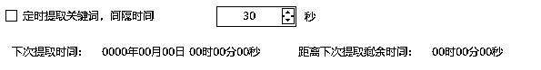

勾选后系统会按间隔自动触发开始提取，方便持续获取最新作品。
间隔时间会在界面显示下次执行时间和倒计时。注意没有输入关键词时定时抓取无效。

* * *

# 我自己的主页数据抓取教程

## 我的笔记抓取

### 步骤1
先点登录XHS，未登录无法获取主页信息。

### 步骤2
点开始提取我的作品，等待数秒后，作品将被加入作品列表。

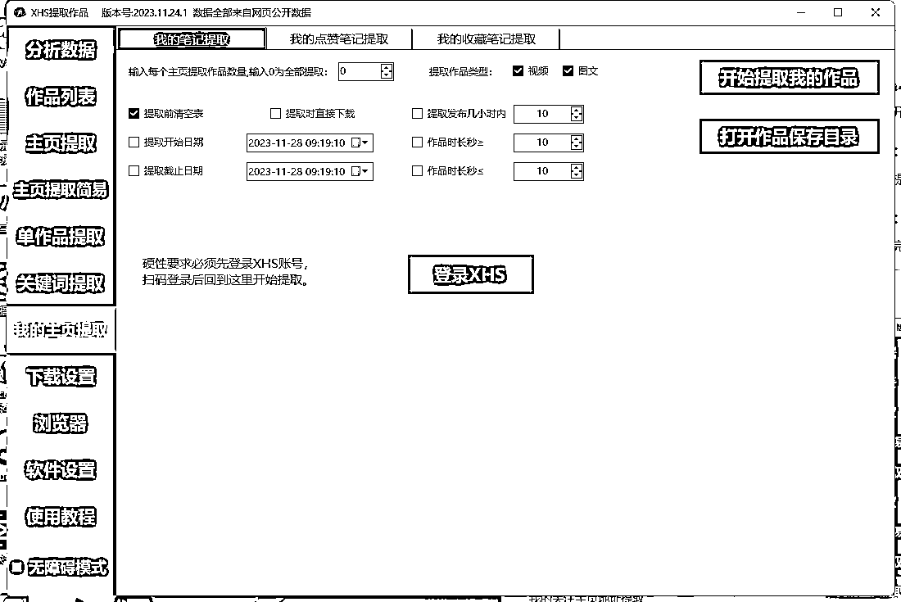

## 我的点赞笔记抓取

### 步骤1
先点登录XHS，未登录无法获取主页信息。

### 步骤2
点开始提取我的点赞，完成后喜欢的作品会进入作品列表。

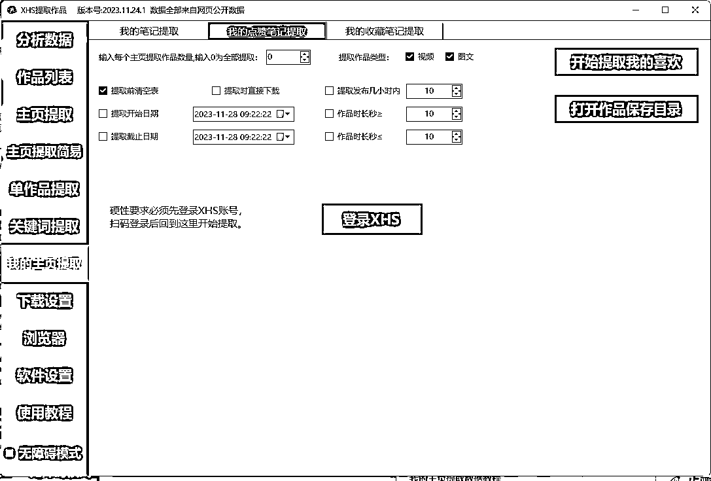

## 我的收藏笔记抓取

### 步骤1
先点登录XHS，未登录无法获取主页信息。

### 步骤2
点开始提取我的收藏，完成后收藏的作品会进入作品列表。

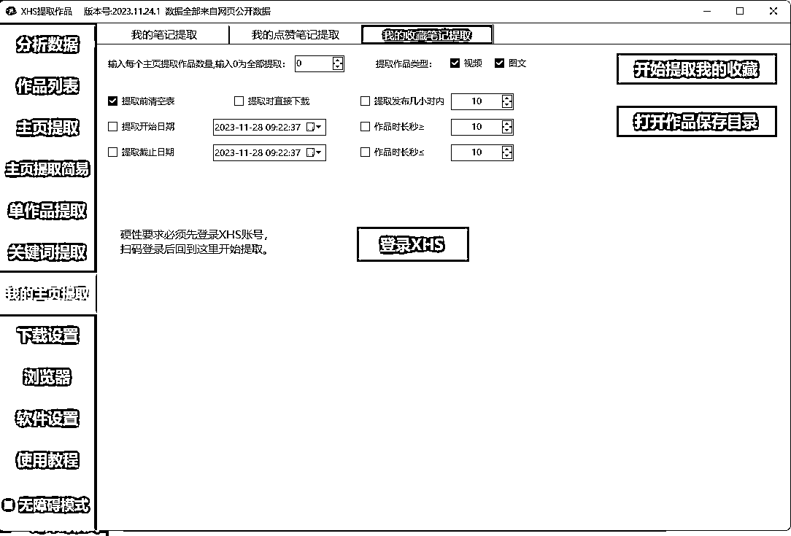

* * *

# 作品列表使用说明

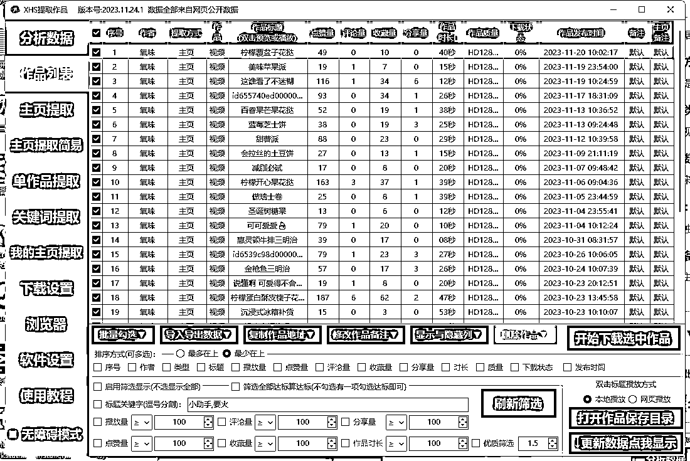

## 列表内字段

#### 选择框
用于批量提取、删除、修改等操作。最顶部的选择框可进行全选。

#### 序号
按添加顺序自动生成。

#### 抓取方式
记录该条数据是通过哪种方式进入列表的。

#### 作品类型
仅视频或图文，标识当前条目的类型。

#### 作品数据
来源于网页公开信息。

#### 备注
为单条记录单独添加的备注，也可批量备注。

#### 主页备注
抓取自主页时若给主页设置了备注，该备注会随作品一起带入列表。

## 批量勾选▼
点击后弹出多种勾选方式：注意勾选不会清空已有的勾选状态。

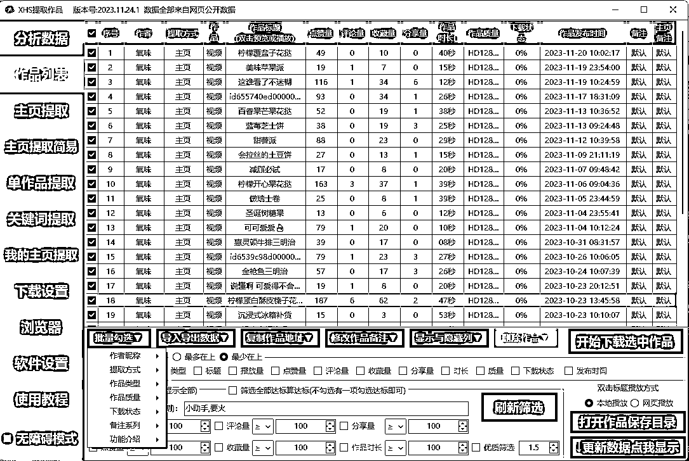

#### 按作者昵称勾选
按提取结果中的作者昵称分类勾选。选择全部作者昵称则该作者下的所有作品都会被勾选。

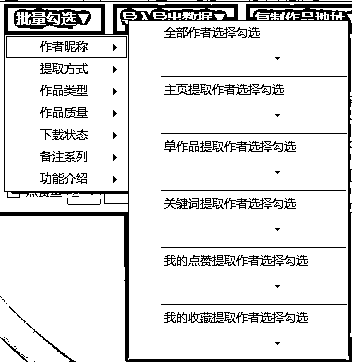

#### 按抓取方式勾选
按所选的抓取方式全体勾选。若使用关键词抓取，下拉框会列出使用的关键词，选择后会勾选所有该关键词抓取的作品。

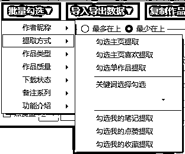

#### 按作品类型勾选
只有视频作品和图文作品两种，点击即可勾选该类型全部。

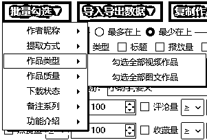

#### 按作品质量勾选
按列表中已有的质量标签显示，点击某个质量会勾选全部同质量作品。

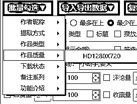

#### 按下载状态勾选
显示列表全部的下载状态，点击可勾选所需状态。

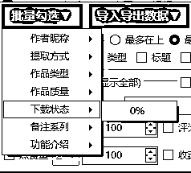

#### 按备注系列勾选
下拉选择指定备注，点击即可勾选对应备注的作品。

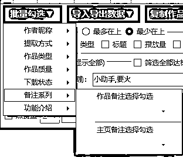

## 导入导出数据▼

#### 导入导出作品TXT
导出的TXT可导入，Excel暂不支持导入。

#### 导出列表全部数据TXT
导出全部作品，JSON格式，便于大数据分析。

#### 导出列表勾选数据TXT
导出已勾选作品，JSON格式。

#### 导出列表全部数据Excel
导出全部作品，Excel表格格式。

#### 导出列表勾选数据Excel
导出已勾选作品，Excel表格格式。

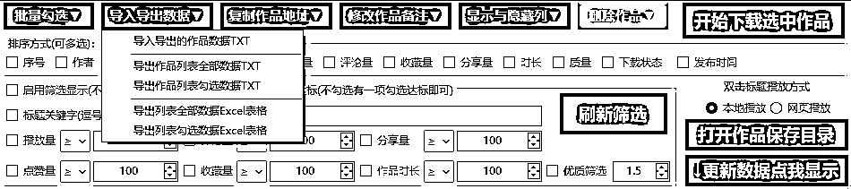

## 复制作品地址▼

#### 复制全部作品地址
复制列表中所有作品链接。

#### 复制勾选作品地址
复制已勾选作品链接。

#### 复制全部作品主页
复制全部作品的主页链接，自动去重。

#### 复制勾选作品主页
复制已勾选作品的主页链接，自动去重。

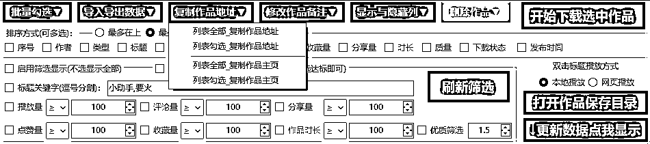

## 修改主页备注▼

#### 全部修改作品备注
弹窗输入新备注后，全部作品备注将被替换。

#### 勾选修改作品备注
弹窗输入新备注后，仅勾选作品备注被替换。
小贴士：单条备注可在列表右键修改。主页备注和合集备注不在此修改，跟随抓取时设定。

图1：
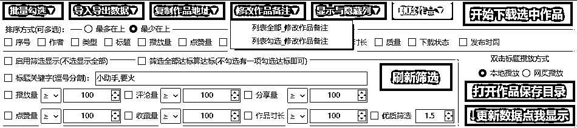
图2：

## 显示与隐藏列▼

#### 显示与隐藏列
点击后弹出列表各列，去掉勾选则隐藏，勾选则显示。用于只展示所需信息。

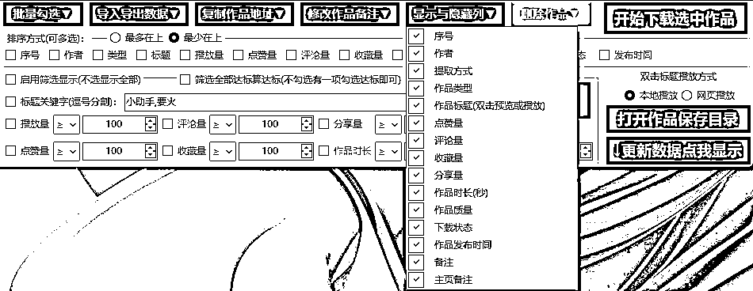

## 删除作品▼

#### 删除列表全部作品
清空作品列表全部数据及本地保存信息，不删除本地文件。

#### 删除列表勾选作品
删除已勾选作品的数据及本地保存信息，不删除本地文件。

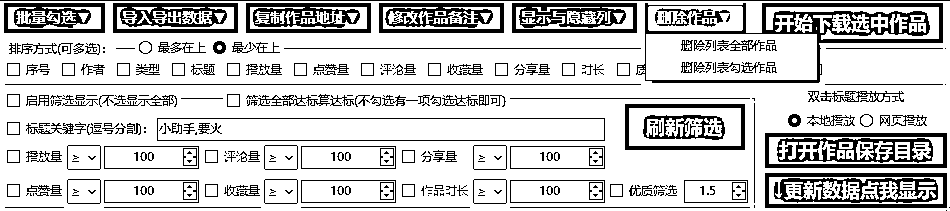

## 排序列表

勾选任意排序项后列表会按该维度排序。

#### 最多在上
降序排列

#### 最少在上
升序排列

排序是实时的，增删数据会自动重排。

## 筛选显示

#### 图1
必须勾选后筛选条件才生效，对作品进行达标与否的筛选。

#### 图2
未勾选时满足任一条件即显示；勾选时必须同时满足所有条件才显示。

图3
筛选为实时生效，增删会自动刷新。若修改条件未生效请点刷新筛选按钮。

图1：

图2：

图3：
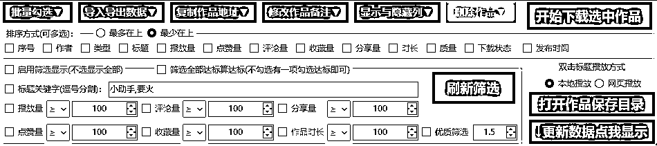

## 双击标题播放方式

#### 勾选本地播放
双击标题列，若本地有文件则本地播放，否则打开网页播放。图文作品直接网页播放。

#### 勾选网页播放
双击标题直接用浏览器打开网页播放。

小提示：无默认浏览器或被杀毒软件拦截时双击可能无反应。

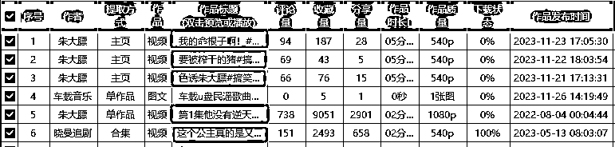

## 作品数据更新

#### 请看图1
点击后弹出图2控件，用于定期刷新作品数据以便分析。

#### 开始更新数据
设置条件后点列表勾选更新数据即可自动更新，完成后提示更新条数。

图1：

图2：

图3：

### 作品更新→防频繁

启用后更新时会按设置间隔休眠，例如每更新10条休30秒，以降低频繁访问风险。

### 作品更新→更新作品类型

勾选视频与图文则同时更新两者。只保留图文或只保留视频同抓取逻辑，系统会自动兜底防止两种都未选。

### 作品更新→更新直接下载

勾选后更新时会同步下载，未勾选则仅更新数据。

### 作品更新→定时更新作品数据

勾选后系统会按间隔自动触发更新，并显示下次更新时间和剩余时间。列表无勾选作品时定时更新无效。

* * *

# 下载设置说明

## 替换作品标题内容

勾选后保存作品时标题会按规则替换。

举例：
原标题：江湖工具箱是分析作品数据的软件
想把“是分析作品”替换为“是最好的一款分析作品”
文本框输入：是分析作品*是最好的一款分析作品
保存后标题变为：江湖工具箱是最好的一款分析作品数据的软件
注意分隔符必须用 *。

## 作品增加标题

设置保存时的标题规则，至少勾选一项，否则默认用作品ID。
标题编码：勾选后会在所选标题项后追加编码，通常为汉字拼音首字母，可自行测试。

## 下载封面图片

勾选后若作品有封面则一并下载。

## 下载图文时下载背景音乐

图文作品若包含背景音乐，勾选后会一并下载。

## 下载视频后修改MD5值

在操作开始前，有个开关是用来触发 MD5 变更的。MD5 的概念如果还不熟悉，建议先自行搜索了解下。

## 选择下载类型

有用户问：提取环节已经把视频和图文筛选过了，为什么下载环节还要再做一次选择，这会不会多此一举？

官方的解释是：不少用户在提取时习惯同时勾选两类素材，而下载类型的选择是整个流程的最后一次过滤。

- 视频与图文同时开启：下载队列会完整保留所有符合条件的素材，因为队列里本就只有这两类。
- 仅开启视频下载，未开启图文下载：队列中只会执行视频类素材的写入，图文类会被跳过。
- 仅开启图文下载，未开启视频下载：队列中只会执行图文类素材的写入，视频类会被跳过。

## 检测储存硬盘低于？MB停止下载

该开关出厂时是默认启用的。当根目录所在的磁盘剩余容量跌破你设定的阈值，程序会自动中断写入，以避免磁盘被写满。

## 选择下载插件：【推荐极速下载器】

目前可用的插件有三款，重点推荐极速下载器。该插件为第三方付费方案，费用较低且兼顾多线程加速，月费 9.68 元。内置下载器与 aria2c 下载器均为免费方案，传输效率相对较低且不支持多线程并发。

## 极速下载器设置【用户必看】

首先点开红色按钮查阅对接说明，说明里最关键的要求是第一步先安装江小二工具箱。

完成购买后回到主界面，填写江小二工具箱的账号与密码，点击验证。只有在授权截止日晚于当前日期时，极速下载功能才可启用。

随后在软件内先勾选极速下载器，如图1。

再对下载线程数进行配置，经验值建议填 5，如图2。这样即可获得较快写入体验。

图1：

我这边演示的系统时间是2023年11月28日06:13:31，你观看的时间若已超过，请以你自己的验证结果为准。

图2：

## 下载线程数量【用户必看】

内置下载器和 aria2c 下载器都不支持并发，线程数请固定为1。若选用极速下载器，则可将数值调到1以上，开启多线程后传输效率会明显提升。

## 经典模式目录层

该模式仅为旧版用户保留，新接入的用户请直接采用自定义独立模式目录层。

## 自定义独立模式目录层【用户必看】

自定义独立模式目录层的含义是，你可以自行决定文件夹的层级深度，勾选对应的项就会在路径中增加一层。

以关键词目录层为例做说明。假设根目录为 D:\保存作品\，关键词为美食，创作者为老江湖牛逼，素材类型为视频，文件名是测试标题.mp4。

在一种勾选组合下，路径会变成：
D:\保存作品\关键词作品\美食\视频作品\测试标题.mp4

如果换成图1的勾选组合，根目录、关键词、创作者、类型、文件名保持不变，仅顺序调整，路径变为：
D:\保存作品\关键词作品\美食\老江湖牛逼\视频作品\测试标题.mp4

若采用图2的勾选组合，路径再次变化为：
D:\保存作品\关键词作品\老江湖牛逼\视频作品\美食\测试标题.mp4

重点观察图1与图2，层级的排列顺序发生了改变，保存时的文件夹结构也会随之重新生成。这里仅以关键词演示，其他维度可类推。

图1：

图2：

## 选择使用目录层模式

新手用户建议直接启用自定义独立模式目录层，经典模式目录层继续服务于老用户。

## 图文独立目录层

未开启图文独立目录时，所有图文素材的图片、音频、封面都会堆放在同一个文件夹，不会单独建子目录。

开启图文独立目录后，每个图文作品的图片、音频、封面会依据作品标题单独建一个文件夹存放。

图1展示的是生成的文件夹，图2展示的是内部内容。

图1：

图2：

## 全部保存根路径【用户必看】

该路径为所有下载素材的顶层存放位置。

- 修改保存作品路径：可自由更改到任意目标位置。
- 初始化路径：点击后恢复为软件自带的默认位置。
- 打开保存路径：直接调出当前使用的存放目录。

* * *

# 浏览器教程

浏览器会在提取数据或使用内置浏览功能时自动弹出显示。当你在提取首页或单条作品时，浏览器会跟随页面联动。若希望以最大化窗口在软件内部呈现，进入本页面后浏览器也会同步切换。

小提示：拖拽浏览器边缘即可移动窗口，边缘出现的小圆点可用于缩放窗口大小。

* * *

# 软件设置教程

#### 基本设置：

#### 最小化隐藏任务栏：

勾选后，窗口最小化时不在任务栏显示，而是退到右下角。

#### 删除浏览器本地缓存文件：

清空全部本地缓存，网页异常或卡顿可尝试使用。

#### 删除浏览器所有 Cookie 登录信息：

仅清除登录态，不影响缓存数据。

#### 主题设置：

软件自带默认主题，也可切换暗夜主题或自行调色。每个色块左侧都有说明，对应界面位置与文字颜色。

# 无障碍模式教程

勾选无障碍模式后，所有筛选条件将被忽略，提取到的全部素材会直接进入列表。

