# 不懂代码也能做网站：从创建项目到上线，手把手带你走一遍

DeepSeek R1 在推理和代码生成方面表现出色，许多人已经用它写程序、做小工具。不过，写出代码只是起点。要让网站真正运行起来，还要处理部署环境、服务器和域名等问题，对没有技术背景的人来说并不轻松。

好消息是，现在可以借助云平台和 AI 编程工具，把这些复杂环节大幅简化。下面就以腾讯云 EdgeOne Pages、GitHub 和 Trae 为例，带大家从创建网站到预览发布，走完一遍完整流程。

## 一、先把网站运行环境准备好

### 1. 登录腾讯云

打开腾讯云官网：https://cloud.tencent.com/  
已有账号直接登录，没有的话先注册。

### 2. 找到 EdgeOne Pages

登录后，在搜索框输入“EdgeOne Pages”，进入对应服务页面。

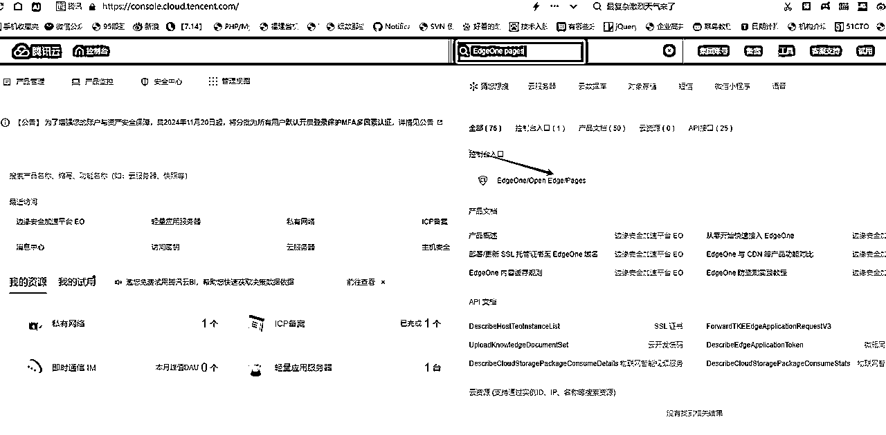

第一次使用时，点击页面里的“立即开通”。

### 3. 授权连接 GitHub

网站代码需要放在 Git 仓库中，因此先把 EdgeOne Pages 和 GitHub 关联起来。

在控制台点击“绑定 GitHub”，随后按照页面提示跳转到 GitHub 授权。若还没有 GitHub 账号，需要先注册一个。国内访问 GitHub 有时会比较慢或不稳定，可以稍后重试；具备稳定网络条件时，操作会更顺畅。

授权时可以选择指定仓库，也可以开放对全部仓库的访问权限。

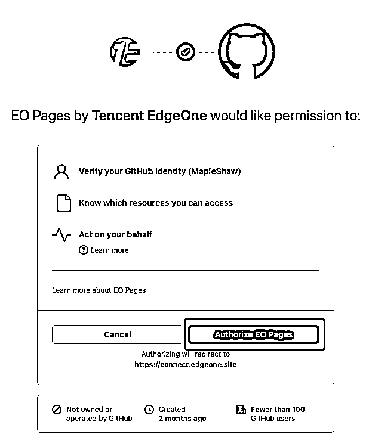

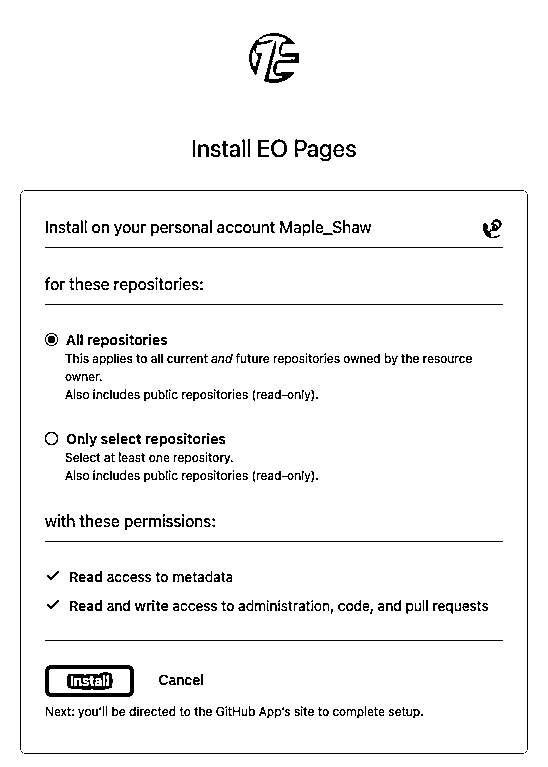

### 4. 用模板创建一个项目

绑定完成后，点击创建项目。

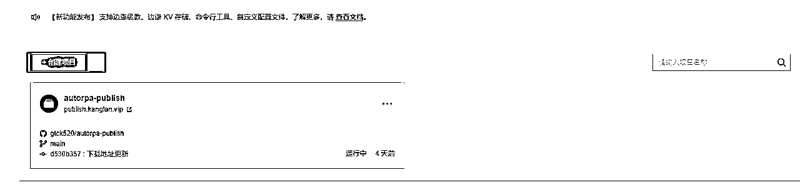

如果手头已经有网站代码，可以直接选择对应仓库部署。初学者通常还没有现成代码，可以从模板入手。这里选择 Vue 模板即可，不需要先弄懂 Vue 是什么。

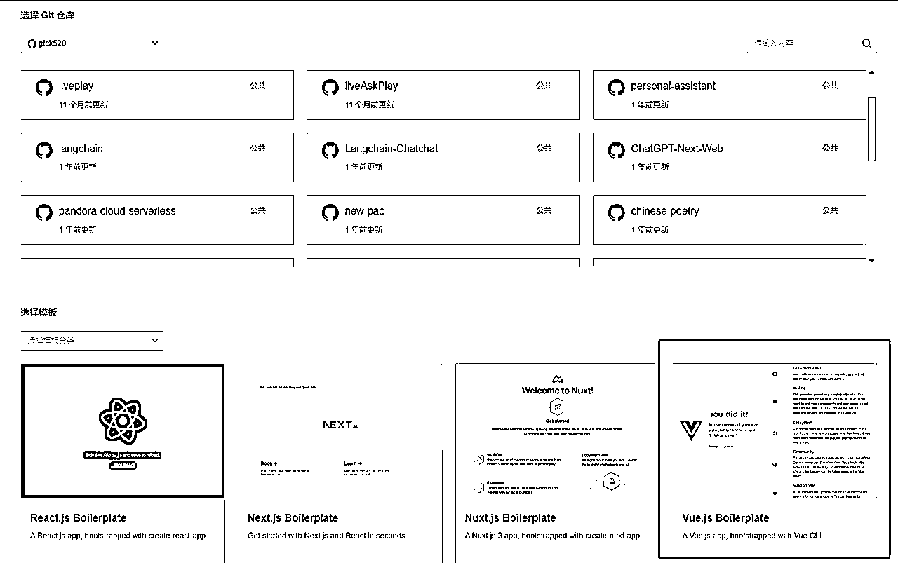

给项目起一个名称，例如 `vue-mywebsite`，然后点击立即创建。EdgeOne 会基于 Vue 模板生成项目，并自动创建相应的 GitHub 仓库。

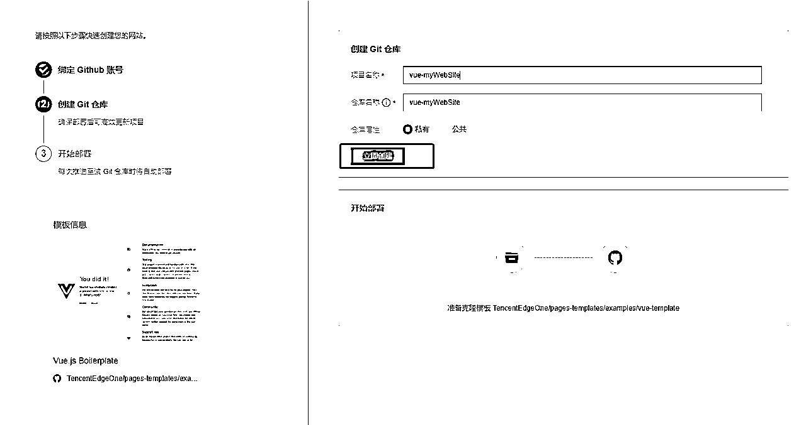

稍等片刻，平台会自动构建并部署。页面显示部署完成后，点击预览，再打开其中的链接，就能看到网站了。

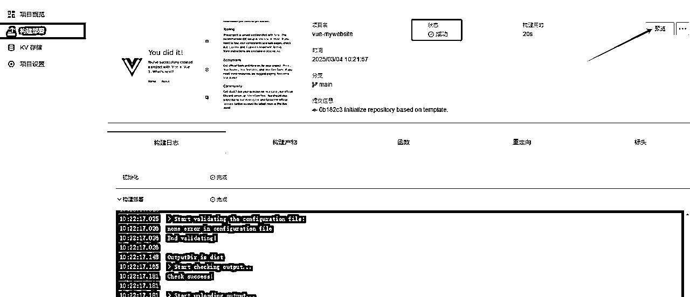

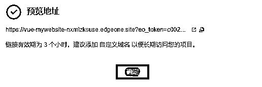

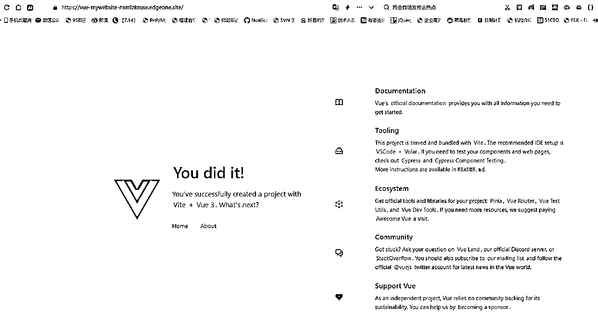

## 二、让 AI 帮你设计和编写页面

此时网站虽然可以访问，但展示的还是模板页面。想把它改成自己需要的样子，就可以请 AI 编程助手来帮忙。

Cursor 是不少人熟悉的选择，不过它需要付费。这里介绍的 Trae 是字节推出的 AI 编程工具，支持 DeepSeek 模型，开发版目前可以免费使用。

### 1. 安装 Trae

访问 Trae 官网下载并安装：

- 国内版：https://www.trae.com.cn/
- 国际版：https://www.trae.ai/

安装后打开软件，按提示设置主题或导入配置即可。首次使用需要登录，可以根据页面指引完成注册。

### 2. 把 GitHub 项目下载到电脑

回到 EdgeOne 项目页面，点击 `main`，进入对应的 GitHub 仓库。

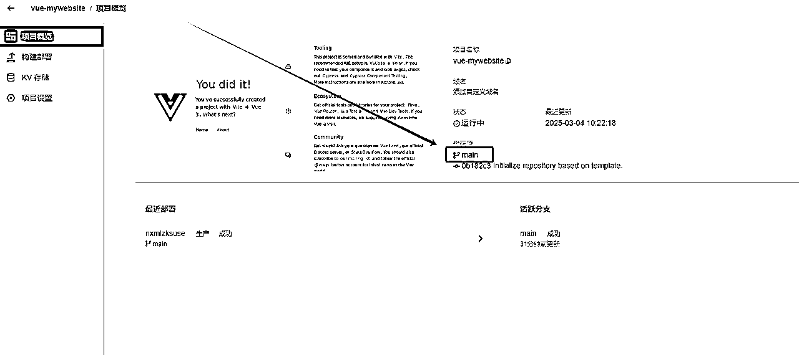

在 GitHub 页面复制仓库地址。

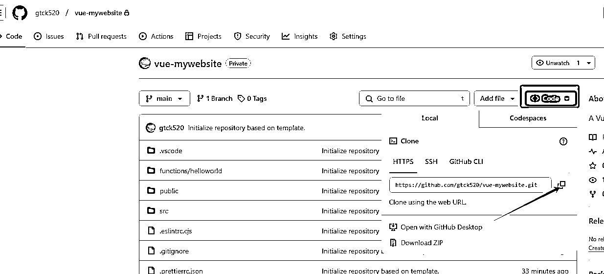

打开 Trae，选择克隆 Git 仓库。

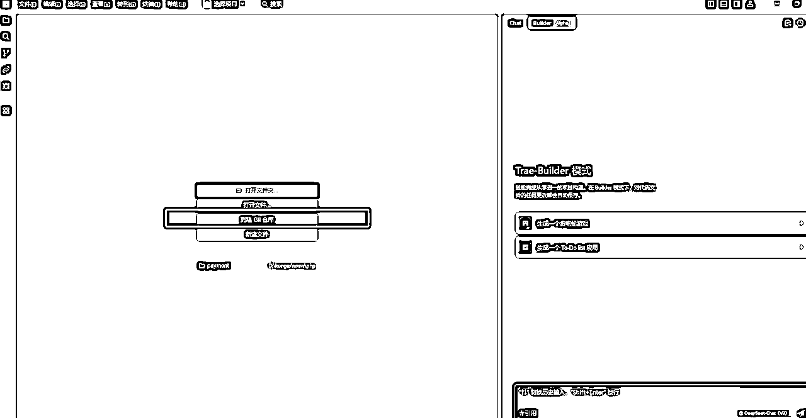

将仓库地址粘贴到输入框，点击识别出的地址，再指定项目在电脑上的保存位置。代码下载完成后，点击打开项目即可。遇到是否信任项目的提示时，可按需确认信任。

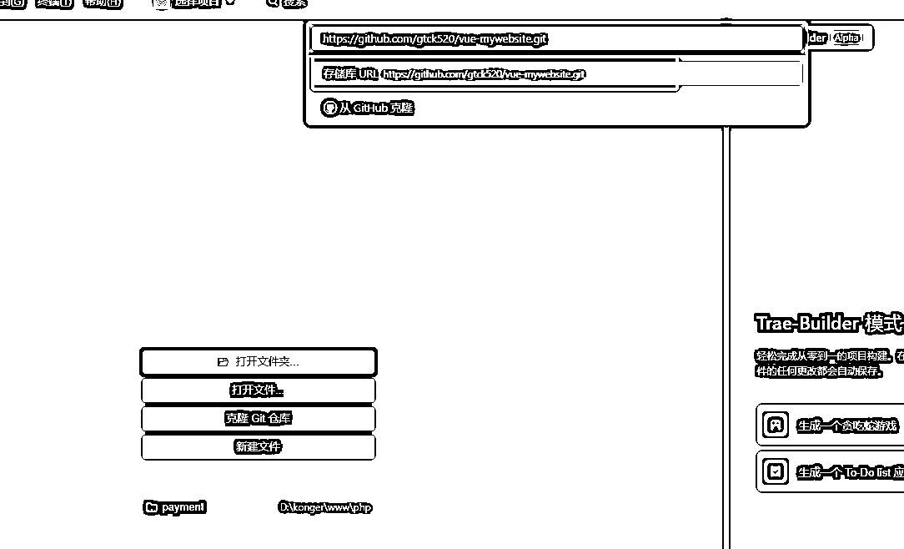

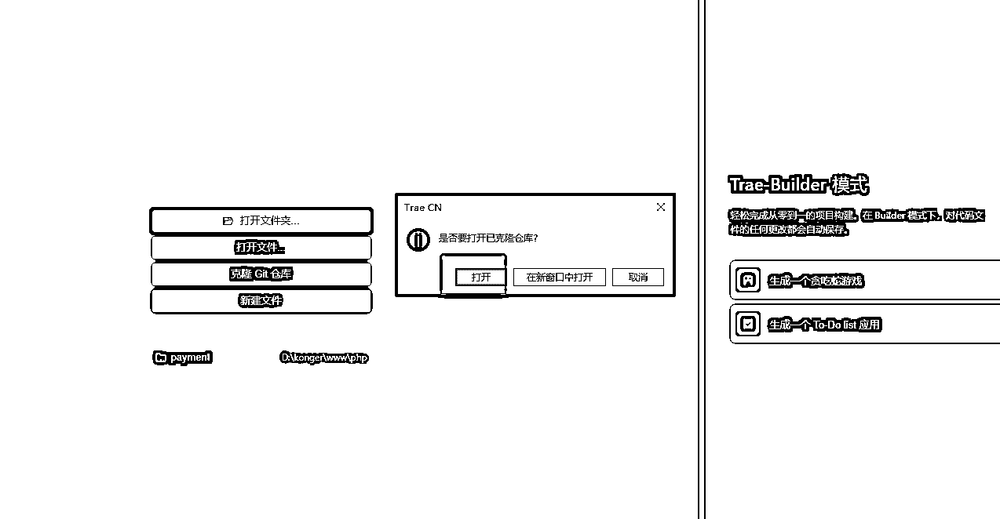

### 3. 描述需求，让 AI 生成页面

准备工作完成后，就可以开始制作页面了。比如，我们想做一张个人介绍名片，可以在 Trae 的 Builder 模式中输入类似需求：

> 这是一个 Vue 模板项目。我叫陈序员大康，想制作一个个人介绍名片网页。请先规划主页的整体布局和文案，再根据以下信息完成页面设计：我有十年程序员经验，喜欢阅读和音乐，目前在研究 AI，重点探索 AI 与 RPA 如何帮助职场人提升效率。我开发过多款受到大家欢迎的自动化工具，也建立了一个 AI+自动化交流群，欢迎感兴趣的人加入。

模型选择 DeepSeek R1。

简单来说，Chat 模式主要用于对话和提供建议；Builder 模式则可以直接修改项目、编写代码。

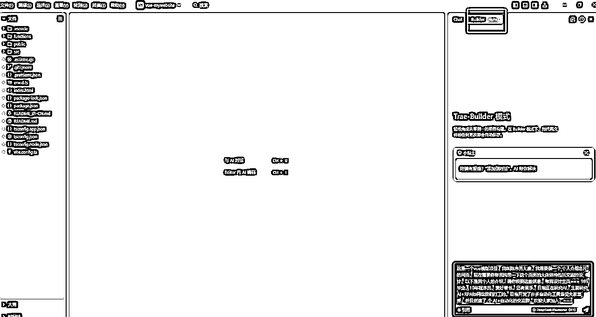

等待 AI 完成初步开发后，检查它生成的效果。满意的话选择接受修改；如果不合适，可以拒绝，再补充要求重新生成。

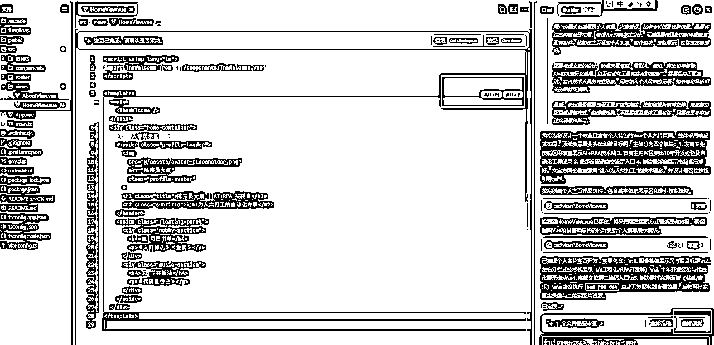

之后可以反复预览和调整。出现报错时，把错误信息交给 AI 排查；页面内容或样式不满意，也可以直接描述希望改成什么样。

## 三、代码更新后自动部署和预览

开发时使用 Node.js 本地运行项目会更方便。如果不清楚如何配置，可以直接向 AI 提问，让它带着你操作。

不想折腾本地环境，也可以把代码推送到 GitHub，再让 EdgeOne Pages 自动重新部署。这样每次代码有更新，都能通过原来的预览链接查看新效果。

### 1. 在 EdgeOne 创建 Webhook

进入 EdgeOne 项目设置，按页面指引创建一个 Webhook。

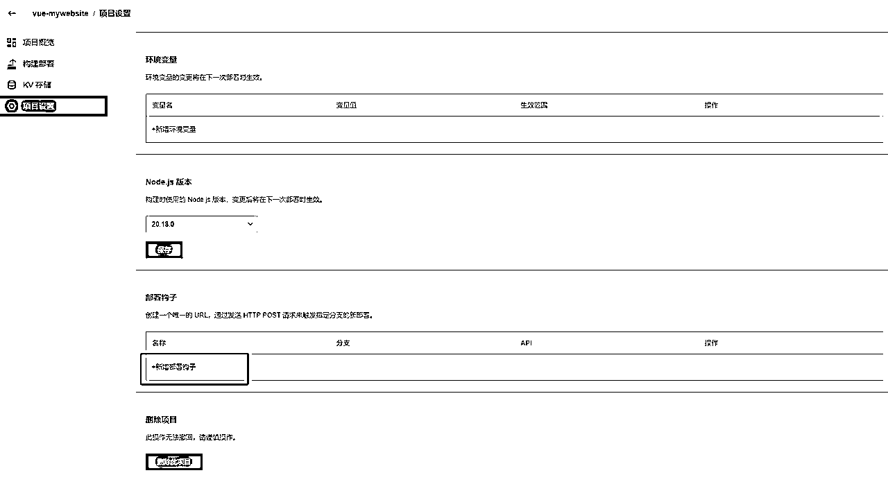

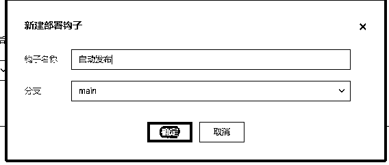

### 2. 把 Webhook 添加到 GitHub

复制刚刚生成的 Webhook API 地址，然后打开对应的 GitHub 项目。

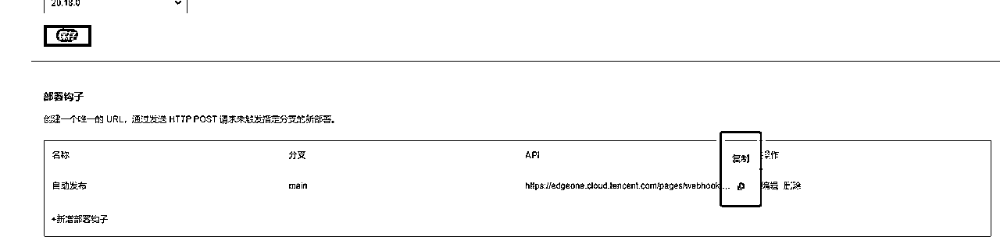

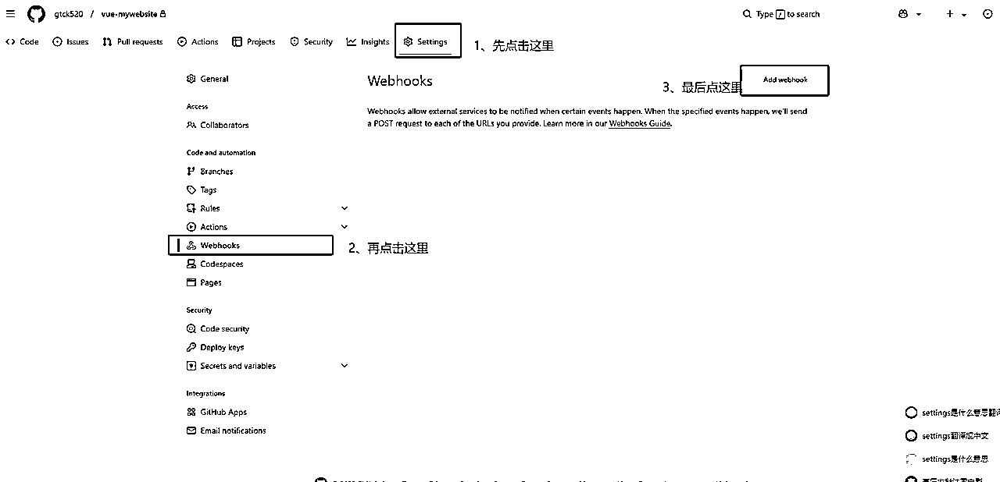

在 GitHub 的 Webhook 配置页面粘贴地址，点击“Add webhook”完成添加。

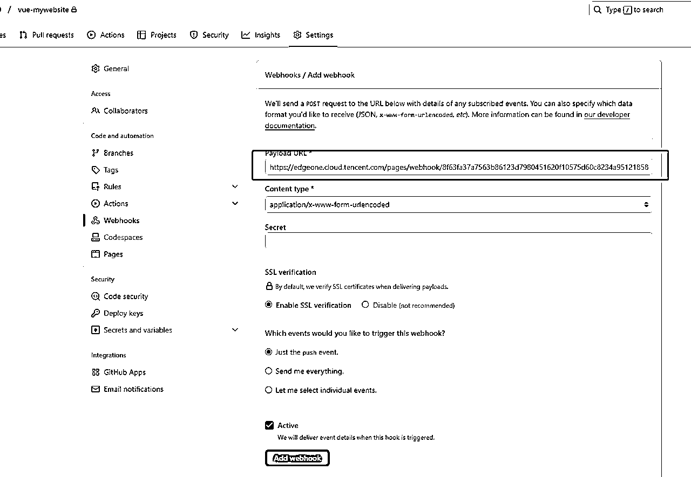

完成后，GitHub 仓库的代码变更就能通知 EdgeOne 自动发布。也就是说，代码更新并推送后，平台会重新构建网站，之后通过预览地址即可查看修改结果。

### 3. 推送修改并检查效果

回到 Trae，先完成本地代码调整，再在消息框中说明本次修改内容，并选择“提交和推送”。

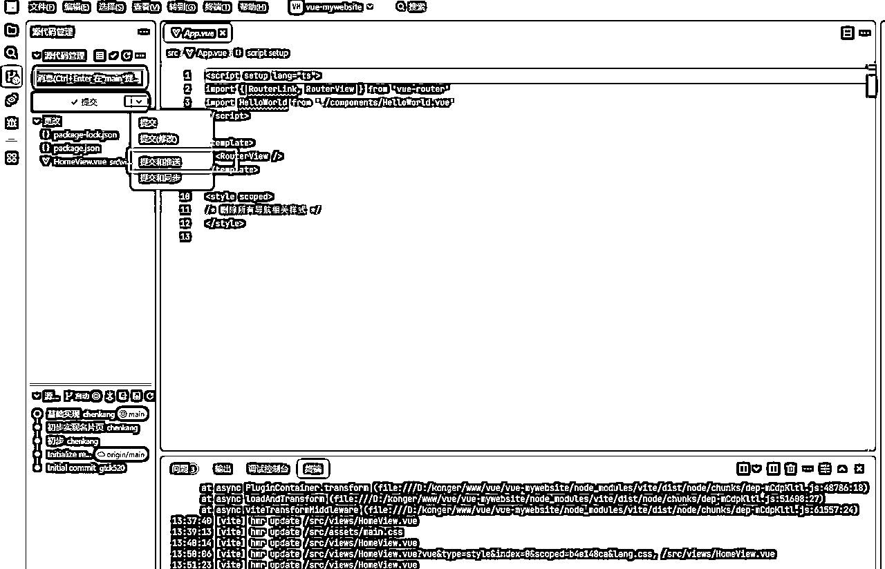

注意：“提交”只会把更改保存在本地；“提交和推送”才会把代码同步到 GitHub，进而触发 EdgeOne 部署。

等待部署运行完成后，打开预览链接检查页面。

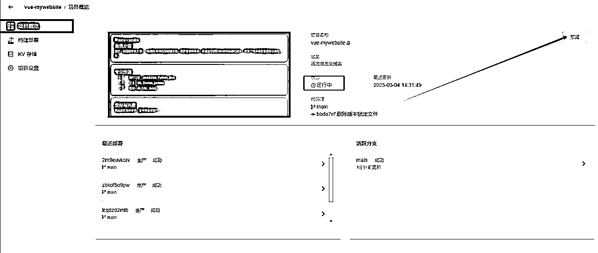

这样，一个简单的单页网站就上线了。当前效果可能还比较基础，可以继续让 AI 优化布局、文案和视觉样式。

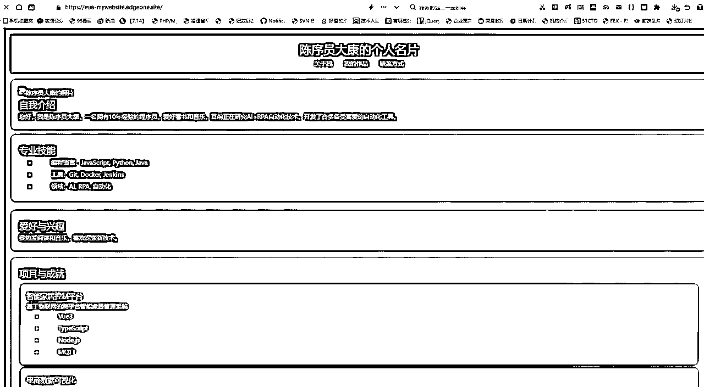

### 4. 想长期访问，可以绑定自己的域名

EdgeOne 提供的访问地址可能有使用期限。如果希望网站长期对外开放，可以购买一个域名，再将它绑定到项目上。

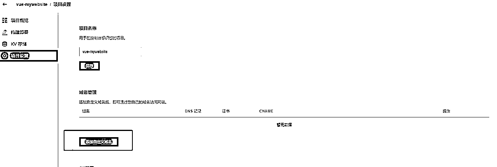

## 四、关于 AI 编程工具的补充建议

实际体验下来，Trae 国内版目前还有改进空间：运行速度偏慢，生成代码的稳定性也不够理想。因此，文中的页面是通过 Trae 国际版制作的，其使用的 Claude 3.5 模型在这一场景下表现更好。

如果条件允许，AI 编程工具可以优先考虑 Cursor，Windsurf 也是可选方案；也可以尝试 Trae 国际版。对于完全没有编程经验的用户，目前不太建议单靠国内版 Trae 完成整个页面。