# 用 Claude 3.7 做可视化，这几套玩法太实用了
作者：龙哥


说实话，Claude 3.7 在可视化这块的表现直接拉满。本文就是把我自己摸索和汇总到的几组实操案例整理出来，分享给大家。

先说清楚一个前提，这里说的「画图」并不是 Midjourney 或 SD 那种生成一张美术图片，而是让模型通过 SVG、HTML、XML 等文本代码来完成图表和页面级的视觉呈现。

## 最基础的用法：直接让它可视化

```
可视化（物品、概念、书籍、电影...）
```

最直接上手的写法就是这么一句：

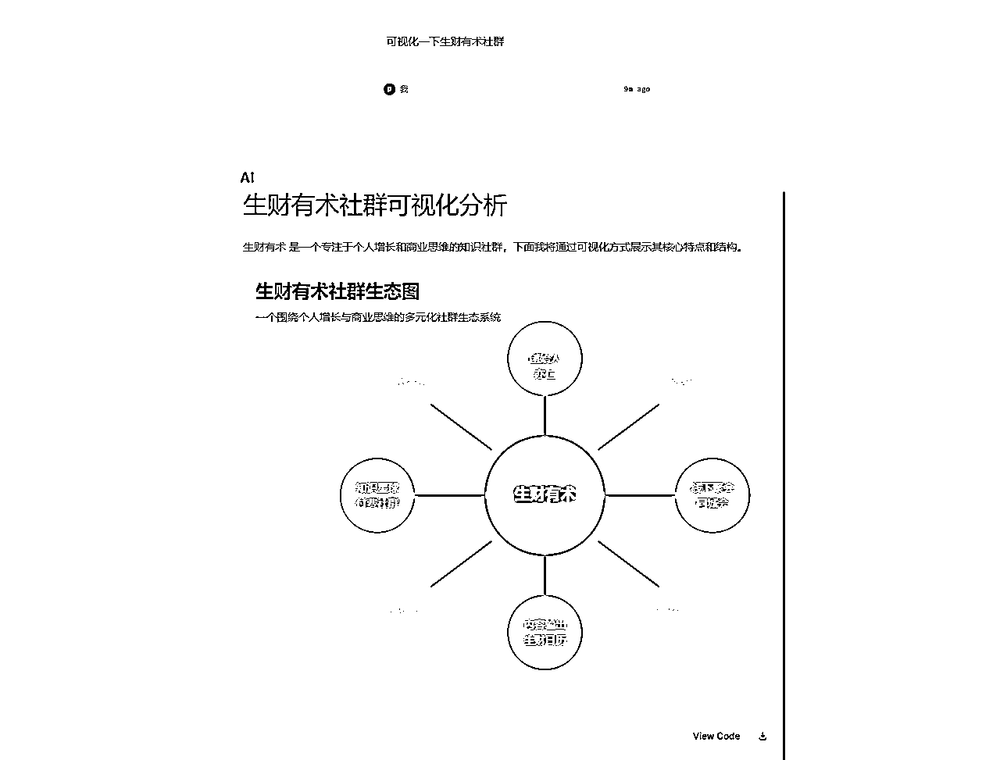

### Flowith 画布里做分支对比

在 Flowith 画布上可以对同一内容做多分支编辑，方便对比不同提示词带来的效果差异：

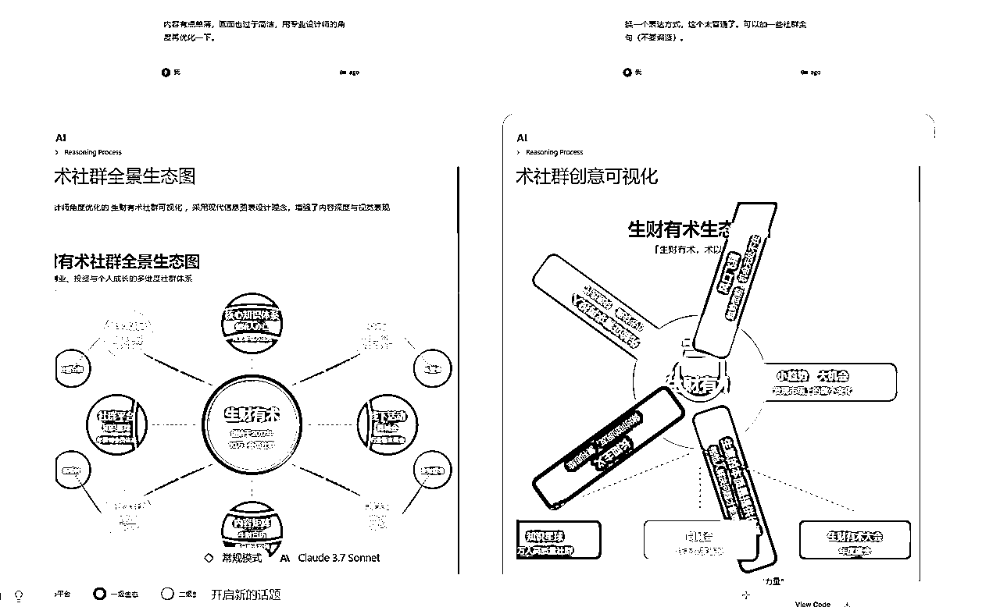

### 生成的 SVG 怎么继续改？

SVG 是文本格式，后续修改非常方便。推荐用 https://inkscape.org/ ，免费开源，Windows 和 Mac 都能用：

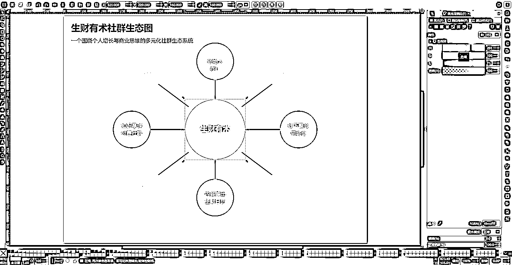

如果你更习惯 Office 生态，也能把 SVG 直接丢进 PPT 里面继续改：

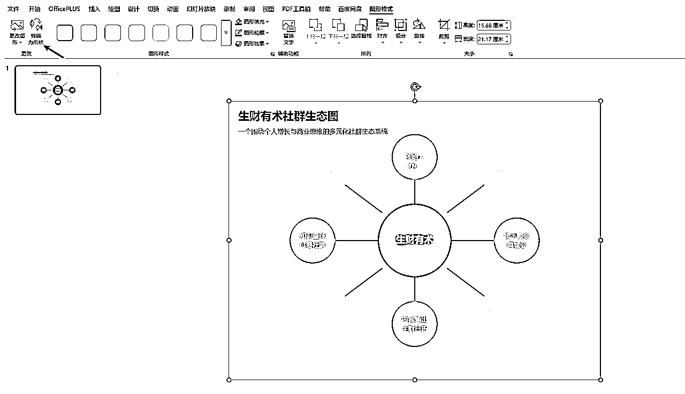

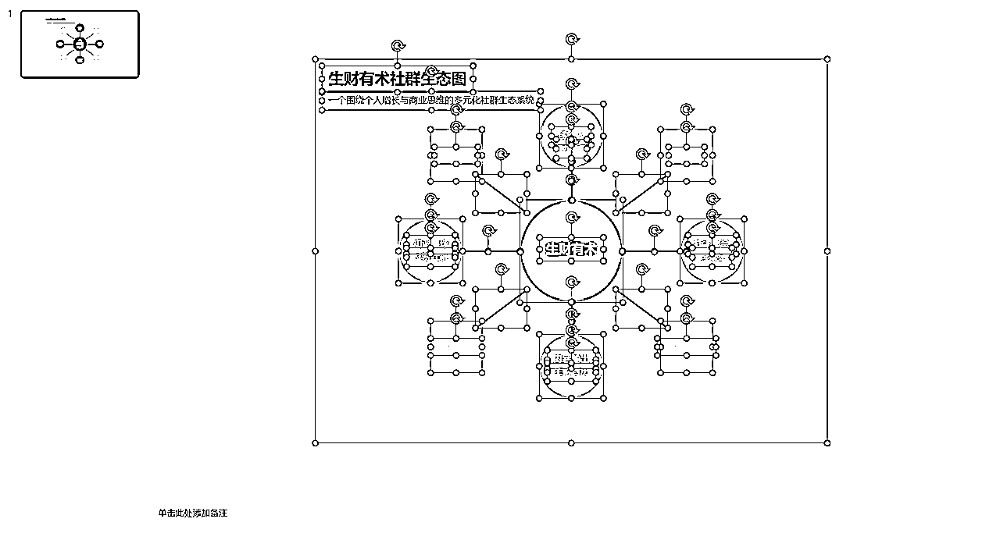

## 用 SVG 模板批量做 PPT

### 先搭一个可复用的模板

```
请你创建一个4：3的页面模板，模拟PPT，遵循设计的最佳实践。
```

我先做了一个 4:3 的画布模板，16:9 也可以，个人觉得 4:3 在画布里预览更舒服：

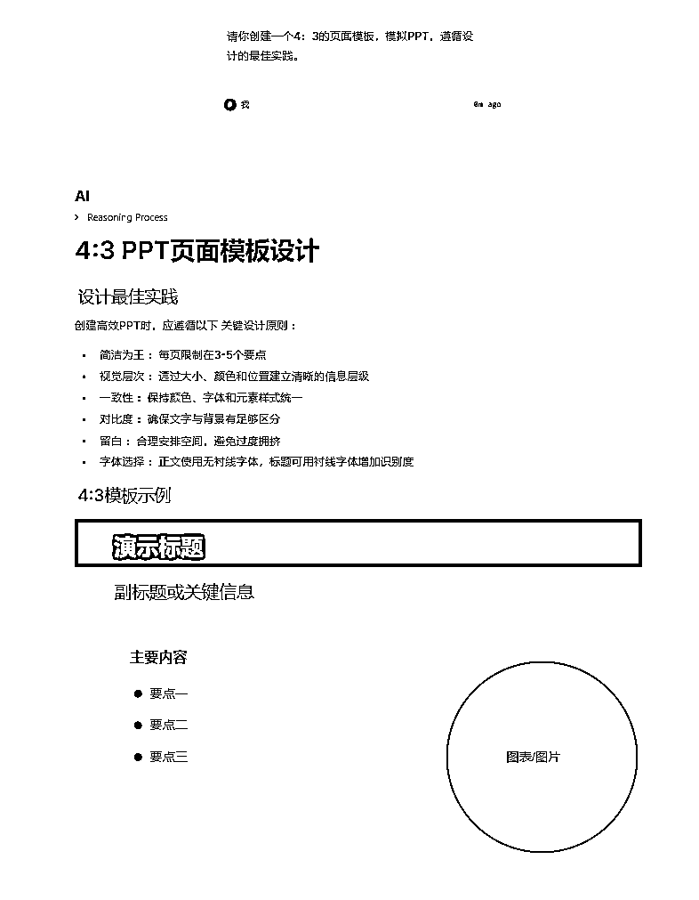

### 给模板换风格

在已有模板的基础上做风格变体，几秒就能换一套视觉：

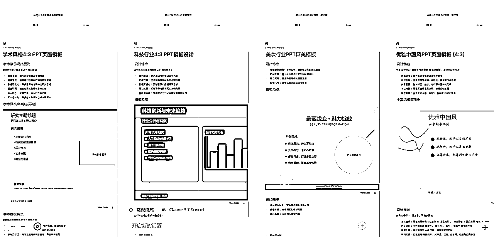

### 基于模板生成整套幻灯片

选好喜欢的模板后，就能直接开始批量出片：

```
基于这个模板，生成一个8页的PPT，内容是像普通用户介绍一下大语言模型，内容要生动有趣浅显易懂。
```

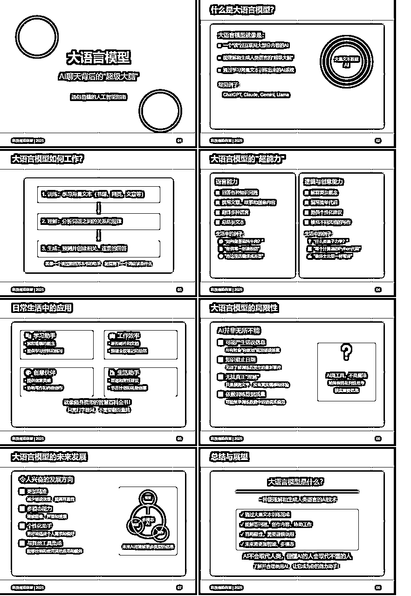

```
用这个模板帮我生成一个 8 页的 PPT，介绍一下道德经。
```

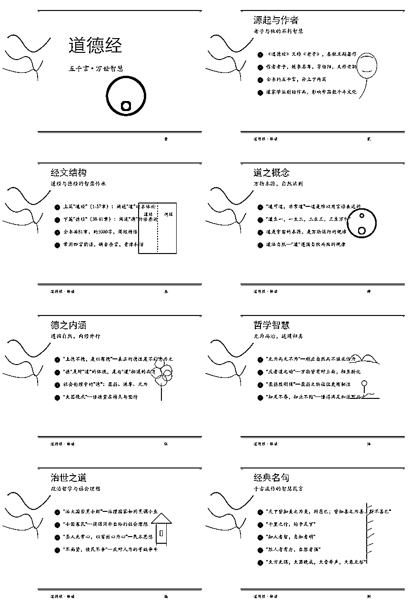

对了，前面提到过，PPT 里是可以把 SVG 加载进来并转成可编辑形状的：

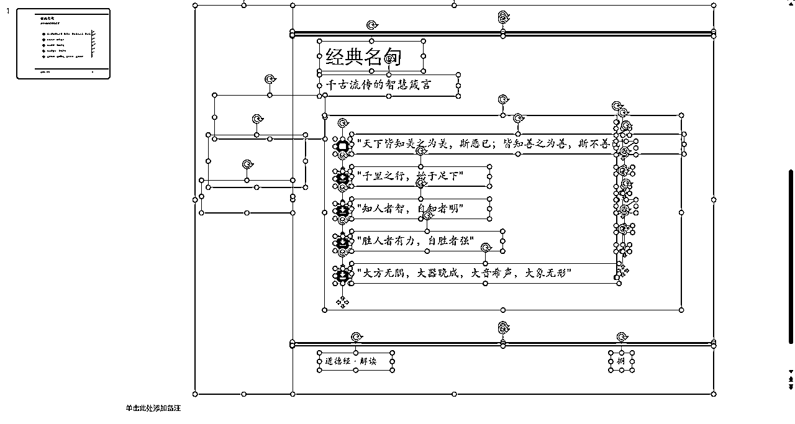

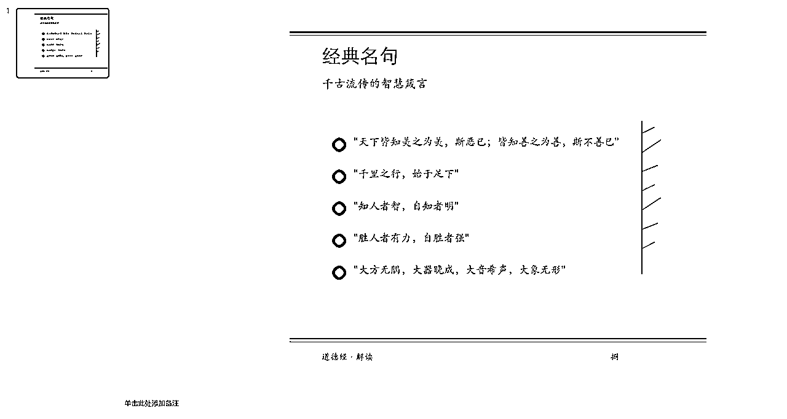

## 用 Three.js 做 3D 效果

### 画一枚火箭

```
用 three.js 帮我绘制一个 3d 的火箭形象，要有炫酷的光效
```

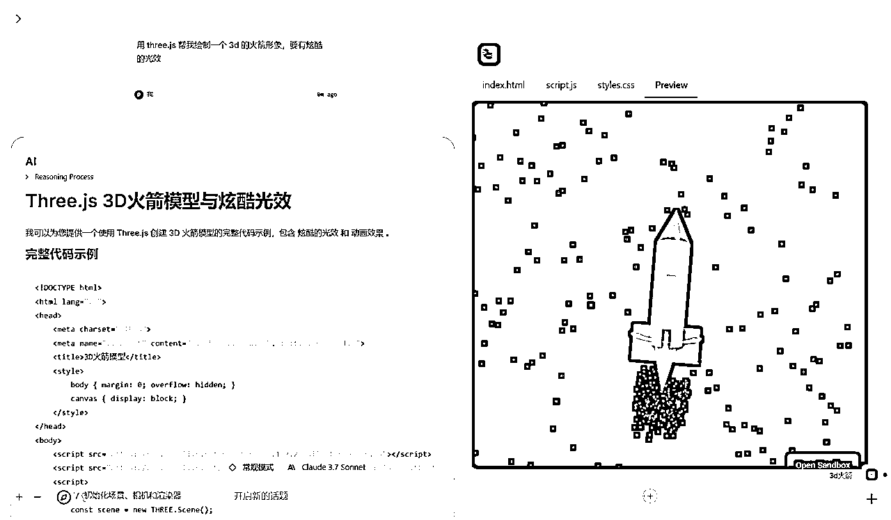

### 动态视角的城堡

```
绘制一个城堡，并且视角动态变化
```

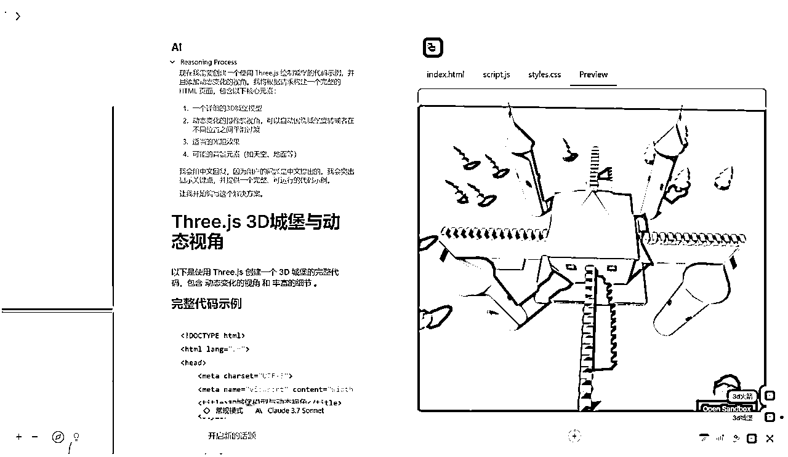

### Three.js 结合 Runway 出视频

这个思路我还没实操过，先记录在这里，有兴趣的可以自己试试。

## 用 HTML 搭建可视化卡片

### 基础版卡片

```
用html帮我生成一个手册，介绍一下常见的prompt编写技巧。可以用cdn，界面要现代化，遵循UIUX的最佳实践，使用响应式布局。
```

### 加入上下文的增强版

参考小排老师的一篇文章，生成出来的效果是这样的：

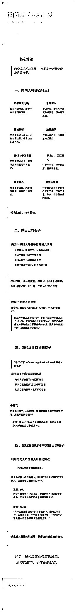

### 做一张生日贺卡

```
请为一位即将在 3 月 14 日迎来 30 岁生日的程序员生成一段可独立运行、可直接保存为 HTML 文件并在浏览器中打开的页面代码，作为独一无二的生日祝福。页面应包括以下要求与元素：

1\. 风格与主题：
   • 整体使用黑客帝国 (The Matrix) 风格的 UI/UX 设计，突出「神秘感」、「矩阵风」和「未来科技感」。
   • 使用 Tailwind CSS 和 Font Awesome 的 CDN。
   • 在视觉上呈现黑暗背景搭配绿色或荧光色系，突出高对比度，保持良好可读性和访问性。

2\. 内容要点：
   • 明确表达「30 岁生日」以及「3 月 14 日」这两个核心信息，并设计以「程序员」身份为主题的祝福文案。
   • 可以添加合适的自定义文案，突出独特的祝福氛围。
   • 参考黑客帝国风格，可在合适位置插入一些霓虹灯、未来感的元素或字符雨 (Matrix Rain) 效果等。

3\. 结构与技术细节：
   • 使用语义化的 HTML 标签（header、main、footer 等）；若有必要，可使用少量 JavaScript 提升交互。
   • 通过 Tailwind CSS 的实用类 (utility-first classes) 完成主要的样式控制，不必冗余自写 CSS。
   • 集成 Font Awesome（可添加适合主题的图标，如编程相关或酷炫科技图标）。
   • 需包含完整的示例 HTML 结构（、、、），包括 meta viewport 等必需标签，确保在现代浏览器和移动端浏览体验良好。

4\. 设计与交互：
   • 界面适配多端设备（PC/移动端）。
   • 页面内可以简单地展示个人信息、生日祝福文字、主题装饰等；如需插入动画或特效，可在代码中简要说明其作用。

5\. 交付形式：
   • 最终输出应当是一段可直接复制到本地并命名为「birthday.html」后打开即能运行的完整静态页面代码。
   • 如有额外的解释，可以附在注释中，或在输出生成完后附加写简要说明。

根据以上要求，请生成符合黑客帝国主题、体现「30 岁」「3 月 14 日生日」信息，且带有 Tailwind CSS 与 Font Awesome CDN，具有独特祝福文案、可直接运行的完整静态 HTML 页面代码。

```

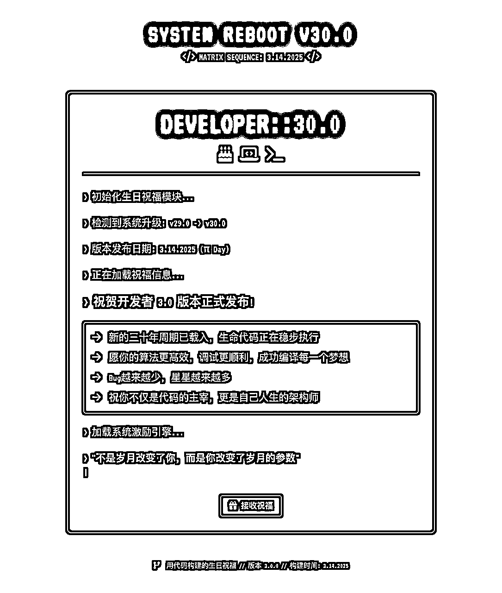

## 生成 DrawIO 能直接打开的 XML

### 四象限图案例

这个思路来自日推上的分享：

```
写一个关于挣钱的效率和持久化程度的四象限整理 xml，结果以可在线编辑的 drawio 格式输出！
```

把模型输出的内容保存为 xml 文件，再用 drawio 打开即可编辑：

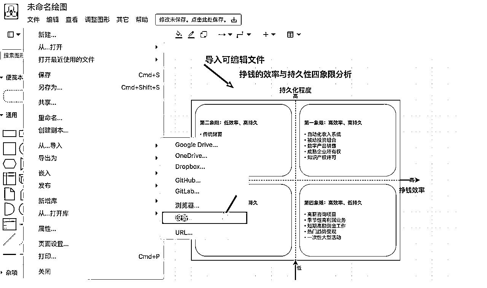

## 用 HTML 做手写风格的可视化笔记

### 手帐风笔记生成

这个 Prompt 来自日本推友，国内自媒体圈似乎还没有太多人用：

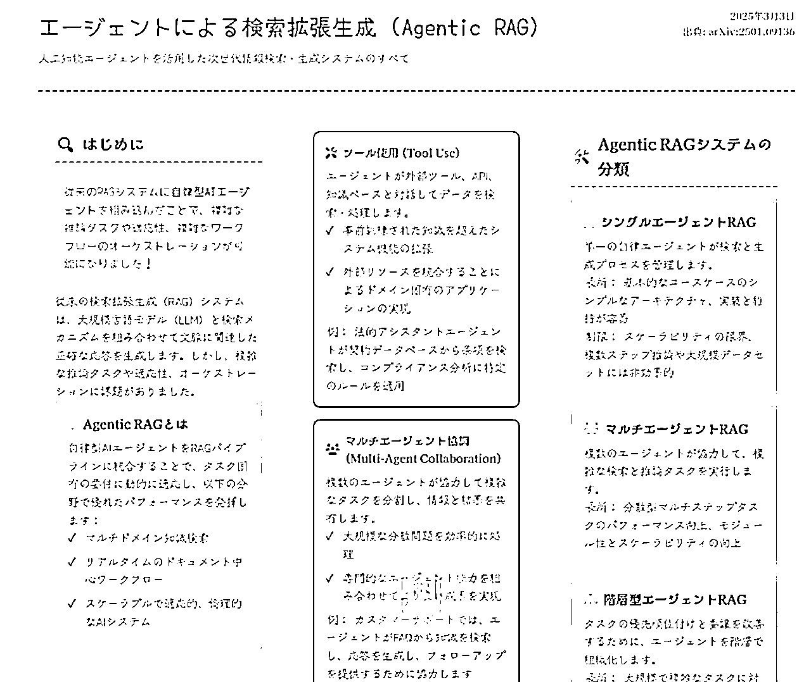

原始 Prompt：

# グラフィックレコーディング風インフォグラフィック変換プロンプト

## 目的

以下の内容を、超一流デザイナーが作成したような、日本語で完璧なグラフィックレコーディング風のHTMLインフォグラフィックに変換してください。情報設計とビジュアルデザインの両面で最高水準を目指します

手書き風の図形やアイコンを活用して内容を視覚的に表現します。

## デザイン仕様

### 1\. カラースキーム

### 2\. グラフィックレコーディング要素

*   左上から右へ、上から下へと情報を順次配置

*   日本語の手書き風フォントの使用（Yomogi, Zen Kurenaido, Kaisei Decol）

*   手描き風の囲み線、矢印、バナー、吹き出し

*   テキストと視覚要素（アイコン、シンプルな図形）の組み合わせ

*   キーワードの強調（色付き下線、マーカー効果）

*   関連する概念を線や矢印で接続

*   絵文字やアイコンを効果的に配置（

*   など） 3\. タイポグラフィ タイトル：32px、グラデーション効果、太字 サブタイトル：16px、#475569 セクション見出し：18px、#1e40af、アイコン付き - 本文：14px、#334155、行間1.4 - フォント指定： ```html
```