# 关于宠物取名类网站的拆解复盘
作者：龙哥

# 写在前面

这篇梳理源自我加入赚钱大本营后的第一次分享的延续。当时纪钟老师在评论区抛来的几个追问让我意识到问题没想透：

刚进来就输出很赞，但我们更在意的是你准备用怎样的商业模式去承载这个点子，这里很推荐小排老师的那篇《市面上有宠物取名的应用吗？用户规模怎样？他们怎么变现？AI 到底是核心功能、噱头还是提效工具？期待你的后续思考》。

我此前更偏向先做出来再说，目的就是快速上手，用行动融入创业节奏。这次就把调研和思考过程整理出来，和大家交流。

# 我调研到的国内外相关站点

1. 宠物名字生成器 https://www.namechef.co/cn/name-generator/pet/ 。

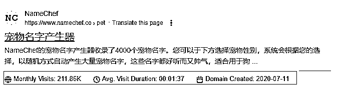

该站上线约四年，属于纯工具向网站。现在的月均访问大概两千多，营收来源是广告。

每月广告收益估算如下：

除了宠物名之外，还能生成中文名、日文名、韩文名、英文名、游戏名、账号名等多种类型。

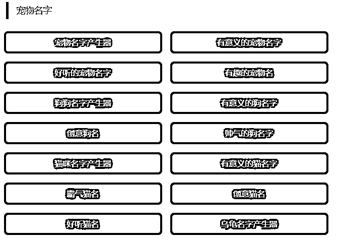

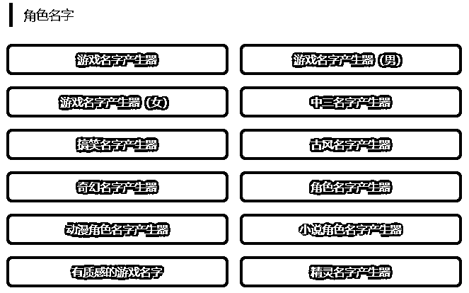

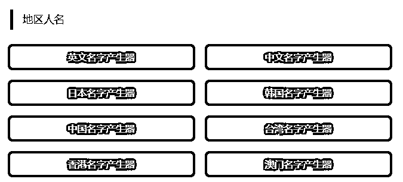

以现有流量和收入推算，年收入约5338元，刨去服务器及运维成本后基本不赚钱。

2. PureCalculators: Calculators for students, professionals, and researchers to advance your research and career.

这是一个聚合各类计算器的工具站，里面也内嵌了宠物取名功能。变现逻辑和前面一样，靠计算器用户的广告曝光来赚钱。

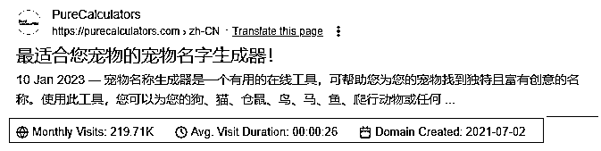

年收入水平与上面那家网站相近。

3. www.randomlists.com

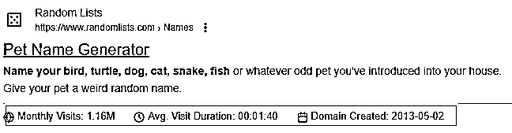

主打各种随机列表生成，宠物取名只是其中一项。只能随机抽取，无法按偏好自定义，定位就是给不想费脑、只要一个结果的用户用的快餐场景。

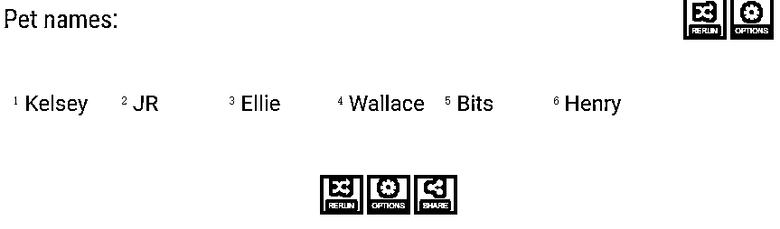

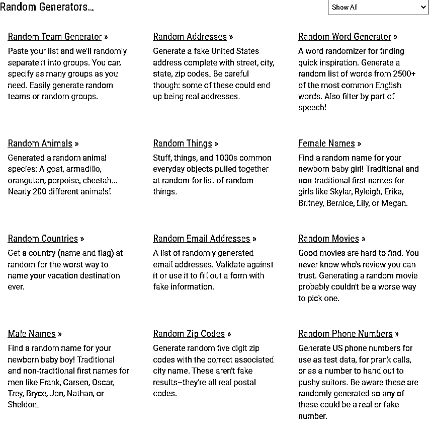

站点还支持随机生成小孩名字、邮箱地址、GIF 等，整体靠广告变现。

4. https://www.fantasynamegenerators.com/

网站历史较久，流量也保持得不错。

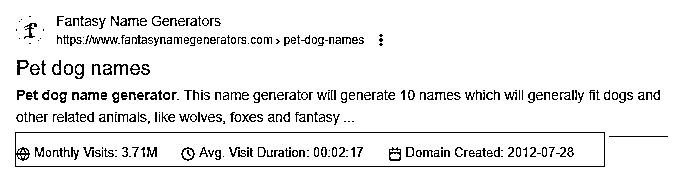

内容盘点：

涵盖书名、桥名、人名、动物名等各类名称生成，相当于一个名字类的资料库。站上还附带 icon 等小工具。

近来站点在尝试向工具扩展以拉新增流，例如：

https://rollforfantasy.com/tools/flag-creator.php， https://rollforfantasy.com/tools/map-creator.php。

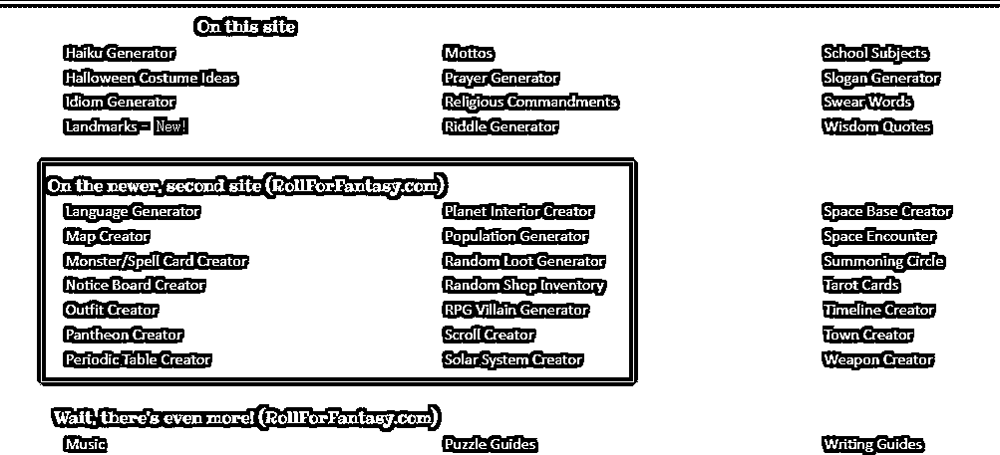

粗略估算其流量与收入水平：

5. https://www.yeschat.ai/

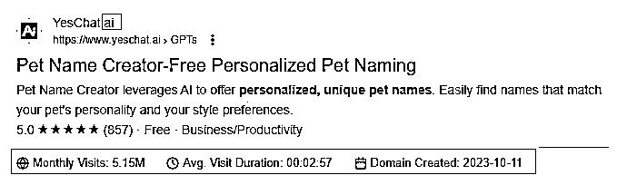

本质是一个 AI 工具综合站，核心是 AI 协作助手。用户需注册并付费订阅才能解锁功能。

订阅价格如下，是否盈利不确定。但借助 AI 热度，流量表现不错，目前未接入广告。

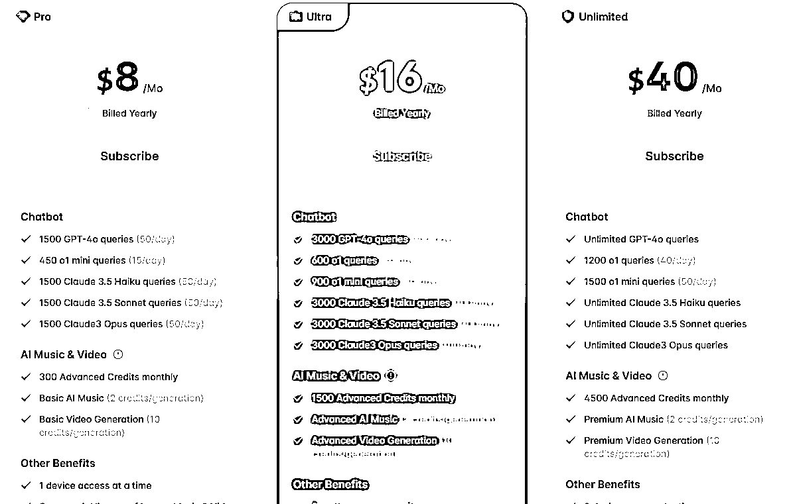

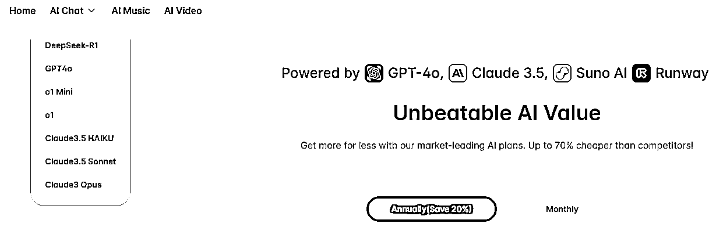

6. https://www.petplace.com/

特意提到它是因为它提供 pet insurance comparison，这在国内几乎是空白，可能是一个新方向。

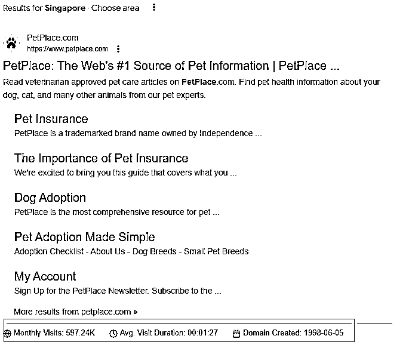

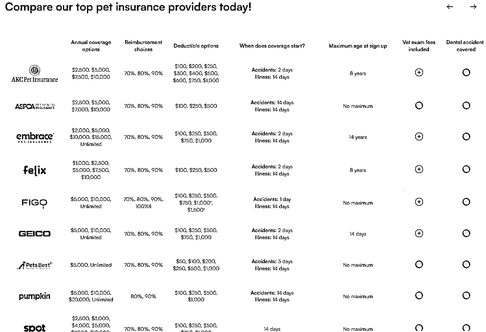

该站访问量不算高，没有广告位，收入大概率来自保险销售，具体规模难以估算。

# 宠物垂类网站常见的赚钱打法

能看到几种典型路径：

## 宠物电商

### 波奇网或跨境电商独立站

通过卖货盈利，不在本次讨论的赛道内，不做展开。

## AI 工具型网站

### www.yeschat.AI

核心是会员订阅收费，宠物取名只是 AI 内容生成能力的一个应用场景。现在这个赛道已经很多人入场，说白了是卖 AI 工具的使用权。

## 纯工具型网站

从调研来看，宠物取名只是引流入口之一，免费开放。因为取名需求不属于高频刚需。站内其他免费功能同理，都是为了扩大流量池，进而通过广告获利。

# 收获与反思

重读刘小排老师的《AI编程赛道第一课：Build a business , not an App》并对照自己的分析，发现和最初设想差距很大。虽然拆解可能还比较初级，但确实有新的认知：

1.  有想法后要先学会判断它值不值得做。判断框架可以参考龙哥大佬的《如何判断一个项目值不值得做？》，需要继续深入学习并落地。

2.  产品能不能做出来，和能不能赚钱是两码事。不能只站在技术可行性角度看项目。

3.  继续按刘老师的《AI编程赛道第一课：Build a business , not an App》的方法论去实践。

4.  整个数据收集和拆解过程，让我对如何拆解一个项目有了更具体的体感，也为三月份的航海积攒了些信心。