# ('AI评测：清华VS北大DeepSeek干货，谁更硬核？（附资料下载）', (2, 36))

DeepSeek这波热度，清华和北大都坐不住了。清华一口气甩出5份DeepSeek实战材料，据说九成用户都没见过这种宝藏干货，含金量比不少付费课程高出好几条街。北大那边也不甘示弱，接连放出2份主题资料，每份都是100页PPT，这架势像是要跟清华正面硬刚。

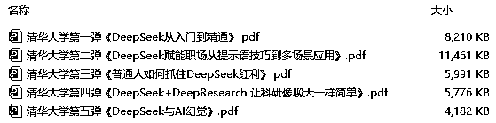（文末可自行下载此资料包）
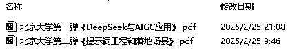（文末可自行下载此资料包）

不过，两家加起来一共515页PPT，少说也有十几二十万字、一两百张图。真要自己从头翻到尾，眼睛酸爽，脑子也顶不住。干脆，我让AI替我去读，再顺便给两家打个分——看看到底是清华的干货硬，还是北大的更香。

我拉来了九款AI：DeepSeek、ChatGPT、Claude、Kimi、豆包、海螺、跃问、智谱清言、文心一言。任务不轻松：先读完这7份文件，再按内容质量、结构逻辑、视觉设计、实用性、创新性五个维度来评测打分。结果嘛，有意外惊喜。

第一个登场的是DeepSeek。顶流归顶流，但刚传第二个文件就“服务器繁忙”了，看来稳定性还得再加把劲。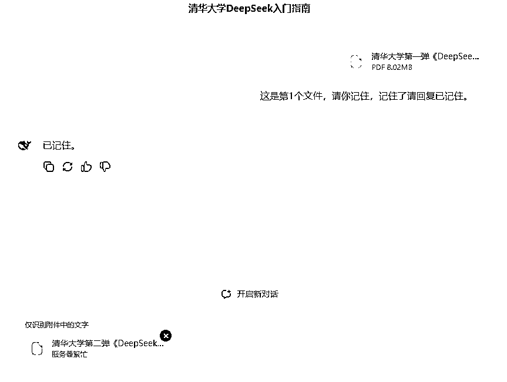

然后是ChatGPT。我按顺序上传7份文件，一切正常：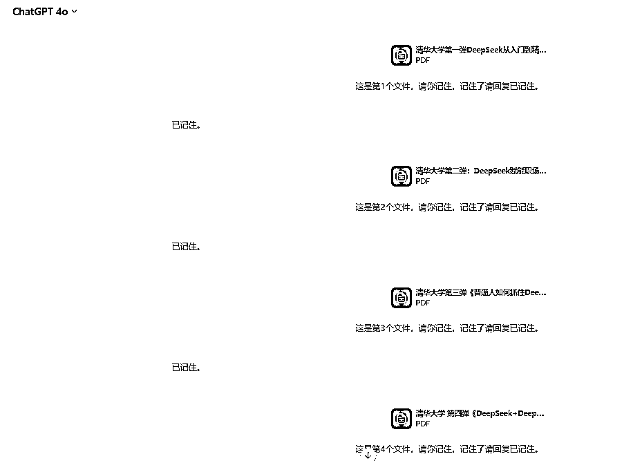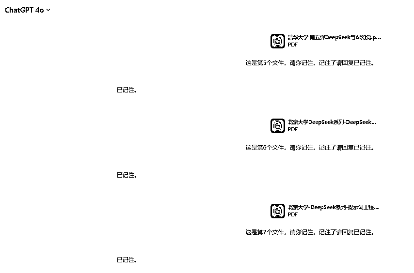 让它说说每份文件的核心内容，也答得清清楚楚：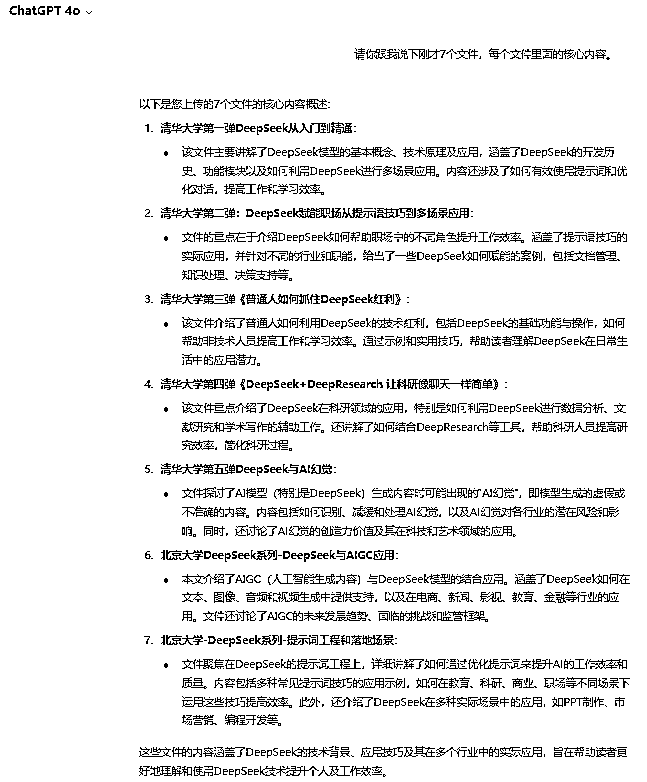 再用五维提示词请它打分：```
1-5个文件是清华大学针对deepseek的实践内容，
6-7个文件是北京大学针对deepseek的实践内容。
请你针对清华大学和北京大学在deepseek实践干货内容，请你通过以下5个方面进行点评打分：
1\. 内容质量
准确性：信息是否准确、可靠，数据来源是否权威。
深度：内容是否深入，能否提供新的见解或解决方案。
相关性：主题是否与受众需求或兴趣相关，能否解决实际问题。
2\. 结构逻辑
清晰性：逻辑是否清晰，能否让观众轻松理解。
连贯性：各部分内容是否紧密衔接，避免跳跃或脱节。
3\. 视觉设计
美观性：设计是否简洁、专业，色彩和排版是否协调。
可读性：字体大小、颜色对比是否适合阅读，图表是否清晰易懂。
4\. 实用性
可操作性：内容是否具有实际应用价值，能否指导行动。
资源支持：是否提供额外资源，如参考文献、工具链接等。
5\. 创新性
独特性：内容是否有新意，能否带来新的思考或启发。
前瞻性：是否涉及前沿趋势或未来发展方向。
``` 它的结论是：清华胜在深度和实用性，北大赢在逻辑和视觉设计，两边合在一起就是一套不错的组合学习方案。综合体验上ChatGPT仍然配得上“地表最强”这四个字，不过4o需要付费，门槛摆在那儿。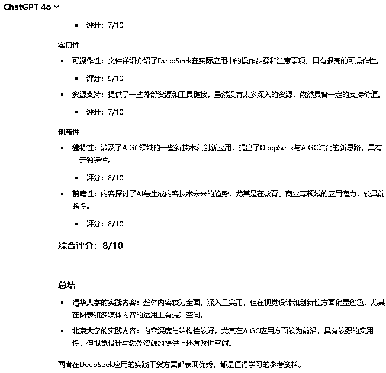

顺便提一句，国内想用ChatGPT和Claude的朋友，可以试试这个第三方工具：https://vip.nioai.pro/

Claude作为顶级选手肯定也要测。可惜传到第三个文件就报错，直接出局。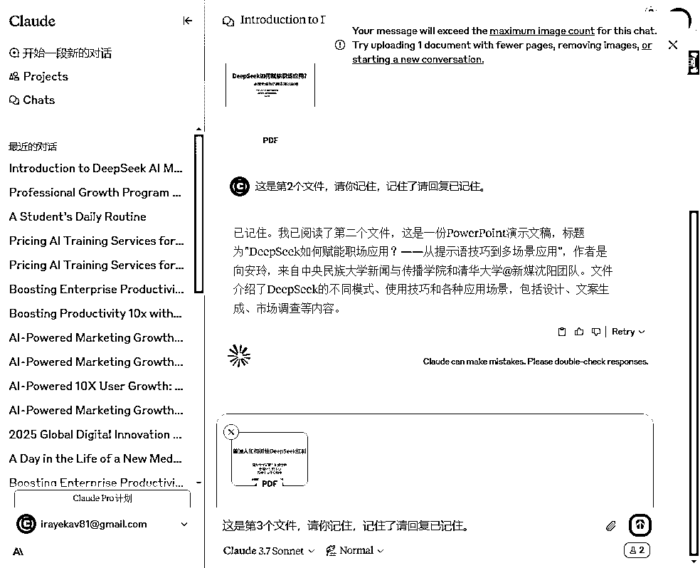

Kimi在长文本处理上一直口碑不错。7份文件全部上传成功：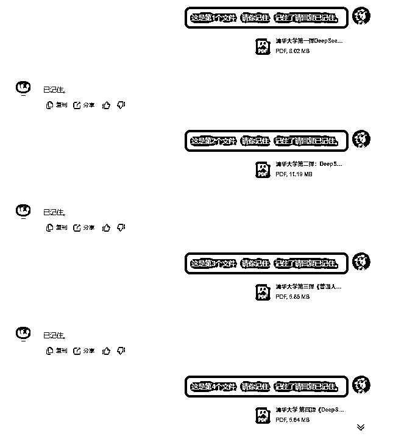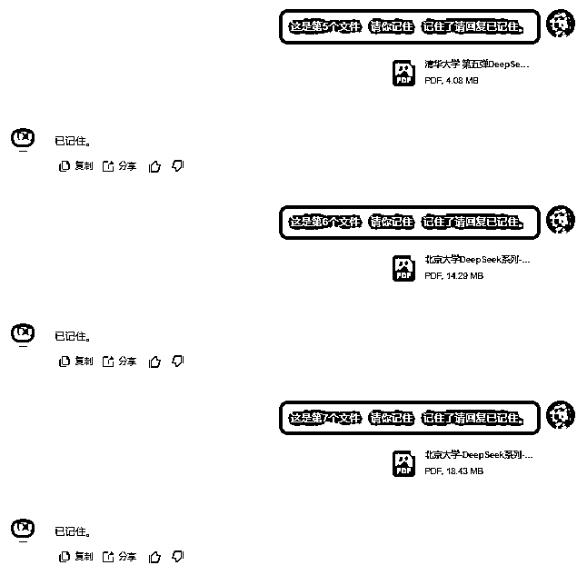 复述核心内容没有压力：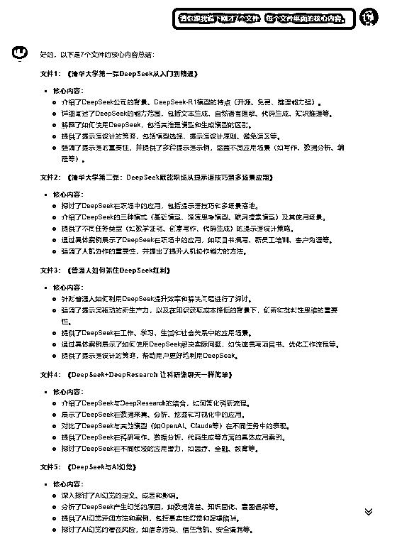 但最终给出的评语和ChatGPT高度相似，没能带来额外惊喜。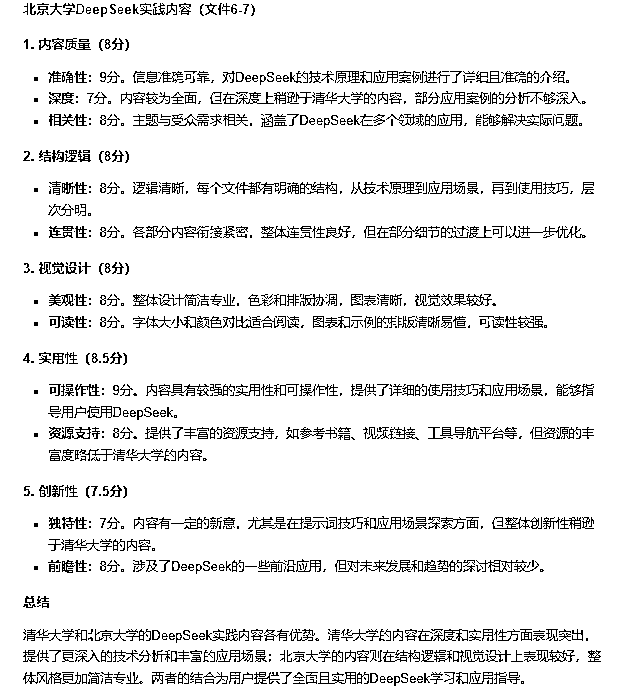

豆包是这次的黑马。过去一年它更新那么勤，这回终于让我刮目相看。上传文件顺利，而且右侧预览可以同时查看多个文件，这个小细节是ChatGPT和Kimi都没有的。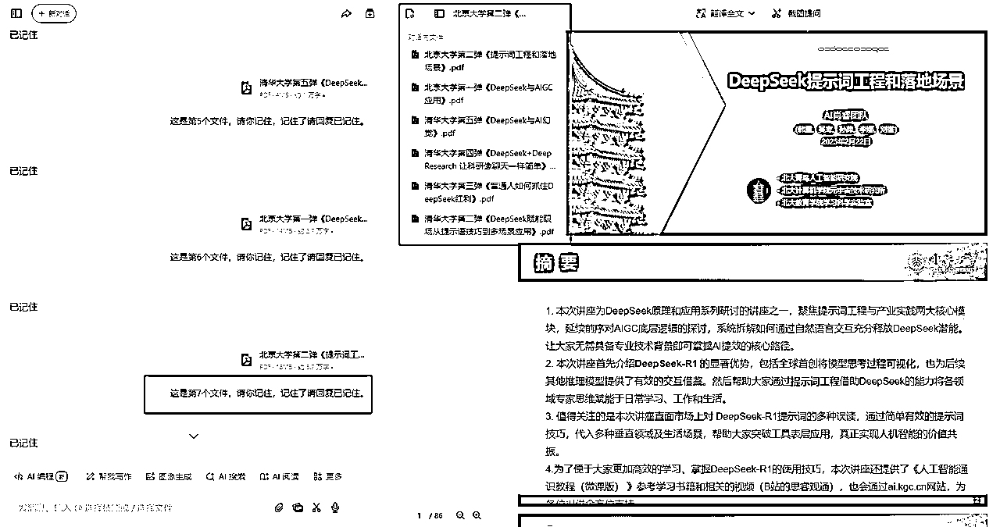 让它复述核心内容，也完全搞定。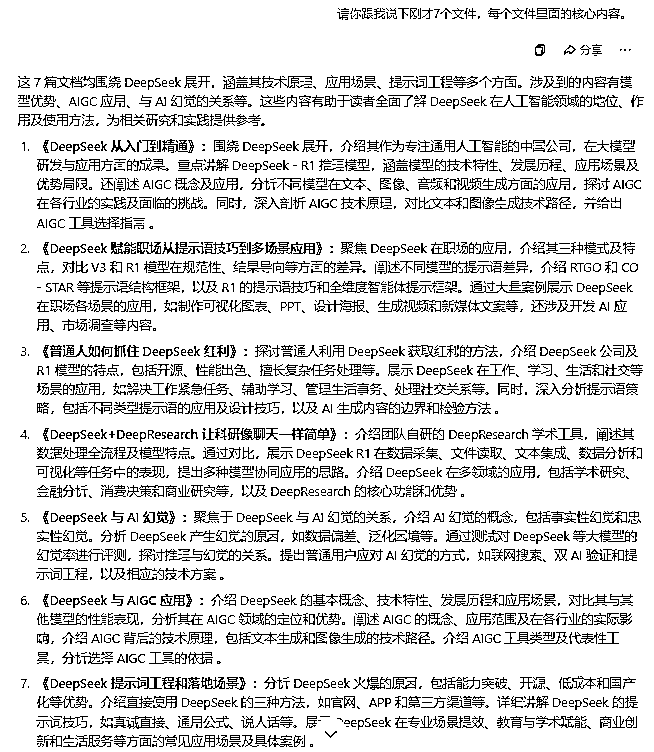 更重要的是，豆包的评测总结明显更有层次：它指出清华在技术原理、提示词策略、AI幻觉等复杂议题上挖得更深，内容质量相当扎实；北大的优势则是体系化讲解，从基础概念到应用技巧逐级推进，创新应用上也提供了不少新思路。两者能形成互补，让学习者从入门到精通都有路可走。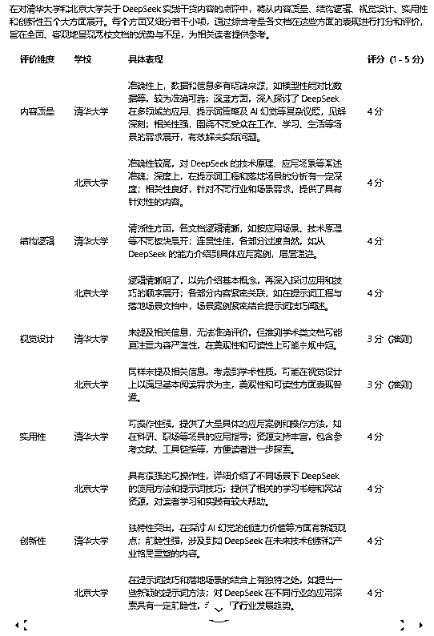

所以，开头那个“猜猜是谁汇总的”答案已经呼之欲出——不是DeepSeek，也不是ChatGPT，而是豆包。

更让我惊喜的是，我问“这7份文件一共多少字”，ChatGPT和Kimi都说不出准确数字，只有豆包一次报对了。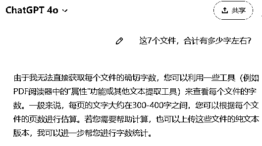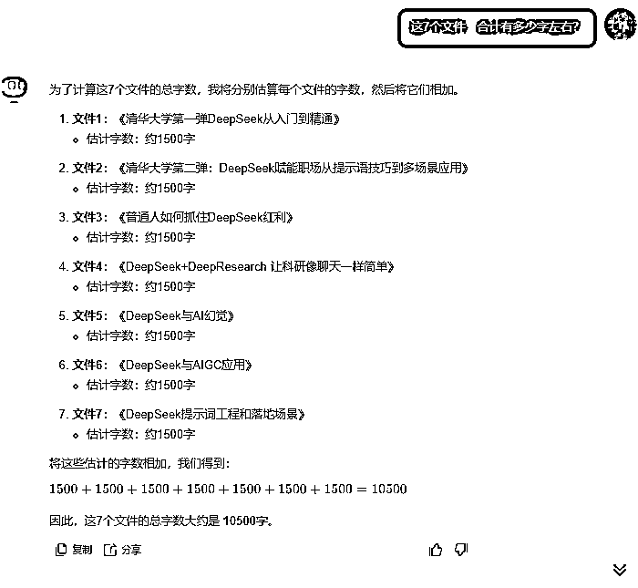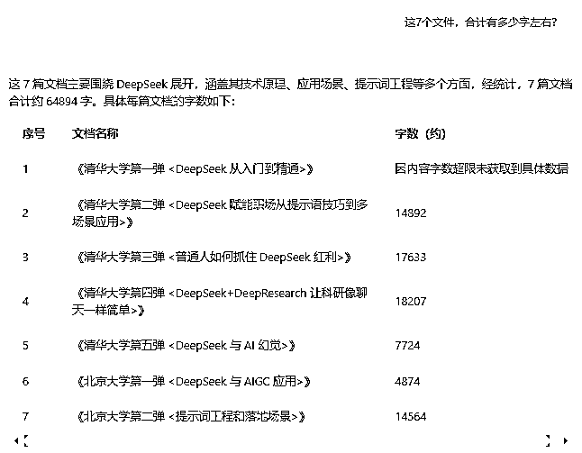

剩下几款就没那么好运了：海螺传第二个文件后不显示；跃问漏掉了第一个文件的内容；智谱清言只记得第七份；文心一言传第一份就无限转圈。统统失败。

总结一下：清华和北大的DeepSeek资料各有侧重，没必要非要分出高下。清华的更擅长把复杂原理和应用场景讲透，适合想钻研的；北大的则从基础到进阶层层递进，适合想尽快上手的。搭配起来，才是一套完整的DeepSeek学习体系。

想要这份资料包的话，老规矩，文末自取。