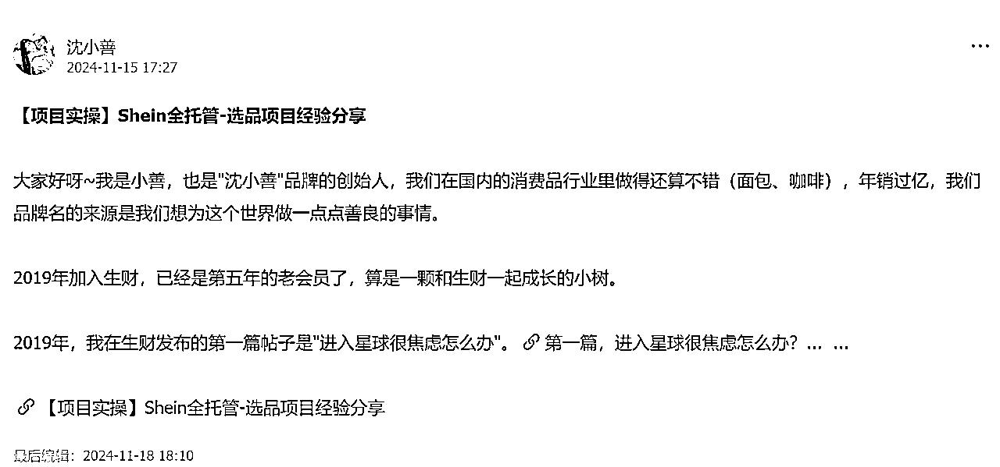
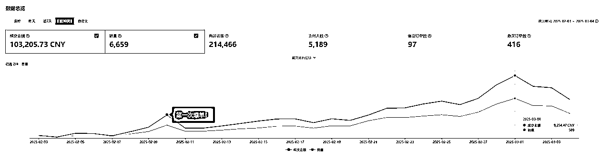
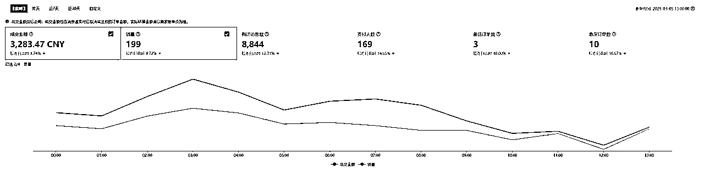
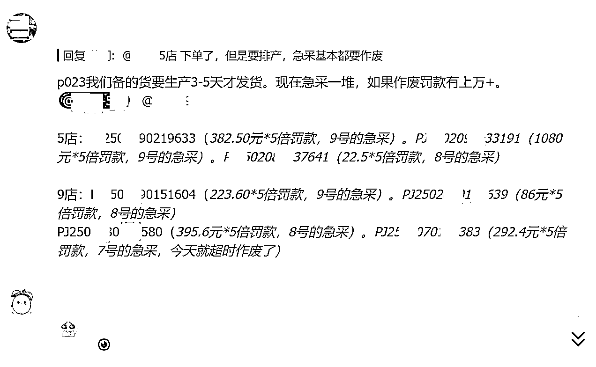
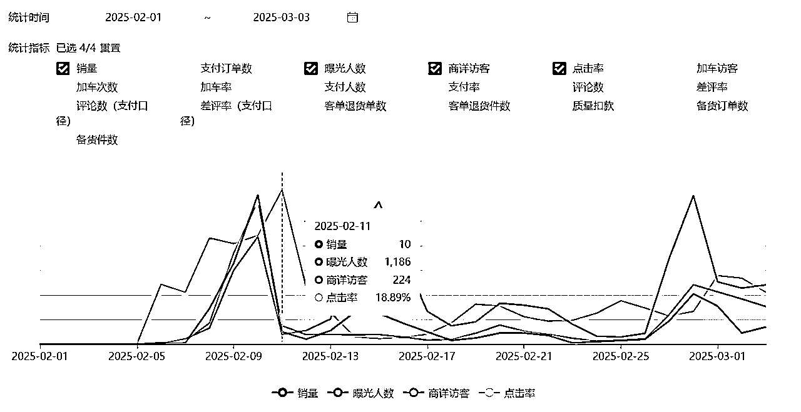
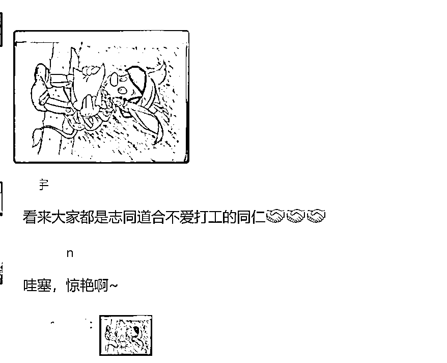
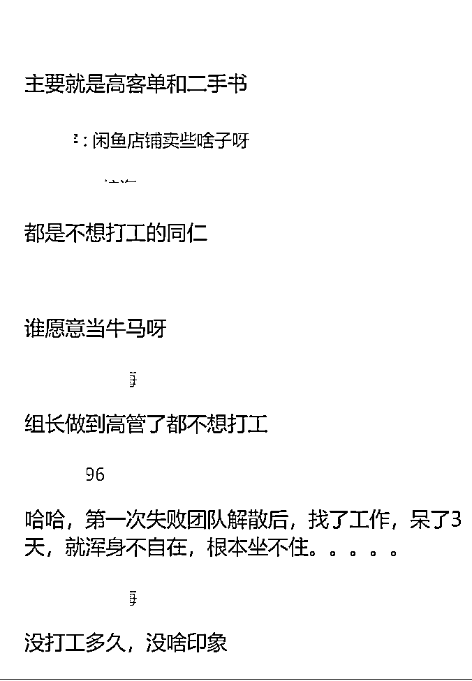
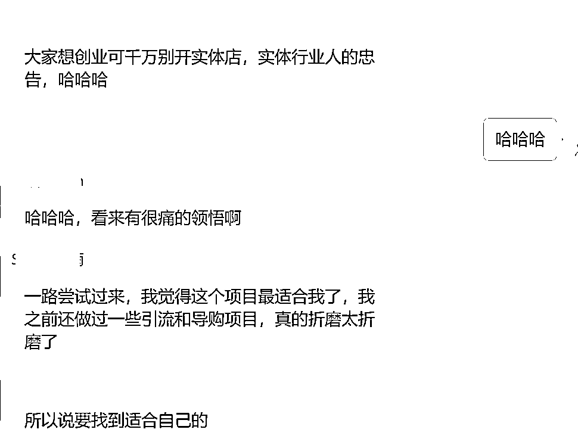
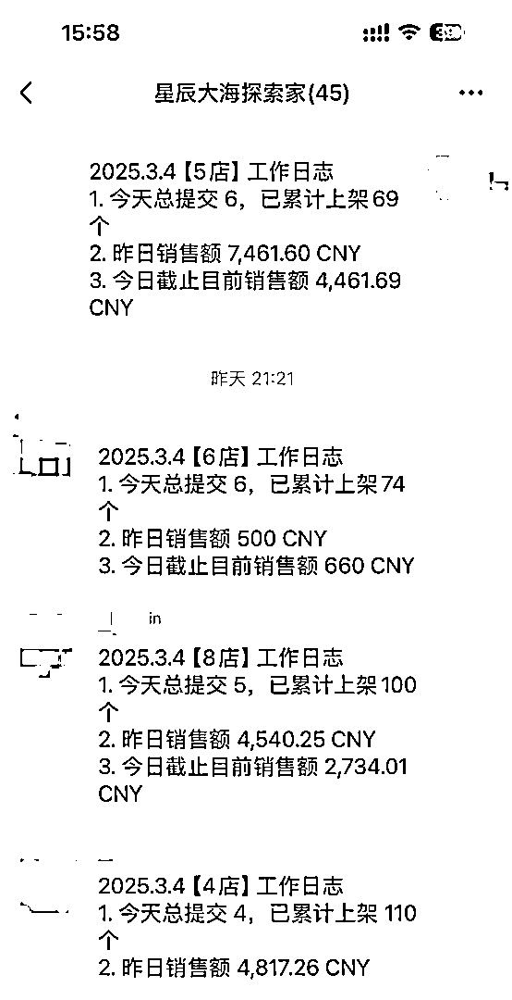

# 【航海好事】从自动驾驶程序员到跨境电商新手：两个月摸通 Shein 全托管

> 来源：[https://u0u31gqf3j8.feishu.cn/docx/FGxodf6S1oggccxkPqYc6LgPnud](https://u0u31gqf3j8.feishu.cn/docx/FGxodf6S1oggccxkPqYc6LgPnud)

# 缘起

大家好，我是李酸🍋，之前在自动驾驶行业做程序员，从实习生一路走到公司管理层，带过150多人的团队。去年，因公司战略调整，我选择离开职场。那之后，我一直在寻找一件真正属于自己的事——最好是每天醒来，都愿意为它投入精力的事业。

不过，对一个从未创业、也没有电商经验的人来说，迈出这一步并不容易。那段时间，我在网上研究各种项目，也参加了不少社群。后来偶然在生财星球看到小善的帖子，和他加上微信聊了几天后，他邀请我到海南数字游民社区当面交流。

我的跨境电商之路，就这样开启了。由于航海项目对报名者有一定经验要求，而我完全是电商新人，为了确保能参与其中，我先报名做志愿者，一边协助大家，一边补课学习。

航海开始后，我认真看了学员们遇到的各类问题，也找来许多跨境电商的文章和视频学习。与此同时，我联系上同在深圳的组长@Rain，每天主动去他家附近的星巴克一起办公。线下讨论让学习效率提升不少，而他已有的电商经验，也帮我少走了很多弯路。

从零开始，到掌握选品、商品上架、寻找货源和优化链接等环节，我用了一个多月。1月5日，我开出了自己的店铺，如今成交金额已经超过10万元。

# 第一次迎来爆单

“天啊，订单起来了！”

2月9日早上9点，我打开店铺后台，发现成交金额已经超过2000元。

我有些不敢相信。从开始学习到那天，不过两个月。此前我每天起床都会先看数据，日成交大多只有180元、200元左右。那段时间正值春节，希音整体表现也不算好，但我们团队还是坚持每天上新、把该做的事情一项项做好。没想到，某一天的成交金额竟然突破了2000元。

这当然谈不上多大的成绩，但对一个从没做过电商的小白而言，却意义非凡。我过去和电商最直接的关系，无非是经常在淘宝、拼多多和京东购物。眼前的这2000元，让我第一次相信：不去上班、靠自己喜欢的工作生活，并非遥不可及。

然而，订单增长很快带来了新的难题。采购对接群里消息不断，原先的供货链接失效，同事催着我尽快找到新的货源。上百笔订单需要紧急采购，可刚联系上的供应商产能还没恢复——春节后工人要到元宵节前后才陆续返岗。

电商从来不是一个人单打独斗的事。要是当时只有我自己，恐怕还得踩更多坑，损失也可能更大。

## 罚款风险：可能超过两万元

2月10日，急采订单还在处理，采购同事已经开始着急：如果货物没能按时发出，可能要面临两万元以上的罚款。

我当时心态都快崩了。好不容易碰到一个卖得好的商品，怎么转眼就可能变成亏损？

## 先把库存清零

这时，小虹老师在群里提醒，如果暂时还没有稳定货源，就赶快将库存调整为0，避免订单继续涌入。我照着做了，同时继续寻找供应商。

在组员们的协助下，我们最终找到了新的货源，并一次下单3000件。

## 断货后，流量也跟着下滑

2月11日，商品销量和曝光量都明显下跌。原本超过1万的曝光人数，直接降到了1000多；日销量也从100多单，回落到每天十几单。

看着数据曲线，我的心情也跟着大起大落。

这就是爆单之后的真实体验吗？😭😭😭😭

# 复盘：爆款只是开始

这一次经历，让我把电商运营的多个环节都真正走了一遍：商品上架、活动提报、数据分析、违规处理、提前备货，以及库存管理。

选出一个爆款，固然重要；但想让商品持续卖得好，还得密切关注数据，及时调整运营策略。小虹老师也告诉我，前期交罚款、爆款断货，都是成长过程中可能要经历的事。再多的培训，也未必比亲自承担一次损失更让人记住。经历过这次教训，我相信自己之后会更加谨慎。

至少这一课，我已经亲身上过了。

# 写在最后

工作多年后我越来越觉得，即便坐到了管理岗位，也可能只是更高级的“工具人”。每天做着自己并不认同的事情，一边承受老板的压力，一边又把压力传递给下属，长期下来，人很难不被消耗。对我来说，一段压抑的职场经历，甚至让身心状态都出了问题。

收入和名声当然重要，但当生活已经有了一定基础，我更希望做一份自己期待的工作。只是对于长期在大厂当螺丝钉的人来说，虽然见过一些业务、也管理过团队，要独立搭建一个小型商业闭环，仍然需要从头摸索。

我很感谢生财有术。通过这里，我了解、观察了许多方向，最终遇见小善团队，也逐渐找到一份更自由、自己真正喜欢的工作。

目前我做的还是运营工作，但我想继续往前走，做出能给用户带来价值的好产品。入行之后，我才真正体会到热爱工作的感觉：晚上刷视频时，我也会主动关注产品怎么优化、用户需求如何调研。等我们这批参加生财培训的同学做到5000单，就准备开始跨境电商改品了，特别期待！

希望等我做出第一个真正为用户创造价值的爆品时，还能再来和大家分享。

在组里和同学们聊过之后，我发现很多人都不喜欢打工。原来，想要改变生活的人并不只有我一个。

如今，我终于找到一份热爱的事业，也遇到一群有意思的伙伴。我们一起做事、交流创业经验，也在彼此陪伴中不断成长。

纵然前路有风雨，也要一步一步向前。

最后，感谢生财有术，感谢小善团队，也感谢一路同行的组员们。

愿大家都能找到自己真心喜欢的工作。如果你也在公司里感到压抑，或者正被不合理的管理方式困扰，欢迎来找我聊聊。