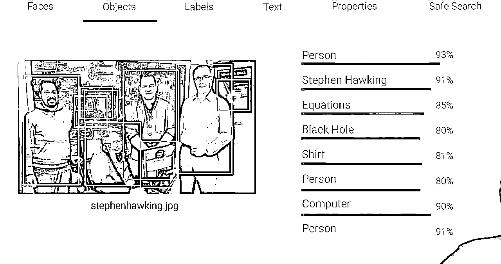
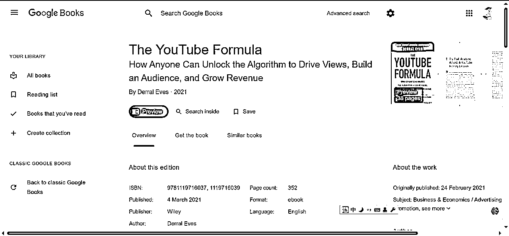
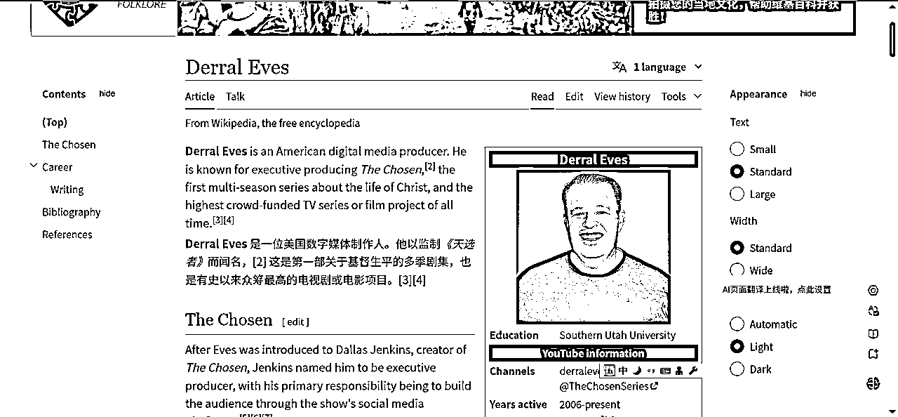
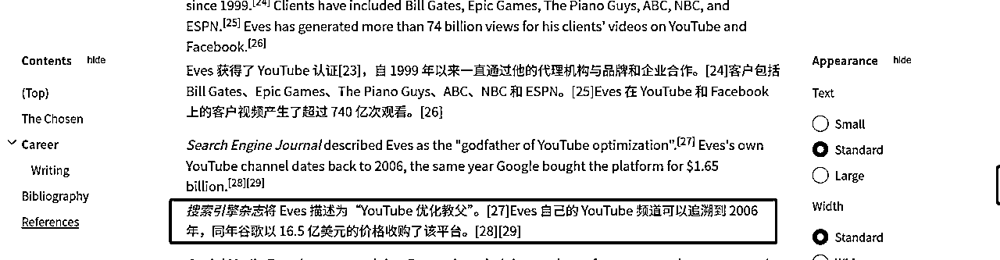
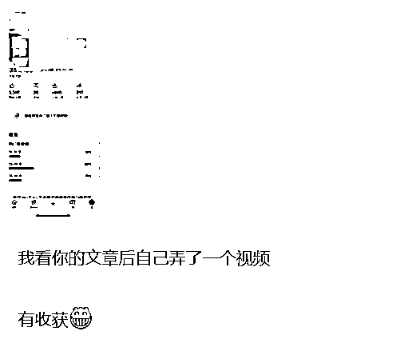
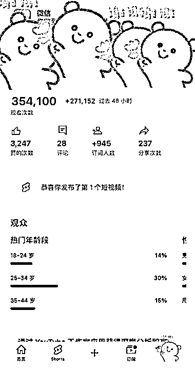
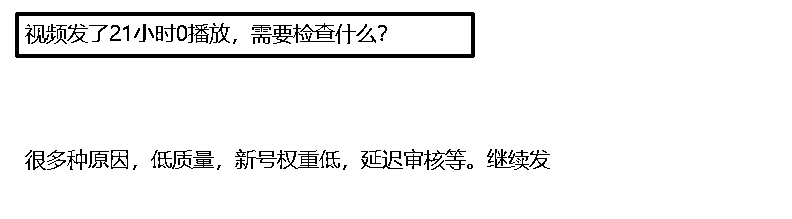
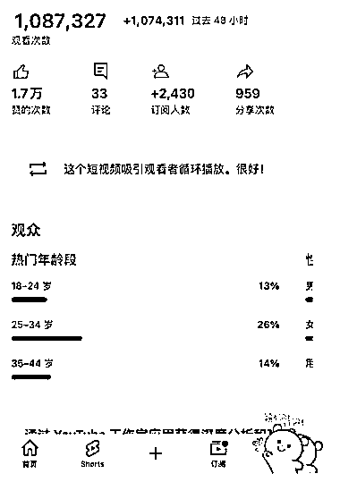

# 做YouTube要不要养号？别再被国内那套经验带偏了

在国内的短视频培训里，“养号”几乎成了标配话术。新号注册后要先养一段时间，不然发什么都起不来。把这套思路原封不动搬到YouTube上，就是典型的刻舟求剑。

我的判断很直接：YouTube压根没有养号的必要。

这个平台2005年就上线了，二十年技术沉淀，算法早已不是靠手工“养”出来的。Google的识别能力有多强不用多说，一张图就能精准拆解人物、场景、文字、物体。YouTube作为Google旗下产品，推荐系统早就成熟到可以自己判断内容好坏。

油管公式的作者

说实话，国内做到一点成绩就把经验照抄到YouTube上，是很偷懒的做法。搜索引擎杂志把Derral Eves称为 “YouTube优化教父”，他的书才是真正值得反复研读的。他的核心观点也很硬：不是平台有问题，是内容不够好。我把这句话单独拎出来加粗，因为它就是答案。

【腾讯文档】 油管公式
https://docs.qq.com/doc/DRkRJUFVRZ1JSTGtZ

专业一点的操作是分频道使用。至少准备两个号：一个日常号，用来随便刷、随便看、找对标；另一个是垂直号，只用来做你想过YPP的领域。

为什么要分开？垂直号的关注列表里放的都是你找到的对标账号，首页就会被这类内容占据。抄作业、找灵感、看趋势会快很多。日常号负责探索，垂直号负责专注，互不干扰。

注册完直接发也行。内容被观众喜欢，自然会有人来。决定播放量的关键，永远是视频本身的质量。

想一下逻辑就通了：就算你把号养得再久，视频一塌糊涂，真的会有人看吗？答案是不会。

现实里常见两种反例：有人养号却0播放，有人新号直接发播放量就起来。这就说明养号没有决定性作用。

YouTube的机制更像赛马。符合推荐逻辑的视频会获得曝光，不符合的就被沉下去。所谓的垃圾视频，是指观众反馈差的视频。算法会根据完播、互动、回看等信号判断。

优质内容会被大力推。视频上线48小时是关键观察期，如果后台出现 “这个短视频吸引观看者循环播放。很好!” 这类提示，就说明方向对了，后续流量有保障。

以上只是我的实操总结。

核心就一句话：内容优质，养不养号无所谓；内容平庸，养号也救不回来。

下面补充一些关于平台逻辑的基础认知，后续再展开讲算法细节。

YouTube的目标是什么
1、预测观众想看什么
2、最大限度地提高观众的长期参与度和满意度

人工智能使用的多个系统
1、浏览功能：首页个性化推荐和订阅页
2、推荐视频：“接下来播放”及相关视频
3、趋势视频：区域/社群热点
4、通知：开启小铃铛的推送
5、搜索：依赖元数据、观众反馈和新鲜度

YouTube如何收集用户数据
1. 用户行为监测
每天会收集海量用户行为数据，包括观看时长、点赞/点踩、是否跳过、观看的具体片段等。公开数据曾提到每天约800亿个数据点，现在只会更多。
2. 视频数据分析
收集封面、标题、描述、字幕等信息，用于理解内容并参与推荐。
3. 反馈机制
通过问卷等形式收集用户对视频的主观反馈，进一步校准偏好。
4. 多层次推荐算法
基于直接反馈、视频关联和历史观看记录进行综合建模。
5. 安全扫描
利用图像识别技术扫描封面和内容，识别违规信息，保证合规。

视频的原数据有哪些
1. 封面图
代表性图片，直接影响点击率。
2. 标题
核心信息，决定搜索和推荐效果。
3. 说明文字
提供上下文，提升搜索相关性。可以用GPT提炼重点填入。
4. 字幕
人工或自动字幕，帮助理解并提升可达性。
5. 其它元数据
上传日期、时长、分类标签等。

如何提高推荐率
1. 优化标题和描述，用好相关关键词
2. 做高质量缩略图，提升点击欲望
3. 增加观看时长，内容要让人看完
4. 保持稳定更新，建立观众预期
5. 提高互动，引导点赞评论分享
6. 合理使用标签，帮助系统理解主题
7. 看分析数据，根据表现调整策略
8. 建立社区，通过直播、社媒等方式增强黏性