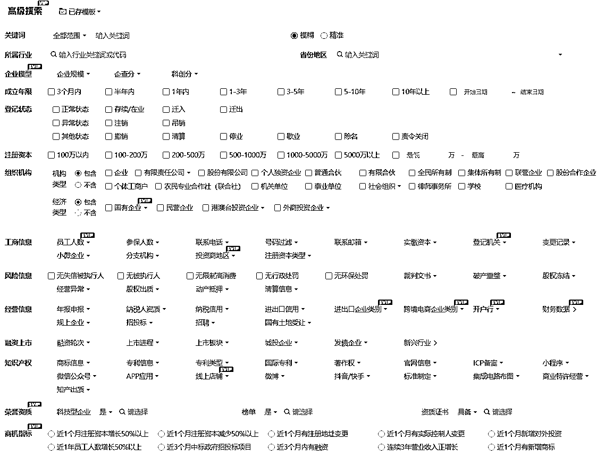
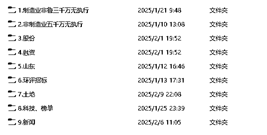
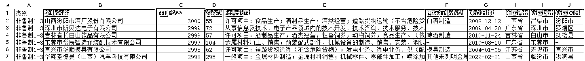
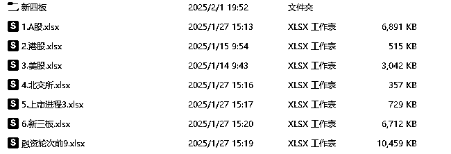
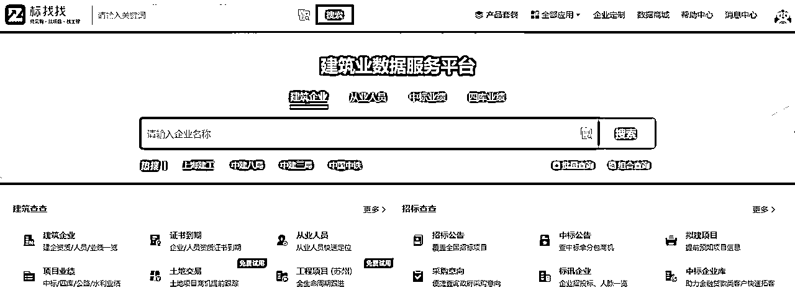
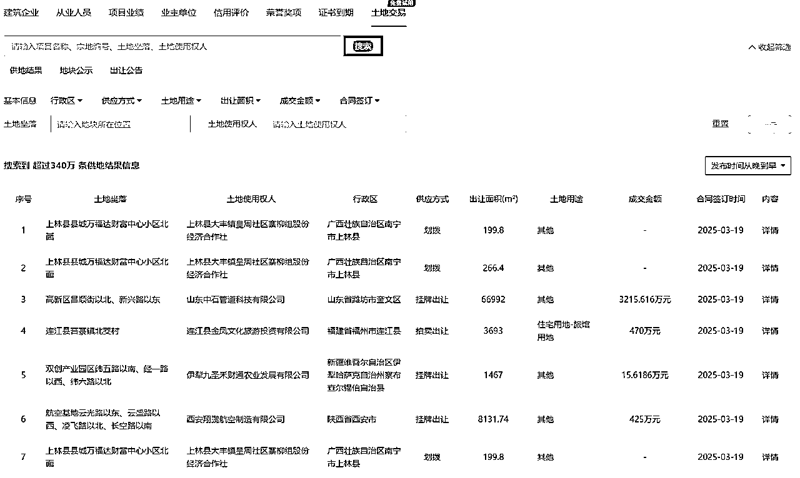
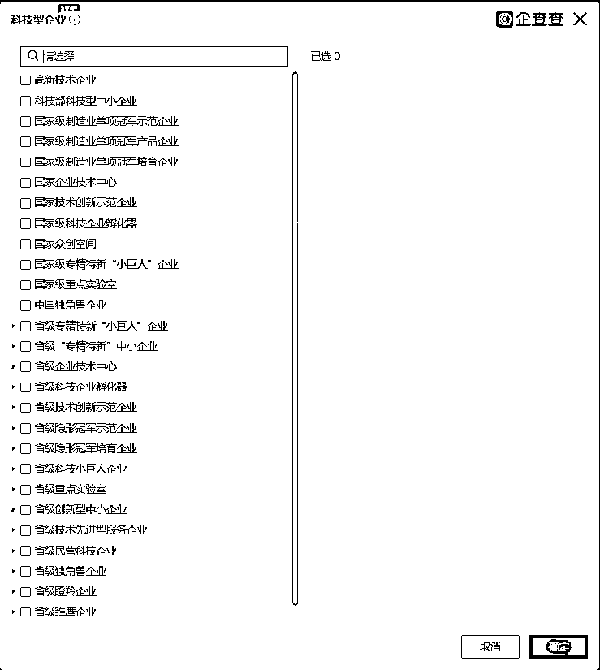
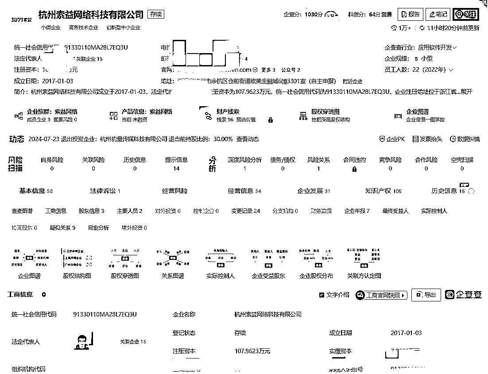
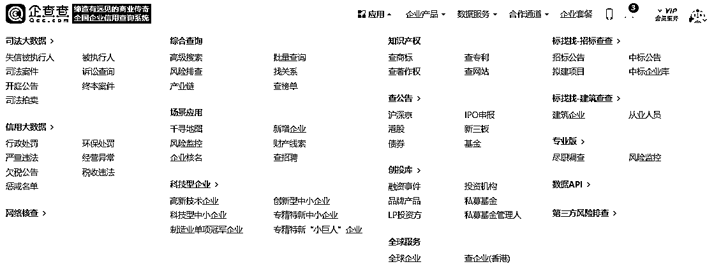
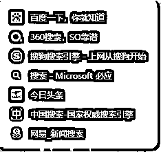

# 一个地方政府招商人的5年实战复盘：招商引资，真正要做的只有三件事

大家好，我是来自“风筝之都”潍坊的半扇咸鱼。

我曾在潍坊滨海开发区做了5年一线招商，2019年至2023年，亲历过从找线索、打电话、邀约企业，到项目考察、谈判、签约和落地的完整流程。

这篇文章不讲空泛理论，只分享招商一线真正用得上的方法。无论你是想进入地方政府招商岗位，还是正在做产业招商、园区招商、招商服务，都可以从中找到一些可执行的思路。

---

# 一、我为什么会走上招商这条路

2018年，我从一所普通本科院校的市场营销专业毕业。

毕业后，我通过校招进入苏宁易购，在卖场做管培生。半年后，我已经做到部门督导，但每天扫街、扫楼、背产品参数、接待客户的工作让我越来越疲惫，于是瞒着父母辞了职。

那时候身上只有几千块钱，我租了间小房子，想着先从校园电话卡推广开始，靠给移动、联通、电信拉新生办卡赚取分成。后来又搬进学校创业大楼，开始尝试自己做项目。

现在回头看，完全是典型的“为了创业而创业”，失败并不意外。

一开始，我通过新生QQ群、贴吧等渠道提前积累了一批客户，原本以为能有几千元收益。没想到正式开学后，很多新生被学长用各种方式截走，最后预估收入缩水到不到1000元。

那是我第一次真正感受到商业竞争的残酷。

之后很长一段时间，我都没有找到合适的项目。可能是因为当时盯上的校园消费群体，本身消费能力有限，也可能是因为那时的我对做项目几乎一无所知。

没钱交房租的时候，压力大到得了鼻炎，鼻子堵得像水泥封住一样。过年回家后，我终于把真实情况告诉父母。

第二年，我回到潍坊，找到一份跨境电商产品经理的工作。

公司当时自称是潍坊乃至山东较早做跨境电商的企业，实际工作内容主要是：

- 在eBay上寻找产品；
- 从国内采购；
- 发往海外仓；
- 负责一条具体产品线。

我们同组的三个新人，分别负责笔记本散热器、键盘和螺丝。我比较年轻，想法多但执行不稳定，产品利润一直做不上去，工资基本只够应付房贷。

后来我才知道，老板过去曾被内部员工“反向培养”出一个比自己规模还大的竞争对手，所以对新人设置了较长的观察期。那两个比我年长、熬过考察期的同事，最后都成为了公司合伙人。

可惜后来彼此联系越来越少。

再回到开发区后，女朋友去小学教英语，我开始留意当地的工作机会。潍坊滨海开发区的产业以化工和制造业为主，当时我也找不到特别匹配的岗位。

直到2019年9月左右，开发区负责招商引资的集团公司公开招聘，岗位要求市场营销专业背景。

我一看，正合适。

折腾了一段时间后，我终于进入了地方政府招商体系。

---

# 二、刚开始招商：每天都很忙，却不知道自己在忙什么

入职第一天，我坐在进门右手边、打卡机旁边的第一张办公桌前。

桌上放着一部电话和一台运行缓慢的联想台式机，慢到让我一度怀疑人生。

我被分到了当时要求最严格的一位部长手下。现在看来，正是那段高压经历，训练了我后来的抗压能力。

刚入职的第一周，主要任务不是打电话，而是把开发区的基本情况摸清楚。

招商人员必须先了解自己的“家底”，包括：

- 开发区面积和功能分区；
- 人口分布；
- 主导产业；
- 当地龙头企业；
- 规模以上企业及其产品；
- 水、电、气、蒸汽价格；
- 土地承载能力；
- 厂房建设成本；
- 污水、固废等处理费用；
- 当地气候条件；
- 人力资源情况。

只有把这些信息掌握清楚，后面和企业沟通时才不会一问三不知。

第二周开始，我正式进入招商工作。

作为一线招商人员，我的任务主要是寻找项目线索、整理企业资料，再把线索交给部长，由部长继续负责企业家对接、邀约、来访、谈判等工作。

所以那时候的我，工作内容和电话销售非常接近：

上网搜企业、找联系人、打电话、加微信、继续打电话。

我在2019年10月入职，直到2020年底，整整一年时间，我都处于一种迷茫状态。

我不知道：

- 什么行业最适合开发区？
- 应该寻找什么类型的企业？
- 企业里的哪个人掌握投资决策？
- 什么样的项目才有可能真正落地？
- 招商工作到底应该如何建立自己的方法论？

虽然单位组织过一些培训，但大多是宏观介绍，对实际找项目帮助并不大。我经常被批评，业绩也只能算一般。

到了2020年底过年期间，我开始认真琢磨：招商到底应该怎么做？

后面我会直接把总结出来的实战方法讲清楚。

先简单汇报一下当时的结果：

- 微信添加企业高管约1400人；
- 累计获取项目线索100余条；
- 接待来访企业20批次；
- 接触过国内500强、上市公司、地方龙头和行业头部企业；
- 项目规模从2亿元到100亿元不等；
- 进入签约流程3个，规模分别为1亿元、2亿元和5亿元；
- 最终签约落地项目1个。

招商圈里经常有人动不动就说自己手里有几十亿、上百亿项目，联系着各种高管、智库人才和高层次专家。

但说到底，大多数招商人也只是普通打工人。

---

# 三、招商引资，本质上就是三步

我后来把招商工作归纳成三件事：

1. 找到匹配的企业；
2. 找到企业内部真正负责项目投资的人；
3. 把对方邀请到当地考察。

看起来简单，真正困难的地方也恰好集中在这里。

---

# 四、第一步：如何寻找合适的企业

我平时特别喜欢研究别人正在跟进的项目。

不是为了抢项目，而是想搞清楚：这些企业到底是从哪里被发现的？招商人员通过什么渠道找到它们？哪些信号说明企业可能有投资需求？

我筛选企业主要看两个维度：

- 有没有实力；
- 有没有投资意愿。

## 1. 先看企业实力

企业实力可以简单理解为三方面的组合：

- 有人；
- 有钱；
- 有资产、技术或资源。

具体而言，以下几类企业通常值得重点关注：

- 世界500强；
- 中国500强；
- 央企、国企；
- A股上市公司；
- 港股、美股上市企业；
- 省级重点企业；
- 市级重点企业；
- 行业龙头；
- 地方头部企业。

其中，A股主板上市公司通常是比较优先的目标。港股、美股企业也可以关注，但筛选时要结合实际经营情况。

不过，越有实力的企业，通常越难接触。

我们当时曾经组建过专门的攻坚小组，专门处理那些多个部门轮番联系仍然没有进展的重点企业。真正的大企业，往往不是打一个电话、发一封邮件就能建立联系的。

这些名单本身并不难找，网上基本都有公开信息。

真正值得注意的是：新进入榜单的企业。

一个企业突然从普通企业进入某个榜单，往往意味着它正处于快速增长阶段，可能有扩产、融资、并购或异地布局的需求。

但也要警惕另一种情况。

有些超大型企业在某个时期突然大规模对外投资，这未必一定代表企业发展良好，也可能是资金链紧张、经营模式激进甚至风险暴露前的表现。

企业规模大，不等于项目安全。

## 2. 用企业信息平台建立自己的企业池

我使用过企查查、天眼查、水滴信用、启信宝、爱企查等多个工具，最后长期使用的还是企查查。

原因很简单：价格虽然不低，但功能确实比较完整，适合做批量筛选和持续跟踪。

它的高级搜索可以按照行业、注册资本、地区、企业状态、融资情况、风险信息等多个维度组合筛选。

我后来根据自己的招商需求，整理了一套企业分类体系。

前两个文件夹，主要按照制造业和非制造业进行区分，再叠加注册资本、风险情况等筛选条件。

第三个文件夹专门收集股份制企业。

为什么要单独关注股份制企业？

因为很多公司在准备上市时，会进行股份制改造。一旦企业进入上市准备阶段，资本运作、产能扩张和产业投资往往会变得更加活跃。

我当时有不少项目线索，就是从股份制企业中筛选出来的，例如川洋新材、新远新材等。

## 3. 关注融资、上市和资本市场信号

第四个文件夹是融资相关企业。

我会把以下企业统一归类：

- 上市公司；
- 新三板企业；
- 新四板企业；
- 北交所企业；
- 最近发生过融资的企业。

很多招商人员只盯着上市公司，实际上，新三板、新四板中也隐藏着不少有潜力的企业。

比如，后来落户我们开发区的福融新材料，就是从新四板企业中逐步追踪出来的。

其他通过上市企业名单找到的项目，还包括南通醋化、诚达药业、康佳产业园、中信金属、港股长沙远大住工、美股万物新生，以及北交所贝特瑞新材料等。

招商最难的地方，一是找到正确的企业，二是找到企业内部真正能推动项目的人。

前一个问题解决不了，后面所有工作都没有意义。

## 4. 把本省企业单独建档

第五个文件夹，我专门放山东省内企业。

原因也很现实：省内企业更容易适应当地环境，企业主对产业基础、交通距离、用工成本和区域文化都更容易接受。

如果你所在的是潍坊，可以优先关注济南、青岛、烟台等经济实力较强的城市。

省内企业的筛选标准，可以比省外企业适当放宽。

我后来成功落地的那个5亿元新材料项目，就是从青岛引进过来的。

招商人的高光时刻，往往不是加了多少企业微信，也不是打通了多少电话，而是项目正式签约的那一刻。

对我而言，2022年7月是特别难忘的时间：

- 捡回了自己的狗“土豆”；
- 工作上完成了项目签约；
- 备孕一年后，妻子也怀孕了。

那段时间，确实有一种所有事情都在往好处发展的感觉。

这个项目后来被列为潍坊市重点项目，2023年上半年建成投产。

对招商人来说，项目落地不仅意味着业绩，也意味着企业找到了合适的发展空间，当地增加了就业和税收，地方产业得到补充。

这大概就是招商工作的价值所在。

## 5. 省内跨区域招商，重点看几种动因

省内异地投资通常有几类原因：

- 企业搬迁；
- 产能扩张；
- 区域协作；
- 原有土地被征收；
- 当地资源和环保容量不足；
- 园区之间的产业协同。

例如，青岛经开区国企产业园相关项目，就和青潍一体化发展政策有关。

我们当时还集中研究过淄博化工企业。淄博化工产业基础很强，但土地和环保容量越来越紧张，因此不少企业存在寻找新空间的需求。

虽然最后并非所有考察项目都能落地，但确实出现过很多有效线索。

济南某医药企业也曾计划寻找500亩左右的医药化工项目承载地，并到我们开发区考察。

我成功落地的那个项目，则是因为青岛一家头部企业原有生产基地被征迁，需要重新寻找发展空间，最终才有机会转移到潍坊。

至于市内项目，最常见的逻辑是企业扩产。

这类项目更偏向租赁标准厂房，但市内企业招商非常依赖人脉和关系网络，后面会详细讲。

## 6. 从土地交易和环评记录中寻找真实投资者

第六、第七个文件夹，我分别整理土地交易和环评招标企业。

为什么要看这些信息？

因为真正买过土地、做过环评、启动过建设项目的企业，通常具备实际投资能力和项目经验。

环评招标信息需要从各地生态环境部门网站逐条查找，比较耗费时间。相比之下，土地交易信息更加集中、实用。

企查查的土地交易板块可以直接查询企业拿地信息。

你可以按照省份、城市、土地供应方式、成交时间、成交金额等条件进行筛选。

我的做法是：

先抓取近五年成交金额超过1000万元的土地交易，再往下筛选小额项目。

为什么不直接忽略小地块？

因为大型企业也可能在某个地区先买几十亩地，建设实验室、小试基地或中试平台。项目规模小，并不等于企业实力弱。

如果条件允许，还可以用爬虫、自动化脚本或智能体，把土地、招标、环评等数据批量整理出来，再交给AI做企业评级和招商优先级排序。

这类工具能极大提升效率。

招商做到最后，本质上就是积累。

如果每天能够找到10个有实力企业的关键联系人，一年就能积累3000多个企业家资源。

第二年再持续维护这些联系人，长期来看，很难一直没有项目机会。

## 7. 从科技标签和企业榜单判断企业质量

第八个文件夹，我称为“科技与榜单”。

除了世界500强、中国500强、省市百强，还有很多企业标签可以用来判断企业实力。

在高级搜索中选择科技型企业后，会出现大量细分标签。

不过，并不是所有标签的含金量都一样。

例如，高新技术企业这个标签，现在已经不能单独作为判断企业实力的核心依据。真正有价值的，是结合研发投入、专利质量、融资情况、产业地位、营收规模以及实际投资记录综合判断。

顺便说一句，生财有术本身也可以通过企业信息平台进行检索。

## 8. 其他几个值得使用的功能

企查查的很多功能，放在招商场景里都比较实用。

在主页上方的“应用”区域，还可以看到不少辅助工具。

### 司法和信用信息

重点关注：

- 失信被执行人；
- 严重违法；
- 欠税公告；
- 股权冻结；
- 经营异常。

尤其是欠税企业，需要谨慎对待。

地方政府除了土地收益，非常看重税收贡献。如果一个企业连现有税款都长期拖欠，异地投资后的经营质量就需要打问号。

当然，这也反映出不少三四线城市招商的现实逻辑：地方往往会优先选择更有实力、能持续贡献税收的企业。

### 产业链分析

综合查询中的产业链功能，可以帮助招商人员找到上下游企业，为产业链招商提供方向。

### 地图筛选

场景应用中的地图功能也很有价值。

我们当时集中寻找浙江化工企业时，如果单纯靠高级搜索难以覆盖，就会直接在地图上圈定区域，再逐一查看圈内企业。

一些新注册企业也值得留意。

比如某个地区突然集中出现一批低空经济企业，可能说明当地产业趋势正在形成。

如果一家公司在多个城市持续设立子公司或投资项目，也值得重点研究，因为这通常说明它具备异地扩张意愿。

### 科技型企业

科技标签可以辅助判断企业研发能力和技术实力。

### 上市公司公告

通过公告可以了解上市公司：

- 募投项目；
- 产能扩张；
- 对外投资；
- 重大合同；
- 资产收购；
- 异地布局计划。

除了企查查，巨潮资讯也是查询上市公司公告的重要渠道。

### 创投库

企业只有拥有一定资金实力，才有能力持续投资其他企业和项目。

因此，关注企业对外投资和创投行为，也能帮助判断其资本实力。

### 土地和项目招标

土地交易、工程招标和项目建设记录，都可以作为判断企业投资能力的重要参考。

---

# 五、一个更快的找线索方法：从新闻里挖项目

前面讲的是相对系统、偏长期的方法。

当时集团里还很流行一种更直接的方式：通过新闻寻找正在产生投资意向的企业。

企业去地方政府考察，地方政府接待企业，往往会在官网、公众号或新闻媒体发布信息。

文章中经常会出现这些词：

- 投资环境考察；
- 会见企业一行；
- 项目投资；
- 深化合作；
- 共谋发展；
- 推进项目落地。

招商人员可以整理关键词，然后通过以下渠道搜索：

- 百度、搜狗等搜索引擎；
- 微信搜一搜；
- 地方政府官网；
- 政府微信公众号；
- 园区官网；
- 当地媒体平台。

找到相关报道后，再反向提炼企业名称、考察地点、企业负责人和投资方向。

这类新闻通常意味着企业近期确实有投资或合作动作，转化概率会比普通企业更高。

但这种方法也存在问题：

- 企业实力差异很大；
- 有些新闻只是礼节性访问；
- 线索容易被大量招商人员重复使用；
- 如果所有人都只搜新闻，就没人愿意沉下心做企业数据库。

所以领导后来也会限制大家过度依赖这种方式。

更好的做法是：

先锁定实力企业，再专门搜索这些企业的投资新闻、考察信息和扩产计划。

效率虽然低一些，但线索质量会明显提升。

现在还可以使用爬虫、自动化工具和AI智能体，批量抓取重点企业新闻，再让AI进行企业筛选、投资意愿判断和线索排序。

这也是传统招商最适合借助互联网工具提升效率的地方。

---

# 六、选产业不能只看热门，要看地方能不能承接

寻找企业时，不能只盯着热门行业。

更重要的是结合当地的：

- 产业基础；
- 土地资源；
- 环保容量；
- 能源供应；
- 人才结构；
- 交通条件；
- 上下游配套；
- 政策边界。

潍坊滨海开发区的优势产业是化工、医药和新材料，所以我通常会围绕这些方向寻找企业。

像微电子、新能源汽车等项目，即使听起来非常热门，但如果当地没有配套、没有资源、没有承接能力，招商人也不应该盲目联系。

项目再好，地方接不住，也只是浪费双方时间。

尤其在全国统一大市场政策持续推进之后，地方不能再单纯依靠差异化招商优惠吸引企业。

未来真正有效的招商逻辑是：

- 地方有真实产业基础；
- 企业来到这里能够赚钱；
- 项目能够长期经营；
- 双方形成互惠关系。

不是靠口号，也不是靠短期补贴，而是靠真实的资源匹配。

---

# 七、第二步：如何联系到企业里的关键人物

找到企业只是第一关。

招商最核心的难题，是联系到真正能决定投资的人。

这里可以借用一个经典理论：六度人脉。

简单来说，世界上的任何两个人，都可以通过不超过六层关系建立联系。

企业家也一样。

我常用的方法主要有以下几种。

## 1. 直接从企业总机和公开电话切入

这是最传统，但往往最有效的方法。

尤其面对央企、国企时，官网电话、子公司电话、部门电话都值得逐一尝试。

央企国企的组织架构复杂、人员调整频繁，单靠一次电话，很难找到真正负责投资的人。

可以从多个部门入手：

- 投资部；
- 战略部；
- 战略投资部；
- 投资发展部；
- 发展规划部；
- 产业运营部；
- 董事会办公室；
- 区域发展部门。

不要假设某一个部门一定负责项目投资。

有些企业负责拿地的是投资部门，有些是战略部门，有些则由下属产业公司负责。

因此，需要通过不同部门交叉确认。

必要时，要连续跟进一周，甚至一个月。

如果企业设有多个子公司，就把相关子公司的电话、邮箱和联系人都整理出来。

央国企招商，考验的不是一两次沟通技巧，而是持续跟进的耐心。

有时候，传真、正式函件、盖章材料仍然很有价值。

发出材料后，再电话确认是否收到、是否转交、由谁负责，往往比单纯发微信更容易形成正式流程。

## 2. 先找部门，再确认具体姓名

如果电话接通后，对方要求提供具体姓名，可以从以下渠道查找：

- 企查查主要人员；
- 企业官网；
- 企业新闻；
- 上市公司公告；
- 脉脉；
- LinkedIn；
- 行业会议名单；
- 公开演讲和采访资料。

重点寻找的岗位包括：

- 投资负责人；
- 战略负责人；
- 副总经理；
- 董事会秘书；
- 产业发展负责人；
- 区域投资负责人；
- 产业园区负责人。

但要注意，工商登记中的高管不一定就是项目负责人。

工商信息只能帮助你建立线索，最终还要通过电话、邮件和交叉验证确认。

## 3. 通过协会和行业圈子寻找介绍人

行业协会、商会、产业联盟、校友会和企业家社群，也可能成为连接企业的入口。

这种方法比较适合擅长社交、善于维护关系的人。

但圈子质量差异很大，不能因为对方自称某协会负责人、商会副会长，就默认他一定能带来项目。

我自己也遇到过刚加好友，对方就开口索要当地特产，声称可以介绍项目，后来却再也没有下文。

所以，协会资源可以利用，但一定要核验对方的真实身份、行业影响力和过往项目记录。

## 4. 使用高管信息和数据工具

市面上有一些工具，可以帮助查询企业高管及投资负责人的联系方式。

涉及个人隐私和合规问题，这里不展开具体工具名称。

但从实际效果来看，合法合规地使用公开信息和企业数据库，确实能够提高找到关键人的概率。

---

# 八、招商培训，为什么很多人觉得没用

我参加过十几次招商培训。

总体感受是：

真正对一线员工有帮助的，应该是技能型、实战型培训，比如：

- 如何筛选企业；
- 如何搭建企业名单；
- 如何找到关键人；
- 如何打第一通电话；
- 如何判断投资意愿；
- 如何设计考察方案；
- 如何推进项目谈判；
- 如何识别项目风险。

但很多培训停留在宏观层面：

- 讲产业趋势；
- 讲招商战略；
- 讲区域发展；
- 讲政策方向；
- 讲成功案例。

这些内容并非完全没有价值，但对于刚入行的一线招商人员来说，距离实际操作太远。

如果一场培训不能让你回去后立刻多找到几家企业、打通几个关键联系人、提升项目推进效率，那它对一线员工的帮助就比较有限。

---

# 九、最后总结：招商没有神秘方法，核心是长期积累

地方政府招商听起来高大上，实际上是一项非常具体、非常琐碎，也非常考验耐性的工作。

真正有效的招商流程，可以浓缩为：

1. 建立目标企业池；
2. 判断企业实力和投资意愿；
3. 找到企业内部关键人；
4. 持续沟通和维护；
5. 邀请企业来实地考察；
6. 结合地方资源匹配项目；
7. 推动签约、建设和投产。

招商不是今天联系、明天签约。

很多项目从第一次接触到最终落地，可能需要一年、两年，甚至更久。

你今天添加的企业高管，可能半年后才有投资计划；你今天打通的电话，可能过一年才真正转化为项目。

所以，招商最重要的能力不是“会吹”，而是：

- 能不能持续积累；
- 能不能建立企业数据库；
- 能不能长期维护关系；
- 能不能判断企业真实需求；
- 能不能让企业看到在当地发展的确定性。

如果每天认真联系10个有实力企业的关键人物，一年下来就是3000多个企业联系人。

把这3000多人维护好，长期没有项目，几乎是不可能的。

现在，我也在尝试把过去的招商经验与网站、自动化工具、AI智能体结合起来，希望用更高效的方式完成企业搜集、新闻抓取、项目筛选和线索分析。

传统招商并不意味着低效。

只要善于使用数据和工具，完全可以让过去依赖人工、经验和人脉的工作，变得更系统、更智能。

这就是我做了5年地方政府招商后，最大的体会。