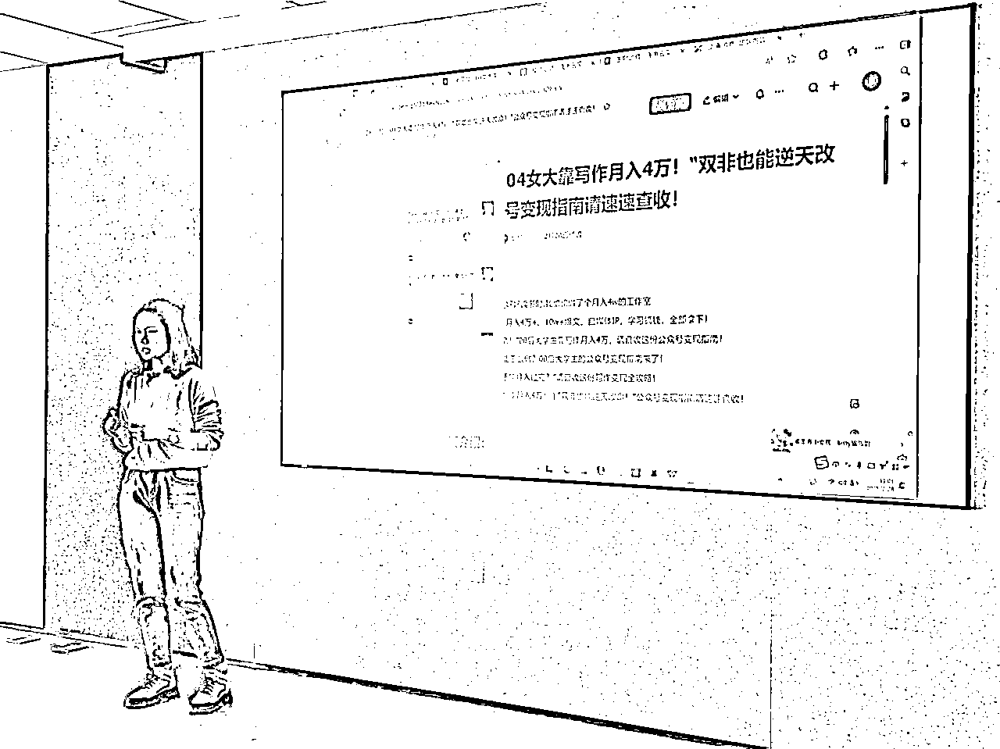

# 一场关于10万+标题的拆解课，贝拉告诉我们：爆款从来不是靠套公式
作者：龙哥

来赚钱联合办公刚满一周，我就赶上了最值的周五内部分享会。说是大佬云集也不为过，每个人身上都自带干货，氛围感拉满。

特别感谢雪姨牵线，请来了操盘过无数10万+的贝拉现场开讲。她正好也解答了我一直的困惑：为什么偶尔能中奖，却总做不出稳定流量的内容。周末把会上记得要点整理下来，远不止标题技巧，更是一套从定位到落地的完整打法。

关于爆款，我的认知被刷新了

❌ 不是撞大运
✅ 而是基于对用户的理解、对规律的拿捏，以及反复试错后的沉淀

这份笔记大概涵盖了七个层面：
1. 内容就该当产品来做
2. 爆款怎么拆，能科学诊断
3. 怎么写出能打的爆款
4. 创作要先想清楚结局，带着目的写
5. 热点可以借，但语义必须对上
6. AI能扛住80%的效率，剩下20%的关键在人
7. 个人IP是怎么搭建起来的

## 一、先把内容当成一门产品来经营

### 内容=产品

每篇文章、每个视频，本质都是一个要打磨的产品。想通这层，后面才有路：

*   核心是什么：你是靠个人魅力、专业能力，还是独特视角在立住？
*   价值在哪：解决用户的哪个具体问题，满足哪类刚需？
*   差异点：同质化环境下，你的不可替代性是什么？

小练习：挑你最近一篇作品，用产品视角复盘。它的核心功能是什么？用户使用体验如何？哪里可以迭代？

### 用户才是原点，别自嗨

创作最大的坑就是只想自己表达。我以前就是，花了大心血写出来，没人看，也只能怪自己没做用户功课。

*   画像要细：不是笼统的25-35岁白领，而是“工作3-5年，卡在职业瓶颈，想突破又没方向的年轻专业人士”
*   痛点要挖深：去评论区、社群、问答平台看真实吐槽，那才是选题库
*   认知要对齐：你的表达方式要贴合目标用户的理解水平和语言习惯

实操建议：做一张交叉表，横轴是你的内容供给，纵轴是用户需求，重合度最高的点就是你的主攻区。

## 二、爆款是可以被拆解的

### 看数据，别凭感觉

*   打开率+留存率一起看：打开高留存低=标题党，留存高打开低=标题没力
*   互动质量比数量重要：评论是浅层点赞还是深度讨论
*   最终转化：有没有带来关注、购买、转发等实际行为

### 对标要会抄

*   选可抄的标杆：找k值、领域相近的对标，别拿天花板对比
*   拆结构不拆皮：关键是研究“为什么这么做”，想引导用户做什么动作
*   取机制不取形式：学的是底层逻辑，不是表面套路

方法：挑3-5篇行业爆款，列出它们的共同点，基本就是用户最在意的核心诉求。

## 三、标题的打法，比想象中更讲究

### 结构上的讲究

*   视觉锚点：关键词怎么放，顺序怎么排
*   层层推进：关键词不是堆砌，是把用户一步步拽进你设定的场景
*   情绪牵引：好的关键词能直接点燃预期的情绪

### 心理上的触发

*   身份共鸣：用户看到瞬间觉得“说的就是我”
*   错失恐惧：不点开就会错过关键信息
*   闭环暗示：先抛问题，再暗示有解法

### 实操细节

*   换词不换意：意思保留，表达更新鲜，内核low但格调高
*   符合IP调性：标题风格要和整体人设统一
*   多版本测试：准备几个标题小范围投放，选赢家再全量

练手：拿一篇平平无奇的文章，试10种改法，让朋友投票最想点的那个。

## 四、创作底层：以终为始

*   先定结果：这篇发布后你要达成什么具体目标
*   倒推设计：从目标反推内容结构和落点
*   能量化：用明确指标判断成败

### 拉近距离与建立信任

*   营造同阵营感：让用户觉得“我们是一类人”
*   承诺要兑现：文章里提到的必须说到做到
*   留有余地：适度开放性表述，提升内容包容度

### 精准拿捏用户心理

*   可达感：难度要让用户觉得“努力下我也能行”
*   高级感：有那么点“看不懂但觉得高级”的满足
*   护自尊：别让用户产生“我注定做不到”的挫败

创作前自问：用户看完能得到什么？会有什么感受？接下来会做什么？

## 五、热点要借，但要借得聪明

*   语义匹配：热点和主题必须有真实关联
*   受众匹配：热点得是你核心用户在乎的
*   抢时间窗：黄金48小时内发声

节点内容有其特殊性：
*   网感>制作能力：更看对氛围的敏感
*   提前排期：重要节点提前规划
*   切入差异化：同样的节点，用不一样的角度

## 六、AI提效，人定方向

AI时代分工清晰了：
*   80/20法则：AI负责80%的重复劳动，人负责20%的关键判断
*   分工不同：AI强在逻辑结构，人强在情感洞察
*   指令决定结果：用AI前必须先想清楚自己要什么

## 七、做IP是一套系统工程

### 三个支柱
*   人：特质、背景、价值观，IP本身要够硬
*   产：你持续输出的内容或服务
*   事：能放大声量的关键节点和话题

### 长期主义
*   保持一致：风格和价值观稳定
*   持续深耕：一个领域不断做深
*   闭环反馈：用用户反馈迭代内容

# 最后唠叨两句

我是林悦己，这次贝拉的分享真的太有收获了。

如果你也在做IP内容想找人聊聊，可以去链接贝拉。期待下一场分享，也期待我自己能早点从“自嗨型创作者”毕业！