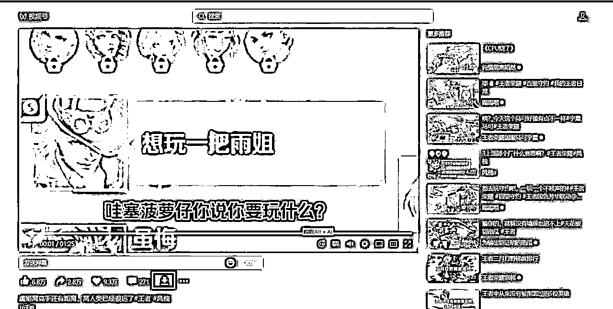
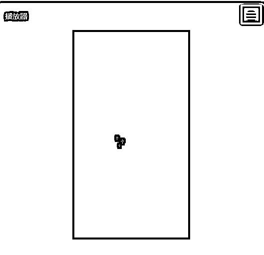
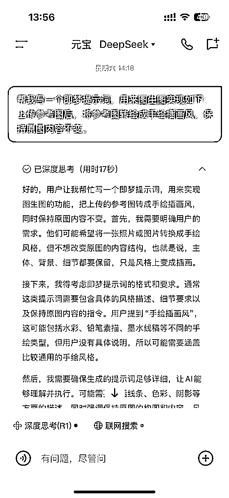
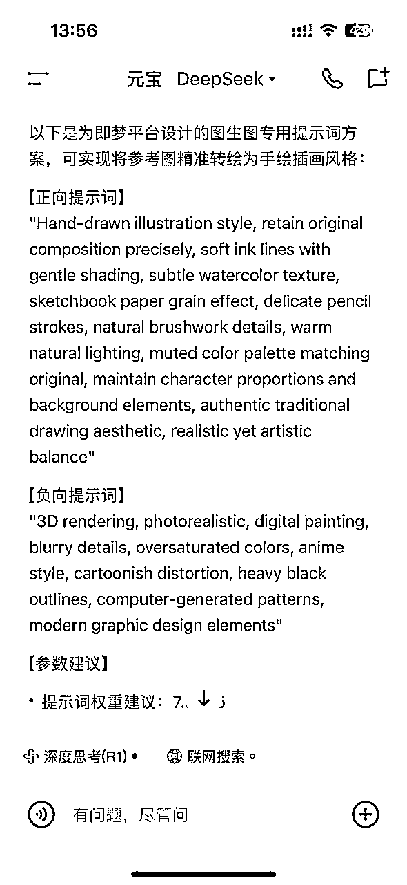
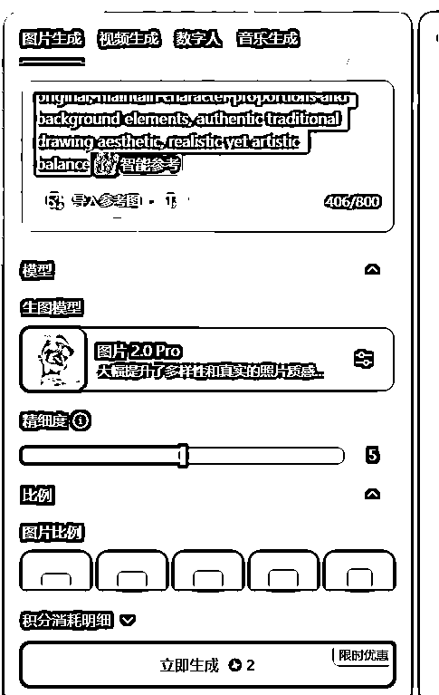
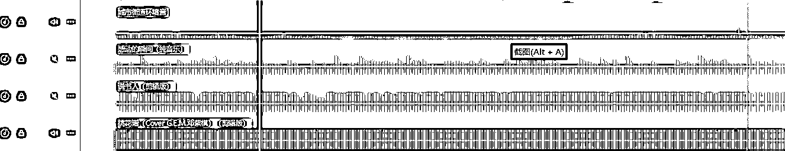
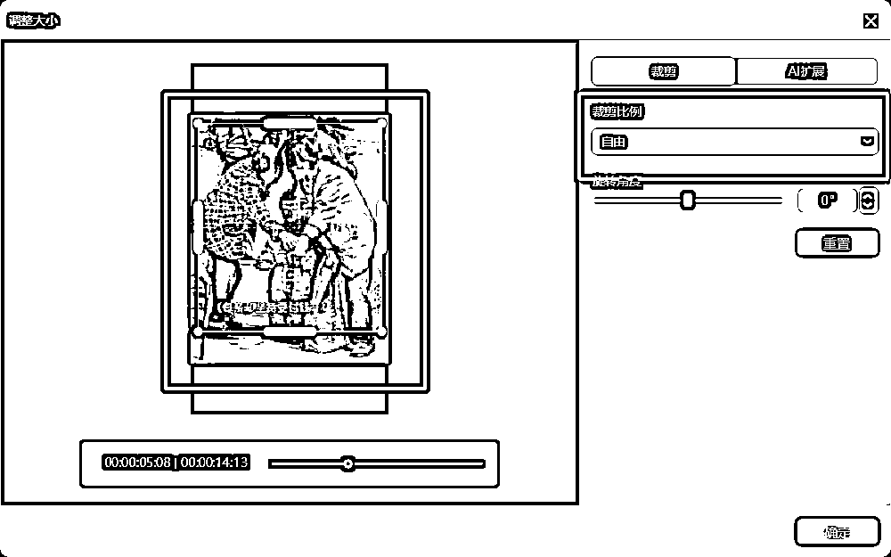
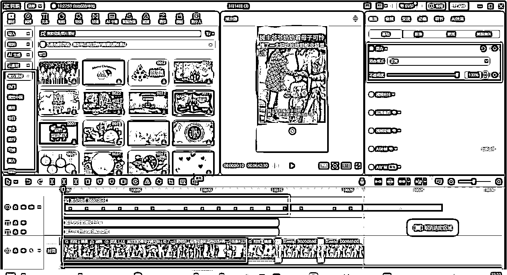

# 热点二剪+AI漫画化撬动视频号分成收益实操拆解

前两天看到龙哥大佬在风向标里放出的这个方向 https://scys.com/articleDetail/xq_topic/8858115581141512 ，我立马拿来验证，到现在已经能看见钱进账了。群里聊完怕细节散掉，这里把我跑通的完整路径整理清楚，给还在找门路的朋友一个可复制的参考。

从标题就能看出三件事要做：

*   挖掘爆款做二次剪辑，并做好去重
*   将视频中的关键画面转绘成漫画/手绘质感
*   达标后开通视频号广告分成：粉丝过百、累计发布十条以上、内容合规

## 一、素材获取与保存

### 怎么找
抖音、视频号直接搜索：
#画一个世界、#感人瞬间、#感动瞬间、#泪目
这几个词基本就够用，多刷多点赞，信息流很快会被同类内容占据。

我的囤料习惯是平时刷到点赞过万的作品就直接发到一个只有自己的群里存着，等攒够量再统一处理。

### 怎么下
抖音无水印下载很成熟。付费首选亨亨猫 https://hhm.zzrjcp.com/ ，免费可用 https://jianghudata.com/ ，都能一键去水印。操作很直观，几分钟就能上手。

视频号下载麻烦一些，可以用这个开源工具：https://github.com/ltaoo/wx_channels_download ，我也把本地包放出来了，需要的自取，杀毒软件可能误报，谨慎的去官网下载。

使用流程：解压后以管理员身份启动，首次会提示安装证书，确认即可。之后每次都要管理员权限启动，然后在微信里打开目标作品，页面会自动出现下载入口，点击即可。

下载完成的素材统一放到工作文件夹里集中管理，后续剪辑直接调用。去重逻辑放在后面。

## 二、关键帧转漫画风格

我现在的做法是剪映截帧+即梦重绘，ComfyUI熟练的可以直接上工作流。

把选中的视频导入剪映，拖到情绪峰值、催泪点等关键时刻，按下图方式导出静态帧：

拿到原图去即梦，用图片生成功能。我目前在用的描述如下：
Hand-drawn illustration style, retain original composition precisely, soft ink lines with gentle shading, subtle watercolor texture, sketchbook paper grain effect, delicate pencil strokes, natural brushwork details, warm natural lighting, muted color palette matching original, maintain character proportions and background elements, authentic traditional drawing aesthetic, realistic yet artistic balance

这个描述是让AI帮我迭代出来的：

另外微信搜“定格漫画”能找到不少现成的方法。

操作步骤：导入参考图-开启智能参考-生图模型选图片2.0 Pro：

通常一次就能成型，再抽几张提升不大。挑一张高清度HD版本保存，后续剪辑用。

## 三、视频号广告分成开通

需要同时满足三项：

*   粉丝达到100
有爆款自然涨，着急的话可以小额加速。我没有买粉，自己操作。
先给微信豆充值，20元基本够用，1:10入口在此：https://scys.com/articleDetail/xq_topic/4848282411241818
再开视频号语音直播放音乐发福袋涨粉，每次几分钱即可，具体手法见：https://scys.com/articleDetail/xq_topic/1525142211141452 。该教程原版带公众号引流，去掉公众号环节就是纯涨粉。我播了半小时，分批发了5毛福袋，涨了二十多个粉丝。
思路都是赚钱圈前辈分享的，实在想不通就问AI。

*   累计发布10条及以上视频
按后文剪辑方法做出10条即可。

*   内容符合视频号规范
按这套流程产出的片，基本不会触发违规。

## 四、剪辑去重与成片

成片风格参考风向标里提到的那个账号。核心是去重+结尾接漫画图。

去重做法：

*   音乐替换
基本不用原声。剪映里找几首热度氛围曲，比如《桃花诺》《说书人》《平凡日子里的挣扎》《感动的瞬间》等，直接铺满时间轴，原音频全静音。

*   画面去重
核心组合：裁剪原片+位置关键帧微动+滤镜+1%透明度画中画

按节奏裁剪原片保留精华。给画面加上位置关键帧，让画面在上下左右做细微位移，人眼难察但平台判定会变。具体演示我没录，直接看这个抖音教程：https://v.douyin.com/i5nTXvB5/
滤镜加一两个即可，这类内容对画质容错很高，甚至有点糊的也能爆。

1%透明度画中画很简单，自拍一段风景或用剪映自带素材放到副轨，透明度调到1%-3%。示意如下：

*   其他辅助手段
转场、贴纸、蒙版都可以上，去重重在巧妙不堆砌。抖音搜“去重”能找到大量教程。

最后把第二步生成的漫画图接在去重片段后面，时长2-5秒都行，给图片加一点缩放或位移关键帧，观感更流畅。

## 五、上线与后续

发布后按视频号分成计划航海手册执行：https://scys.com/view/docx/Ze3rdUHuIouvqTxK7amcyp6anXf
发布节奏、排错、放量方法都在里面，按步骤走就行。

这套打法门槛低，关键在选材有情绪、转绘有质感、去重别敷衍。先跑通一条，后续就是规模化。