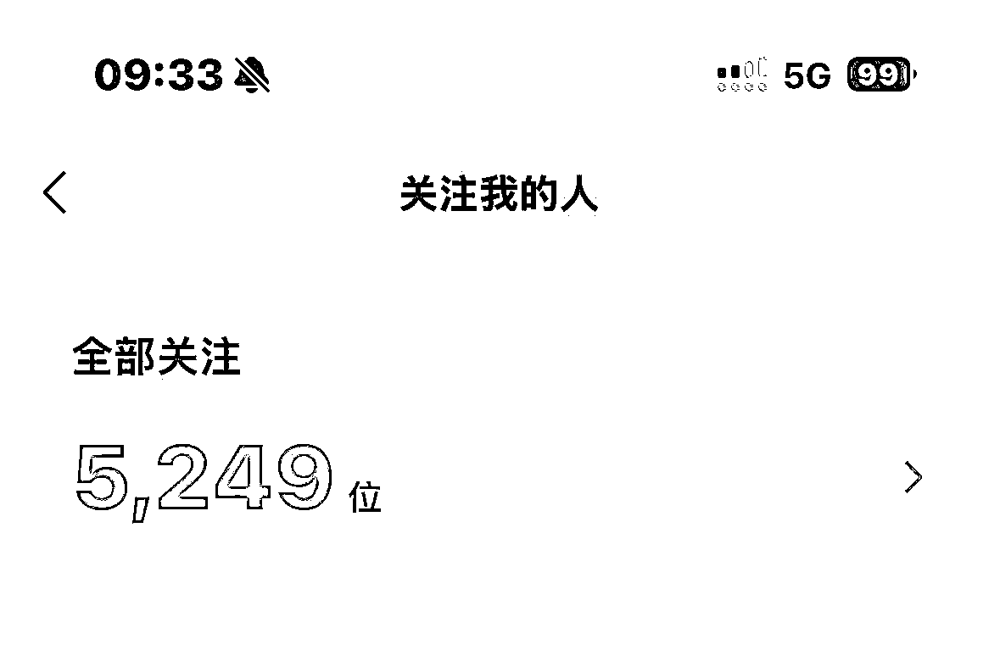
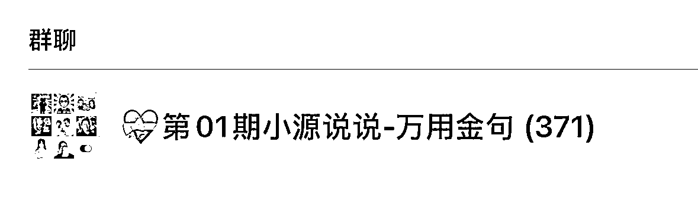
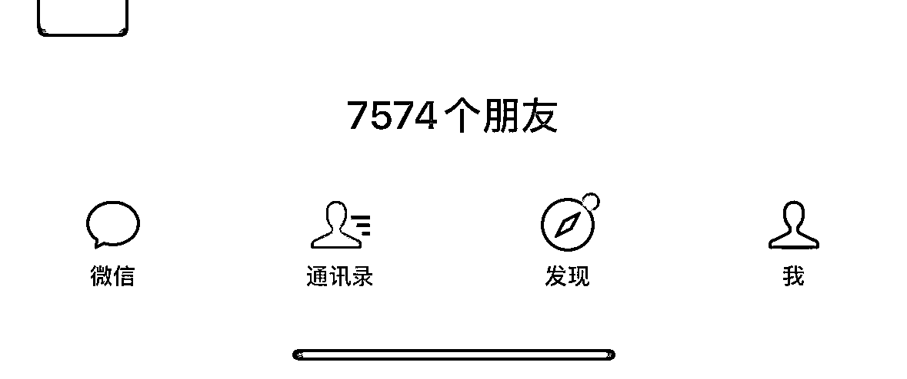
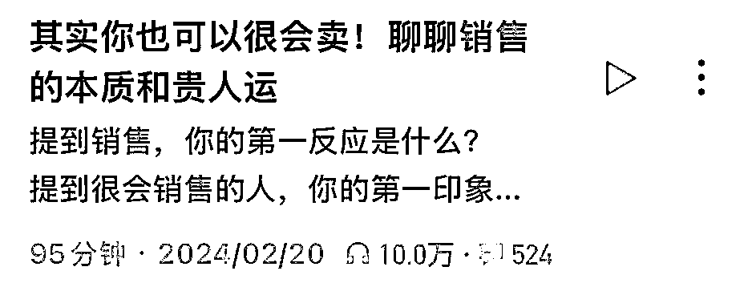
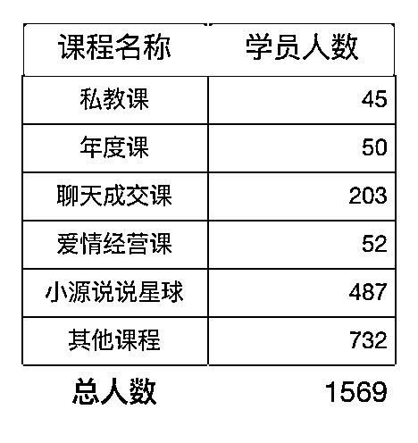
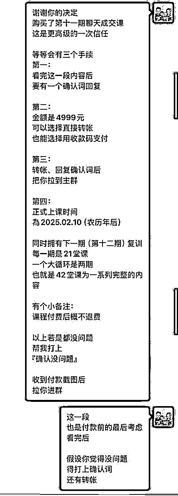
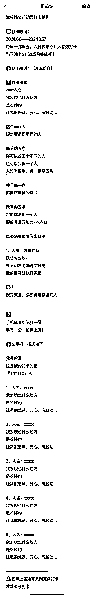

# 【赚钱技能】从低客单到高客单，用户是养出来的

全文共：13,729 字

预计阅读时间：10.8 分钟

大家好，我是根源。

从2022年年初正式转到线上知识付费算起，今年刚好是第四个年头。

对我而言，知识付费本质上就是把过去线下卖产品、卖课程的路径搬到了线上。只不过在线上成交之后，还得负责内容交付。所以我一直把这个赛道理解成一个销售赛道，只是带了交付环节。

既然是销售，就必然存在客单价的高低差异。今天想聊的就是，如何把低客单的成交一步步升级，最终卖出真正的高客单产品。希望我的实操经验能给正在摸索的圈友一些参考，也欢迎讨论。

* * *

# 低客单与高客单，差别在哪

## 先从价格分层说起

我给高单价一个很粗糙的定义：产品金额只要超过五千，我就把它算作入门级的高单价。五千以内通通归为低单价。当然往上没有天花板，上万、十万也都属于高单价范畴，这里只是做个通俗划分。

## 交付逻辑完全反过来

低客单和高客单的交付心态截然不同。

做低客单时，交付者会把重心全部放在“用户想要什么”，甚至不惜迎合。现在做高客单，逻辑就反了。不是去猜用户要什么，而是要想清楚“我能带给用户什么”。

一个是从用户出发，一个是从自身出发。低客单更像是在满足需求创造价值，高客单则是把自己的优势和价值最大化，让用户主动跟随。

而高客单交付必须配合一套筛选机制，通过内容编排和规则设计把合适的人挑出来。这个过程我称之为用户培养。

### 也就是说，一旦你掌握了培养用户的方法，就能自然地把低客单客户带到高客单上来。

* * *

# 先说说我的互联网体量

在聊方法前，先晒一下我的公域数据，多少有点不好意思，我到现在也只能算互联网小白。

2022年初开启第一次线上沟通课，定价131.4元。那是我正式入局知识付费的起点。当时线上几乎零基础，唯一的对外阵地只有公众号，并且一直到现在也只有这一个。

## 公众号体量

公众号从2022年到2023年初，用一年时间涨到约5000粉。

到现在两年多后，也才五千两百多。三年下来年均增长大概一千多到两千。

## 第一期付费课数据

第一期小源说说沟通课，报名总计371人，剔除工作人员后实际368人。

这批人分两部分：100人是我花10天，每天一对一谈单卖出10份；剩下的主要是明白老师写了一篇推文，通过他的链接进来的。这368人，是我起家时的核心资产。

## 微信体量

我只有一个微信大号，没有小号。

2022年初通讯录4861人，到现在三年过去涨到约7500人，三年净增约2000多，年均800左右。

## 播客体量

去年上过一档播客当嘉宾，到现在一年多，单期收听量10万。

以上就是能查到的公开数据。放在互联网里确实不起眼，流量成绩很平庸，除了公众号几乎没有其他平台。

但收益上，2022到2024这三年，平均每年稳定在七位数级别。这里说的是纯利润，不是营收。

如果只看微信通讯录这个最客观的指标，三年从4800多到7500多，净增2700人。平均每年净增900人，这900人就能带来七位数的利润，倒推下来人均客单在千元左右。

当然不可能加了好友就立刻付费。2022年起做社群到现在，这2700位新增好友里，真正付过费的有1569人，转化率约60%。

## 产品价格带

早期产品结构是三段式：100多元、900多元、2000多元。

现在已经演进为：5000元、3万元，再往上是终身私教，原价6万元现已涨到六位数。

其中最关键的资产是第一期沟通课的群。公众号5000粉，真正能导流到好友的比例5%-10%就不错了。而那371人，才是我第一年复购、转介绍的核心池，后续所有的裂变都源于这个池子。

* * *

# 如何培养能升单的用户

## 第一招：用付费做第一次筛选

要从低客单过渡到高客单，核心能力就是培养用户，让他愿意从几百元慢慢付到上万元。

培养本质上也是筛选，最直接的筛选就是付费。

早期做销售怕流失客户，只要用户表现出一点意向就会想尽办法成交，甚至什么都答应，先收钱再说。这是我过去走过的弯路。

如果目标是高客单，低价成交时反而要把节奏放慢。无论是百元、千元还是万元，在付款前我都会发一段较长的确认话术。

我会告诉用户，这是最后一次确认，也是付款前的冷静期。看完后如果仍愿意信任，就回复“确认没问题”再转账。

加上这一步，用户会感受到交付方的审慎，而不是一味催单。这本身就是筛选，冲动型小额付费的人会被筛掉，认真阅读、愿意停下来思考的人会被留下。同时也建立了“每次付费前都会有确认”的习惯。

## 第二招：盯住群里参与度最高的人

用户进群后，会有作业环节。100人里可能只有20人写，80人沉默。很多群主会自责，但我会反过来关注那20个天天准时写的。

他们愿意在低价产品里写作业，说明认可内容、渴望成长，也接受我的价值观。

这20人会进入我的核心观察名单，我会在群里互动，也会私聊。私聊后可能剩十几人依然高频沟通，三五人几乎不回。那这十几人就是真正认可我的用户。

我通过价值观输出把认同我的人吸过来。

## 第三招：持续输出，占领心智

通过社群机制筛出高意愿用户后，下一步是长期占据心智。

2022年我开始写公众号，每篇都锁定单一主题。我特别强调有教练/顾问带成长，效率更高、更稳。我自己被教练带了十年，基本功因此扎实。这呼应了龙哥的一句话：

### 当时是什么拯救你的，你就用这个去拯救别人。

当时公众号60%的内容都围绕这个主题写。写完就会同步到社群，平均阅读300多，基本就是社群自己在看。我的初衷也不是引流，而是给已有学员一个持续接收我观点的渠道。

当你有高客单产品构想时，不要只提一次，要反复提。用户看一次播下种子，看十次才会发芽。

高客单是小众生意。如果一个产品20万，引流产品100元，卖出一单就等于2000个引流用户。这个服务难度完全不同。所以高客单必须提前布局，而不是拍脑袋上线就有人买。

## 第四招：用复购次数筛选高意愿

和你买高客单的人如果是陌生人，后续交付成本会非常高。所以我的原则是：

### 小单价产品连续复购三次以上的人，才值得重点关注。

这里的小单价指5000元以下。若他买了三次以上，我会高度重视。

我当时有二三十个群的用户，一百多元的产品买了两次，九百多元买了一次，相当于一年内开了三十多个付费群，其中约20%的用户付费次数超过十次，买什么买什么。有一半以上最后都上了我最高单价的产品。

复购次数是培养和筛选的硬指标。

## 第五招：建立私交

高单价几乎不可能没有私交成交。陌生人直接冲高客单买，十有八九是坑。

高单价意味着高服务质量，信任感不足会让我在交付时特别累、特别烦躁，价值观不合磨合成本极高。

所以我几乎不会主动邀请没上过课、没付费超过两次或累计金额不到三千的用户去了解高客单产品。金额和付费次数是判断是否值得推进的关键门槛。

## 第六招：用清晰且复杂的规则训练用户

比如设计一个打卡营，规则写得很细：

1. 内容要同时发到微信群和星球作业区打卡。
2. 每条作业100字以上，且附带字数统计。
3. 必须在当天24点前完成，超时的算次日。

规则看起来繁琐，但只要说清就好。最后让用户复制一段承诺语：姓名、已阅规则、保证14天全勤、未完成罚200元红包。

愿意接龙的人已经过了第一关。100人里50人承诺，最后能全勤的可能只有20人左右。

没完成分两类：一种认罚直接发红包；一种找理由求情。前者是通过复杂机制筛选和训练出来的好用户，升级成高客单客户的概率很高。

## 第七招：聊天时多提问

和用户的交流，我会用4:6的比例，闲聊四成，提问六成。

提问能激发思考。浅思考是三五十字敷衍回复，深思考会是600-700字的长文输出。

反复提问培养用户的深度思考习惯，也能让我更清楚他是否真正认同我的价值观。

## 第八招：提高聊天频率

平时要多找用户聊天，分享近况、见闻、学习心得或日常关心。

我的最低标准是一周至少3天、累计对话超过100句，即我和用户各至少50句。可以拆分在周一10句、周二20句完成。

愿意为一个人付高客单，很大程度上是因为熟悉。熟悉他的沟通方式、解决问题的路径，这种熟悉感必须靠高频互动来建立。

培养用户不是一招鲜，而是从付费筛选、参与度观察、心智占领、复购验证、私交建立、规则训练、提问引导到高频互动的一整套体系。

高客单价成交的底层，不是靠几句漂亮话术，而是靠信任累积。

客户愿意支付越高的金额，通常就越不会把钱交给一个完全陌生、缺乏了解的人。正因为如此，平时与客户保持稳定沟通，持续互动，并让对方逐渐熟悉你，往往比偶尔一次强行推销更有价值。

可以把它理解为一个简单的关系公式：

**客户愿意支付的金额，往往与他对你的信任程度成正比；而相处时间与信任建立，也通常呈正相关。**

不过，这里有一个重要前提：聊天时间长，并不等于沟通质量高。

## 什么样的聊天，才算高质量？

很多人会误以为，自己发了很多文字、讲了很多内容，就是一次高质量沟通。实际上，判断标准并不是“谁说得多”，而是双方在对话中的参与结构。

如果始终是你在输出，对方只是简单回复几句，这种交流通常属于低质量沟通。它可能看起来很热闹，但客户并没有真正参与，也没有投入足够的思考。

相反，更高质量的沟通，往往是你适当收缩表达，把更多空间留给客户，让对方愿意讲述自己的情况、想法和需求。

如果用比例来衡量：

- 相对高质量的聊天，双方表达大约是6:4；
- 相对低质量的聊天，可能接近7:3，甚至更悬殊。

也就是说，你说得越多，对方回应越少，越可能说明这段交流还没有形成有效互动。尤其是在沟通初期，如果客户始终不愿意展开表达，往往意味着他没有深入思考，或者还没有真正进入信任状态。

这里的“高质量”和“低质量”，并不是在评价客户好不好，也不是说聊天越多越好，而是在观察：双方是否形成了相对平衡、有效的交流。

---

## 边界式交付：不同价格，对应不同服务方式

除了通过沟通建立信任，在产品交付上，也必须建立清晰的边界。

我的做法是：根据产品价格和服务深度，设置不同层级的答疑与交付方式。不同阶段，用户获得的服务权限不同，不能因为某个问题看起来简单，就随意跨越服务边界。

### 第一层：低价会员，仅限平台内提问

比如，三位数的社群会员，所有问题都需要在对应的平台提问。

如果对方通过私人微信来咨询，我不会直接作答，而是会明确告诉他：

“请把问题提交到平台的提问区，我会在那里统一回复。”

我也不会在私下回答之后，再把内容补充到社群或平台里。因为这个价格对应的服务方式，就是在指定平台完成答疑。

### 第二层：升级社群，可在群内公开获得解答

如果客户希望更快得到回应，或者希望在社群里直接交流，就需要进入更高一级、四位数价格的社群。

在这个阶段，他可以在群内提出问题，并获得公开解答。但即便如此，私下微信依然不属于这个层级的交付范围。

也就是说，第一阶段和第二阶段，都有明确的答疑场景：

- 平台会员，在平台提问；
- 高阶社群，在群内提问；
- 私聊提出的问题，不在对应服务范围内直接回复。

### 第三层：通过咨询权益，获得私下解答

再往上，就是一对一的私下答疑。

想获得这种服务，通常有两种方式：

1. 单独购买咨询服务；
2. 购买包含咨询权益的高价课程。

只有在具备相应权益的情况下，才会进入私下回复环节。

而且，私下咨询也不是无限制的。一般以一个小时为基本服务单位，对外咨询通常按照一小时计算；高价课程中赠送的咨询，通常是1到2小时，但本质上仍然以小时为计费与交付单位。

具体形式可以是：

- 文字沟通；
- 飞书语音；
- 线上语音连麦；
- 线下面谈。

### 第四层：私教服务，享受专属陪伴

最高层级是教练或私教服务。

进入这一层后，学员可以根据需要，随时进行一对一沟通。无论是文字、语音、直播连麦，还是线下交流，都可以纳入服务范围。

因为一对一服务的核心，不是简单地重复一个标准答案，而是根据具体人的背景、目标和现实问题，提供真正针对性的方案。

同一个问题，对不同的人可能有完全不同的处理方式。因此，一对一答复本身就是高度定制化的价值。

---

## 为什么一定要把交付边界划清楚？

从低价产品到高价课程，再到私教服务，价格越来越高，交付方式也应当逐层升级。

这并不是故意增加麻烦，而是在维护整个产品体系的公平性。

假设一个客户只购买了低价产品，却可以随时通过私聊获得一对一答疑，那么他实际上就享受了高价产品才应有的权益。

开始时，也许只是偶尔问一个简单问题。可一旦你开了这个口子，之后就很容易变成：

- 今天问一个问题；
- 明天再追问几个细节；
- 遇到新情况继续来咨询；
- 你只能不断投入时间回答。

这样一来，那些花费几千元购买一对一咨询，或者购买更高价格课程的客户，就会产生明显的不公平感：

“原来只要多问几次，也能得到私下解答，那我为什么还要支付更高的费用？”

所以，边界感并不是冷漠，也不是拒绝客户，而是在用清晰的规则保护不同产品的价值。

不同产品，必须拥有不同的服务逻辑；不同价格，也必须对应不同的交付深度。

---

## 高客单客户，往往更看重效率

有能力购买高价产品的客户，很多时候并不是没有问题，而是不愿意花大量时间在群里等待，也不喜欢反复寻找答案。

他们可能会觉得：

“还要去平台发帖、等回复，太慢了。我希望直接得到针对我的解决方案。”

这类客户通常很清楚一件事：如果想获得更高效率、更私密、更个性化的服务，就需要支付更高的费用，或者购买相应层级的产品。

当服务规则足够清楚时，客户反而更容易做决策：

- 我支付什么价格；
- 我可以获得什么服务；
- 如果需要更高效率的支持；
- 我应该升级到哪一种交付方式。

这就是边界式交付的意义：让不同阶段的客户，都能获得与其付费水平相匹配的服务。

---

## 最重要的一条原则

无论产品如何设计，都必须守住一个核心：

**不能让高客单价客户觉得，自己付出的钱没有得到相应价值。**

服务边界越清晰，产品层级越明确，客户越容易理解不同价格之间的差异，也越不容易因为权益混淆而产生失衡感。

从低价到高价的销售，不只是提高价格，更是要同步升级：

- 信任关系；
- 沟通质量；
- 服务效率；
- 交付深度；
- 解决方案的个性化程度。

当客户知道自己付出的每一分钱究竟买到了什么，产品价值才真正被建立起来。

以上，是我从低单价产品走向高单价销售过程中的一些实践和思考，希望能给你带来启发。

---

## 关于我

我是根源，也是第四期赚钱圈友。

目前是一名拥有2万多个实战案例的心理咨询师，同时积累了13年线下销售与团队管理经验。

2022年开始转型线上，逐步开展知识付费相关项目。

如果你能读到这里，说明你对这篇内容确实有兴趣，也欢迎继续阅读我过去整理的文章。

### 2021年文章

1. 精华《直觉式萨克斯：透过社群成功变现146万》  
https://t.zsxq.com/116B1bcYc

2. 《73项被动收入打造》  
https://t.zsxq.com/11EHjTH0P

3. 《杭州夜话02场，夜话官复盘》  
https://t.zsxq.com/19IkX4UMl

4. 《年入百万，团队从20人到4万人》  
https://t.zsxq.com/19JYt77hL

5. 《主题：如何更有效地链接见面会认识的圈友》  
https://t.zsxq.com/19VY2LWg4

### 2022年文章

1. 《互联网小白，第1次做线上产品，7天赚回10倍门票》  
https://t.zsxq.com/11ooZZbM7

2. 《把捣乱分子“逆势”转成爱用者的好方式》  
https://t.zsxq.com/19lipLhJ5

3. 《好的内容，是目前依旧没退流行的变现方式》  
https://t.zsxq.com/19BLMAYw1

4. 《明白老师的一个启发，让我从100天日耕的过程赚了30W+》  
https://t.zsxq.com/19BgNoxfi

### 2023年文章

1. 《私域的意义不是管理，而是经营》  
https://t.zsxq.com/19WEsfSq1

2. 精华《9年传统行业，1年时间从一无所有到年入200万》  
https://t.zsxq.com/10nmEr1cA

3. 精华《25个提高微信成交率的小技巧》  
https://t.zsxq.com/11AgRW24F

4. 精华《35个让私域收入翻3倍的技巧》  
https://t.zsxq.com/11FmV2aqZ

5. 《续篇：25个提高微信成交率的小技巧（26—50）》  
https://t.zsxq.com/13yRbmUwo

6. 《私域话题：涨价之后，如何回复以及留住客户？》  
https://t.zsxq.com/11UJk9HxQ

7. 精华《成为自由职业者的20个必备特质》  
https://t.zsxq.com/14Xtxhh15

8. 《36个让私域成交率翻倍的实战指南！》  
https://t.zsxq.com/17zSrYzvk

9. 精华《产品线有引流体系，如何通过沟通促成升单？》  
https://t.zsxq.com/17ocUJEFA

10. 《知识付费赛道，如何透过处理“反对问题”，增加用户黏性和复购率？》  
https://t.zsxq.com/181fSc5rv

### 2024年文章

1. 精华《第一次尝试“问答群形式”的公域往私域转化，7天变现11万》  
https://t.zsxq.com/18gBXlWxE

2. 《线上新手，我是如何用一套固定流程，累计成交300万高价产品？》  
https://t.zsxq.com/18IWgDiXo

3. 精华《私域话题：如何在客户咨询过程中，通过三个步骤提高2倍成交率？》  
https://t.zsxq.com/196Ad34aR

4. 《私域的十倍增长话题：不同信任程度的客户，如何提升成交率？》  
https://t.zsxq.com/YKHGT

5. 精华《为什么都是做副业，我能第一年就达到七位数？》  
https://t.zsxq.com/APodD

6. 《写作赛道，如何使用“算账思维”精准评估产出？》  
https://t.zsxq.com/ymcEE

7. 《私域+知识付费话题：如何通过增加合理的触达次数，提升2倍以上成交率？》  
https://t.zsxq.com/elSxU

8. 《9年传统行业转型第2年，如何维持百万利润》  
https://t.zsxq.com/61VlK

9. 《把副业做到超过主业收入，你必须知道的20件事！》  
https://t.zsxq.com/bkbd1

10. 精华《用这13个思维，我做过的副业全都成功变现！》  
https://t.zsxq.com/1q1Re

11. 精华《如何找到靠谱的人，让项目成功几率提升十倍？》  
https://t.zsxq.com/hJZfN

12. 《私域筛选流程小尝试：四位数产品课程，转化率40%》  
https://t.zsxq.com/o2dJx

13. 《30个“提高5倍微信成交率”的小技巧》  
https://t.zsxq.com/oThQB

14. 《私域话题：引流来的客户，用什么话术可以提高2倍成交率？》  
https://t.zsxq.com/RuaIy

15. 精华《如何处理退费（反对）问题，让高客单产品的退费率大幅降低？》  
https://t.zsxq.com/X2PEX

16. 《如何善待恶贵人，增加项目赚钱的稳定度？》  
https://t.zsxq.com/aspYc

17. 精华【赚钱技能】如何透过几个标准，筛选出合适的合伙人？  
https://t.zsxq.com/h1J4J

18. 精华【赚钱技能】我是如何建立自己的时间管理体系，让工作效率维持在不错的状态？  
https://t.zsxq.com/u4HxT

19. 精华【失败经验】四万人的团队，如何凭一身实力把团队搞崩盘？  
https://t.zsxq.com/YuLQz

20. 【赚钱技能】我知道副业很重要，但是却找不到坚持的动力  
https://t.zsxq.com/SDRdD

21. 【赚钱技能】好的咨询师，都得有属于自己的课程  
https://t.zsxq.com/sb0tW

22. 精华【赚钱认知】为什么大多数人的收入无法提升？  
https://t.zsxq.com/bUiir

23. 精华【赚钱技能】新人如何在一个社群里正确地请教与互动  
https://t.zsxq.com/d1GwK

24. 精华【航海好事】加入赚钱四年后，第一次有幸担任航海教练  
https://t.zsxq.com/u77ZC

25. 【赚钱认知】找对圈子，是提升认知的关键，谢谢赚钱大学！  
https://t.zsxq.com/Rf8Uq