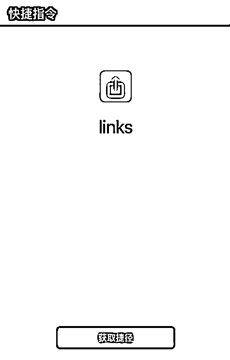
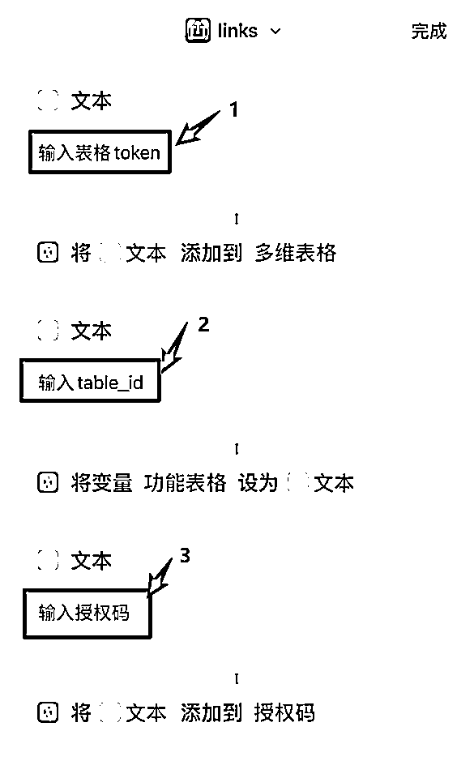
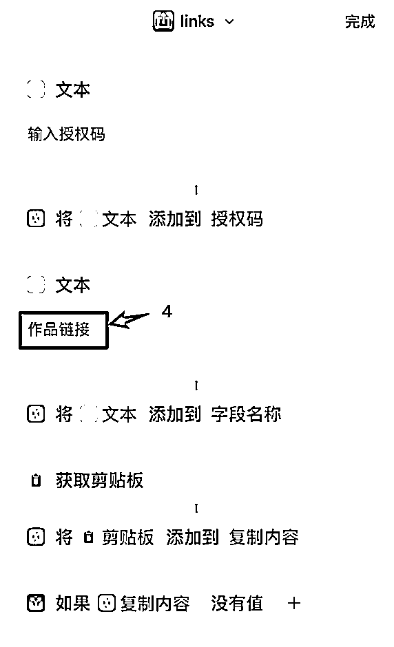
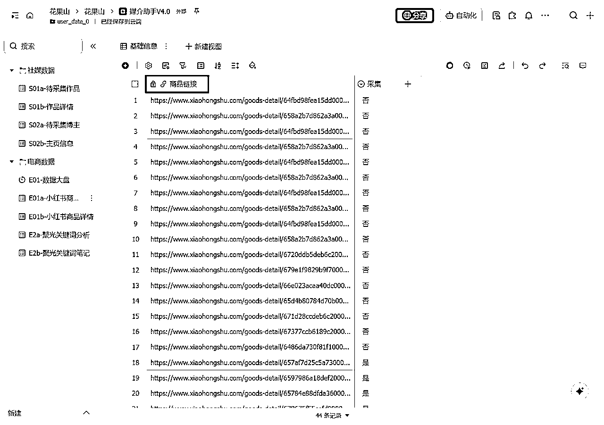

# iOS端采集链接上传多维表格

经常在手机上刷到好物、看到心仪的商品，想第一时间记到多维表格里？其实用iOS快捷指令就能实现“复制链接→自动入库”的丝滑操作。今天分享一套完整流程，全程免手动输入，尤其适合盯闲鱼动态这类场景。

1. 先拿到多维表格的关键参数
在你自己建立的表格里，找到 API 相关的三个值：token、table_id，以及授权码。如果不太清楚在哪看，可以参考官方文档，这里不赘述具体路径。

2. 安装快捷指令
直接点击下方链接，然后用手机自带的 Safari 浏览器打开（注意：别在微信或QQ里直接点，复制到 Safari 再访问）。
[快捷指令链接]

3. 填入参数完成配置
打开快捷指令后，把刚才拿到的三个参数——token、table_id、授权码——按提示填进去。确认无误后再保存。

4. 设置超链接字段
回到多维表格，把某一列的格式改为“超链接”，并命名为“作品链接”（或者你喜欢的任何名字）。但有一个关键点：快捷指令里的文本名称必须和表格里的字段名完全一致，一个字都不能差。比如你把它改成“商品链接”，那两边都要同步改。

5. 设置触发方式
根据你的使用习惯，给快捷指令安排一个触发入口。比如放到主屏幕、设置背面轻点，或者关联到分享菜单——这样你从任意App复制链接时，都能一键唤起。

常见的使用场景：
- 闲鱼商品监测：复制宝贝链接到多维表格，定时盯价格、库存变化，再配合自动化提醒，非常好用。

整个过程只需配置一次，之后就是复制粘贴的重复操作。需要的话，赶紧动手搭一个吧。