# 海外小游的变现打法：7套可复制的盈利路径拆解

大家好，赚钱的伙伴们。

我是七鹿，曾经在国内上市科技公司负责产品，现在是七只鹿游戏的联合创始人，这一年一直在做H5小游戏出海。

最近七只鹿AI公众号发布了《深度解析七种H5小游戏出海商业变现模式》，群里反馈很强，受邀我把原文重新梳理了一遍，和大家复盘一下。

去年十月我和合伙人正式入局海外小游戏，用AI建站工具fafafa搭了不少站点，也接触了大量同行。这个赛道吸金能力确实惊人。

下面把我对行业的一些复盘和框架分享出来，总结出七种主流盈利方式，供正在找方向的朋友参考。

* * *

海外互联网生态足够开放，小游戏出海的路子远不止应用商店上架。Facebook小游戏投放之外，Discord、YouTube等内容阵地也在用，近期被反复提及的Google SEO 游戏站模式，又让很多人重新看到海外小游戏的现金流。

哪怕不懂开发，也能借助AI工具快速起一个游戏站点分一杯羹。抓准一个正在升温的游戏，一年也能做到稳定收钱。

先把底层逻辑理清。大家结合自身手上的资源和擅长领域选赛道，也能更快建立对这个生态的认知地图。

正如我此前写过的https://mp.weixin.qq.com/s/F9VYe6BNRA9WVuFd1sU7CQ

做游戏站本质是做套利。把社交媒体上还没被引爆的小品搬到Google这个最大流量池里，吃自然搜索的红利。把搜来的用户导到站内，再用广告或充值差价变现。投入的并非大量资金，而是时间研判成本。

这和早期有人撬动TikTok短视频红利的思路类似，先低价买来TikTok的游戏曝光，再导到挂Google广告的站点里成交。核心在于找到TikTok侧的获客单价低于Google广告侧变现单价的品类。

所以我们更像处在游戏产业链的渠道环节。渠道的价值就是价差买卖，用更便宜的价格买进流量，用更高的价格卖出流量。

## 一、商业模型四要素

先把一个小游戏变现模型拆开：

流量套利模式分析框架：我们可以构建更全面的流量套利模式分析框架

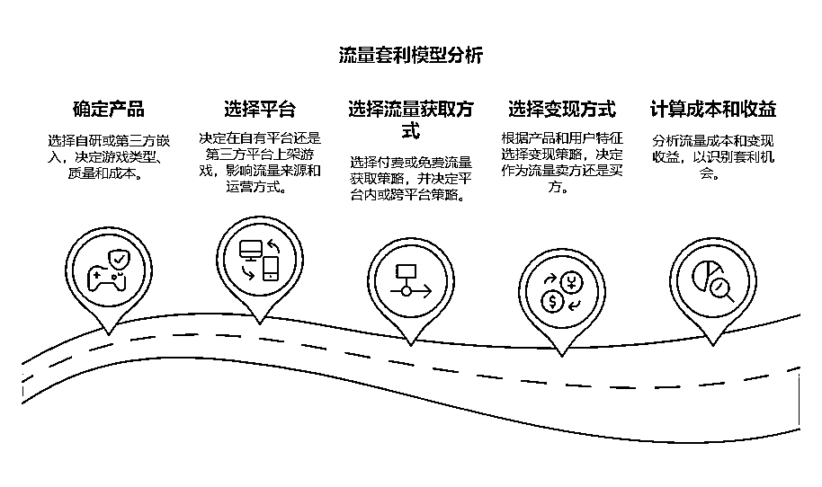

1. 确定产品：是自研还是接入第三方，直接决定内容形态、品质与成本。
2. 选择阵地：是自建站点还是借力第三方平台上线，决定流量来源与运营方式。
3. 选择获客路径：付费买量还是自然获客，结合产品特性做站内或跨站投放。
4. 选择变现手段：根据产品与用户画像判断是扮演流量出售方还是流量采购方。出售方靠低成本拿量高价卖出；采购方靠产品或资金换取平台流量。
5. 核算成本收益：对比获客成本与变现结果，判断是否形成套利空间。

## 二、要素详解

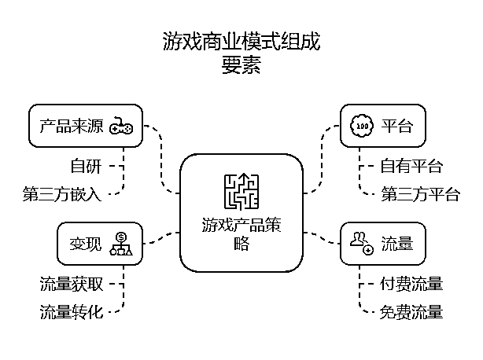

### 产品

游戏从哪里来

自研：自主开发，掌握IP与完全掌控权，投入高但利润天花板高。常见形态有H5站、App、SDK、客户端。

第三方接入：通过iframe嵌入他方游戏，几乎零开发成本，但质量与题材受制于上游。

### 阵地

用户在哪里触达

* 自营阵地：自建网站、App，掌控力强，变现规则自定义，但流量需自建。
* 他方平台：如Poki、Facebook Instant Games、微信小游戏，有现成用户池，但受规则制约。
* 专业游玩平台：Poki、CrazyGames、itch等，用户本来就为玩游戏而来。
* 移动分发平台：Google Play、App Store、Steam等，覆盖面广。
* 社交内容平台：TikTok、YouTube、Discord、Facebook等，社交属性强。
* B2B分发平台：Gamedistribution、Gamemonetize等分发渠道

### 流量

来源是什么

* 付费流量：广告投放、KOL合作，上线快但成本高。
* 站内投放：在游戏所在平台买量，如在Poki上买Poki广告。
* 跨站投放：在外部平台投放再导流，如TikTok投放导向自建站，Google搜索导向自有站。
* 自然流量：SEO、社群运营、病毒传播，成本低但周期长。
* 平台内自然流量NTFI：依托平台推荐与自然曝光，如Poki新游推荐，TikTok/YouTube/Discord内部传播。
* 平台外自然流量NTFO：通过SEO优化自建站收割Google搜索，通过社群把用户引到自营站点。

### 变现

流量是承载变现的核心

所有玩法都围绕获客与转化，核心是重新分配流量价值，用收益减成本形成利润。

两类角色

* 流量出售方：低成本获取流量，高价卖给广告平台或分成平台。
典型场景是H5游戏站靠广告或联盟分成赚钱，本质是流量转售。追求低成本获客与高溢价出售。
* 流量采购方：付费购买流量把用户导向自有资产，用用户付费或广告收入覆盖成本。
典型场景是自研游戏在Steam/YouTube买量，靠产品品质与用户付费盈利。
* 变现方式分类：广告、内购、买断、分成等，均服务于上述两类角色的闭环。

* 广告：横幅、插屏、激励视频，适合用户量大付费意愿低的休闲品类。开发者扮演流量出售方，把注意力卖给广告主。也可视为主出售或采购，取决于分成关系中的主导权。
* 游戏内广告
* 平台内广告：使用平台SDK，如Poki广告、Gamedistribution游戏内广告、AdMob等
* 第三方广告：如Google AdSense
* 游戏外广告：H5站的网页内广告

* 内购：道具、虚拟货币，适合粘性高付费意愿强的中重度游戏
* 买断：一次性付费，适合内容扎实的高品质作品
* 内购/买断更适合中重度游戏，开发者多为流量采购方，需花钱买高价值用户

* 分成：把自研游戏上架到GM/GD等B2B平台拿分成，或为Steam/App游戏导量拿佣金
* 混合模式：广告+内购并存，可能同时扮演两类角色，需动态平衡

* 变现核心公式
* 利润 =（用户生命周期价值 LTV - 流量获取成本 CAC）× 用户规模
* 出售方：LTV来自广告/分成，CAC依赖自然流量
* 采购方：LTV来自用户付费，CAC依赖投放效率

* 变现策略选择
* 轻量产品如H5小游戏：优先广告，降低CAC，靠规模
* 中重度产品：优先内购/买断，提升LTV，需精准买量
* 擅长低成本获客的，做流量出售方；擅长产品运营的，做流量采购方

成功变现的关键是找到CAC与LTV的最佳平衡点。

## 三、七大实操模式

把上述要素组合起来，目前出海的主流打法有七种，先说结论：本质都是低成本拿量，高溢价变现赚差价。

* 资源有限的团队：优先社交裂变模式三或SEO套利模式六
* 技术产品型团队：Poki等专业平台套利模式二、B2B技术套利模式五
* 资金充足的团队：混合变现对冲模式四或跨平台付费流量模式一、自研移动游戏模式七

### 模式一：跨平台付费流量套利

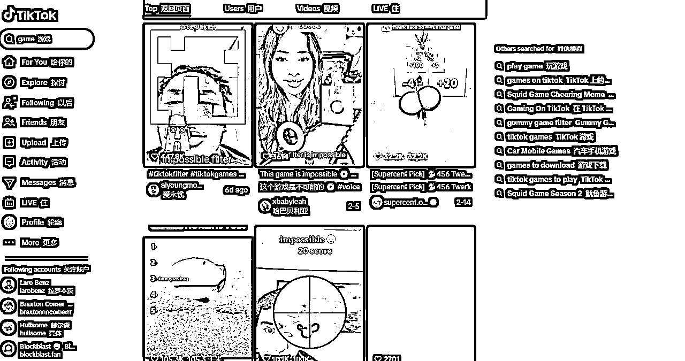

要素组合：
产品：第三方IFrame嵌入游戏
阵地：自建小游戏网站
流量：TikTok付费广告
变现：自建站挂载Google AdSense

套利逻辑：
TikTok短视频展示游戏亮点→点击进入自建站→广告收入覆盖投放成本

数据验证：停留>3分钟 → 至少2次广告曝光 → 单用户收益>0.02美元

适用场景：
低成本休闲游戏，主攻欧美高价值用户，和东南亚、拉美等新兴市场

风险：
TikTok外链跳转受限，需准备备选导流路径

核心逻辑是单用户收益>单用户成本，通过TikTok低价获客，靠AdSense高价变现形成差价。

关键拆解
低成本入口：TikTok在东南亚、拉美投放成本低，CPC便宜。内容用魔性玩法、即时反馈刺激点击。
轻量载体：iframe嵌入免自研，自建站只做承载+广告位，上线快。
变现优化：停留超3分钟触发多次广告曝光，提升eCPM。按区域选广告形式，如激励视频。
护城河在于数据闭环，实时优化投放和站内设计，确保ROI>1。轻资产可快速复制。

风险：平台限流、eCPM波动，需多渠道分流、动态调区。

本质是二道贩子流量生意：低价从TikTok收人，高价卖给Google广告主，靠转化效率赚钱。

* * *

### 模式二：平台内自然流量套利

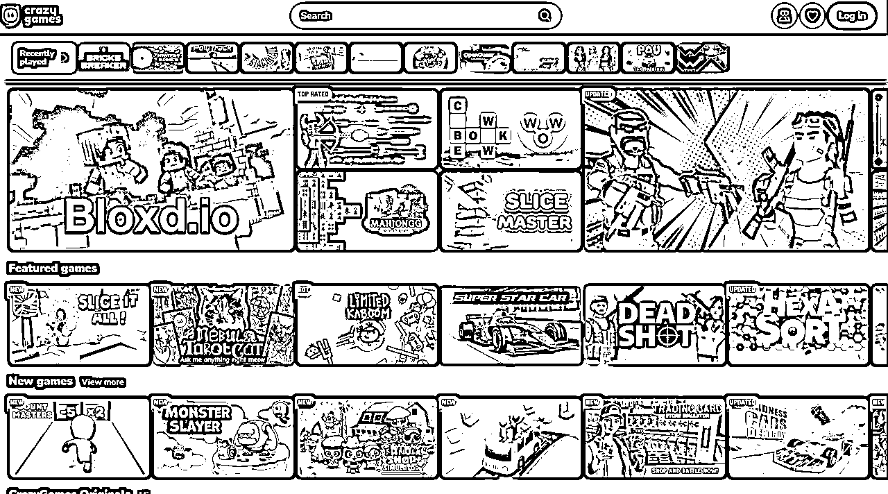

要素组合：
产品：自研精品H5小游戏
阵地：Poki、CrazyGame、ITCH等
流量：平台自然推荐
变现：内购分成或广告分成

套利逻辑：
利用Poki高活跃用户→做好付费设计提升LTV→平台抽成后净利>40%

适用场景：
欧美市场付费意愿强，千次展现收入高

风险：
需持续优化留存，DAU需>20%

核心是通过自研H5精品，借平台自然推荐，靠欧美用户高付费设计提升ARPU，平台仅抽30%左右，利润可观。

关键要素
产品定位：H5开发成本低、适配性强。精品化设计+付费点或高频广告。
流量选择：吃平台算法推荐红利，降低买量成本。瞄准欧美高ARPU用户。
变现优化：内购+激励视频混合，ARPU>$1。新手礼包、限时活动延长生命周期。

风险：留存依赖、平台算法波动，需多平台分发。竞争同质化，需玩法微创新或IP联动。

适合快速开发+数据驱动团队，靠低边际成本匹配高价值自然流量细化运营。

* * *

### 模式三：社交裂变免费流量套利

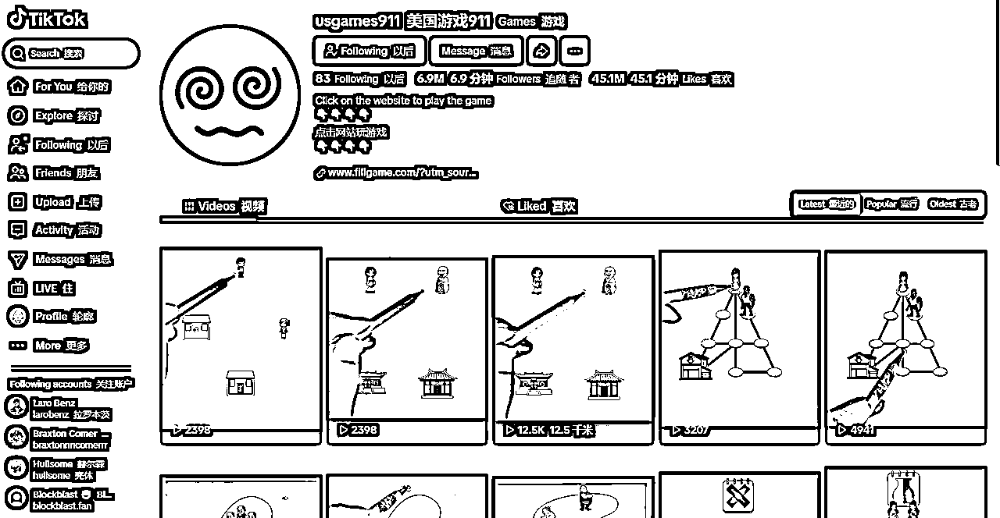

要素组合：
产品：第三方IFrame嵌入游戏，自建游戏网站
阵地：Facebook、Instagram、TikTok、Discord社群
流量：社群运营导流至网站
变现：综合广告收入

套利逻辑：
通过Discord等社群分发链接→用户邀请好友解锁奖励→免费流量价值放大

数据验证：裂变系数K>0.5

适用场景：
强社交属性游戏，偏年轻用户

风险：
重度依赖运营能力，需持续产出活动内容

核心是把获客成本转给用户，用邀请解锁奖励实现病毒传播，靠免费流量池+广告变现。

轻量产品快速分发，链接靠社群扩散。广告用展示+激励+插屏组合，形成用户增长-广告收入正循环。

依赖社群运营和多渠道分发，需平衡变现和体验。

本质是用社交杠杆撬动免费流量，靠规模换广告收入。

* * *

### 模式四：综合游戏平台付费流量套利

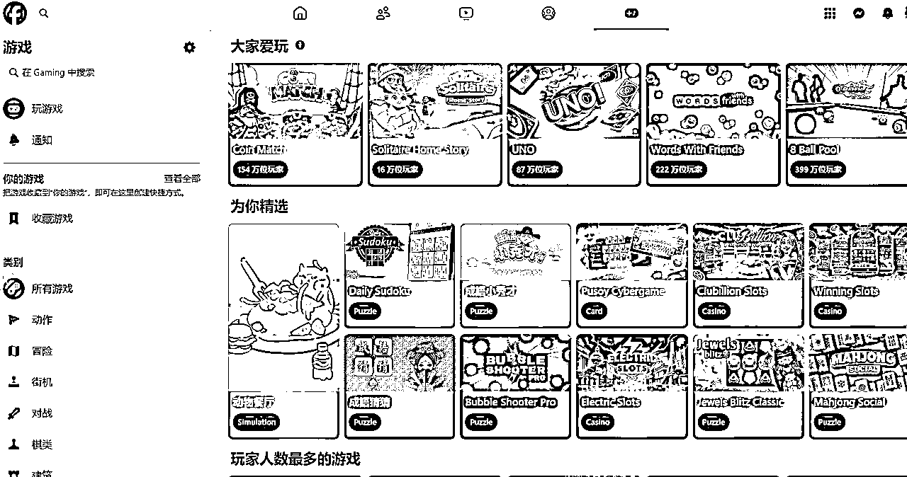

* 要素组合：
* 产品：自研轻中度游戏，如模拟经营
* 阵地：Facebook Instant Games、YouTube、Discord等小游戏平台

海外小游戏生意，真正值得研究的并不是“做一款游戏”本身，而是如何把不同地区、渠道和用户阶段中的价值差异，重新组合成可持续的收入结构。下面从几种典型路径展开说明。

---

### 路径一：内购与广告协同的双收入模型

**获客方式**

可在 Facebook、Instagram、TikTok、Discord 等渠道购买用户，采用 PTFI 投放方式，将单个安装成本压在 0.5 美元以内。

**收入来源**

一部分玩家通过内购贡献收入，目标 ARPPU 高于 3 美元；另一部分玩家不消费，但能通过广告曝光产生收益，eCPM 争取超过 8 美元。

模型能否成立，通常要观察两个门槛：

- 付费用户占比超过 5%
- 广告触达比例高于 70%

**它是如何运转的？**

可以把玩家大致分为两组：

- **高价值玩家**：通过模拟经营、长期养成、内容解锁等设计，让欧美用户持续投入，重点提升留存和单客付费。
- **大众玩家**：利用简单、易上手的玩法吸引更广泛的人群，再通过广告收入覆盖其获取费用。

换句话说，消费型玩家负责拉高利润，非消费型玩家负责贡献媒体收入，两部分收入互相补位。

**渠道组合**

Facebook、YouTube 等平台适合承载即开即玩的小游戏，用户进入成本较低；同时，可以借助 Discord 社区和熟人关系带来自然扩散。

TikTok 的年轻用户、Instagram 上的家庭用户可以形成互补，再利用自动化投放筛选更可能消费的人群，争取让高价值玩家带来的生命周期收入超过整体获客支出。

**收益测算**

单用户平均收入可按以下方式估算：

`平均收入 = 付费比例 × 单个付费用户收入 + 非付费比例 × 单个用户广告收入`

当付费占比达到 5% 以上、广告覆盖率维持在 70%以上时，理论上有机会跨过盈亏临界点。

**为什么具有缓冲能力？**

这套结构有两个调节按钮：

- 付费表现变弱时，可以适度增加广告触点；
- 广告单价下滑时，则依靠核心付费人群维持收入。

但调节必须建立在用户体验允许的范围内。激励视频、资源兑换等形式通常比强制插屏更柔和，能够把广告包装成游戏功能，而不是单纯打断流程。

**适用范围与限制**

欧美市场同时具备较好的内购能力和广告单价，更适合测试这一模型。其他地区如果消费能力与广告价格无法同时支撑，复制效果可能明显变差。

运营过程中要持续观察付费比例、广告覆盖程度和安装成本之间的关系，并及时调整商品价格、广告出现时机和展示密度。

---

### 模式五：面向渠道商的小游戏分发合作

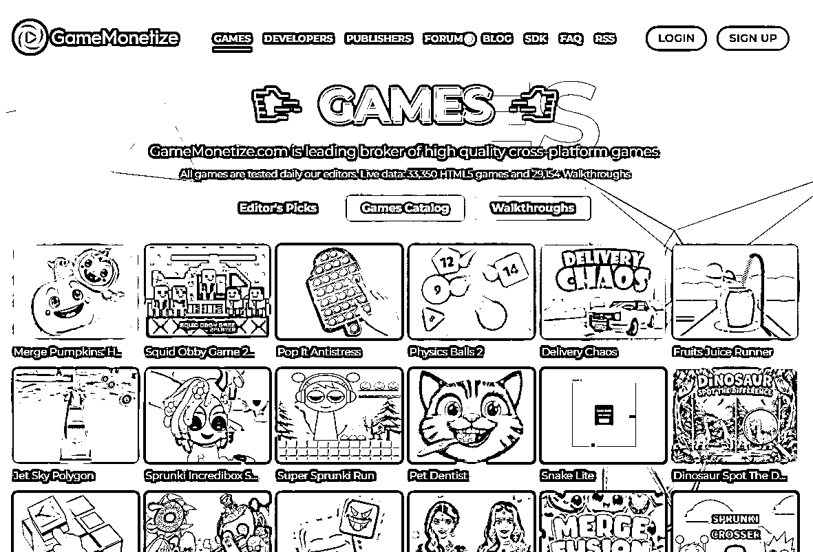

**基本配置**

- 产品：自研、定制化的 H5 轻游戏
- 渠道：通过 SDK 接入 Gamedistribution、Gamemonetize 等专业分发网络
- 用户来源：平台及其合作网站的现成用户
- 收入方式：按广告收入进行结算

**运行方式**

开发团队把游戏交给专业分发平台，由平台负责触达大量下游站点和玩家。团队不必自行搭建面向普通玩家的推广体系，而是按照约定比例分享广告收入。

这条路线适合技术能力较强、但缺少玩家运营经验的团队。

**优势在哪里？**

1. **研发投入相对可控**  
   H5 产品体量小，制作周期短，适合快速试错和连续更新。

2. **省去前端获客环节**  
   分发网络已经拥有网站、渠道和用户资源，开发者可以直接借助既有体系触达玩家。

3. **经营结构较轻**  
   不必自行维护大规模买量和社区运营团队，推广压力部分转移给渠道方。

**需要注意的地方**

平台型分发最大的隐患是依赖性：

- 平台流量规模会限制收入上限；
- 分成政策调整会影响利润；
- 游戏质量不足可能被减少曝光，甚至移除；
- 同类型产品过多时，单款作品很容易被淹没。

因此，单纯复制热门玩法并不够，还需要在机制、美术风格、节奏或题材上建立辨识度。

**更稳妥的做法**

可以通过持续收集玩家行为数据，优化广告出现的位置与形式；和重点渠道建立长期合作，争取更好的结算条件；必要时加入内购或其他收入来源，提升单个玩家的贡献值。

这条路线的核心，是用研发效率换取渠道流量。最终结果取决于产出速度、产品品质和渠道关系能否长期匹配。

---

### 模式六：依靠搜索需求获取免费访客

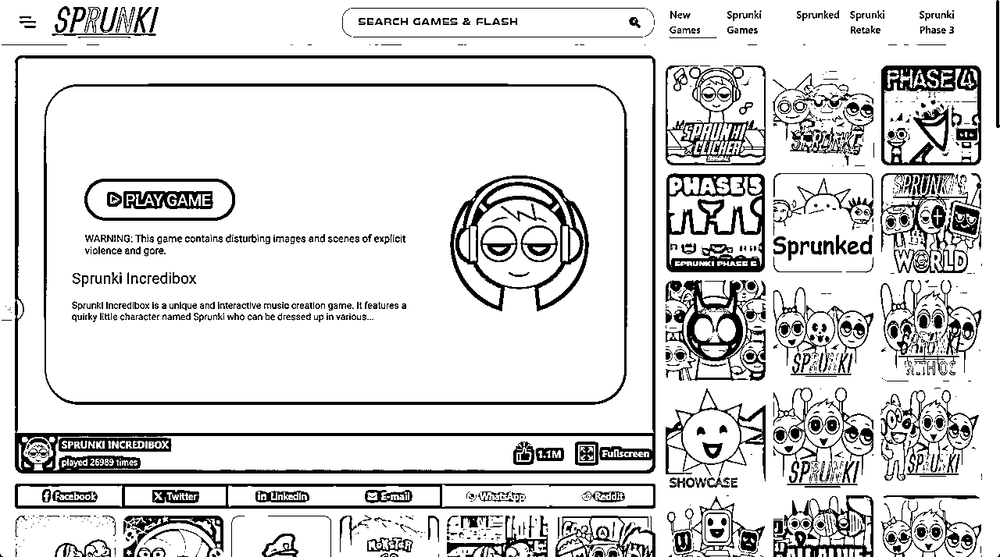

**配置方式**

- 产品：合法嵌入的第三方小游戏，例如经典玩法的授权版本
- 承载方式：自建网站
- 用户来源：Google 搜索结果中的自然访问
- 收益来源：Google AdSense

**基本机制**

围绕“在线免费玩某某游戏”这类具体搜索需求制作页面，借助搜索优化获取访问，再通过站内广告获得收入。由于网站直接对接广告平台，不需要与第三方分摊每次展示所得。

一个可参考的验证目标是：核心页面进入搜索结果前列，日访问量达到 1 万以上，月度广告收入超过 3000 美元。

**内容怎么做？**

不一定要从零研发游戏，可以选择合规的嵌入方案，把页面重点放在用户真正想找的内容上。

例如：

- 面向明确需求制作专题页；
- 围绕不同游戏、玩法和设备建立页面；
- 优先选择竞争较弱、意图更清晰的搜索词；
- 通过规模化覆盖，积累分散但稳定的访问来源。

单个页面的访问量可能并不高，但当大量细分页面同时获得排名后，总访问规模就可能明显提升。

**收入为什么有吸引力？**

网站直接连接 AdSense，理论上可以保留更多媒体收益。并且，搜索“免费在线玩”的访客目的较明确，页面内容与广告主题更容易匹配。

**必须具备的能力**

- 用 Ahrefs、SEMrush 等工具分析搜索需求和竞争强度；
- 高效制作页面，并做好加载速度、移动端适配和站内结构；
- 确认游戏来源合法，使用授权内容或开放许可素材；
- 持续跟踪排名变化，及时调整页面质量和站点结构。

**如何降低波动？**

不要把全部访问压在一个游戏或一个词上。可以覆盖多个题材和品类，并持续优化重要页面的可信度、原创信息和用户体验，以降低算法变化带来的冲击。

这条路线的优势在于：页面模板可以复用，新增内容的成本逐步下降；而搜索访问一旦形成规模，就可能沉淀为持续性的广告收入。

不过，它并不适合期待短期爆发的团队。前期需要时间积累，长期还应考虑建设垂直品牌、开展联运、会员或其他收入业务，减少对搜索平台的单点依赖。

---

### 模式七：在主流游戏平台上自行发行

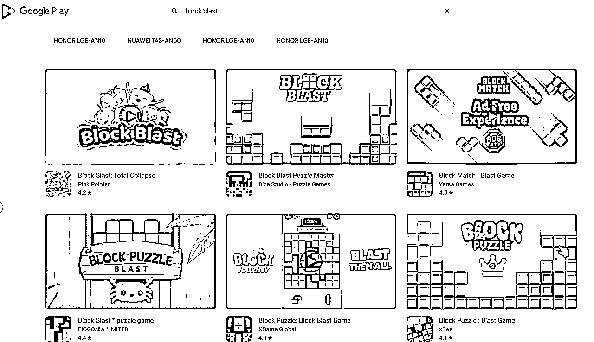

**基本配置**

- 产品：自主研发的高完成度小游戏
- 渠道：Google Play、App Store、Steam 等商店
- 用户来源：平台内自然推荐与外部付费推广
- 收入方式：买断、内购以及游戏内广告

**盈利前提**

只要获取一个玩家所花的钱，低于这个玩家后续带来的综合收入，投放就有继续放大的可能。最重要的是持续验证 CAC 与 LTV 的关系，而不是只看下载量。

**产品要求**

这条路线更适合有一定研发基础、愿意投入较长制作周期的团队。产品需要在玩法、美术、社交互动或使用体验上形成明显特色，才能从大量同类内容中脱颖而出。

移动端用户通常利用零散时间娱乐，因此操作门槛、单局节奏和反馈速度都非常关键。团队还要具备较快的更新能力，能够根据市场反馈持续修正产品。

**流量与收入组合**

流量可以来自：

- Google Ads、Apple Search Ads 等商店投放工具；
- 社交平台、视频平台等外部渠道；
- 商店推荐、榜单和搜索带来的自然访问。

收入则可以灵活组合：

- 一次性购买；
- 关卡、道具或内容内购；
- 适度植入的游戏广告。

通过不同付费方式覆盖不同类型的玩家，有助于提高整个生命周期的收入。

**主要风险**

平台拥有庞大用户和成熟支付体系，但开发者也会受到审核规则、账号政策、推荐机制和竞争环境的影响。

更稳妥的方式是同时布局移动端与 PC 端，并经营 Discord 等自有社群，逐步沉淀品牌和 IP，减少对单一商店的依赖。

这条路线本质上是用产品质量撬动平台分发，再用数据持续调节投放和收入设计。它的上限较高，但对资金储备、研发能力和长期运营提出的要求也更高。

---

## 五、如何理解海外小游戏套利？

从更底层看，海外小游戏项目是在寻找不同场景之间的价值落差，再把这种落差转化为收入。

可以从三个方向理解：

### 1. 时间上的先手

某个玩法或作品即将走红时，提前围绕相关搜索需求制作内容，有机会在热度真正爆发前获得排名。例如，热门作品崛起前，提前布局替代品、攻略或在线体验相关的搜索需求。

### 2. 地区之间的差价

不同国家的获客价格和广告单价并不一致。低价地区的访问，如果经过合理的内容与广告设计，可能转化为高广告价值市场中的收入。

### 3. 信息与产品之间的落差

成熟玩法在一个地区验证成功后，经过语言、画风、节奏和支付习惯调整，可能在另一个尚未充分竞争的市场重新获得机会。

---

## 团队该如何选路线？

可以从三个维度判断：

- 手里有什么资源；
- 团队最擅长什么；
- 能承受多大的试错成本。

技术团队、内容团队、投放团队和运营团队，适合的路径并不相同。不要因为某个案例赚钱，就直接照搬别人的模式。

---

## 更合理的实践顺序

对刚入场的团队来说，搜索内容和社交传播通常更适合做第一轮测试，因为前期资金压力相对小。

有一定投放能力后，可以再测试短视频渠道与广告媒体收入的组合。

无论选择哪条路，都建议先验证“访问从哪里来、用户留下什么、收入如何产生”这条链路，再投入大量时间打磨复杂产品。与此同时，不要一开始同时铺开多个方向，先把一个模型验证清楚，达到稳定回报后再复制。

---

## 三阶段验证法

### 第一步：确认需求

先用趋势工具和关键词工具检查目标市场的搜索热度、竞争程度和用户意图。

随后制作最小版本，例如：

- 1 个可玩的产品；
- 若干搜索页面；
- 或一组短视频素材。

观察点击率、停留时间和初步收入信号，而不是凭感觉决定方向。

### 第二步：验证单一路径

先选择一个渠道和一种收入方式，集中验证产品与市场是否匹配。

可以重点关注：

- 玩家是否愿意停留 3 分钟以上；
- 广告是否有足够展示机会；
- 访问是否能够带来可重复的收入。

### 第三步：复制与扩展

当单个项目的数据稳定后，再进行：

- 同一渠道增加更多游戏；
- 同一玩法覆盖更多页面；
- 将搜索、社区和短视频等渠道组合起来；
- 用不同市场分散单点波动。

---

## 风险控制建议

### 流量结构

不要完全押注某一个来源。可以让付费访问、社群访问和自然访问共同构成流量池，降低平台政策变化带来的影响。

### 收入结构

广告收入可以作为基础层，再叠加内购、联运、订阅或平台分成，避免单一收入突然失效。

### 合规要求

必须确认游戏版权、素材授权、广告展示和平台规则都符合要求。短期流量如果建立在侵权或违规基础上，后续很容易因投诉、下架或账号限制而归零。

---

## 接下来值得关注的变化

未来需要持续留意：

- 搜索平台对低质量批量页面的审核趋严；
- 移动商店对账号、内容和广告行为的检查加强；
- 社交平台对外部跳转的限制；
- AI 辅助生成游戏和内容生产工具的发展；
- 中东、拉美、非洲等新市场的用户增长机会；
- 区块链激励、虚拟资产等新型游戏经济模型。

---

## 写给准备入场的人

海外小游戏仍然存在机会，但红利不会永久停留在同一个渠道。

更实际的做法是：先找到适合自身能力的细分位置，再用一个最小项目验证需求、流量和收入。没有资金或完整团队，也可以从合法的搜索内容、社群传播和简单产品开始，通过持续实践积累经验与资源。

其中，社交传播和搜索获客的初始投入相对可控，适合用来观察海外市场的真实反馈。对于正在寻找 AI 出海方向的人，小游戏依旧是值得研究的细分赛道之一。

下面是几个可供观察的案例：

https://jujutsuinfinite.com  
该站去年 11 月上线，12 月访问量达到约 12 万。

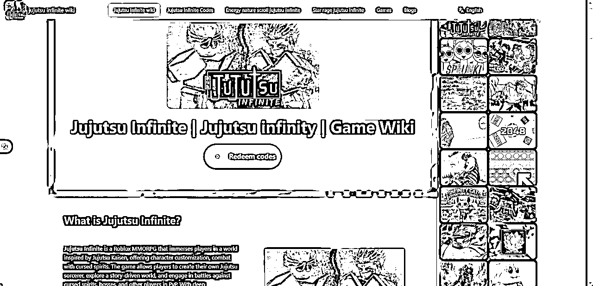

https://escaperoad2.io/  
去年 10 月上线后，相关小游戏在 12 月出现明显增长，一个月访问接近 6 万。

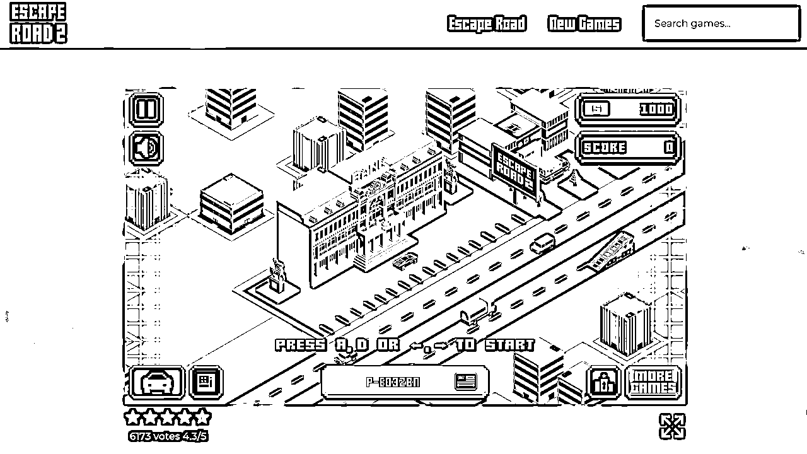

游戏盒子站：  
https://blockbreakergame.online  
属于围绕新兴热门词搭建的游戏集合型站点。

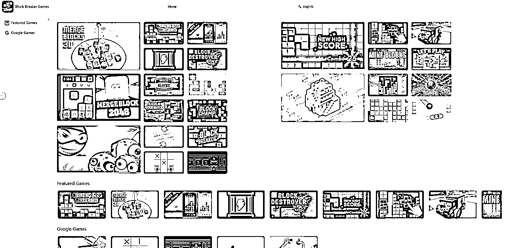

以上案例仅用于观察网站结构、内容组织和流量变化，实际操作仍需重视版权、平台政策和数据验证。

欢迎留言交流。