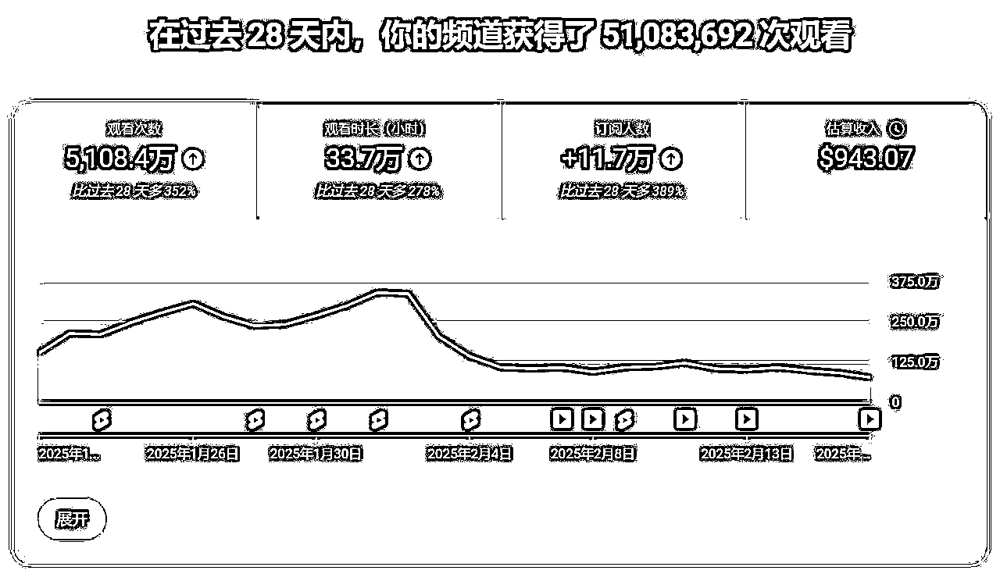
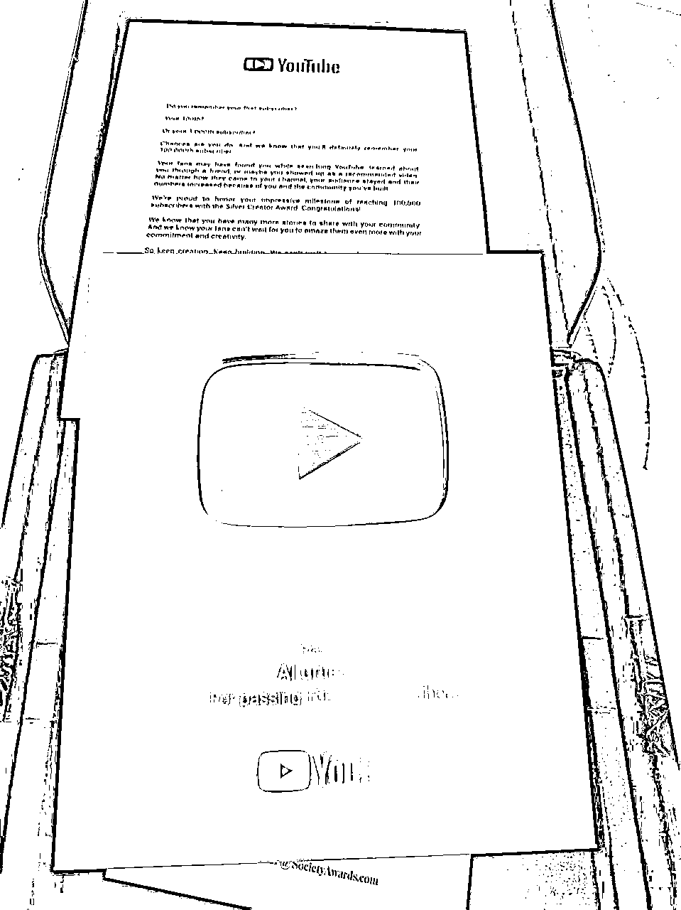
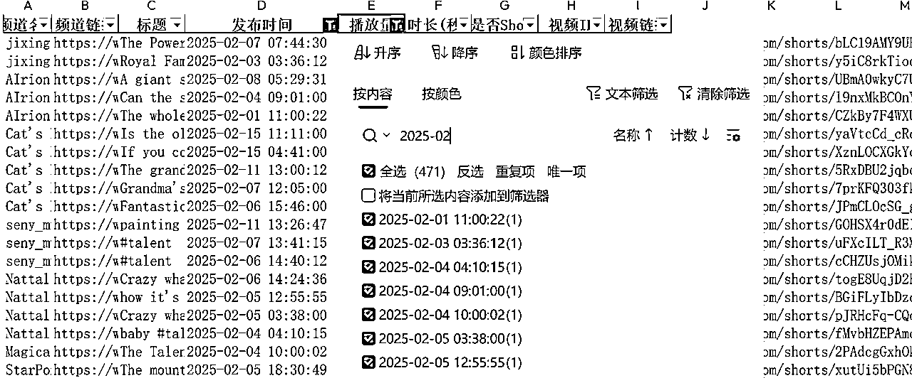
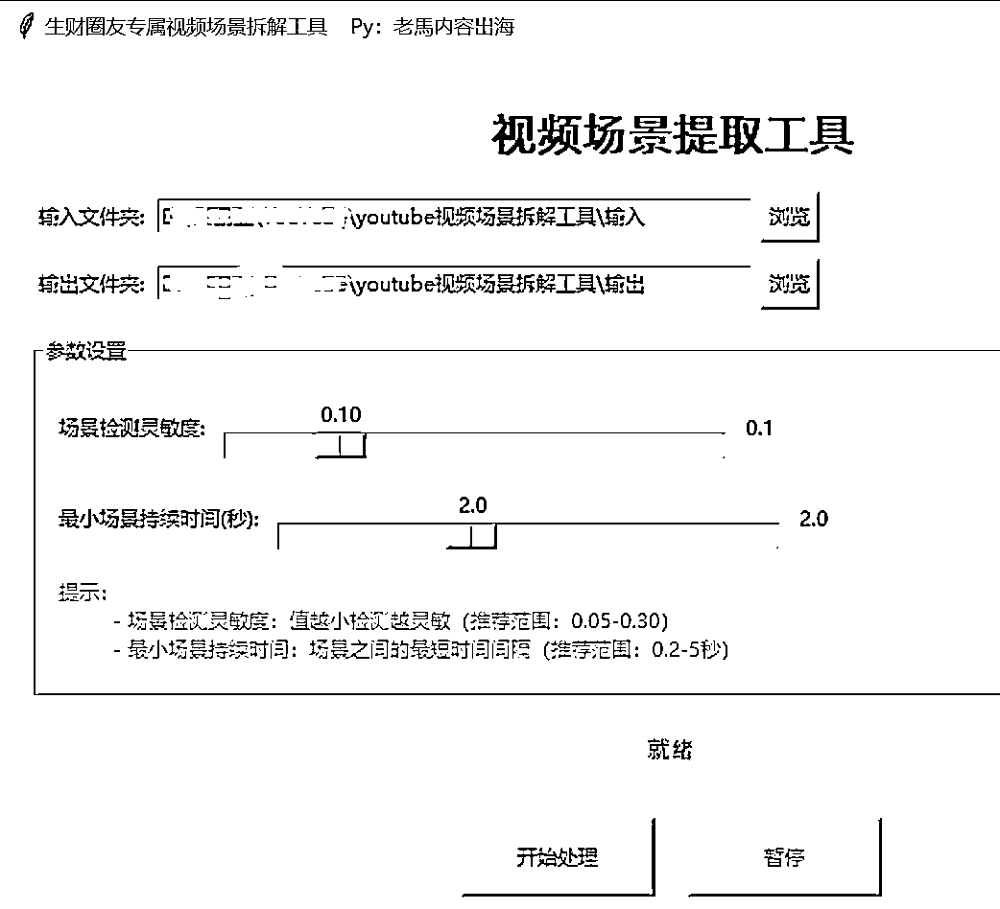
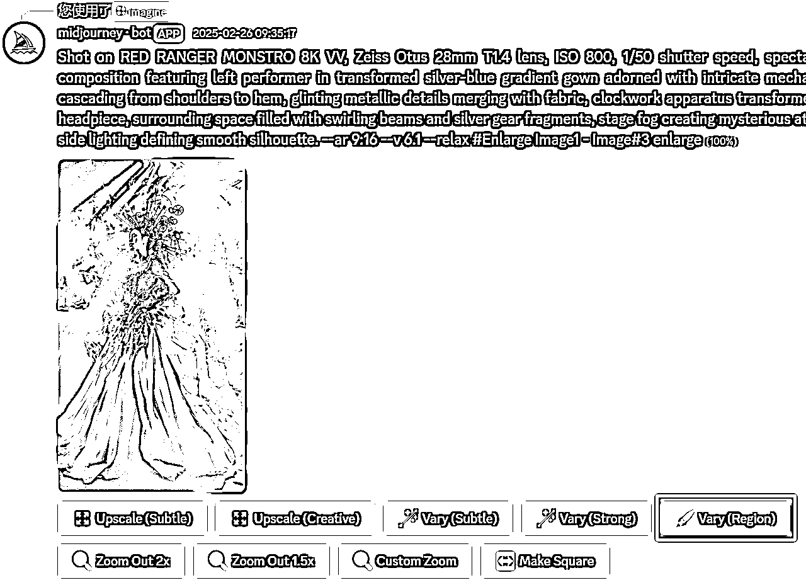
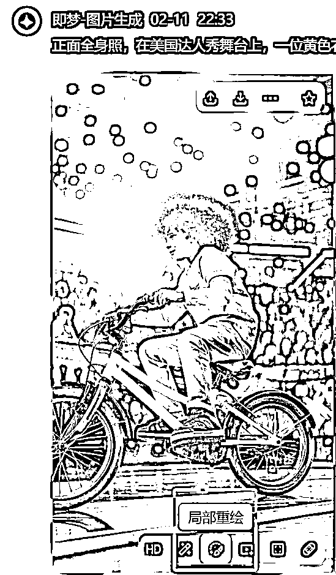
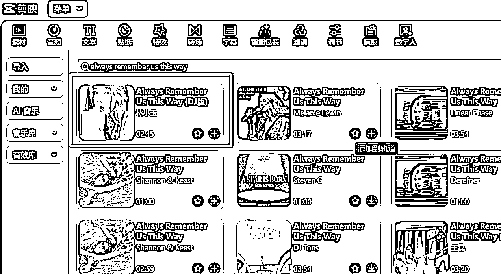
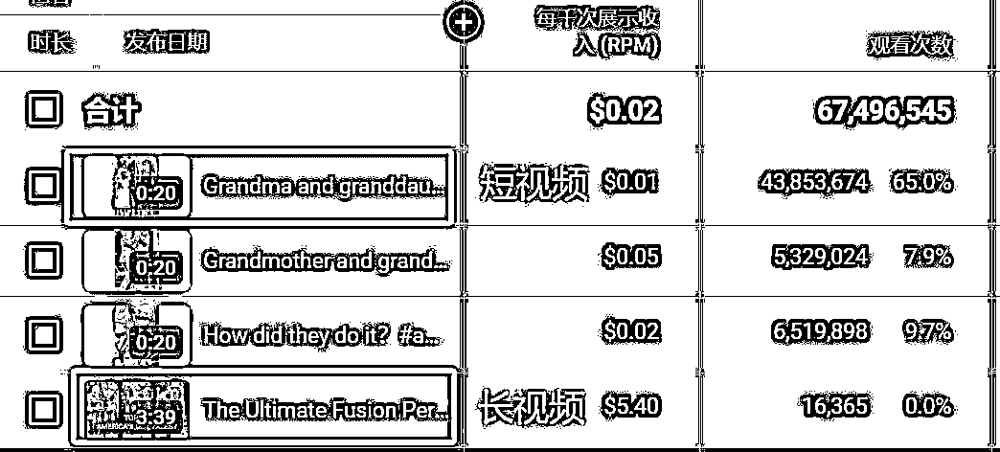
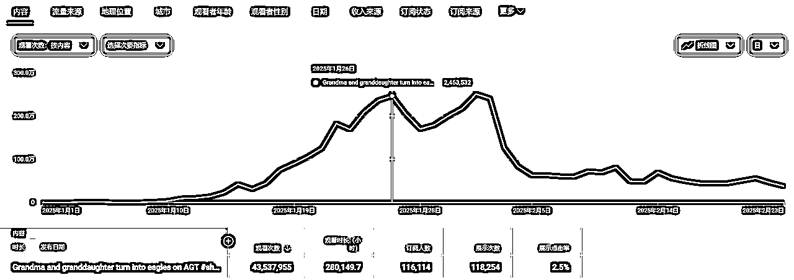
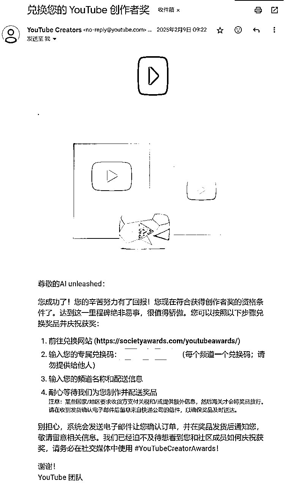

# 用两个月拿到 YouTube YPP 并领到银奖牌的实战复盘

> 来源：[https://p7pqvd4m3c.feishu.cn/docx/NsdjdAagDo9x9sxhrv3crml6nUc](https://p7pqvd4m3c.feishu.cn/docx/NsdjdAagDo9x9sxhrv3crml6nUc)

# 一、起因

大家好，我是花生。在生财混了两年多，一直在找一个能长期做的副业分担生活压力。因为白天工作要紧，试过好几次航海项目都坚持不下来。

转机出现在去年，亦仁老师在《超级标》里提到一句话：宝宝巴士把自制内容搬上 YouTube，一年广告分成高达 5000 万美金。那一下子点燃了我。去年 12 月，生财推出 YouTube 航海，我立刻报名上船。

现在的数据是：加入后一个半月就通过了 YPP，审核通过后 20 多天流水 900 美元，还意外拿到 YouTube 10 万订阅的银牌奖杯。

# 二、从零到入门的路径

《超级标》出来时我完全懵圈，不知道第一步该干嘛。后来在社区里看到 @老马 的干货帖和 @方波妮 的操作笔记，才对 Shorts 有了初步概念。正好赶上 YouTube 航海的开班，果断跟进。再后来 @Gray 的分享帮我拆解明白了达人秀类视频到底怎么做。

# 三、怎么找到可复制的爆款

## 1、锁定对标账号

航海手册强调用标签和音乐去找同类。我总结了两套实操方法：

1. 直接在 YouTube 搜索框输入关键词，比如“AI”，按播放量排序，挑近一个月内破百万、近一周破十万的视频，把这些账号全部标记关注。
2. 每天拿手机刷 10 分钟 YouTube 首页，平台会主动推当下的热门 Shorts，看到播放很高的就点赞关注，慢慢积累素材池。

## 2、抓取信息与下载

这块我用的是 @龙教练 做好的可视化采集下载工具，上手很快。想做差异化内容的话，我额外用 cursor 写了两段 Python 脚本，一个负责采集视频元数据，一个负责批量下载，跑完会导出 Excel，再按发布时间和播放量筛选目标视频。

脚本我放百度网盘了，懂 Python 的朋友可以直接拿去用：百度网盘

# 四、爆款复刻流程

我的复刻目前还是手工打磨，没上 Stable Diffusion 也没全自动化，可以参考 @Gray 的达人秀制作思路，把爆款元素重新组合。

举个例子，左边是我盯上的对标视频 190 万播放，右边是我复刻的版本，最终冲到 4400 万播放。

## 1、拆解画面

先用老马分享的场景拆解工具，把对标视频逐帧拆成关键帧，理清镜头节奏和切换点。

## 2、生成新图

把关键帧丢进 Midjourney 提炼关键词，重新生成同义画面。手感很重要，我会多刷几版挑最顺眼的。动作要精确，图稳了后期视频才流畅。必要时用 MJ 或即梦做局部修改，只改需要改的部分。

## 3、成片

图片丢进 Runway 做首尾帧间的动态生成。效果不理想就调提示词。手册里讲得很细，这里就不展开。提醒一点，动作幅度要大，画面才有冲击力，所以前期我特意做过左右位换的版本，就是为了更抓眼。

## 4、剪辑发布

剪映完成最后剪辑。变身类视频我一般切 4 段，中间穿插评委反应镜头。BGM 直接在剪映里找对标账号同款音乐，用的是剪映自带曲库，没触发版权警告就一直沿用。

# 五、陪跑期的心路历程

复刻过程中最烦的就是抽图抽视频抽不到满意的，有时候要刷上百次，真的想放弃。后来我告诉自己：平常心对待，一个 90 分的作品顶十个 60 分，爆一个就等于一次 YPP。

YouTube 推流很慢也很有后劲。1 月份我频道月播放才 100 多万，快过年时突然开始放量，其中一个视频直接吃到 4000 多万流量，直接把我送进 YPP。

特别感谢 @鱼丸，1 月份拉我进了 YouTube 实战陪跑。这个群氛围很强，方波妮教练和 Gray 教练几乎冲在前面，不断开新玩法。每周直播拆解，群友每天都有新工具和新心得。我没参加这次陪跑，大概率没这么快。

Gray 的一对一辅导帮我定位了短板，方波妮和 Gray 的陪跑手册真的像一本 YouTube 百科，按步骤走就能过审。PIN 码接收也很顺利。

额外一个变现点是按方波妮老师的方法，把已发的短视频拼接成长视频，用短视频的流量带长视频，长视频的 CPM 收益是短视频的 10 倍以上。

# 六、YPP 与银牌到手

1 月底年前，有两个视频小爆，频道总播放直接冲到千万级，达标 YPP。当时特别激动，感觉美金真的要到手了。过年期间我没更新，频道却在长尾，某个视频从几百万一路涨到 3000 多万，过年每天稳定 40-50 美元进账。

过年回来的某天，打开 YouTube 弹出通知：订阅突破 10 万，可申请银奖牌。当时一脸懵，后来 Gray 教练解释这是官方给 10 万订阅频道寄发的实体奖。据说官方会给绑定的 Gmail 发邮件，按指引填写频道名和收件地址即可，地址要用英文。物流是 UPS 到当地仓，然后转顺丰派送。奖牌到手的那一刻，真的很感动。

# 七、最后的话

我想用自己的经历给还在犹豫的人一点底气。我运气成分也有，项目本身也不错，但关键是我每天只投入 1-2 小时，做 1-2 条视频也能过线，投入更多的人更不用说。

现在工具越来越强，文字、图片、视频、配音、音乐都能 AI 化，做自媒体简直如虎添翼。AI 不能挡，要想办法把它融进生活和生意里。

感谢生财给我出海赚美金的机会，感谢 YouTube 航海的 @老马 和 @龙教练 提供的体系和工具，感谢私教陪跑的 @方波妮 教练和 @Gray 教练带来的变现思路和陪跑支持，也感谢陪跑群里一起学习的伙伴们。